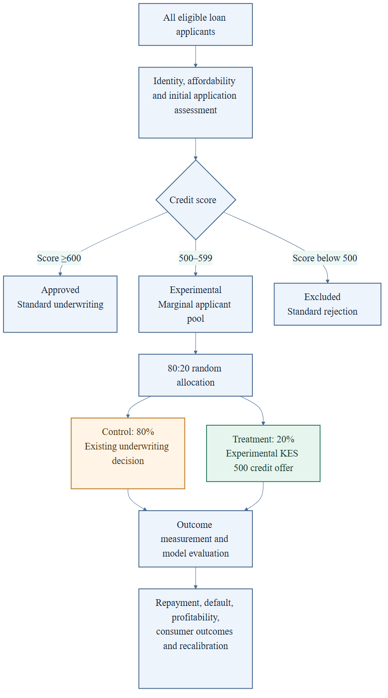
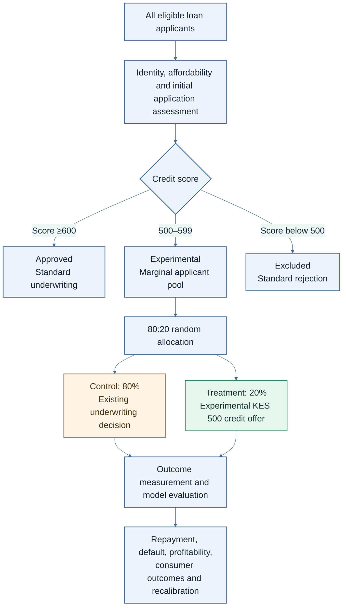
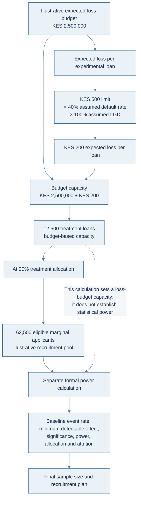
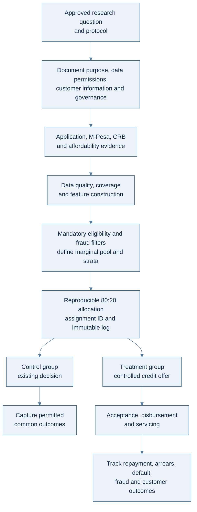
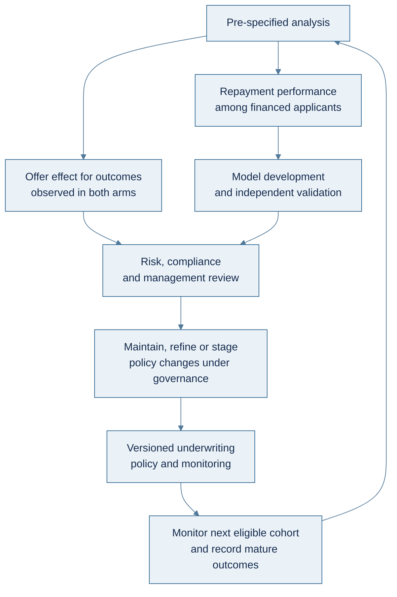
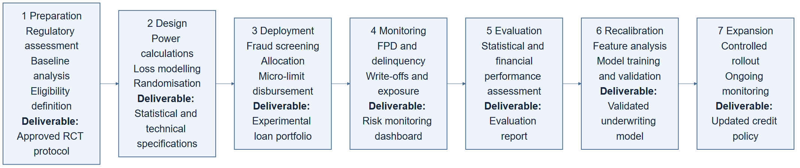
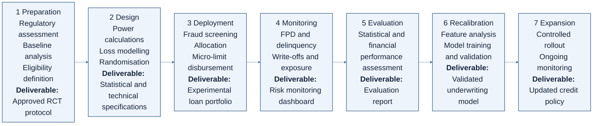

Using Randomised Controlled Trials to Evaluate Marginal Rejected Applicants in Kenyan Digital Credit Underwriting
An experimental framework for credit-risk optimisation, financial inclusion, alternative-data modelling and regulatory compliance.
Abstract
Credit underwriting systems are traditionally trained and validated using historical repayment information from borrowers whose applications were approved. This creates a sample-selection problem because repayment outcomes are unavailable for applicants who were rejected, even when some of those applicants might have demonstrated acceptable repayment behaviour if granted credit. In Kenya, this limitation is particularly relevant to digital credit providers seeking to expand lending to individuals, informal businesses and micro and small enterprises with limited conventional credit histories. Randomised Controlled Trials (RCTs) provide a structured experimental approach to investigating this problem by introducing controlled variation in credit access among applicants located near an established underwriting threshold. This article proposes an RCT framework for evaluating marginal rejected applicants within a Central Bank of Kenya (CBK)-regulated Digital Credit Provider (DCP). It examines the application of M-Pesa transactional information, Credit Reference Bureau (CRB) records, controlled credit limits, statistical power, experimental loss budgets, deterministic randomisation, consumer protection and model recalibration. A proposed experimental scenario uses a KES 2.5 million loss budget, a KES 500 initial credit limit and a 20% treatment allocation among eligible marginal applicants. The article distinguishes experimental assumptions from empirically established findings and develops a practical methodology for translating experimental results into improved underwriting decisions.
Keywords: Randomised Controlled Trials, credit underwriting, reject inference, digital lending, alternative data, M-Pesa, credit scoring, Kenya, financial inclusion, sample-selection bias, credit risk management.
1. Introduction
Credit scoring is fundamentally a predictive exercise in which financial institutions estimate the probability that an applicant will meet contractual repayment obligations. Traditional underwriting systems use information such as repayment history, outstanding indebtedness, income, employment characteristics, existing credit facilities and previous interactions with financial institutions. Although these variables provide useful information, conventional credit scoring systems encounter a structural limitation when their training datasets contain predominantly approved applicants. The lender observes repayment outcomes for customers who received credit but does not directly observe whether rejected applicants would have repaid had they received equivalent financing. Consequently, the population used to develop a credit scoring model may differ systematically from the population to which that model is subsequently applied. This problem is commonly described as sample-selection bias or the reject-inference problem in credit scoring literature [1], [2].
[ScienceDirect](https://doi.org/10.1016/j.jbankfin.2003.10.010) · [Journal of Applied Statistics](https://doi.org/10.1080/02664763.2021.1929090)
The problem has particular significance in Kenya, where mobile financial services and digital lending have expanded the range of financial products available to individuals and small businesses. Mobile money transactions generate potentially useful information about financial activity, including transaction frequency, inflows, outflows, business collections and liquidity patterns. These characteristics may provide additional information about applicants whose conventional credit histories are incomplete or unavailable. However, the existence of alternative data does not automatically establish that an applicant is creditworthy, nor does it demonstrate that an underwriting model can accurately predict their repayment behaviour. Research examining Kenyan digital credit has established that digital lending can expand borrowing opportunities among populations less likely to access conventional credit, while also documenting significant consumer and credit-reporting challenges [3]. An experimental framework is therefore necessary to evaluate whether expanding credit eligibility can improve portfolio performance and financial inclusion simultaneously.
[PubMed Central (PMC)](https://doi.org/10.1016/j.jdeveco.2021.102697)
This article proposes using RCTs to investigate the repayment behaviour of marginal rejected applicants within a Kenyan digital lending environment. The central proposition is that lenders can obtain more informative underwriting data by selectively extending controlled credit facilities to applicants who fall just below an existing approval threshold. Rather than approving all rejected applications or changing the entire credit scoring system, the lender establishes a predefined experimental population, applies mandatory identity and fraud checks, and randomly selects a proportion of eligible applicants for a controlled credit facility. The resulting repayment observations can then be used to evaluate the predictive performance of existing underwriting variables and investigate whether alternative information improves risk differentiation. The experiment must be designed as a financial risk-management intervention rather than simply a machine-learning data collection exercise, with measurable limits on capital exposure, consumer impact and operational risk.
2. Theoretical Foundation: Selection Bias and Reject Inference
2.1 The reject-inference problem
In conventional credit underwriting, a lender estimates repayment probability using historical observations from approved borrowers. Let X represent an applicant's observable characteristics, Y represent the repayment outcome and A represent the approval decision. The lender typically observes Y only when A = 1. The resulting training dataset therefore represents borrowers selected by the previous underwriting policy rather than the entire applicant population. This distinction matters because approval decisions are usually influenced by variables that are themselves associated with repayment risk. Consequently, the observed relationship between applicant characteristics and default may not generalise reliably to rejected applicants. Crook and Banasik [1] investigate this problem and examine whether conventional reject-inference techniques can correct the predictive limitations arising from the exclusion of rejected applicants. Their findings establish the importance of evaluating reject-inference methods empirically rather than assuming that statistical augmentation automatically produces more accurate credit models.
Reject inference traditionally involves techniques such as augmentation, parceling, extrapolation, weighting and statistical sample-selection adjustments. These methods attempt to estimate the likely repayment behaviour of rejected applicants using available information, historical relationships and assumptions about the underlying applicant population. However, their reliability depends heavily on assumptions about why applicants were rejected and how their repayment outcomes would have differed under approval. Ehrhardt et al. [2] demonstrate that commonly used reject-inference approaches contain important modelling assumptions and that no single method consistently dominates across all evaluated circumstances. Their research supports a more cautious approach to model development: where feasible, lenders should obtain actual repayment observations from a carefully selected sample of previously rejected applicants instead of relying exclusively on synthetic or inferred outcomes. An RCT provides a mechanism for generating these observations under a documented allocation procedure, improving the empirical foundation for subsequent underwriting analysis [1], [2].
[ScienceDirect](https://doi.org/10.1016/j.jbankfin.2003.10.010) · [Journal of Applied Statistics](https://doi.org/10.1080/02664763.2021.1929090)
2.2 Randomised Controlled Trials in credit underwriting
An RCT introduces random allocation into an experimental intervention so that differences in observed outcomes can be attributed more confidently to the intervention, subject to the trial design and implementation assumptions. In credit underwriting, the intervention may involve offering a controlled loan facility to a randomly selected group of otherwise eligible marginal applicants. The treatment group receives the experimental credit offer, while the control group remains subject to the existing underwriting policy. The lender subsequently measures outcomes such as loan acceptance, repayment, delinquency, default, repeat borrowing and contribution margin. Randomisation helps reduce systematic differences between the two groups at baseline, allowing more credible comparisons of the effects of offering credit. However, the distinction between a credit-access experiment and a model-comparison experiment is important: an RCT evaluating additional credit access does not automatically establish that a new scoring model is superior to an existing one. Each research question requires an explicitly defined intervention and outcome.
For the proposed Kenyan application, the principal experimental question is whether a carefully defined population of marginal rejected applicants contains borrowers who can be served sustainably through a controlled credit product. The lender is not attempting to establish that all rejected applicants should receive credit. Instead, it seeks to estimate repayment outcomes within a specific risk segment and assess whether transactional information can distinguish comparatively stronger applicants within that segment. The treatment group provides actual repayment observations that were previously unavailable under the standard approval policy. The control group preserves the existing decision process and provides a contemporaneous reference for broader outcomes, including subsequent borrowing behaviour where lawful and measurable. The experiment should therefore distinguish three separate objectives: measuring repayment performance among experimentally approved applicants, estimating the effects of extending credit access, and improving the predictive performance of the underwriting model. Treating these objectives as interchangeable would produce misleading conclusions about experimental effectiveness.
3. Kenyan Digital Credit Market and Alternative Data
3.1 Mobile money and transactional information
Kenya's mobile financial services ecosystem creates opportunities for incorporating transactional information into credit-risk assessment. M-Pesa transactions can provide insights into the financial activities of individuals and enterprises, including the frequency of customer payments, business receipts, transfers, cash withdrawals and recurring expenditure. For small enterprises, Till and Paybill records may offer useful indicators of commercial activity that are not adequately represented in conventional financial statements. The lender could derive features such as monthly transaction velocity, average incoming payments, net inflow volatility, frequency of active transaction days, concentration of revenue sources and the relationship between inflows and recurring obligations. These variables may provide a more contextualised view of repayment capacity, particularly for informal businesses that operate without audited accounts or extensive banking histories. Nevertheless, transactional volume should not be confused with disposable income because gross business receipts may include supplier payments, transfers between personal accounts and funds committed to operating expenses.
The relevance of transactional information is supported by research on alternative-data lending. A 2024 CGAP study examining micro and small enterprise lending in India found that transactional information could have predictive value comparable to conventional credit history and that combining transactional information with credit history could improve predictive performance [4]. Although the study does not establish equivalent results for Kenyan applicants, its findings provide a useful empirical basis for investigating similar approaches in the Kenyan market. More directly, research on Kenya's M-Shwari ecosystem demonstrates that mobile-based digital loans have expanded access to credit and influenced household resilience [3]. These studies support investigating mobile money information as an underwriting input while emphasising the need for local validation. A Kenyan DCP should establish whether transactional variables improve discrimination, calibration and economic outcomes within its actual applicant population rather than importing assumptions from another market.
[CGAP Research & Publications](https://www.cgap.org/research/publication/leveraging-transactional-data-for-micro-and-small-enterprise-lending)
3.2 Credit Reference Bureau information
CRB information provides an additional source of information for evaluating applicant indebtedness and historical repayment behaviour. Relevant variables may include the presence of previous credit facilities, repayment records, outstanding obligations, historical delinquency and the recency of negative credit events. However, a limited or negative credit history should not automatically be interpreted as evidence of an inability to repay. An applicant may have a thin credit file because they have not previously participated extensively in formal credit markets, while another applicant may have a negative historical record despite demonstrating improved current financial circumstances. Combining CRB metadata with transactional information provides an opportunity to distinguish applicants with limited conventional credit histories from those whose current financial activity indicates materially different repayment capacity. The experiment should evaluate these distinctions through measurable repayment outcomes, using consistent feature definitions and documented data-quality controls.
The Kenyan regulatory framework also makes credit information reporting an important operational consideration. Regulation 14 of the CBK Digital Credit Providers Regulations, 2022, addresses the exchange of credit information between digital credit providers and licensed CRBs, including the submission of positive and negative information subject to the applicable requirements. The Regulations also establish specific notification requirements and restrictions concerning negative information reporting, including the treatment of outstanding amounts not exceeding KES 1,000 [5]. Accordingly, an experimental borrower should receive clear information about applicable credit-reporting arrangements, and the lender should implement reporting procedures consistent with the governing rules. The experimental nature of a loan does not remove the need for accurate reporting, appropriate customer notification or proper dispute handling.
[CBK Regulations](https://www.centralbank.go.ke/wp-content/uploads/2022/03/L-.N.-No.-46-Central-Bank-of-Kenya-Digital-Credit-Providers-Regulations-2022.pdf)
4. Proposed Experimental Architecture for Kenya
4.1 Institutional and regulatory assumptions
The proposed experimental environment assumes that the lender operates as a CBK-licensed, non-deposit-taking Digital Credit Provider. This provides a defined institutional context for examining the interaction between credit underwriting, consumer protection, data governance and capital allocation. A DCP must operate within the requirements of the CBK Digital Credit Providers Regulations, 2022, alongside applicable provisions of the Data Protection Act, 2019, and its implementing regulations. The proposed design also has relevance to commercial banks and other regulated financial institutions, although their prudential and institutional requirements may differ. SACCOs operating under the Sacco Societies Regulatory Authority (SASRA) framework would require a separate assessment of the applicable governance and lending requirements. The experiment should therefore be implemented within the lender's actual regulatory classification, rather than assuming that identical approval and reporting requirements apply across every category of credit provider [5], [6].
[CBK Regulations](https://www.centralbank.go.ke/wp-content/uploads/2022/03/L-.N.-No.-46-Central-Bank-of-Kenya-Digital-Credit-Providers-Regulations-2022.pdf) · [Kenya Law](https://new.kenyalaw.org/akn/ke/act/2019/24/eng%402019-11-15/source)
An important regulatory distinction concerns changes to credit pricing. Regulation 29(1) of the CBK Digital Credit Providers Regulations provides that a DCP shall not change its pricing model or parameters without prior written approval from CBK. This provision is relevant to experimental design because a lender considering changes to its pricing parameters must establish whether the proposed intervention constitutes a regulated pricing change. It would be inaccurate, however, to conclude that every modification to a credit scoring algorithm automatically requires CBK approval under that particular provision. The regulatory treatment of a scoring-model modification, credit-limit adjustment or experimental approval rule should be assessed according to its actual implications and applicable requirements. For the proposed experiment, maintaining the existing approved pricing structure while controlling experimental credit exposure provides a practical starting point. Changes to contractual credit terms must also be assessed against the disclosure, variation and customer-acceptance provisions of the Regulations [5].
[CBK Regulations](https://www.centralbank.go.ke/wp-content/uploads/2022/03/L-.N.-No.-46-Central-Bank-of-Kenya-Digital-Credit-Providers-Regulations-2022.pdf)
4.2 Defining the marginal applicant population
The experiment requires an explicit definition of marginal applicants because randomisation across the entire rejected population would expose the lender to unnecessary and potentially disproportionate credit risk. The proposed scorecard architecture establishes three decision categories. Applicants scoring 600 or above qualify for standard underwriting approval, applicants scoring between 500 and 599 constitute the experimental marginal population, and applicants scoring below 500 remain outside the experimental population. These numerical thresholds are illustrative parameters rather than validated Kenyan credit-risk standards. Their suitability depends on the scorecard's construction, calibration, historical performance and relationship with observed default outcomes. A lender using a different scoring scale should establish equivalent boundaries through empirical analysis. The marginal population should additionally satisfy predetermined requirements concerning affordability, existing indebtedness, fraud screening, data availability and product eligibility. This ensures that experimental participation is based on documented credit-risk criteria rather than arbitrary selection.
The applicant population should be defined before randomisation, using a reproducible data extraction and eligibility procedure. For example, applicants with a score between 500 and 599 could be further segmented according to the quality of their M-Pesa transactional records, CRB history and estimated business cash flows. A thin-file applicant with consistent monthly business receipts may represent a different risk profile from an applicant with frequent historical delinquencies and highly volatile transaction activity. These distinctions can be represented through additional experimental strata without abandoning the central objective of investigating marginal rejects. Stratification is particularly valuable where applicant characteristics are heterogeneous because it can improve balance between treatment and control groups and facilitate analysis of treatment effects across relevant subpopulations. The resulting experimental dataset should preserve the applicant's original score, feature values, eligibility status, randomisation assignment and subsequent repayment observations to support independent validation.
Figure 1. Proposed underwriting and experimental allocation architecture

4.3 Treatment and control allocation
The proposed experimental allocation assigns 80% of eligible marginal applicants to the control group and 20% to the treatment group. Applicants allocated to the control group retain the existing underwriting decision, while treatment-group applicants receive an offer for the experimental credit facility. This approach is commonly described as a randomised swap-in design because a proportion of applicants who would otherwise have been rejected are selected to receive credit. The treatment assignment should be generated independently of the loan officer's discretion and recorded in an auditable allocation register. The lender must also distinguish between an applicant being selected for an offer and an applicant actually accepting and drawing the facility. Analysing only borrowers who accept the offer can introduce post-randomisation selection bias, particularly if acceptance is associated with financial circumstances or repayment propensity. Consequently, the principal evaluation should preserve the original randomised assignment and separately report offer acceptance, utilisation and repayment outcomes.
An 80:20 allocation is a reasonable starting hypothesis where the lender prioritises limiting experimental exposure. Nevertheless, unequal allocation has statistical implications. Given an equivalent total sample size, a 50:50 allocation generally provides greater statistical efficiency when comparing two groups of similar variance. An 80:20 design requires a larger overall sample to achieve comparable statistical power, although the additional control observations may be operationally acceptable where the treatment involves actual credit exposure. The lender should therefore select its allocation ratio by considering both experimental precision and the financial consequences of issuing experimental loans. Where there is sufficient historical information, simulation-based power calculations can quantify the trade-off between treatment allocation, expected default rates and the minimum economically meaningful difference that the experiment is intended to detect. The 80:20 allocation should be regarded as a proposed risk-management decision, not an inherently optimal statistical configuration.
5. Experimental Credit Facility and Financial Risk Budget
5.1 Micro-limit graduation strategy
The proposed intervention uses a micro-limit graduation strategy under which treatment-group applicants receive an initial credit offer of KES 500 instead of the lender's standard starting facility of approximately KES 3,000. The purpose is to obtain actual repayment information while limiting the lender's initial principal exposure to each experimental borrower. A small facility can provide information about repayment timeliness, repayment completion and customer engagement with the lender's repayment channels. Successful repayment may subsequently contribute to a more informed assessment of the customer's eligibility for a larger credit facility. However, repayment of a KES 500 loan does not establish that the same customer can sustainably service a KES 3,000 or KES 5,000 loan. The relationship between loan size and repayment performance must be evaluated separately because repayment capacity, borrowing incentives and the economic burden of debt may change as exposure increases.
The micro-limit should therefore operate as the first stage of a controlled graduation framework rather than an automatic approval mechanism for subsequent lending. Applicants who repay successfully may become eligible for a subsequent assessment involving updated transactional information, current indebtedness and repayment history. The graduation model should consider the time elapsed since repayment, any changes in business cash flows and the customer's total exposure across other lenders. Repeated borrowing should not automatically be interpreted as improved creditworthiness because frequent borrowing may also indicate liquidity constraints or dependence on short-term refinancing. This distinction is especially important in digital credit markets, where repeat borrowing and short loan tenures can produce misleading interpretations of customer engagement. The Competition Authority of Kenya's digital credit market inquiry documented concerns involving repeated borrowing, pricing transparency and the relationship between repayment behaviour and credit terms [7]. A responsible graduation strategy should therefore optimise sustainable repayment capacity rather than simply maximise repeat-loan volume.
[Competition Authority of Kenya](https://www.cak.go.ke/sites/default/files/Digital_Credit_Market_Inquiry_Report_2021.pdf)
5.2 Estimating the experimental loss budget
The proposed experiment allocates KES 2,500,000 as an experimental write-off budget. Assuming a KES 500 principal facility and a 40% default rate, with the conservative assumption that every default results in a complete loss of principal, the expected principal loss per experimental loan is KES 200. The maximum number of experimental loans implied by the budget is therefore calculated as follows:
Nₘₐₓ = B ÷ (PD × LGD × EAD)
Where:
- B represents the experimental loss budget.
- PD represents the probability of default.
- LGD represents loss given default.
- EAD represents exposure at default.
Substituting the proposed assumptions:
Nₘₐₓ = 2,500,000 ÷ (0.40 × 1.00 × 500)
Nₘₐₓ = 12,500 experimental loans
This calculation provides a simplified expected-loss capacity rather than a guaranteed maximum loss. It assumes that each borrower receives one KES 500 facility, that the default rate remains constant and that defaulted principal is completely unrecoverable. It also excludes funding costs, operating expenses, collection expenses, fraud losses outside the assumed default rate and any incremental costs associated with customer acquisition or regulatory compliance. More importantly, an expected-loss calculation does not ensure that realised losses will remain below the budget because actual defaults are random outcomes. The lender should therefore incorporate a separate liquidity and loss buffer and define a hard exposure limit that prevents the experimental portfolio from exceeding its authorised capital allocation.
The 12,500 experimental loans also have implications for the total applicant population. With a 20% treatment allocation, obtaining 12,500 randomly selected treatment applicants would require approximately 62,500 eligible marginal applicants, assuming complete allocation and that every selected applicant accepts and draws the loan. If acceptance is lower than 100%, the lender must recruit a larger eligible population or extend the experimental period to achieve the intended number of disbursed loans. The distinction between selected applicants, approved applicants, accepting applicants and actual borrowers should be reflected in the experimental reporting framework. A more conservative operational approach would establish separate limits for the number of treatment offers, actual disbursements and aggregate outstanding exposure. This would prevent a mismatch between theoretical sample allocation and actual capital utilisation. The lender should also calculate expected losses using multiple default scenarios, such as 20%, 30%, 40% and 50%, to understand how sensitive the experiment is to deteriorating credit performance.
5.3 Financial interpretation of experimental outcomes
The primary financial objective should be to determine whether extending credit to marginal applicants generates an acceptable risk-adjusted economic return. Default rate alone is insufficient because a lending product may generate revenue from borrowers who repay while incurring losses from customers who default. The analysis should incorporate principal recovery, interest and permitted charges, funding costs, operational expenditure, collection expenses and customer acquisition costs. For an experimental portfolio, the lender should estimate contribution margin per disbursed loan and compare it with the corresponding expected loss. Additional measures should include portfolio-at-risk, first-payment default, days past due, roll rates, cure rates and vintage-level cumulative loss. These measures allow the lender to distinguish between temporary repayment delays and persistent credit deterioration. The analysis should also consider whether customers are taking multiple simultaneous loans, since apparent repayment success at one lender may be supported by borrowing elsewhere.
A further consideration is the difference between statistical significance and commercial significance. A model may identify a statistically significant improvement in default prediction while producing insufficient economic value to justify implementation. Conversely, a modest improvement in approval rates may generate substantial portfolio value if the additional customers demonstrate acceptable repayment performance and contribute positive risk-adjusted margins. The lender should therefore define an economic decision threshold before the experiment begins. For example, management could specify the minimum acceptable contribution margin, maximum realised loss and maximum default rate for the experimental segment. These thresholds should be linked to the lender's risk appetite, product economics and capital allocation framework. The resulting decision should not depend exclusively on whether a statistical hypothesis test produces a conventional p-value below 0.05. It should establish whether the experiment provides sufficient evidence to support a sustainable underwriting-policy change.
6. Statistical Design, Sample Size and Experimental Validity
6.1 Statistical power and minimum detectable effects
The proposed maximum of 12,500 experimental loans is derived from the loss budget and assumed default probability, not from a formal statistical power calculation. This distinction is essential because a financially affordable experiment may still be too small to identify the improvement that management wants to measure. Statistical power depends on the primary outcome, baseline event probability, minimum detectable effect, significance level, allocation ratio and desired probability of detecting the specified effect. For a binary outcome such as default, sample-size calculations require an estimate of the default proportions under the relevant comparison groups. A standard approach is to specify the control and treatment event rates, choose an acceptable Type I error rate, commonly 5%, and establish the desired power, commonly 80% or 90%. The sample size can then be estimated using established statistical procedures for comparing two proportions [8]. The calculation should be performed before recruitment, with assumptions documented and justified using historical portfolio data or relevant empirical research.
[NIHR Journals Library / NCBI Bookshelf](https://www.ncbi.nlm.nih.gov/books/NBK549166/)
For the proposed experiment, the primary repayment outcome could be defined as default within a specified observation period following disbursement. Secondary outcomes could include first-payment default, 30-day delinquency, repayment completion and net contribution margin. Each outcome must have a clearly specified measurement period because a borrower who has not yet reached the contractual repayment date should not be classified as a successful repayment or a default. The lender should also account for censoring and incomplete observation where loans have different origination dates. A vintage-based approach would group borrowers according to their disbursement period and evaluate performance at consistent loan ages. The primary statistical analysis should use the original randomised allocation, with supplementary analyses investigating acceptance, actual utilisation and borrower characteristics. This preserves the integrity of the experimental design while providing management with additional information about the commercial performance of the facility.
6.2 Randomisation and reproducibility
Random allocation must be implemented through a controlled mechanism that is independent of manual loan officer decisions. The original proposal recommends applying a cryptographic hash to an applicant identifier, combining it with a static salt and using the resulting integer modulo 100 to determine treatment assignment. This provides deterministic assignment, meaning that the same identifier and salt produce the same allocation. However, a deterministic hash function is not equivalent to an independently generated random allocation if the underlying identifiers, salt and assignment process are predictable. A more robust implementation would use a secret-keyed cryptographic function, such as HMAC-SHA-256, with a securely controlled experiment key. The lender should also establish a stable applicant-level identifier, prevent duplicate applications from receiving inconsistent assignments and preserve the allocation version used for each experiment. This provides reproducibility and an audit trail while reducing opportunities for manipulation by operational personnel.
The following Python implementation illustrates the proposed routing logic using a keyed hash and an explicitly defined marginal score band:
import hashlibimport hmacdef rct_underwriting_router(    applicant_id: str,    score: int,    secret_key: bytes) -> str:    # Standard approval    if score >= 600:        return "STANDARD_APPROVE"    # Exclude applicants outside the experimental boundary    if score < 500:        return "HARD_REJECT"    # Deterministic assignment within marginal population    message = applicant_id.encode("utf-8")    digest = hmac.new(        secret_key,        message,        hashlib.sha256    ).hexdigest()    allocation = int(digest, 16) % 100    # 20% treatment allocation    if allocation < 20:        return "APPROVE_VIA_RCT_TIER"    return "CONTROL_STANDARD_DECISION"
This implementation is illustrative and should be incorporated into a production-grade allocation service with controlled key management, versioned experiment configuration, access restrictions and independent audit logging. The randomisation key should be kept separate from ordinary application data, and the system should retain the original allocation even if the applicant reapplies. A further statistical improvement would involve stratified block randomisation, particularly where the marginal population contains materially different groups based on score ranges, transaction volumes or CRB history. This helps prevent imbalances arising from random allocation within small samples. The assignment should be performed only after all mandatory eligibility filters have been applied. The experiment must also preserve a record of applicants excluded before randomisation, including the applicable exclusion reason, to enable transparent reporting of the final study population.
6.3 Monitoring, interim analysis and early stopping
An effective RCT requires continuous operational monitoring, but repeated examination of experimental results can affect the statistical validity of the final analysis if stopping decisions are made without predefined procedures. The proposed experiment introduces a kill-switch threshold based on cumulative losses among the first 2,000 experimental loans. The original proposal suggests suspending randomisation if the observed write-off rate exceeds 55%. This is a useful operational starting point, but a percentage threshold alone does not adequately distinguish random variation from a genuine deterioration in portfolio quality. The lender should establish a formal monitoring protocol that specifies the frequency of interim assessments, the primary risk indicators, the statistical boundaries for stopping and the authority responsible for approving continuation. The CONSORT 2025 reporting framework emphasises transparent reporting of sample-size assumptions, interim analyses, stopping decisions and participant progression in randomised trials [9]. Although developed primarily for clinical trials, its principles of experimental transparency are applicable to the documentation of financial-services RCTs.
[BMJ](https://www.bmj.com/content/389/bmj-2024-081123)
The monitoring dashboard should include first-payment default, 7-day and 30-day delinquency, cumulative write-offs, exposure at default, repayment completion, fraud incidence and outstanding experimental principal. These measures should be examined at both individual borrower and portfolio levels. A sudden increase in first-payment default may indicate weaknesses in the marginal applicant definition, changes in applicant composition or an emerging fraud pattern. A deterioration in repayment completion may indicate affordability problems or weaknesses in repayment-channel functionality. A rapid increase in fraud losses may indicate that identity verification controls are being bypassed. The lender should distinguish between these causes before deciding whether the experimental credit threshold requires recalibration or the entire experiment should be suspended. A predefined stopping protocol should also specify whether suspension applies to new disbursements only or to the entire experimental facility, including the management of existing outstanding loans and customer obligations.
6.4 Defining experimental success
The experiment should be evaluated against predefined success criteria rather than retrospective interpretations of favourable results. A successful outcome would demonstrate that the marginal population contains a sufficiently large proportion of borrowers capable of repaying the experimental facility within the agreed contractual period, while generating acceptable risk-adjusted financial returns. The evaluation should also establish whether transactional variables improve the predictive performance of the existing scorecard and whether the resulting model maintains acceptable performance across relevant customer segments. Statistical measures could include the Area Under the Receiver Operating Characteristic Curve (ROC-AUC), Precision-Recall AUC, Brier score, calibration slope and observed-to-expected default ratios. These metrics should be complemented by economic measures such as expected loss, realised loss, contribution margin and return on risk-adjusted capital. Model discrimination measures whether borrowers can be ranked by risk, whereas calibration assesses whether predicted default probabilities correspond to actual observed default frequencies. Both are necessary for reliable credit-risk management.
The lender should additionally evaluate whether the experimental approach produces a meaningful improvement in access to credit without creating disproportionate consumer harm. Relevant indicators include the proportion of marginal applicants receiving credit, the share successfully repaying, subsequent eligibility for larger facilities and evidence of multiple borrowing or deteriorating indebtedness. Financial inclusion should not be measured exclusively through the number of additional loans disbursed. A sustainable expansion should improve access to appropriately sized financing while maintaining transparent pricing, responsible repayment practices and effective customer complaint mechanisms. This is particularly relevant in Kenya, where research on digital credit has documented both expanded access and the concentration of negative CRB outcomes associated with digital lending [3]. The final experimental assessment should therefore combine portfolio economics, predictive performance and borrower-level outcomes rather than treating approval growth as the sole measure of success.
[PubMed Central (PMC)](https://doi.org/10.1016/j.jdeveco.2021.102697)
7. Regulatory Compliance and Consumer Protection
7.1 Data Protection Act and automated decision-making
The Data Protection Act, 2019, establishes important requirements for the processing of personal information in Kenya. Section 35 addresses automated individual decision-making and provides data subjects with rights concerning decisions based solely on automated processing that produce legal effects or significantly affect them. The section also provides for reconsideration or a new decision that is not based solely on automated processing, subject to the statutory provisions and exceptions. The Data Protection (General) Regulations, 2021, further address automated decision-making by requiring transparency about the processing, meaningful information concerning the logic involved, fairness safeguards and the availability of human intervention. Consequently, a DCP implementing experimental credit allocation should examine its automated decision-making arrangements, provide appropriate customer information and establish effective mechanisms for handling requests for reconsideration. It should also assess whether a Data Protection Impact Assessment is required, particularly where the processing presents the high-risk characteristics identified under the applicable data protection framework [6], [10].
[Kenya Law — Data Protection Act](https://new.kenyalaw.org/akn/ke/act/2019/24/eng%402019-11-15/source) · [Kenya Law — General Regulations](https://new.kenyalaw.org/akn/ke/act/ln/2021/263/eng%402022-12-31/source.pdf)
The proposed randomisation mechanism should be understood as an experimental allocation procedure rather than a replacement for the lender's entire credit-risk decision-making process. Mandatory eligibility, identity verification, affordability and fraud controls should be completed before applicants enter the randomisation population. This is important because random allocation should not override requirements concerning the lawful processing of personal information, consumer protection or responsible lending. The lender should document the experimental purpose, identify the personal information required, establish an appropriate lawful basis for processing and implement data minimisation and retention controls. Applicants should receive understandable information about the use of transactional information in credit assessment, the nature of the experimental facility and applicable decision-review channels. Where automated decisions have significant effects, the relevant statutory safeguards must be incorporated into the actual customer journey rather than appearing only in internal policy documents. A transparent approach strengthens governance while providing a defensible basis for evaluating alternative-data underwriting.
7.2 CBK pricing and lending requirements
The CBK Digital Credit Providers Regulations, 2022, establish requirements concerning licensing, customer information, confidentiality, credit information exchange, advertising and loan terms. Of particular relevance to the experiment are Regulation 27, which addresses the information that must be provided in loan terms and conditions, and Regulation 29, which governs changes to pricing models and parameters and certain variations to credit terms. These requirements have direct implications for the experimental product because a lender introducing a micro-limit facility must communicate the applicable principal, charges, repayment obligations, interest and total cost of credit appropriately. A reduction in credit limit should not be treated as a substitute for proper contractual disclosure. The lender should also establish whether any proposed variation to its pricing model or customer terms requires prior regulatory approval, notice or customer acceptance. These assessments should be completed before experimental disbursement rather than retrospectively after the product has generated repayment observations [5].
[CBK Regulations](https://www.centralbank.go.ke/wp-content/uploads/2022/03/L-.N.-No.-46-Central-Bank-of-Kenya-Digital-Credit-Providers-Regulations-2022.pdf)
Uniform pricing is a practical design option because it isolates the experimental intervention to credit eligibility and exposure rather than simultaneously changing the cost of borrowing. However, this should be described as a methodological choice rather than a universal statutory requirement that all experimental applicants must pay identical charges. The lender must apply the approved pricing framework and the relevant contractual and regulatory requirements to the actual product. Where an experiment involves different pricing parameters, the regulatory implications must be assessed separately before implementation. Likewise, the lender should communicate the KES 500 credit limit and all repayment obligations clearly. The experimental status of the facility should not diminish consumer rights or change the lender's responsibility for transparent customer treatment. A properly designed pilot should therefore maintain clear separation between the experimental allocation process, the contractual loan agreement and the regulated pricing arrangements.
7.3 Consumer protection, fairness and non-discrimination
Randomisation introduces an important fairness consideration because two applicants with similar observable characteristics may receive different credit decisions solely because of their experimental allocation. This requires careful governance and transparent documentation of the intervention. The experiment should operate under predefined eligibility criteria that establish why the marginal population is appropriate for a controlled lending pilot. Random allocation should then be applied consistently within that population, with no discretionary overrides based on protected characteristics or irrelevant personal information. The lender should assess the distribution of treatment assignments and repayment outcomes across relevant demographic and socioeconomic groups to identify unintended disparities. The analysis should also investigate whether alternative-data variables systematically disadvantage particular groups, especially applicants whose business transactions are conducted through channels that are not captured in the lender's data. Fairness should be evaluated throughout the development, implementation and validation of the underwriting model rather than treated as a one-time compliance exercise.
The lender should also recognise that an experimental rejection and a conventional rejection have different analytical implications. Applicants allocated to the control group remain subject to the existing underwriting policy, whereas treatment applicants are selected to receive an additional credit opportunity. The decision architecture should not misrepresent a random allocation as an individualised assessment of repayment ability. Where the experiment generates automated decisions with significant effects, the applicable requirements concerning disclosure, human intervention and reconsideration remain relevant. The institution should also maintain complaint-handling mechanisms that enable customers to challenge inaccurate data, identity mismatches and potentially erroneous decisions. The World Bank's digital credit research identifies data privacy, inadequate disclosure and inappropriate collection of personal information as material risks in digital lending [11]. Consequently, a successful experimental framework must balance the lender's need for additional information with the consumer's rights concerning personal data and fair treatment.
[World Bank Digital Finance Inclusion](https://digitalfinance.worldbank.org/topics/digital-credit/screening-and-approving-customer)
7.4 Fraud prevention and identity verification
Fraud controls must operate independently of the experimental allocation mechanism. An applicant who fails identity verification or triggers a credible fraud alert should not enter the experimental treatment population merely because their credit score falls within the marginal band. The lender should apply appropriate identity verification, device-risk assessment, duplicate-application detection and transaction-monitoring procedures before randomisation. Where third-party identity verification services or telecommunications records are used, the institution should establish the legal basis, data access arrangements and reliability of the information obtained. The original proposal refers to comparing IP addresses, device fingerprints and Safaricom registration information. These may provide useful risk indicators where lawfully and technically available, but an IP address or device mismatch should not automatically establish fraudulent identity. Such indicators can generate false positives, particularly where customers share devices, use changing network addresses or conduct business through shared infrastructure. A proportionate fraud-screening process should combine multiple signals, maintain appropriate human review and document the basis for exclusion.
The lender should also distinguish between fraud prevention and credit-risk experimentation when reporting results. Fraudulent applications should be identified and handled through the institution's established security controls, while legitimate but high-risk applicants should be assessed through the predefined credit-risk framework. Combining the two categories may distort the estimated default rate and lead to incorrect conclusions about the predictive value of transactional information. For example, a portfolio with elevated identity fraud could demonstrate poor repayment performance even where the underlying marginal credit population has reasonable repayment capacity. Separating fraud-related losses from ordinary credit defaults enables more accurate portfolio attribution and more effective model recalibration. The experiment should therefore maintain distinct indicators for confirmed fraud, suspected fraud, first-payment default, ordinary delinquency and contractual default, supported by documented classification procedures.
8. Model Recalibration and Integration into the Underwriting System
8.1 Incorporating experimental observations into credit models
Once sufficient repayment observations have accumulated, the lender can use the experimental dataset to investigate whether its existing scorecard adequately differentiates risk within the marginal applicant population. The first stage should involve comparing predicted default probabilities with observed repayment outcomes. This analysis can identify systematic overestimation or underestimation of risk within particular score ranges or transactional profiles. The lender can then investigate whether variables derived from M-Pesa transactions, CRB metadata and business cash flows improve model performance when incorporated into the existing feature set. Candidate modelling approaches may include logistic regression, gradient-boosted decision trees and survival-analysis models, depending on the complexity of the data and the institution's validation requirements. The experimental observations should be retained with their original allocation information so that analysts can distinguish randomly selected applicants from customers approved through the conventional underwriting process. This is essential for understanding the population represented by the resulting training dataset.
The model-development process should preserve a separation between training, validation and out-of-time testing. Experimental observations should not be randomly distributed across these datasets in a way that introduces information leakage, particularly where applicants have multiple applications or repeated borrowing records. The lender should group observations at the appropriate customer level and establish a time-based validation strategy that reflects actual deployment conditions. The resulting model should be assessed for discrimination, calibration, stability and performance across relevant applicant segments. Particular attention should be paid to whether experimental borrowers differ materially from the broader marginal population due to offer acceptance, loan utilisation or changes in customer behaviour. A model trained on experimentally approved applicants may still require adjustment before it is deployed across the entire rejected population. The RCT generates valuable repayment information, but the validity of any resulting model depends on the quality of the experimental design and the extent to which its observations represent the intended deployment population.
8.2 Experimental data and the distinction between predictive and causal inference
An important methodological consideration is that randomisation of credit offers does not automatically make every resulting repayment observation suitable for unrestricted model training. The experiment can estimate the performance of applicants who receive the randomly assigned credit offer, but repayment outcomes remain unavailable for applicants who never receive credit. Consequently, the lender should distinguish between estimating repayment probability among experimentally financed applicants and estimating the broader causal effects of offering credit. Randomised assignment can identify the effect of being offered the experimental facility on outcomes observable for both groups, subject to appropriate assumptions and follow-up. However, estimating repayment outcomes for the entire rejected population still requires careful consideration of the experimental eligibility criteria, treatment acceptance and product-specific conditions. The lender should document these distinctions in its model-development methodology and avoid presenting observed treatment-group default rates as universally representative of all rejected applicants.
A further improvement would involve maintaining a separate experimental evaluation dataset that is not used during initial model development. This dataset can be used to assess whether an updated scorecard genuinely improves the classification of marginal applicants under a subsequent experimental or controlled deployment. Such separation reduces the risk that improvements observed during model development simply reflect overfitting to the experimental sample. The lender could also introduce a staged deployment process, beginning with the original marginal population and gradually expanding eligibility only after predefined risk and profitability conditions have been satisfied. Each stage should have its own performance assessment and exposure limits. This creates an iterative underwriting process in which new repayment information informs model development, subsequent model versions are independently validated, and portfolio expansion remains subject to measurable risk controls. The approach is consistent with the broader principle that credit-model improvements should be supported by out-of-sample evidence rather than relying exclusively on historical fit.
9. Proposed Implementation Roadmap
The implementation should proceed through a sequence of controlled stages, beginning with regulatory and operational readiness, followed by experimental recruitment, monitoring and independent evaluation. During the preparation stage, the DCP should document its research objectives, establish the eligible applicant population, define the experimental product and obtain the necessary internal approvals. Compliance, legal, risk management, data protection and technology teams should jointly assess the proposed intervention. The institution should also establish a baseline using historical portfolio data, including the existing marginal population's score distribution, application volumes, available transactional information and existing default experience. This baseline will inform the statistical power calculation and determine whether the proposed 12,500-loan capacity is sufficient for the research objectives. The preparation stage should conclude with an approved experimental protocol, data dictionary, allocation mechanism, monitoring framework and documented capital allocation.
The second stage involves technical implementation and controlled recruitment. The underwriting engine should apply mandatory eligibility and fraud filters before routing eligible marginal applicants through the randomisation mechanism. The allocation service should record each applicant's original score, experimental eligibility, treatment assignment, experiment identifier and assignment timestamp. Treatment applicants should receive the appropriately disclosed KES 500 experimental credit offer, while control applicants retain the existing decision process. The lender should monitor offer acceptance, disbursement, repayment and outstanding exposure through a dedicated dashboard. Experimental results should be reconciled against the institution's loan-management system, accounting records and CRB reporting processes. Any discrepancy between the allocation register and actual loan disbursements should be investigated and documented. This stage should prioritise operational integrity and data completeness because unreliable assignment or repayment records can undermine the validity of the entire experiment.
The third stage involves performance evaluation and controlled model integration. Once the required repayment observation period has elapsed, the risk team should compare actual outcomes with the predefined experimental success criteria. The assessment should cover default rates, delinquency, expected loss, realised loss, contribution margin and relevant customer outcomes. The data science team should then investigate the incremental predictive contribution of transactional information and evaluate alternative model specifications using appropriate validation procedures. Independent model validation should examine data quality, discriminatory performance, calibration, fairness, stability and implementation risks. Management should receive a documented recommendation addressing whether the experimental population should be retained, expanded, restricted or discontinued. Any subsequent changes to pricing, product terms or underwriting policies should undergo the appropriate regulatory and internal governance assessments. The experiment should therefore culminate in a documented credit-policy decision rather than an automatic expansion of experimental approvals.
Table 1. Proposed implementation and governance framework
| Stage | Principal activities | Deliverable |
| --- | --- | --- |
| 1. Preparation | Regulatory assessment, baseline analysis, eligibility definition | Approved RCT protocol |
| 2. Design | Power calculations, loss modelling, randomisation | Statistical and technical specifications |
| 3. Deployment | Fraud screening, allocation, micro-limit disbursement | Experimental loan portfolio |
| 4. Monitoring | FPD, delinquency, write-offs, exposure | Risk monitoring dashboard |
| 5. Evaluation | Statistical and financial performance assessment | Experimental evaluation report |
| 6. Recalibration | Feature analysis, model training and validation | Validated underwriting model |
| 7. Expansion | Controlled rollout and ongoing monitoring | Updated credit policy |
10. Discussion: Implications for Financial Inclusion and Credit-Risk Management
The proposed framework offers an opportunity to address a structural limitation in conventional credit underwriting while improving the lender's understanding of financially underserved populations. Applicants with limited CRB histories or irregular conventional income documentation may still demonstrate meaningful economic activity through mobile money transactions and business receipts. By selectively extending controlled credit facilities, a DCP can investigate whether some of these applicants have repayment capacity that is not adequately recognised by its existing underwriting system. This may support more inclusive lending without requiring the institution to abandon established risk-management controls. The potential benefit is particularly relevant to micro and small enterprises whose business activity is not always reflected in conventional financial statements. Nevertheless, financial inclusion should be pursued through the provision of appropriately sized and affordable credit rather than simply increasing the number of applicants approved. The experiment should therefore establish whether the additional credit opportunities produce sustainable repayment outcomes and measurable economic value for both borrowers and the lender.
From a financial institution's perspective, the framework also creates a more disciplined approach to innovation in credit underwriting. Instead of deploying a new alternative-data model across the entire applicant population, management can establish a controlled experimental environment with explicit exposure limits and predefined performance criteria. This makes it possible to evaluate new underwriting variables before they become embedded in production credit policies. The approach is relevant beyond digital microcredit and could be adapted to SME lending, buy-now-pay-later products, consumer credit and selected working-capital facilities. For example, a lender financing small enterprises could investigate whether recurring business receipts, payment concentration and seasonal transaction patterns provide better indicators of repayment capacity than conventional income proxies. The experimental structure would allow the institution to assess the economic implications of expanding its eligibility criteria while preserving a documented relationship between credit decisions and observed outcomes.
However, the framework's effectiveness depends on the interaction between experimental design, regulatory compliance, portfolio economics and model governance. A KES 500 experimental facility may limit principal exposure, but it cannot independently establish the borrower's capacity to service a larger loan. Similarly, a 40% assumed default rate may be useful for initial budgeting but should not be treated as an empirically established characteristic of Kenyan marginal applicants. The lender must validate these assumptions through historical analysis and actual experimental observations. Randomisation should also be designed to generate statistically informative results rather than simply distribute a predetermined proportion of rejected applicants into a treatment group. A carefully designed experiment with fewer observations may provide more useful evidence than a much larger experiment with poorly defined outcomes, weak data quality or inadequate follow-up. The strongest implementation is therefore one in which statistical power, financial exposure and consumer protection are considered jointly.
11. Conclusion
Randomised Controlled Trials provide a practical methodology for investigating the repayment behaviour of marginal rejected applicants and addressing sample-selection limitations in conventional credit scoring systems. In Kenya, the combination of mobile money transactional information, CRB metadata and controlled experimental lending presents an opportunity to improve the empirical foundation of digital credit underwriting. The proposed framework uses a CBK-regulated DCP environment, a marginal score band of 500–599, an 80:20 control-to-treatment allocation, a KES 500 experimental credit limit and a KES 2.5 million expected-loss budget. Under the assumed 40% default rate and 100% loss given default, the budget implies a theoretical capacity of 12,500 experimental loans, requiring approximately 62,500 eligible marginal applicants under the proposed treatment allocation. These figures establish a starting scenario for experimental planning rather than a validated forecast of actual portfolio performance.
The most important contribution of the proposed approach is the creation of an evidence-generation mechanism that connects credit eligibility decisions with actual repayment observations. By introducing controlled variation in credit access, the lender can investigate whether its existing underwriting criteria exclude applicants who could be served sustainably. The resulting information can inform the development of alternative-data features, scorecard recalibration and gradual expansion of credit eligibility. Nevertheless, the experiment must be supported by formal statistical power calculations, reproducible randomisation, accurate credit reporting, fraud controls, transparent customer communication and predefined stopping procedures. Regulatory compliance under the CBK Digital Credit Providers Regulations and the Kenyan data protection framework must remain integral to the design. Ultimately, the objective is not to approve more rejected applicants indiscriminately, but to develop a more accurate and economically sustainable relationship between borrower characteristics, credit access and observed repayment performance.
References
IEEE referencing style
[1] J. Crook and J. Banasik, “Does reject inference really improve the performance of application scoring models?,” Journal of Banking & Finance, vol. 28, no. 4, pp. 857–874, 2004. doi: [10.1016/j.jbankfin.2003.10.010](https://doi.org/10.1016/j.jbankfin.2003.10.010).
[2] A. Ehrhardt, C. Biernacki, V. Vandewalle, P. Heinrich, and S. Beben, “Reject inference methods in credit scoring,” Journal of Applied Statistics, vol. 48, nos. 13–15, pp. 2734–2754, 2021. doi: [10.1080/02664763.2021.1929090](https://doi.org/10.1080/02664763.2021.1929090).
[3] P. Bharadwaj, W. Jack, and T. Suri, “Fintech and household resilience to shocks: Evidence from digital loans in Kenya,” Journal of Development Economics, vol. 153, Art. no. 102697, 2021. doi: [10.1016/j.jdeveco.2021.102697](https://doi.org/10.1016/j.jdeveco.2021.102697).
[4] Consultative Group to Assist the Poor (CGAP), [“Leveraging transactional data for micro and small enterprise lending”](https://www.cgap.org/research/publication/leveraging-transactional-data-for-micro-and-small-enterprise-lending), Mar. 2024. [Online]. Available: https://www.cgap.org/research/publication/leveraging-transactional-data-for-micro-and-small-enterprise-lending.
[5] Central Bank of Kenya, The Central Bank of Kenya (Digital Credit Providers) Regulations, 2022, Legal Notice No. 46 of 2022, Kenya Gazette, Mar. 18, 2022. [Online]. Available: [CBK Regulations](https://www.centralbank.go.ke/wp-content/uploads/2022/03/L-.N.-No.-46-Central-Bank-of-Kenya-Digital-Credit-Providers-Regulations-2022.pdf).
[6] Republic of Kenya, Data Protection Act, 2019, No. 24 of 2019, Nairobi, Kenya, Nov. 2019. [Online]. Available: [Kenya Law](https://new.kenyalaw.org/akn/ke/act/2019/24/eng%402019-11-15/source).
[7] Competition Authority of Kenya, Digital Credit Market Inquiry Report, Nairobi, Kenya, 2021. [Online]. Available: [Digital Credit Market Inquiry](https://www.cak.go.ke/sites/default/files/Digital_Credit_Market_Inquiry_Report_2021.pdf).
[8] National Institute for Health and Care Research, “Conventional approach to a randomised controlled trial sample size calculation,” NIHR Journals Library. [Online]. Available: [NCBI Bookshelf](https://www.ncbi.nlm.nih.gov/books/NBK549166/).
[9] S. Hopewell et al., “CONSORT 2025 statement: Updated guideline for reporting randomised trials,” BMJ, vol. 389, Art. no. e081123, 2025. doi: [10.1136/bmj-2024-081123](https://doi.org/10.1136/bmj-2024-081123).
[10] Republic of Kenya, The Data Protection (General) Regulations, 2021, Legal Notice No. 263 of 2021, Nairobi, Kenya, 2021. [Online]. Available: [Kenya Law](https://new.kenyalaw.org/akn/ke/act/ln/2021/263/eng%402022-12-31/source.pdf).
[11] World Bank, “Digital credit: Data privacy and consumer protection,” Digital Finance Inclusion. [Online]. Available: [World Bank Digital Finance Inclusion](https://digitalfinance.worldbank.org/topics/digital-credit/screening-and-approving-customer).
12. Technical and methodological notes for implementation
The proposed research framework should be treated as a prospective experimental protocol rather than a report of completed experimental findings. Its numerical assumptions are illustrative and require validation using the lender's historical application and repayment data. Three methodological refinements are particularly important before implementation:
1. Separate statistical power from loss capacity. The 12,500-loan calculation establishes an expected-loss-based experimental capacity. A formal power calculation must independently establish the required treatment and control sample sizes using the expected event rates and minimum detectable effect.
2. Use appropriate randomisation and preserve experimental assignment. A keyed cryptographic allocation mechanism, stable applicant identifiers, stratification and an immutable allocation register will improve reproducibility and auditability. Analyse applicants according to their original assignment, with separate reporting for acceptance and disbursement.
3. Establish the legal and operational basis before launch. Review Regulation 29, applicable customer disclosure requirements, Data Protection Act Section 35, the Data Protection (General) Regulations and the institution's regulatory obligations. The experimental protocol should receive appropriate risk, compliance and management approval.
The recommended next research step is to develop a full statistical analysis plan containing the primary hypothesis, secondary hypotheses, sample-size calculations, loss-budget scenarios, interim monitoring boundaries and model-validation criteria. This would convert the proposed framework into a research protocol that a Kenyan digital lender could evaluate for controlled implementation.
---
## Diagram appendix
Figure 1 is displayed in the article body; its Mermaid source appears here. Figures 2–5 are supporting visual summaries, with editable sources beside their PNGs in `assets/`.
### Figure 1 Mermaid source
The following Mermaid source generates the Figure 1 diagram placed in the article body.

### Figure 2. Loss budget and recruitment capacity
At the stated assumptions, expected loss is KES 200 per experimental loan. The resulting budget capacity is distinct from the formal statistical power calculation.

### Figure 3. Data and experimental allocation
The research protocol links data permissions, evidence quality, eligibility, reproducible assignment and outcome capture.

### Figure 4. Evaluation and governed learning
The evaluation separates offer effects on common outcomes from repayment performance among financed applicants, then routes evidence through validation and management review.

### Figure 5. Implementation and governance roadmap
This figure renders the seven stages and deliverables in Table 1 as a sequential implementation path, preserving the source activities and outputs.

