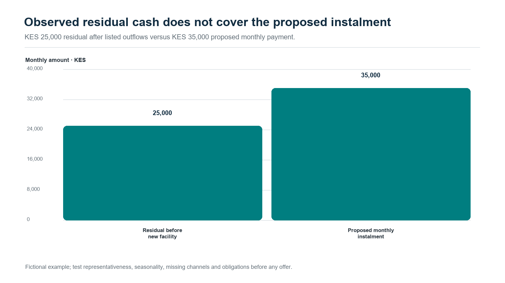
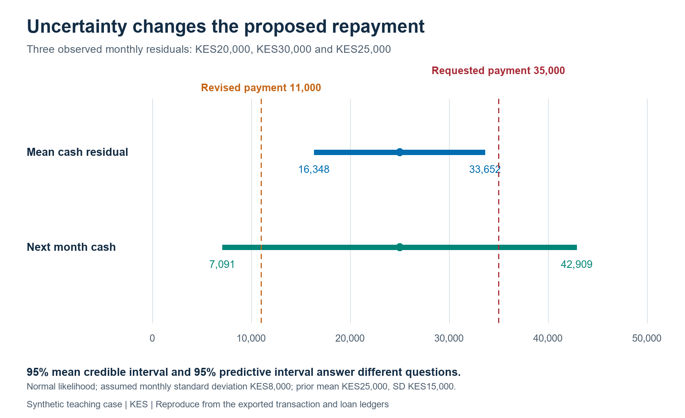
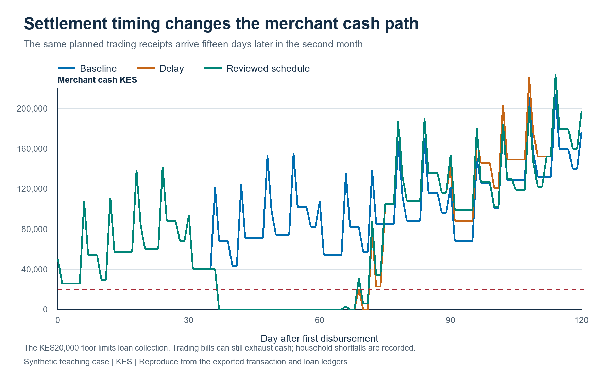
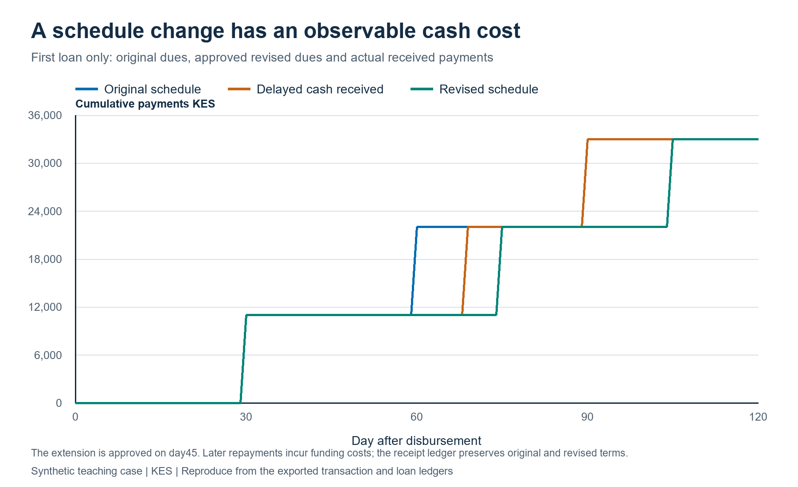
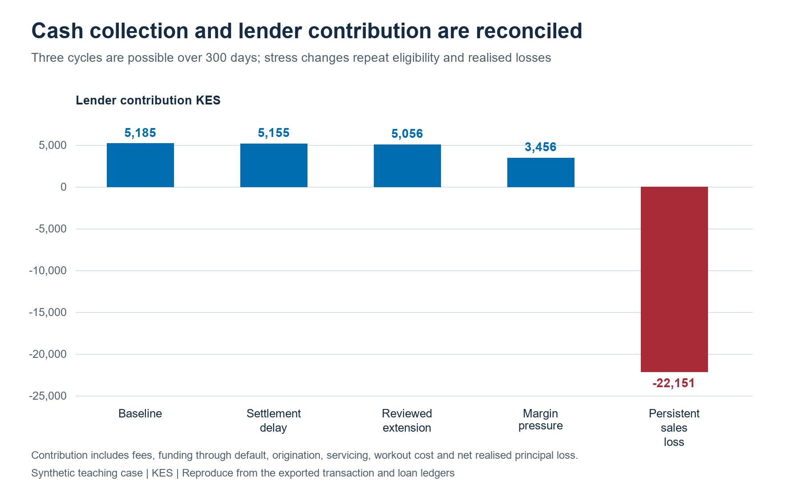
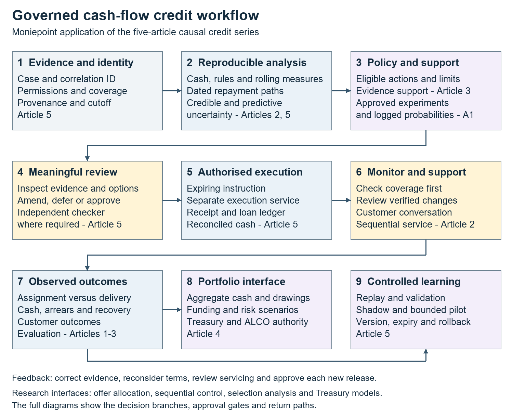

# Cash Flow First Credit: From Moniepoint’s Position to Underwrite for Collection

## A practical response for digital credit providers

Recent reporting on Moniepoint’s cash-flow lending position raises a practical design question: how can a lender translate transaction activity into a sound view of repayment capacity? This article turns that question into a working method: identify which receipts are the enterprise’s own recurring cash, reconcile them against operating costs and existing obligations, and test whether instalments fit its cash cycle and seasonal needs. It carries those assumptions through post-disbursement monitoring, customer support, and realised recovery. [1], [2]

This conversation has an earlier, related source. In a June LinkedIn post, Eniolorunda discussed layering credit onto payment flows and using payment data responsibly. That is separate from the October collateral report. Responses to the June post raised three operational points: data portability and credit infrastructure must keep pace with payments; businesses outside major urban centres can have active transactions and still struggle to access working capital; and providers should use transaction data responsibly. These comments sharpen the implementation question without being reactions to the October report. [3]

This article applies that question to non-deposit-taking credit providers, including digitally delivered lenders whose activity falls within Kenya’s CBK regime. The proposition is straightforward: transaction evidence can help lenders see enterprises that asset-based screens miss. The analytical task is to determine which activity represents the borrower’s own recurring business cash, what remains after operating and household needs, and whether repayments can be scheduled around the enterprise’s cash cycle.

## What the survey says—and what it does not

EFInA’s 2026 survey covered 18,679 adults across Nigeria’s 36 states and the Federal Capital Territory. Adult formal credit use rose from 6% in 2023 to 10% in 2026; overall financial inclusion was 79%, compared with 73% formal inclusion. Formal credit use was 8% among business owners and 7% among farmers. These population measures do not establish business coverage, underwriting quality or portfolio performance. They indicate access and suitability questions that product and repayment evidence must answer. [4]

Moniepoint’s public working-capital information describes a product with repayment features intended to fit a merchant’s pace. It is a concrete product example, not independent evidence of impact or portfolio results. Cash-flow evidence and repayment design belong together: daily or seasonal sales patterns can inform whether monthly, weekly or another schedule better fits the business. [5]

## Start with the source of repayment

A business loan is repaid from cash generated by the enterprise, or from another explicitly identified source. Collateral can provide a secondary recovery route and affect loss severity, but its stated value does not demonstrate that scheduled payments fit the business. Credit files should make both questions visible: can expected cash generation meet the payment schedule, and what recovery routes remain if it cannot?

Cash-flow underwriting is more than applying a score to account turnover. Gross credits may include sales, transfers between the borrower’s accounts, new borrowing, owner capital, refunds, reversals, insurance proceeds and asset sales. If every credit is classified as revenue, the model can overstate capacity and structure repayment around money the business did not earn. Sound analysis maps accounts to the legal and operating entity, reconciles payment channels, and distinguishes recurring trade receipts from financing or other balance-sheet movements.

The same care applies to outflows. Supplier purchases, wages, rent, utilities, taxes, delivery costs, inventory replenishment, owner drawings, household transfers and existing debt payments compete for cash. A monthly surplus can conceal a weekly liquidity trough. A merchant may have money at month-end while needing working capital to restock several days earlier. The schedule should follow the cash cycle, not merely a monthly average.

## A reproducible transaction to decision case

Consider a fictional merchant with KES 500,000 in monthly account credits. Transaction review identifies KES 410,000 as customer receipts, KES 45,000 as transfers from the owner’s other account, KES 30,000 as a separate loan disbursement and KES 15,000 as refunds or reversals. The gross-credit total is not monthly sales. The cash-flow case begins with the source-labelled KES 410,000, reconciled against point-of-sale records, cash deposits, mobile-money statements and the borrower’s account map.

Suppose the month also shows KES 270,000 in supplier purchases, KES 70,000 in wages, rent and utilities, KES 20,000 in owner drawings and KES 25,000 in existing debt payments. The residual is KES 25,000 before the new facility, so a KES 35,000 monthly instalment does not fit this observed month. The lender should test representativeness, seasonality and missing channels before considering a smaller facility, a schedule matched to verified receipts, more information or no offer.

An upcoming seasonal peak should be supported by past sales patterns, orders or other evidence. Test delayed sales, higher supplier prices and lower turnover against payment timing. Purpose, amount and operating plan should align; anticipated growth alone does not establish affordability.

*Figure 1. The KES 500,000 credit total is decomposed by source; KES 410,000 is classified as customer receipts in the example.*

*Figure 2. The fictional KES 25,000 residual is below the proposed KES 35,000 instalment.*

The evidence packet should present uncertainty alongside the cash estimate. Multiple periods help separate normal transaction variation from changes in the borrower’s underlying capacity. Where evidence is thin or the estimate lies near a policy boundary, a reviewer should see plausible ranges for cash available for debt service and the facts that could change the decision. A Bayesian implementation can express this through posterior intervals or the probability that debt service exceeds a limit. The interval supports a human judgement; it is not an unexplained score or automatic approval.

## From the source ledger to a reviewed facility

The illustration now has a reproducible Python case. It generates three historical months of bank and wallet records, separate ground truth, controlled-account links, source coverage and versioned cash classifications. Each transaction has an economic-event identifier, settlement day, availability day and classification-known day. The decision snapshot is frozen at day 90. This implements the methods developed in *Underwrite for Collection*, Part 2a §2.1, “Resolve the economic entity before calculating cash-flow features”, and §4, “Reconstruct the state the decision could actually see”. A later correction improves a later review while preserving the evidence actually available to the earlier one. [6]

The final historical month reproduces the KES500,000 credit total and KES25,000 residual above. Across the three months, verified cash after the stated obligations is KES20,000, KES30,000 and KES25,000. Ten scenarios then test the complete chain. A duplicate feed is reconciled to its original economic event; a KES50,000 internal transfer nets across two controlled accounts. Missing wallet coverage and a material classification first known on day 96 route the day 90 case to an evidence request. Their repayment outcome remains unobserved because the fixture has no funded loan. Part 2b's observation contract and Article 3 of the subsequent five-article research series develop why funding, take-up, observation and repayment need distinct records. [6], [7]

For an accessible numerical uncertainty calculation, the case assumes monthly residual Cₘ ∼ Normal(μ, σ²), with σ = KES8,000 and prior μ ∼ Normal(25,000, 15,000²). These stated assumptions make the inference reproducible from three observations. The conjugate posterior gives mean KES25,000 and a 95% credible interval of KES16,348–33,652; the next-month predictive interval is wider, KES7,091–42,909. The first describes uncertainty about mean capacity, while the second includes variation between individual months. The full case note derives both. [8]

P(Cₙ₊₁ < a | observed cash) is the modelled probability that next month's residual falls below instalment a.

That probability is 6.27% for KES11,000 and 86.31% for KES35,000. The example policy also limits the instalment to half the posterior mean, KES12,500, and tests the daily cash calendar against a KES20,000 collection reserve. These thresholds are declared teaching assumptions. The proposed revised facility is KES30,000, repaid through three KES11,000 instalments on days 30,60 and90. Its initial calendar reaches minimum cash of KES26,000. The lower payment, uncertainty measures and timing evidence enter a simulated maker–checker review together. Part 2b §11 develops the decision boundary; Article 2's “Bayesian decision boundaries turn predictions into limit-review evidence” and Article 5's “Show the reviewer three kinds of uncertainty” explain how richer posterior models can serve the same workflow. [6], [7]

*Figure 3. The 95% credible interval for mean residual cash and the 95% predictive interval for a future month are separate decision inputs. Prior, noise and policy assumptions are explicit.*

## Follow the cash after disbursement

The forward ledger covers 300 days. A normal month has five customer receipts of KES82,000 and five supplier commitments of KES54,000, alongside the dated operating, household and existing-debt payments. Disbursement enters as financing cash and a matching principal liability. Payments clear the oldest due instalment first, with principal then fee within that instalment. Original dues, revised dues, payment allocations, arrears and execution receipts retain separate fields. The collection reserve limits payments on the new loan; trading bills can still exhaust cash, so unpaid obligations and household shortfalls are separately recorded.

The baseline completes three prescribed facility cycles. A repeat request receives a fresh review after the previous facility settles, a seven-day cooling-off period, thirty observed days of sufficient residual cash and checks on bills and the reserve. This tests the repeat-lending controls. In a live product, the next application would also establish a renewed business purpose, financing gap and customer value. The model holds the trading-receipt assumptions fixed rather than assigning an unmeasured sales gain to the loan.

A fifteen-day settlement delay in the second month produces eight days past due on the first loan, followed by repayment. The reviewed-reschedule scenario records a proposal and checker approval on day 45 and shifts the remaining dues from days 60 and90 to days 75 and105. Contractual arrears then fall to zero. Both delayed scenarios still show a KES20,000 household shortfall; changing a due date changes the payment obligation but leaves that underlying pressure visible. Their higher closing cash includes the foregone household payment and must be read beside it. Part 1's dated cash-cycle treatment and Part 3's intervention contract provide the foundation for this distinction. [6]

*Figure 4. Daily balances reveal the liquidity trough concealed by a monthly total. The delayed scenarios include household shortfalls as well as repayment outcomes.*

*Figure 5. The original contract, approved modification and actual received cash remain separately observable. Rescheduling also changes the time for which the lender funds principal.*

The lender calculation includes collected fees, daily funding at 12% per annum, KES500 per origination, KES2 per performing loan-day and KES400 for workout. Funding continues on unrecovered principal after default. A thirty-day-past-due rule identifies default in this fixture; a separate recovery review follows thirty days later. The persistent-sales-loss scenario records KES20,000 residual default principal and unpaid operating bills. Supplier and operating commitments continue to accrue under the declared contracted cash-calendar assumption. Those balances measure the financing and workout requirement; a trading-and-inventory extension would model curtailment, supplier credit limits and altered sales when the operating plan changes.

Lender contribution = collected fees − funding − origination, servicing and workout costs − principal written off + cash recoveries.

Over the full horizon, baseline contribution is KES5,185; delayed settlement gives KES5,155; the reviewed extension gives KES5,056; persistent sales loss gives KES-22,151. Contribution is before central overhead, tax and a capital hurdle. These results connect received cash and time to economics, following Part 5 §6, “Collection timing becomes a treasury variable”, and §7's treatment of ALM and FTP. Article 4 extends this into institution-level funding decisions. [6], [7]

*Figure 6. Lender results include funding through workout. Borrower cash, unpaid bills and household shortfalls accompany the contribution measure.*

## Underwrite for Collection: from approval to realised cash

Underwrite for Collection starts with the outcome that matters: sustainable repayment and realised cash collection across a facility’s life. It works backward to the evidence needed at each decision point. Before approval, the lender establishes purpose, borrower identity, entity and account links, cash-flow provenance, obligations, affordability and facility structure. At disbursement, it records amount, destination, timing, pricing, schedule and approved conditions. Afterwards, monitoring tests whether the business still fits the assumptions. When a payment is missed, servicing distinguishes timing stress, data error and business deterioration before selecting a response. The whitepaper integrates product design, underwriting, servicing, collection, restructuring and recovery in one evidence chain. [6]

This lifecycle also distinguishes financing an operating business from financing a ring-fenced receivables stream. Business financing assesses the enterprise as a going concern: cash generation, working capital, obligations, owners and continuing operations. A ring-fenced receivables arrangement relies on identified invoices or collections dedicated to repayment. It requires evidence about eligibility, obligor concentration, dilution, legal transfer and enforceability, account control, servicing continuity, timing, reserves and waterfall performance. Each structure has a different repayment source and monitoring plan. Naming the proposition at the outset tells the lender which evidence and recovery path to test.

## A governed agentic workflow

At scale, cash-flow lending is a coordination problem as well as a modelling problem. Evidence may come from a DCP wallet, a bank account, a merchant acquirer, a POS terminal, accounting software, a bureau and customer-supplied records. A governed agentic workflow can coordinate specialist tasks while tested computation and authorized people retain clear responsibilities. The purpose is to assemble a traceable credit case: language-model agents organize and explain evidence, registered numerical services calculate cash and uncertainty, and authorised people decide within approved policy.

An orchestration service creates a case and correlation ID, then routes tasks to scoped agents. An intake agent checks consent, source permissions, file integrity and coverage dates. A transaction-provenance agent proposes labels for sales, transfers, refunds and loan proceeds, linking each label to source records and confidence. A deterministic cash-flow engine calculates receipts, outflows, obligations and forecast paths using versioned code. A challenger agent tests alternative classifications, missing channels, unusual inflows, concentration and stress cases. A policy service compares estimates and uncertainty with approved thresholds and routes the case to the designated approval authority.

The deterministic baseline belongs inside this workflow. Provenance-adjusted trailing receipts, reconciled balances, known obligations, a dated payment calendar, cash reserves and arrears provide replayable measures against which a proposed recommendation can be tested. A rolling average changes as observations arrive; its calculation rule can remain fixed and versioned. The current case implements a thirty-day trailing residual gate for repeat review. Seven-day and ninety-day receipt measures are useful proposed extensions, each requiring a cutoff, observation window, minimum coverage, units, seasonality treatment and documented handling of missing data.

Those controls have distinct roles. A balance identity or duplicate check validates the evidence; a hard eligibility gate limits the available actions; an approved threshold implements credit policy; a rolling average describes recent activity; a statistical model quantifies uncertainty; and a causal study estimates the consequence of changing an action. Agents can investigate a missing channel, propose a cash classification or prepare an exception packet around this foundation. Versioned rules and human mandates govern the resulting action, and an override retains its reason, approver and expiry. The EBA's loan-origination and monitoring guidance is a useful international comparator for lifecycle governance and early-warning indicators, while NIST's AI Risk Management Framework gives a complementary structure for human–AI roles and accountability. Kenya's legal requirements continue to govern the local application. [9], [10]

The reviewer sees the cash bridge, data coverage, model version, assumptions, uncertainty, proposed terms and exceptions. A credit officer can accept, amend, request records or decline with evidence-based reasons; maker-checker controls separate proposal from approval where required. After disbursement, monitoring can flag material changes and servicing can prepare a reminder, payment-date adjustment or restructuring referral for authorized review.

For example, if observed inflows fall sharply, the workflow first checks for a missing channel, seasonal pattern, account migration or data-ingestion delay. It compares new evidence with the approved cash calendar, estimates the effect on payment capacity and routes the case for review. The customer conversation can then establish what changed and what arrangements are workable. This keeps a noisy signal from becoming unnecessary pressure.

Language models can extract records, summarize evidence, draft notes and route tasks. Statistical models estimate risk and uncertainty; calculation services produce cash bridges; policy engines apply approved rules. Reviewers can inspect sources, correct records and document decisions. Logs link identity, time, source, model and policy versions, approval, tool call and outcome to the correlation ID. Task-based access, pseudonymous identifiers, role controls and retention limits reduce unnecessary exposure; credit data stays within approved systems.

*Figure 7. The source, calculation, policy, approval, execution and monitoring stages form one governed workflow. The complete diagrams and readable Word supplement retain the detailed paths.*

### Read the evidence and calculation path

The first panel answers the underwriting question before it reaches a score: whose cash is this, which records describe the same movement, and what was actually knowable at review? The intake path binds the purpose and source permission to a case, account map and dated evidence snapshot. The case's bank and wallet split makes the reconciliation concrete: a missing wallet month reduces coverage, a duplicate shares an economic-event ID, and a later-known receipt classification remains outside verified operating cash at the earlier cutoff. The calculation branch then builds the cash bridge, descriptive checks, uncertainty and a challenger review. The current engine supplies the declared Normal cash posterior and dated calendar. The broader hierarchy and action-effect interfaces are developed in the five-article series and are labelled as research extensions in the diagram.

[Full evidence and calculations flowchart](charts/MONIEPOINT_WORKFLOW_01_EVIDENCE_AND_CALCULATIONS.png)

### Read the approval and execution path

The second panel shows how evidence becomes an authorised action. Reconciled information reaches versioned policy and eligibility gates, which determine the available terms and required review. The reviewer receives source coverage, the KES25,000 residual, the credible and predictive intervals, the dated cash minimum, the requested payment and the smaller proposal. The synthetic maker records a proposal; a different checker records approval before a payment adapter returns its execution receipt. A revised schedule follows the same separation. The diagram also shows expiring instructions and a current-conditions check for a production adapter: the evidence, permissions and applicable terms should still match the authorised instruction when execution occurs. These deployment controls extend the case's versioned approval and receipt records into the complete operating contract developed in Article 5.

[Full approval and execution flowchart](charts/MONIEPOINT_WORKFLOW_02_APPROVAL_AND_EXECUTION.png)

### Read the monitoring and learning path

The third panel begins with observed receipts and the approved payment calendar. A lower reported flow first branches into source quality, coverage and classification checks. In the feed-gap fixture, the missing channel routes to repair while the merchant's economic cash remains unchanged. In the delayed-settlement fixture, the evidence supports a customer review and a prospective schedule change. The next records distinguish the original due date, revised obligation, actual payment, borrower shortfall and lender funding cost. Mature outcomes can then support a registered evaluation or model update. Articles 1 and 2 develop experimental allocation and sequential decisions; Article 3 treats selective outcomes; Article 4 connects timing to funding; Article 5 preserves authority, change control and audit evidence. The complete flowchart therefore connects an implemented case with clearly identified interfaces for subsequent validated work.

[Full monitoring and learning flowchart](charts/MONIEPOINT_WORKFLOW_03_MONITORING_AND_LEARNING.png)

[Complete governed workflow diagram](charts/MONIEPOINT_GOVERNED_AGENTIC_CREDIT_WORKFLOW.png).

## Kenya’s DCP and data-protection setting

Kenya’s sector framework changed on 29 September 2026, when the Central Bank of Kenya (Non-Deposit Taking Credit Providers) Regulations, 2026 (Legal Notice 191) were published and commenced. Regulation 97 revokes the 2022 Digital Credit Providers Regulations. Regulation 3 covers non-deposit-taking credit business not regulated under another written law, with exclusions including banks, microfinance institutions, co-operatives, Saccos, credit-guarantee providers and certain regulated leasing or hire-purchase arrangements. Under regulation 96, existing LN46 licensees are deemed licensed under the new framework, while other existing in-scope providers have six months from publication to apply; accrued rights and liabilities continue. Regulation 60 addresses AI in lending decisions through customer information and explanations, human oversight, bias assessment, technical robustness, transparency, privacy and security. Providers should map these rules to their entity, product and transition position. [11]

The Data Protection Act, 2019 and Data Protection (General) Regulations, 2021 govern personal-data processing in the lending workflow. Where a decision is based solely on automated processing and has legal or similarly significant effects, section 35 adds safeguards and rights to notification and reconsideration. Regulation 22 requires notice and meaningful information about logic, with fairness, error-prevention, statistical, bias-control and human-intervention safeguards. Section 31 requires a DPIA where processing is likely to create high risk; regulation 49 identifies relevant high-risk operations and regulations 50–53 set the assessment, consultation and audit process. The system should record sources and purposes, how an output affected a case, and how reviewers can correct errors and consider a customer’s explanation. The CBK’s regulation 60 separately addresses AI lending decisions for providers within its scope. [12], [13]

Data quality is part of customer treatment. The lender should distinguish authorized account aggregation from inferred or third-party data, record source and purpose, and provide a practical path to correct inaccurate transaction labels. A challenged classification should be reviewed before it affects pricing, a limit change, collection treatment or bureau reporting. Human review should give the reviewer enough context to reconsider the recommendation.

## Evidence, learning and responsible growth

Cash-flow models should be tested against outcomes that answer the credit question. Predictive performance matters, alongside calibration, stability across business types, concentration, arrears timing, cure, restructuring, realised recovery, repeat borrowing and the borrower’s cash remaining after payment. CGAP’s work on small-business digital credit and transactional data describes transaction evidence as a potential source for underwriting and places assessment within a wider credit value chain that includes origination, servicing and collections. Peer-reviewed work also motivates careful testing: Berg et al. find that digital-footprint variables contain credit-scoring information in their study setting, while Chen et al. estimate effects of Alibaba FinTech credit on small-business volatility using a credit-score threshold. These studies inform the questions; they do not establish performance for Moniepoint, Nigeria or Kenya. [14], [15], [16], [17]

Pilots can test repayment cadence, limit steps, reminders or supportive interventions against a credible benchmark. Monitor approval, pricing, repayment, operating cash retained, complaints, repeat borrowing and borrower outcomes, across business type, gender, geography, data coverage and first-time status. Show uncertainty. When actions change outcomes, separate prediction from treatment effect; compare recipients and non-recipients only under a design that supports the inference.

A DCP should learn from both success and failure. If customers repay through a different account, revise the data map. If instalments repeatedly conflict with sales timing, test the schedule. If collection produces payment but leaves the merchant without restocking cash, record that consequence in the outcome assessment. Underwrite for Collection treats realised payment, continuing cash-generating capacity and borrower experience as connected parts of credit performance.

## Reproduce the case and develop the empirical study

The accompanying repository contains source transactions, coverage records, separate synthetic truth, decision snapshots, daily cash, loan and instalment ledgers, monitoring routes and audit events. Thirty-six tests check source totals, temporal validity, uncertainty, cash and principal reconciliation, FIFO allocations, review order and funding through default. The named charts are generated from those outputs. The [case and instructions](https://github.com/TheAlchemistNerd/underwrite-for-collection/tree/main/research_lab/moniepoint_cashflow_case) and the [whitepaper](https://doi.org/10.5281/zenodo.23343888) make the calculation and its assumptions inspectable.

The next empirical question is whether an intervention improves outcomes for eligible merchants. Article 1's offer experiments, Article 2's sequential collection framework and Article 3's selective-outcome analysis specify the required eligibility, timing, assignment, follow-up and observation records. A pilot could compare approved schedules or supportive actions, record actual treatment receipt and assess both repayment and resources retained by the merchant. Logged allocation probabilities support off-policy evaluation when its assumptions and support conditions are met. The published policy-evaluation literature gives a rigorous basis for that extension. The current simulated responses provide reproducible test fixtures and a concrete data contract for such a study. [7], [18]

## The practical answer

The cash-flow proposition becomes an operating standard when a lender establishes who generated cash, identifies what remains after obligations, fits payments to that capacity, monitors assumptions and learns from realised collection. Collateral remains a recovery route; identified receivables may be the contracted repayment source in a specific structure. Underwrite for Collection links these questions across affordability, facility structure, monitoring, servicing, collection and outcomes. Agentic workflows can coordinate that work when roles are bounded, calculations reproducible, data purpose-bound, decisions explainable and people retain meaningful authority.

## References

[1] K. Mgboji, “Cash flow, not collateral, should drive lending to Nigerian businesses, says Moniepoint CEO,” Nairametrics, Oct. 7, 2026. https://nairametrics.com/2026/10/07/cash-flow-not-collateral-should-drive-lending-to-nigerian-businesses-says-moniepoint-ceo/

[2] Payments Africa, “Moniepoint CEO Advocates Cash Flow Over Collateral for Business Lending,” Oct. 8, 2026. https://www.paymentsafrica.news/articles/moniepoint-ceo-advocates-cash-flow-over-collateral-for-business-lending

[3] T. Eniolorunda, LinkedIn post on credit layered onto payment flows and responsible use of transaction data, June 2026. https://www.linkedin.com/posts/tosin-eniolorunda-46833618_the-launch-of-the-nigeria-payments-system-activity-7467533754530496512-VoKE

[4] EFInA and National Bureau of Statistics, “Access to Financial Services in Nigeria 2026 Survey: Report Highlights,” 2026. https://a2f.ng/download/8756/?tmstv=1791573600

[5] Moniepoint, “Working Capital Loans.” https://moniepoint.com/ng/business/working-capital-loans

[6] N. Maloba, Underwrite for Collection: An Integrated Research Whitepaper on Sustainable MSME Credit, 2026. Zenodo. https://doi.org/10.5281/zenodo.23343888

[7] N. Maloba, *Causal Credit and Treasury Decision-Making*, five-article research series, 2026. Articles 1–5 and mathematical appendices. https://github.com/TheAlchemistNerd/underwrite-for-collection/tree/main/series/publications/linkedin/2026-10-08_causal_credit_series.

[8] A. Gelman, J. B. Carlin, H. S. Stern, D. B. Dunson, A. Vehtari and D. B. Rubin, *Bayesian Data Analysis*, 3rd ed. Chapman & Hall/CRC, 2013, ch. 2. https://sites.stat.columbia.edu/gelman/book/.

[9] European Banking Authority, *Guidelines on loan origination and monitoring*, EBA/GL/2020/06, 2020, especially sec. 8.5. https://www.eba.europa.eu/activities/single-rulebook/regulatory-activities/credit-risk/guidelines-loan-origination-and-monitoring.

[10] National Institute of Standards and Technology, *Artificial Intelligence Risk Management Framework*, GOVERN 2.1 and 3.2, 2023. https://airc.nist.gov/airmf-resources/airmf/5-sec-core/.

[11] Central Bank of Kenya, “Central Bank of Kenya (Non-Deposit Taking Credit Providers) Regulations, 2026,” Legal Notice No. 191, Kenya Gazette Supplement No. 234, Sept. 29, 2026, regs. 3, 60, 96–97. https://new.kenyalaw.org/akn/ke/act/ln/2026/191/eng@2026-09-29/source.pdf

[12] Data Protection Act, No. 24 of 2019, §§ 25, 31, 35. https://new.kenyalaw.org/akn/ke/act/2019/24/eng@2019-11-15/source

[13] Data Protection (General) Regulations, 2021, regs. 22, 27–36, 49. https://new.kenyalaw.org/akn/ke/act/ln/2021/263/eng@2022-01-14/source

[14] CGAP, “Digital Credit Models for Small Businesses,” Oct. 2019. https://www.cgap.org/research/publication/digital-credit-models-for-small-businesses

[15] CGAP, “Leveraging Transactional Data for Micro and Small Enterprise Lending,” 2024. https://www.cgap.org/research/publication/leveraging-transactional-data-for-micro-and-small-enterprise-lending

[16] T. Berg, V. Burg, A. Gombović, and M. Puri, “On the rise of FinTechs: Credit scoring using digital footprints,” *The Review of Financial Studies*, vol. 33, no. 7, pp. 2845–2897, 2020, doi: 10.1093/rfs/hhz099. https://academic.oup.com/rfs/article/33/7/2845/5568311.

[17] T. Chen, Y. Huang, C. Lin, and Z. Sheng, “Finance and firm volatility: Evidence from small business lending in China,” *Management Science*, vol. 68, no. 3, pp. 2226–2249, 2022, doi: 10.1287/mnsc.2020.3942. https://pubsonline.informs.org/doi/10.1287/mnsc.2020.3942.

[18] M. Dudík, J. Langford and L. Li, “Doubly robust policy evaluation and learning,” in *Proc. 28th International Conference on Machine Learning*, 2011. https://icml.cc/2011/papers/554_icmlpaper.pdf.
