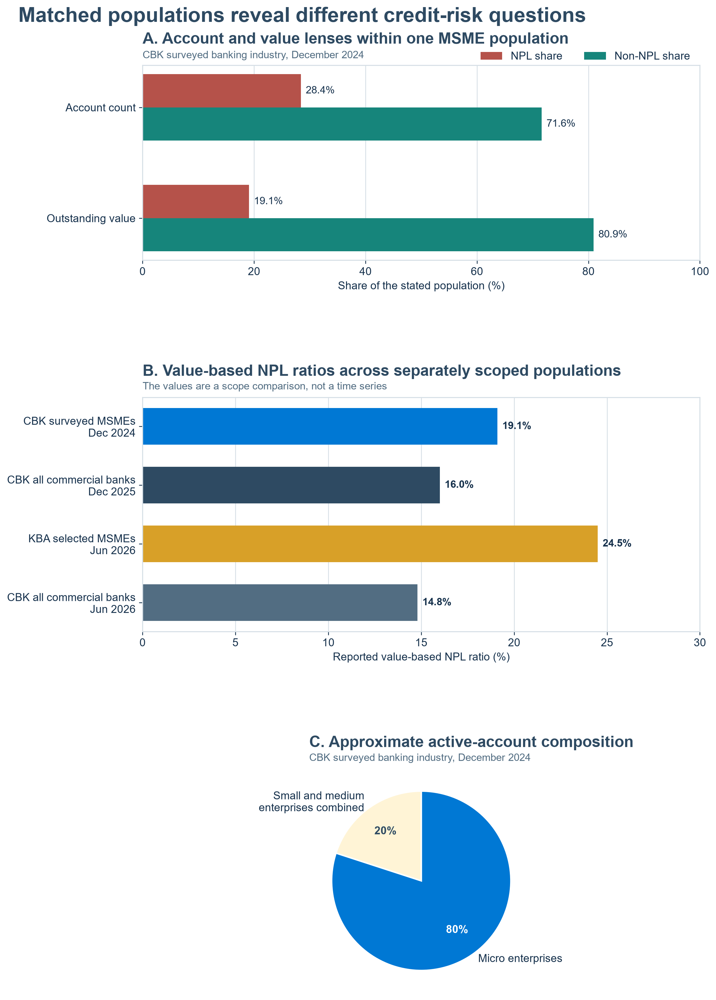

# Abstract

A credit decision is usually recorded at origination, but its economic quality is revealed through a sequence of later cash events. This is especially important for micro, small and medium enterprises whose customer receipts, inventory purchases, payroll, taxes, supplier obligations and household withdrawals often move on different calendars. A viable business can therefore experience a payment-timed liquidity shortage, while a weak product structure can convert a temporary shortage into repeated arrears and eventual loss.

This paper develops **underwrite for collection** as a lifecycle architecture for Kenyan MSME credit. The proposition is that product design, underwriting evidence, monitoring, intervention, restructuring and recovery should be connected through one cash-flow and credit-state history while retaining clear institutional responsibilities. Collection is treated as the production of sustainable contractual or restructured cash flows, measured alongside customer outcomes, operating cost, expected loss, capital and funding consequences.

Part 1 establishes the economic problem, interprets Kenyan portfolio evidence through consistent populations and denominators, maps collection cascades, and identifies the ecosystem required for responsible implementation. The later parts develop temporal data and feature engineering, hierarchical Bayesian and causal inference, regulatory orchestration, bank-controlled research architecture, KESONIA-linked pricing and balance-sheet consequences, and a programme of randomised pilots and quasi-experimental evaluation.

## 1. When a profitable month still misses Tuesday's instalment

Imagine a small wholesaler serving kiosks, restaurants and informal traders on the edge of a Kenyan town. The business begins the month with stock purchased partly in cash and partly on seven-day supplier terms. Some customers pay immediately through mobile money. Others receive goods on short trade credit because maintaining those relationships matters more than insisting on cash at every delivery. Two larger customers settle only after completing their own approval cycles. Payroll falls on the twenty-eighth day. Rent, electricity, transport and tax obligations follow separate calendars. The owner also draws money for household needs because the boundary between enterprise and family liquidity is economically real even when the accounting records treat them separately.

At month end, sales may exceed the cost of stock and operating expenses. The income statement can show a profit. Yet the Tuesday loan instalment may still fail if the larger customer payment arrives on Friday, the supplier debit falls on Monday, and the owner replenishes fast-moving stock before the weekend. The problem is not captured fully by monthly income, average account balance or a static debt-service ratio. It is a timing problem inside a wider operating cycle.

The lender experiences the same business through a different calendar. Its system knows the disbursement date, contractual schedule, interest accrual, due amount and days past due. The borrower experiences inventory days, receivable days, supplier terms, wage dates, seasonality and the timing uncertainty of each customer payment. Underwriting becomes stronger when those two calendars are designed to meet rather than left to collide after disbursement.

This paper uses **MSME** as a practical portfolio term while preserving the distinctions inside it. The Central Bank of Kenya's 2024 supply-side survey classified enterprises by turnover, employment and investment, drawing on Kenya's Micro and Small Enterprises Act and the relevant public-finance framework. In that survey, micro enterprises had annual turnover not exceeding KSh500,000 and fewer than ten workers; small enterprises had turnover between KSh500,000 and KSh5 million and 10 to 49 workers; medium enterprises had turnover between KSh5 million and KSh100 million and 51 to 250 workers, with additional investment thresholds [1]. The Micro and Small Enterprises Act itself establishes statutory definitions for micro and small enterprises and recognises enterprises across production and services, including formal and informal activity [2].

Those categories support reporting and policy, but they do not make the underlying businesses homogeneous. A market trader, transport operator, manufacturer, pharmacy, farm-input dealer and professional practice can occupy the same broad size category while presenting different cash-conversion cycles, fixed-cost burdens, seasonality, concentration and recovery options. A bank may also segment enterprises differently for product, risk or relationship management. Every empirical result in this series will therefore state the population definition used by its source or participating institution.

The economic unit of analysis is not simply “the MSME” or “the loan”. It is the relationship among a business model, a financing purpose, a contractual facility and a sequence of cash obligations. The same enterprise may use an overdraft to bridge receivables, asset finance to acquire productive equipment, invoice finance against a particular debtor, a term loan for expansion, and a digital working-capital facility for short stock cycles. A sound assessment asks whether each product fits the cash flow it is meant to finance and how the facilities interact when conditions weaken.

Let the business's liquid cash position immediately before the contractual payment at time (t) be represented as:

\[
L_t = B_{t^-} + C_t^{\mathrm{collected}} - O_t^{\mathrm{essential}} - W_t^{\mathrm{committed}} - D_t^{\mathrm{senior}},
\]

where \(B_{t^-}\) is available cash before the payment window, \(C_t^{\mathrm{collected}}\) is cash actually settled and available, \(O_t^{\mathrm{essential}}\) is essential operating expenditure, \(W_t^{\mathrm{committed}}\) is other committed working-capital use, and \(D_t^{\mathrm{senior}}\) is any obligation contractually or operationally paid before the facility being assessed. This is a descriptive liquidity identity, not a universal affordability formula. Its purpose is to show why booked revenue, invoiced sales and average monthly inflows do not necessarily equal cash available for a particular instalment.

Even collected cash needs an economic identity. A settled credit may be a customer receipt, merchant settlement, loan drawdown, owner contribution, refund, reversal or transfer from another account controlled by the same enterprise. Every item can improve the balance visible in one account while carrying a different implication for recurring operating capacity, leverage and collection sustainability. Where several accounts, wallets or related entities participate in the operating cycle, the lender should consolidate authorised evidence at the economic-unit level and avoid counting one amount each time it crosses an observed boundary.

The paper therefore distinguishes **cash occurrence**, **settlement and availability**, **economic provenance**, and **decision treatment**. The first records that money moved; the second establishes whether it can fund an obligation; the third resolves the supported source, connected entity and transaction path; the fourth determines whether the amount belongs in an operating, liquidity, financing, capital or unresolved analytical view. Point-in-time correctness remains essential, but an event can be correctly observed before a decision and still be misclassified economically. Part 2a develops the temporal entity graph, path reconstruction and classification controls required before cash-flow features are calculated.

The first architectural task is therefore to align observable business clocks with the credit clock.

```{.mermaid layout=fullpage}
%%{init: {
  "theme": "base",
  "themeVariables": {
    "fontFamily": "Arial",
    "primaryColor": "#EAF2F8",
    "primaryTextColor": "#17324D",
    "primaryBorderColor": "#2E5E7E",
    "lineColor": "#4F6B7A",
    "secondaryColor": "#E8F5F2",
    "tertiaryColor": "#FFF4D6"
  },
  "flowchart": {"curve": "stepAfter", "nodeSpacing": 32, "rankSpacing": 46}
}}%%
flowchart TB
    subgraph BUSINESS[MSME operating clocks]
        direction TB
        S[Customer order and sale] --> I[Invoice or immediate receipt]
        I --> R{Cash settled<br/>before due date?}
        R -->|Yes| A[Available operating cash]
        R -->|No| AR[Accounts receivable<br/>still outstanding]
        P[Inventory and supplier terms] --> A
        C[Payroll, tax, rent,<br/>utilities and transport] --> A
        H[Owner and household<br/>withdrawals] --> A
    end

    subgraph CREDIT[Credit clock]
        direction TB
        D[Disbursement and purpose] --> Q[Contractual repayment date]
        Q --> M{Cash available<br/>in payment window?}
        M -->|Sufficient| PAY[Payment allocated]
        M -->|Temporary gap| GAP[Early liquidity pressure]
        M -->|Persistent gap| ARR[Arrears state]
    end

    AR -. later settlement .-> A
    A ~~~ D
    A ==> M
    GAP -. payment alignment,<br/>support or review .-> PAY
    GAP -. unresolved .-> ARR

    classDef operating fill:#EAF2F8,stroke:#2E5E7E,color:#17324D,stroke-width:1.5px;
    classDef credit fill:#E8F5F2,stroke:#16857B,color:#17324D,stroke-width:1.5px;
    classDef alert fill:#FFF4D6,stroke:#C58A00,color:#5A4100,stroke-width:1.8px;
    class S,I,R,A,AR,P,C,H operating;
    class D,Q,M,PAY credit;
    class GAP,ARR alert;
```

**Figure 1: Two calendars determine whether a viable MSME can meet a particular instalment.** The business clock records when economic activity turns into available cash. The credit clock records when contractual cash is due. Product design and lifecycle monitoring connect them.

This starting point changes the underwriting question. Instead of asking only whether the enterprise appears able to repay on an average day, the lender asks how repayment will be produced through the facility's life, which events could interrupt it, which evidence would reveal deterioration, and which actions could restore alignment while the enterprise remains viable. That is the practical foundation of underwriting for collection.

<!-- U4C-CASE-1-START -->

### Worked operating case: a profitable order can still miss its payment date

The connected example starts with KES 250,000 cash, a KES 200,000 customer advance and KES 500,000 borrowing. The order earns KES 180,000 before finance costs and ends with KES 405,000.00 cash when the customer pays on day 60. If the same customer receipt arrives on day 90 but the loan remains due on day 60, the unfinanced forecast reaches KES -395,000.00. Maintaining the KES 100,000 operating floor would require KES 495,000.00 of additional cash. That amount identifies the additional funding to secure or the payment schedule to renegotiate. Enterprise cash and the specific loan's repayment clock must therefore be tested together. Cash above the operating floor is analytical owner headroom to assess against the enterprise's other obligations and distribution rules.

See the worked case appendix, U4C-MSME-001, and the [GitHub research lab](https://github.com/TheAlchemistNerd/underwrite-for-collection/tree/main/research_lab) for the declared hypothetical assumptions, full schedules, calculation code, tests and instructions for reproducing both worked cases.

<!-- U4C-CASE-1-END -->

## 2. Read the portfolio through matched populations

Public evidence establishes the scale of the question, provided each statistic remains attached to its population and date. The CBK survey reported approximately 0.89 million active MSME loan accounts worth KSh784.4 billion at December 2024. Micro enterprises represented about 80 percent of accounts across the surveyed banking industry, while medium enterprises held the largest share of MSME credit by value within commercial banks. These account and value distributions describe different parts of the surveyed MSME portfolio [1].

The same survey recorded 252,502 non-performing MSME accounts worth KSh149.8 billion. These represented 28.4 percent of MSME accounts and 19.1 percent of outstanding MSME value. The account share describes the prevalence of non-performance by account count; the value share describes its proportion of outstanding value. They are complementary measures of the December 2024 MSME population [1].

For the full banking sector, CBK reported gross NPLs of KSh697.3 billion and gross loans of KSh4,070.2 billion at December 2024. At December 2025, gross NPLs were KSh696.9 billion and gross loans were KSh4,347.2 billion. The gross NPL-to-gross-loans ratio was 17.1 percent and 16.0 percent at the respective year ends. CBK attributed the 2025 asset-quality movement mainly to repayments, recoveries and increased new advances [3]. These year-end totals provide sector context; they are not an MSME-only series, a measure of cash recovered, or a cohort-level repayment outcome.

The KBA MSME dashboard provides a later and separately scoped view. Its selected June 2026 portfolio reported a value-based NPL ratio of 24.5 percent and KSh234.67 billion of NPL outstanding [4]. The dashboard also separates product, institution, borrower and count views. Its figures should travel with their reporting month, filter state, covered institutions, numerator and denominator so the selected population remains clear.

For the full banking sector, CBK reported that gross loans rose from KSh4,453.0 billion in March 2026 to KSh4,645.5 billion in June 2026. The gross NPL-to-gross-loans ratio was 15.6 percent and 14.8 percent at those dates; gross NPLs declined by 1.3 percent while gross loans increased by 4.3 percent [5]. These measures cover the broader banking sector, rather than the selected MSME dashboard population. In the same survey, credit officers expected recovery efforts to intensify in nine economic sectors during the quarter ending September 2026. This is a reported expectation, not an observed recovery outcome [5].

Taken together, the 2024 MSME survey, 2025 full-sector annual report and two separately scoped 2026 views provide dated context for the research question: what evidence is needed to assess whether lending supports sustainable repayment and realised recovery? The published aggregates describe scale and reported asset-quality stocks and ratios. They do not identify the payment history of an MSME lending vintage, the durability of cure, the timing and amount of borrower cash received, or net recovery after workout costs. Part 1 therefore uses these statistics to motivate the required population definitions and lifecycle outcomes, without treating differently scoped observations as one trend [1], [3]-[5].

Figure 1A presents three views with their dates and scopes visible. Panel A holds the CBK December 2024 MSME population constant and reports non-performance by account count and outstanding value. Panel B places four value-based NPL ratios beside one another while preserving their different dates and coverage. Panel C shows the approximate MSME account composition reported for 2024. The panels support interpretation of distinct reporting populations; they do not form a single time series.

\clearpage

{width=88%}

**Figure 1A: Dated and separately scoped views of Kenyan credit evidence.** Panel A holds one CBK 2024 MSME population; Panel B compares separately scoped value ratios, not a time series; and Panel C shows the 2024 MSME active-account composition. Sources: [1], [3]-[5].

\clearpage

These views form a more useful evidence chain when their identities remain visible:

| Measure | Economic meaning | Minimum reporting information | Question it can answer |
|---|---|---|---|
| New lending during a period | Origination flow | Start and end date, product, institution and amount | How much qualifying credit was advanced? |
| Outstanding performing balance | Stock at a date | Reporting date, accrued amounts and classification | How much current exposure remains? |
| NPL value ratio | Problem balance divided by the stated loan balance | Definition of NPL, numerator, denominator and date | What share of value is non-performing? |
| NPL account ratio | Problem accounts divided by stated accounts | Account unit, multiple facilities and closure treatment | How widespread is non-performance by count? |
| Vintage default rate | Defaults from one origination cohort divided by that cohort's exposure | Origination window, maturity, censoring and horizon | How did a particular lending cohort perform? |
| Cure and re-default | Movement out of and back into delinquency | State rules, performance window and modification treatment | Did apparent improvement remain durable? |
| Net recovery | Realised recovery less attributable workout cost | Cash dates, cost allocation and discount basis | What economic value remained after default? |

This denominator discipline changes management conversation. Origination, delinquency, cure and recovery become connected observations rather than competing headlines. A bank can follow a defined cohort from application and disbursement through scheduled payments, actual receipts, arrears, modification, cure, default and recovery. KBA can support common industry definitions and aggregate comparison. Regulators and public institutions can interpret access and stability using transparent populations. Researchers can identify which questions public aggregates can answer and which require controlled institution-level data.

The resulting research object is a **lifecycle vintage**. It contains facilities sharing a defined origination window, product, borrower segment and observation horizon. Within that vintage, account transitions and cash outcomes can be measured consistently. This creates the empirical bridge between lending activity and collection performance that a stock-versus-flow comparison cannot supply on its own.

## 3. Collection begins in product architecture

A collection outcome is partly designed before the first shilling is disbursed. The financing purpose determines when productive value can emerge. The tenor determines how long the business has to convert that value into cash. Repayment frequency determines how closely debt service follows the receipt cycle. Grace periods, draw conditions, limit controls, security, guarantees, covenants and pricing determine how risk is divided and how much room remains when conditions change.

Berger and Udell describe an SME lending technology as more than a score. It combines primary information sources, screening and underwriting policies, the structure of the loan contract, and monitoring strategies. Their wider framework also connects lending technology to the legal, information, regulatory and institutional environment in which finance is provided [6]. This is a useful foundation for the present argument. A bank does not underwrite an enterprise in isolation. It selects a technology through which a particular product will gather evidence, allocate rights, observe performance and respond to deterioration.

Consider four common mismatches. A short digital loan can fund inventory whose sale and customer settlement take longer than the contractual tenor. An overdraft can finance equipment that produces returns over several years, leaving the facility permanently utilised. Equal monthly instalments can burden a seasonal enterprise during its low-revenue period even when annual cash generation is sufficient. An automatic sweep can collect efficiently while removing the liquidity needed to purchase the next unit of stock, weakening the activity from which repayment must ultimately come.

Each mismatch can appear initially as a borrower-risk problem. Yet part of the risk originates in the relationship between purpose and structure. Product architecture should therefore answer seven questions before approval:

1. What productive or liquidity need is the facility funding?
2. When should that use generate settled cash rather than booked revenue?
3. Which cash flows are realistically available for debt service after essential operating needs?
4. How do tenor, repayment dates and amortisation follow that conversion process?
5. Which other lenders, suppliers, tax claims or account sweeps compete for the same cash?
6. Which observable events indicate a temporary timing gap, a persistent viability problem or a servicing error?
7. Which actions remain proportionate and useful at each stage?

The answer is not necessarily a more flexible product in every case. Flexibility can postpone recognition of a structurally weak facility. The objective is an explicit fit among purpose, cash generation, payment structure, control rights and remedial options. A productive asset with a long payback period may require term finance. A verified invoice may support a self-liquidating facility linked to its settlement. Fast-turning stock may support a shorter working-capital cycle. Seasonal activity may justify a repayment profile aligned with observable peaks and troughs. Each design still requires affordability, credit approval, pricing and portfolio controls.

The current Basel credit-risk principles place these activities in one governance chain. They connect a sound credit-granting process with ongoing administration, grading, monitoring, independent review and early remedial action. They also call for prompt identification of deterioration and recognise that specialised workout capacity may improve rehabilitation and ultimate repayment. The principles warn that remuneration linked narrowly to volume, short-term profit or portfolio indicators can create conflicts with sound credit management [7].

This matters because an organisation can optimise each department locally while weakening the whole credit relationship. Sales can maximise disbursement. Credit can minimise approval-time default estimates. Operations can maximise automated deductions. Collections can maximise this week's receipts. Finance can minimise current provisions. Treasury can minimise apparent funding cost. Sustainable collectability requires a shared lifecycle scorecard so that one function cannot improve its headline measure by transferring risk or cost to another stage.

```{.mermaid layout=fullpage}
%%{init: {
  "theme": "base",
  "themeVariables": {
    "fontFamily": "Arial",
    "primaryColor": "#EAF2F8",
    "primaryBorderColor": "#2E5E7E",
    "lineColor": "#47697A",
    "secondaryColor": "#E8F5F2",
    "tertiaryColor": "#FFF4D6"
  },
  "flowchart": {"curve": "stepAfter", "nodeSpacing": 28, "rankSpacing": 40}
}}%%
flowchart TB
    N[MSME financing need] --> P[Purpose and cash<br/>conversion analysis]
    P --> T[Product terms,<br/>price and protections]
    T --> U[Underwriting and<br/>uncertainty assessment]
    U --> D[Disbursement with<br/>clear obligations]
    D --> M[Lifecycle monitoring<br/>and account-state updates]
    M --> I{Material change?}
    I -->|No| C[Contractual collection<br/>and relationship service]
    I -->|Temporary pressure| S[Support, payment alignment<br/>or evidence review]
    I -->|Persistent deterioration| W[Restructure, workout<br/>or recovery path]
    C --> O[Cash and customer outcomes]
    S --> O
    W --> O
    O --> L[Model, policy, pricing<br/>and product learning]
    L --> P

    classDef design fill:#EAF2F8,stroke:#2E5E7E,color:#17324D,stroke-width:1.5px;
    classDef operate fill:#E8F5F2,stroke:#16857B,color:#17324D,stroke-width:1.5px;
    classDef decision fill:#FFF4D6,stroke:#C58A00,color:#5A4100,stroke-width:1.8px;
    class N,P,T,U,D,L design;
    class M,C,S,W,O operate;
    class I decision;
```

**Figure 2: Product architecture begins and completes the collection loop.** Realised payment, cure, recovery, cost and customer outcomes return to product design through governed learning.

Underwriting for collection can now be defined more precisely. It is the governed design and assessment of a credit relationship so that expected contractual or restructured cash flows remain compatible with the enterprise's economic activity, while deterioration can be recognised and addressed through lawful, proportionate action. Approval remains important, but it becomes one gate within a longer productive system.

## 4. From cash-flow pressure to a collection cascade

An MSME default is often preceded by a chain of smaller adaptations. A restaurant loses a major corporate customer and initially absorbs the decline through its cash buffer. It then buys smaller quantities from suppliers, losing volume discounts. The owner delays maintenance, draws an overdraft more heavily and pays one obligation with cash intended for another. Stock-outs reduce sales. A missed instalment attracts charges and collection contact. Suppliers shorten terms. The business can move from a temporary revenue shock to a self-reinforcing liquidity and credit problem.

The sequence matters because the same observed arrears balance can arise from different mechanisms. A delayed receivable may produce a short timing gap with a credible cure path. A permanent loss of customers may indicate reduced operating viability. A payment-allocation error may create apparent delinquency even though cash was received. Multiple automatic deductions may generate avoidable competition for liquidity. Product misuse may place long-term investment inside a facility designed for short working-capital turnover. A lifecycle architecture seeks evidence that distinguishes these mechanisms early enough for the response to fit the problem.

The credit state at time (t) can be represented at a high level as:

\[
S_t \in \{\text{current},\ \text{early arrears},\ \text{late arrears},\ \text{modified},\ \text{cured},\ \text{defaulted},\ \text{recovery},\ \text{closed}\}.
\]

This set is a management vocabulary rather than the final statistical model. Part 2b will define transition, censoring and competing-risk mechanics. For Part 1, its value is to prevent several economically different conditions from being compressed into a single performing or non-performing label.

A **cure** occurs when an account returns from a defined delinquent state to a defined performing state. A **durable cure** remains performing through a specified follow-up window. A **re-default** occurs when material delinquency or default returns after cure. A **recovery** records value realised after default and should be reported gross and net of attributable workout costs. These definitions make short-term cash receipt, restored payment capacity and final economic resolution visibly different outcomes.

```{.mermaid layout=fullpage}
%%{init: {
  "theme": "base",
  "themeVariables": {
    "fontFamily": "Arial",
    "primaryColor": "#EAF2F8",
    "primaryBorderColor": "#2E5E7E",
    "lineColor": "#516B78",
    "secondaryColor": "#E8F5F2",
    "tertiaryColor": "#FDECEC"
  },
  "flowchart": {"curve": "stepAfter", "nodeSpacing": 30, "rankSpacing": 42}
}}%%
flowchart TB
    X[External or enterprise shock<br/>lost customer, delayed invoice,<br/>input cost, illness or disruption]
    X --> B[Cash buffer absorbs<br/>initial pressure]
    B --> G{Buffer and receipts<br/>restore alignment?}

    G -->|Yes| ST[Stable payment and<br/>continued operation]
    G -->|Partly| A[Working adaptations<br/>smaller orders, delayed maintenance,<br/>higher utilisation, owner injection]
    G -->|No| E[Early liquidity gap]

    A --> E
    E --> D{Signal recognised<br/>and mechanism understood?}
    D -->|Yes| INT[Proportionate intervention<br/>payment alignment, evidence review,<br/>support or restructure assessment]
    D -->|No| ARR[Contractual arrears<br/>and additional cost]

    INT --> V{Business remains<br/>economically viable?}
    V -->|Yes| CURE[Cure under an affordable<br/>contractual or modified path]
    V -->|No| RES[Orderly resolution,<br/>security or guarantee process]

    CURE --> DUR{Performance sustained<br/>through follow-up window?}
    DUR -->|Yes| DC[Durable cure]
    DUR -->|No| RED[Re-default and renewed review]

    ARR --> S[Supplier terms tighten,<br/>stock and service capacity fall]
    S --> L[Revenue weakens and<br/>liquidity pressure compounds]
    L --> DEF[Default or charge-off]
    DEF --> REC[Recovery cash less<br/>workout and legal cost]

    RED --> INT
    RES --> REC
    ST --> LEARN[Lifecycle outcome evidence]
    DC --> LEARN
    REC --> LEARN
    LEARN -. product and policy learning .-> D

    classDef shock fill:#FFF4D6,stroke:#C58A00,color:#5A4100,stroke-width:1.6px;
    classDef stress fill:#FDECEC,stroke:#B64B4B,color:#5B2222,stroke-width:1.6px;
    classDef support fill:#E8F5F2,stroke:#16857B,color:#17324D,stroke-width:1.6px;
    classDef evidence fill:#EAF2F8,stroke:#2E5E7E,color:#17324D,stroke-width:1.5px;
    class X,B,G,A,E,D,V,DUR shock;
    class ARR,S,L,DEF,RED stress;
    class INT,CURE,DC,RES,REC,ST support;
    class LEARN evidence;
```

**Figure 3: An MSME collection cascade with stabilising intervention paths.** The architecture distinguishes an external shock from the adaptations, account states and feedback loops through which the shock affects repayment. Earlier diagnosis preserves a wider range of constructive actions.

The diagram also shows why collection conduct and credit performance are connected. Contact that consumes the owner's operating time, creates reputational harm or demands cash needed to complete a profitable order can weaken the repayment source. A well-timed reminder, accurate reconciliation, temporary alignment of payment dates, or a viability-based restructuring review may preserve more value. Part 3 will translate this principle into regulated action design and customer safeguards.

The bank should measure the entire path. A short-term payment following intensive contact may be followed by renewed arrears. A modification may lower the instalment yet extend exposure and total financing cost. A recovery may look strong before legal, repossession and staff expenses are recognised. A durable lifecycle scorecard therefore includes time to arrears, cure, durability, re-default, cash collected against cash due, modification performance, gross and net recovery, complaint outcomes and the continuing operation of the financed business where this can be measured lawfully.

This creates a productive learning loop. Each completed or censored account history adds evidence about the fit of the original product, the timing of deterioration, the response to intervention and the eventual cash outcome. That evidence can improve future design, but it must be reconstructed point in time and interpreted with the policy that produced it. Parts 2a and 2b develop those requirements.

## 5. One borrower, many institutions, one economic outcome

The MSME experiences one financing relationship even when the supporting capabilities are distributed across many organisations. The bank may own the facility and credit decision. A payment provider records cash movement. A credit-reference bureau holds shared credit information. An accountant or enterprise platform may hold invoices and operating records. A guarantee provider may absorb a defined share of loss. A specialist servicer may support restructuring or recovery. Each participant sees a different projection of the same economic relationship.

Fragmentation becomes costly when definitions, incentives and clocks fail to meet. The payment system can show a receipt that the loan ledger allocates a day later. A relationship manager can know that a major invoice is delayed while the collections engine sees only a broken instalment. A bureau can record an exposure without the lender's current hardship context. Finance can calculate an allowance from one state history while operations report cure from another. The borrower can receive several messages from teams that do not share the same case record.

Institutional coordination is only one half of the problem. The accounts and counterparties observed by those institutions must also be resolved into the economic unit being financed. One proprietor may use several bank accounts and mobile-money wallets; one payment aggregator may settle many underlying sales; one business group may move working liquidity among related entities. A connected relationship is evidence, not a verdict. It can identify common control, a genuine related-party sale, owner funding or an internal transfer. The classification must retain the supported economic purpose, its confidence and the date on which the relationship was known.

The World Bank's analysis of Kenya's entrepreneurship ecosystem connects MSME finance to product diversity, financial information, payment delays, managerial capacity, guarantees and wider institutional infrastructure [8]. Underwrite for collection adds a lifecycle question to that ecosystem view: how can each capability contribute to a coherent and fair path from financing need to final cash outcome?

```{.mermaid layout=fullpage}
%%{init: {
  "theme": "base",
  "themeVariables": {
    "fontFamily": "Arial",
    "fontSize": "20px",
    "primaryColor": "#EAF2F8",
    "primaryBorderColor": "#2E5E7E",
    "lineColor": "#4F6B7A",
    "secondaryColor": "#E8F5F2",
    "tertiaryColor": "#FFF4D6"
  },
  "flowchart": {"curve": "stepAfter", "nodeSpacing": 20, "rankSpacing": 24}
}}%%
flowchart TB
    M[MSME and authorised representatives]

    subgraph BANK[Participating bank or licensed credit provider]
        direction TB
        RM[Relationship and product]
        CR[Credit risk and approval]
        OP[Operations and servicing]
        CO[Collections, restructuring<br/>and recovery]
        RF[Risk, finance, ECL,<br/>capital and treasury]
        MV[Model validation,<br/>compliance and audit]
        RM --> CR --> OP --> CO --> RF
        MV -. independent challenge .-> CR
        MV -. control assurance .-> CO
        MV -. reconciliation .-> RF
    end

    subgraph MARKET[Evidence and execution partners]
        direction TB
        PAY[Payments and account rails]
        CRB[Credit reference bureaus]
        ACC[Accountants, invoices and<br/>enterprise systems]
        SRV[Approved service and<br/>workout providers]
        PAY ~~~ CRB ~~~ ACC ~~~ SRV
    end

    subgraph RISK[Risk-sharing and development partners]
        direction TB
        RISK_PAD["<br/>"]
        DFI[DFIs and funders]
        GUA[Guarantee or credit<br/>insurance providers]
        RES[Independent researchers<br/>and model validators]
        RISK_PAD ~~~ DFI ~~~ GUA ~~~ RES
    end

    subgraph PUBLIC[Industry and public institutions]
        direction TB
        KBA[Kenya Bankers Association<br/>research and coordination]
        CBK[Central Bank of Kenya<br/>applicable supervision]
        ODPC[Office of the Data Protection<br/>Commissioner]
        MSEA[MSME institutions and<br/>representative bodies]
        KBA ~~~ CBK ~~~ ODPC ~~~ MSEA
    end

    M <==>|product, evidence,<br/>consent or other lawful process,<br/>service and redress| BANK
    MARKET <-->|authorised events,<br/>verification and execution| BANK
    RISK <-->|risk terms, validation<br/>and controlled research| BANK
    PUBLIC <-->|standards, engagement,<br/>supervision and policy evidence| BANK
    M <-->|capability, representation<br/>and market context| MSEA
    KBA -. aggregate evidence and<br/>shared definitions .-> RES
    RES -. disclosure-controlled findings .-> KBA

    classDef borrower fill:#FFF4D6,stroke:#C58A00,color:#5A4100,stroke-width:2px;
    classDef bank fill:#E8F5F2,stroke:#16857B,color:#17324D,stroke-width:1.5px;
    classDef partner fill:#EAF2F8,stroke:#2E5E7E,color:#17324D,stroke-width:1.5px;
    classDef public fill:#F2ECF9,stroke:#715090,color:#352447,stroke-width:1.5px;
    classDef spacer fill:transparent,stroke:transparent,color:transparent;
    class M borrower;
    class RM,CR,OP,CO,RF,MV bank;
    class PAY,CRB,ACC,SRV,DFI,GUA,RES partner;
    class KBA,CBK,ODPC,MSEA public;
    class RISK_PAD spacer;
```

**Figure 4: Proposed MSME lifecycle-credit ecosystem.** The participating lender remains accountable for its product, credit decision, servicing and controls. Partners contribute authorised evidence, execution, risk sharing, research or oversight through defined interfaces.

```{.mermaid layout=fullpage}
%%{init: {
  "theme": "base",
  "themeVariables": {
    "fontFamily": "Arial",
    "fontSize": "20px",
    "primaryColor": "#EAF2F8",
    "primaryBorderColor": "#2E5E7E",
    "lineColor": "#4F6B7A",
    "secondaryColor": "#E8F5F2",
    "tertiaryColor": "#FFF4D6"
  },
  "flowchart": {"curve": "stepAfter", "nodeSpacing": 24, "rankSpacing": 34}
}}%%
flowchart TB
    A[AUTHORISED OBSERVATIONS<br/>bank accounts, mobile-money wallets,<br/>tills, platform settlements and ledgers]
    B[SOURCE AND EVENT CONTROL<br/>authentication, canonical identifiers,<br/>timestamps, reversals and reconciliation]
    C[TEMPORAL ECONOMIC-ENTITY GRAPH<br/>enterprise, owners, accounts, facilities,<br/>counterparties and effective relationships]
    D[TRANSACTION-PATH RECONSTRUCTION<br/>transfer pairing, settlement decomposition,<br/>duplicate control and cycle detection]
    E[ECONOMIC CASH ATTRIBUTION<br/>operating, financing, capital, internal,<br/>exceptional or unresolved, with confidence]
    F[DECISION-SPECIFIC CASH VIEWS<br/>recurring operating capacity, available liquidity,<br/>debt service, concentration and evidence coverage]
    G[LIFECYCLE CREDIT DECISION<br/>product fit, limit, monitoring, intervention,<br/>collection, ECL, capital and funding]

    A --> B --> C --> D --> E --> F --> G

    R[REVIEW AND CUSTOMER EVIDENCE<br/>proportionate clarification, reason code,<br/>correction and appeal] -. material uncertainty .-> E
    E -. classification record .-> R
    Q[QUALITY AND GOVERNANCE<br/>purpose limitation, false merge or split,<br/>monetary error, drift and audit trail] -. controls .-> B
    Q -. validates .-> C
    Q -. challenges .-> E

    classDef input fill:#FFF4D6,stroke:#C58A00,color:#5A4100,stroke-width:1.6px;
    classDef process fill:#EAF2F8,stroke:#2E5E7E,color:#17324D,stroke-width:1.6px;
    classDef decision fill:#E8F5F2,stroke:#16857B,color:#17324D,stroke-width:1.8px;
    classDef control fill:#F2ECF9,stroke:#715090,color:#352447,stroke-width:1.5px;
    class A input;
    class B,C,D,E,F process;
    class G decision;
    class R,Q control;
```

**Figure 4A: From observed account movement to entity-resolved economic cash.** Settlement and point-in-time reconstruction remain prerequisites. Entity and path resolution then determine whether an observed credit represents new operating cash, financing, capital, an internal movement, an exceptional item or an unresolved amount before it enters a ratio or model.

The MSME remains an active participant rather than a data source at the edge of the diagram. Product purpose, repayment expectations, data use, price, available support, consequences of default and routes for correction or complaint should be intelligible. Enterprise representatives can also help define outcomes that matter beyond immediate repayment, including continuity of trade, employment, supplier relationships and the burden created by an intervention.

Within the lender, ownership must remain precise. The business function understands the relationship and financing purpose. Credit approves exposure within policy. Operations maintains the account and allocates payments. Collections and restructuring manage deterioration through approved actions. Finance and risk translate cash outcomes into allowance, capital and management information. Treasury assesses funding and liquidity. Validation, compliance and audit provide independent challenge. A shared event and state history connects these roles without collapsing their responsibilities.

KBA can support common research definitions, aggregate evidence and convening. CBK and other relevant authorities retain their statutory mandates. DFIs, guarantee providers and credit insurers can support risk sharing or research when the contractual structure, incentives and claims process are explicit. Technology and data partners can provide tools within the lender's control environment. Independent researchers can evaluate performance through approved, disclosure-controlled access.

This is a proposed collaboration architecture. Participation, data access, regulatory engagement and publication rights will be established through written agreements in any actual pilot. Part 4 specifies the bank-controlled technical boundary, while Part 6 turns the ecosystem into a staged research and implementation programme.

## 6. From a strong proposition to testable evidence

The lifecycle thesis creates hypotheses rather than predetermined results. Payment-date alignment may improve durable cure for enterprises with predictable receipt cycles. A temporary working-capital adjustment may preserve more value than repeated collection contact when a verified customer payment is delayed. Additional transaction evidence may improve risk differentiation for one product and add little for another. A guarantee may expand responsible access, alter screening incentives, or shift losses without improving the underlying facility. Each proposition needs an estimand, comparison, horizon and outcome.

Historical data provide an essential starting point, but treatment decisions shape the history being analysed. Accounts receiving intensive collection may have been selected because they were already deteriorating. Borrowers approved under one policy differ from rejected applicants whose repayment outcomes are unobserved. Restructured facilities differ from untreated facilities in both recorded and unrecorded ways. A model can forecast these observed patterns accurately while leaving the effect of a proposed action unresolved.

Randomised pilots can identify incremental effects when two or more lawful and professionally credible options exist. Quasi-experimental methods can support inference when assignment follows a genuine threshold, phased rollout, external rule or other mechanism with defensible assumptions. Both approaches begin with prospective definitions of treatment, comparison, eligibility, outcome and time zero. They also require operational adherence, customer safeguards, contamination analysis and enough follow-up to observe durable rather than momentary performance.

Evidence from microfinance illustrates why outcome breadth matters. Banerjee, Duflo, Glennerster and Kinnan's randomised evaluation of a group-lending expansion in India found increased take-up and investment in existing businesses, while effects differed across consumption, business and longer-term outcomes [9]. Its setting and product differ from Kenyan MSME bank credit, so its value here is methodological. A credit intervention can change several outcomes by different amounts and over different horizons. A Kenyan pilot should therefore measure repayment, cure, re-default, net recovery, business continuity, access, cost, complaints and distributional effects rather than searching for one universal success statistic.

The practical route begins within a participating institution's control environment. Public CBK and KBA data establish definitions, portfolio context and reproducible aggregate baselines. Synthetic data can test software, power calculations and disclosure controls. Institution-level analysis then occurs through a bank-controlled research environment in which authorised data remain governed by the bank. Retrospective point-in-time reconstruction precedes prospective shadow scoring. Customer-affecting trials begin only after product, model, conduct, privacy and operational gates are satisfied.

The remaining parts build this programme in sequence:

- **Part 2a** defines event time, data lineage, explicit lifecycle variables and residual AI representations.
- **Part 2b** develops hierarchical Bayesian risk, timing and dependence models, then separates prognostic prediction from causal identification.
- **Part 3** maps model evidence into fair interventions through the Credit Policy and Compliance Gate.
- **Part 4** specifies the bank-controlled research, integration, validation and audit architecture.
- **Part 5** reconciles lifecycle cash outcomes with KESONIA-linked pricing, expected credit loss, capital, liquidity, ALM, FTP and risk transfer.

The evaluation object will be a vector rather than a single collection rate. For horizon (h), a programme may report:

\[
\mathcal{O}_h =
\left(
P(\mathrm{current}_h),
P(\mathrm{durable\ cure}_h),
P(\mathrm{redefault}_h),
\operatorname{NPV}(\mathrm{net\ cash}),
C_{\mathrm{workout}},
H_{\mathrm{customer}},
B_{\mathrm{continuity}}
\right).
\]

Here, \(C_{\mathrm{workout}}\) represents attributable servicing and recovery cost, \(H_{\mathrm{customer}}\) represents defined conduct or customer-harm outcomes, and \(B_{\mathrm{continuity}}\) represents a pre-specified measure of continued business operation where lawful data are available. The vector does not assign an automatic common monetary value to every component. It makes the trade-offs visible so that the statistical analysis, credit committee and conduct review can apply their respective decision standards. Each pilot will identify one primary estimand and a limited family of secondary outcomes before assignment begins.

Together, these parts will test a central research question:

> Which product structures, evidence sources and proportionate interventions improve sustainable collection for defined Kenyan MSME populations, at acceptable risk, cost and customer impact?

That question can support a bank pilot, an industry research programme and a policy discussion because it does not require all participants to share one model or pool raw customer data. It requires common outcome definitions, reproducible evidence, explicit responsibilities and a willingness to measure what happens after disbursement.

## Conclusion

The wholesaler who misses Tuesday's instalment may have a failing business, a temporary settlement gap, an unsuitable repayment calendar, a competing-liquidity problem or an account error. A lender learns which explanation applies by connecting product purpose, event-time evidence, contractual state and intervention history. It then measures whether the chosen response produces durable cash performance and a fair customer outcome.

Underwrite for collection turns that reasoning into an institutional architecture in practice. It aligns the business clock with the credit clock, follows matched vintages through their lifecycle, recognises deterioration while constructive options remain available, and returns realised outcomes to product and policy design. The next part begins by constructing the point-in-time evidence required to make that lifecycle observable.

\newpage

## References

[1] Central Bank of Kenya, *2024 Survey Report on MSME Access to Bank Credit*. Nairobi, Kenya: CBK, 2025. [Online]. Available: https://www.centralbank.go.ke/uploads/banking_sector_reports/1809756600_2024%20Survey%20Report%20on%20MSME%20Access%20to%20Bank%20Credit.pdf. [Accessed: Sep. 6, 2026].

[2] Republic of Kenya, *Micro and Small Enterprises Act*, No. 55 of 2012, rev. Dec. 31, 2022. [Online]. Available: https://new.kenyalaw.org/akn/ke/act/2012/55/eng%402022-12-31. [Accessed: Sep. 6, 2026].

[3] Central Bank of Kenya, *Bank Supervision Annual Report 2025*. Nairobi, Kenya: CBK, 2026. [Online]. Available: https://www.centralbank.go.ke/uploads/banking_sector_annual_reports/1241268828_ANNUAL%20REPORT%202025.pdf. [Accessed: Oct. 4, 2026].

[4] Kenya Bankers Association, “MSME Credit Analysis: Loan Performance,” Jun. 2026. [Online]. Available: https://msmedata.kba.co.ke/kba/loan-performance. [Accessed: Oct. 4, 2026].

[5] Central Bank of Kenya, *Commercial Banks' Credit Officer Survey for the Quarter Ended June 30, 2026*. Nairobi, Kenya: CBK, 2026. [Online]. Available: https://www.centralbank.go.ke/uploads/banking_sector_reports/1173990236_Credit%20Survey%20Report%20for%20the%20Quarter%20ended%20June%202026.pdf. [Accessed: Oct. 4, 2026].

[6] A. N. Berger and G. F. Udell, “A more complete conceptual framework for SME finance,” *Journal of Banking & Finance*, vol. 30, no. 11, pp. 2945-2966, 2006, doi: 10.1016/j.jbankfin.2006.05.008.

[7] Basel Committee on Banking Supervision, *Principles for the Management of Credit Risk*. Basel, Switzerland: Bank for International Settlements, Apr. 2025. [Online]. Available: https://www.bis.org/publications/202504-guidelines-principles-management-credit-risk. [Accessed: Sep. 6, 2026].

[8] World Bank, *Entrepreneurship Ecosystems and MSMEs in Kenya: Strengthening Businesses in the Aftermath of the Pandemic*. Washington, DC, USA: World Bank, 2022. [Online]. Available: https://documents1.worldbank.org/curated/en/099825010272234077/pdf/P16955700a458a0b60a2840483976223299.pdf. [Accessed: Sep. 6, 2026].

[9] A. Banerjee, E. Duflo, R. Glennerster and C. Kinnan, “The miracle of microfinance? Evidence from a randomized evaluation,” *American Economic Journal: Applied Economics*, vol. 7, no. 1, pp. 22-53, 2015, doi: 10.1257/app.20130533.
