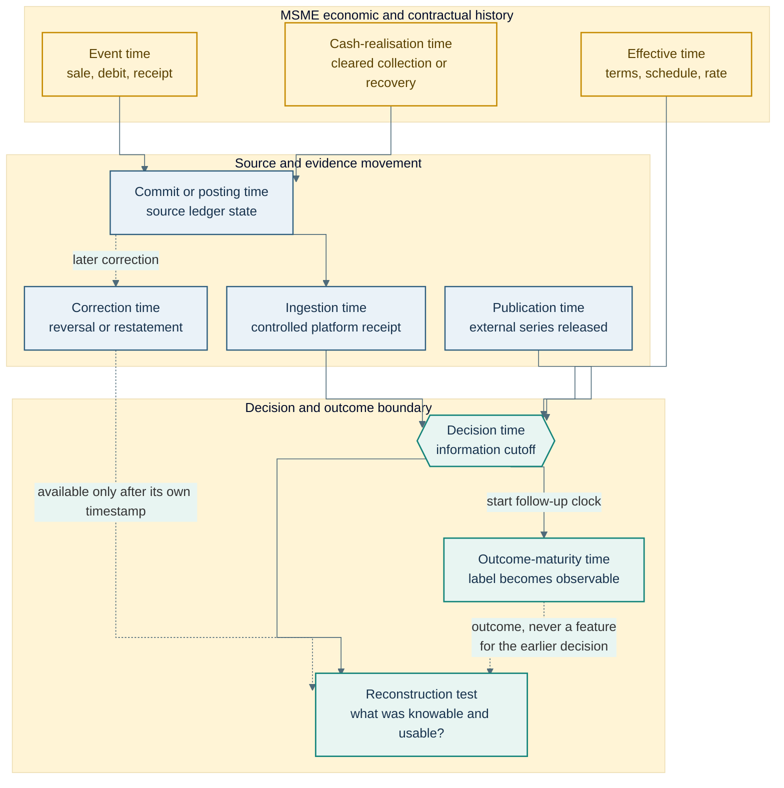
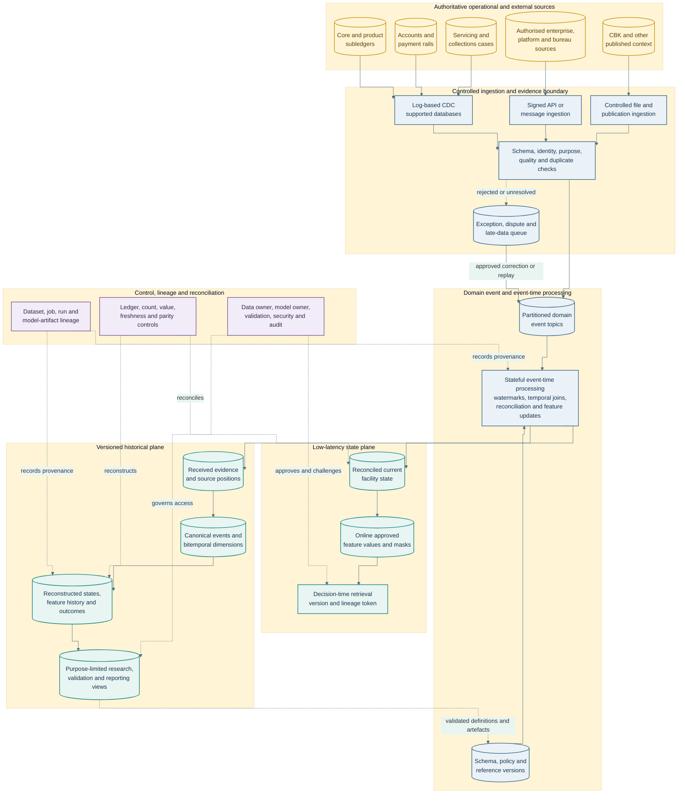
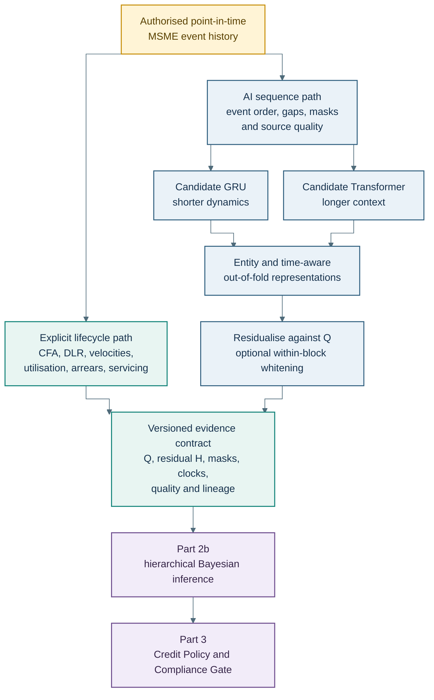

# Abstract

Part 1 followed a Kenyan MSME from an operating cash-flow mismatch into arrears, intervention, cure or loss. Part 2a asks what the lender could legitimately have known at each point in that journey. A customer receipt has an economic event time, a settlement time, a ledger-posting time and an analytical availability time. A repayment arrangement has an agreement date and an effective date. A macroeconomic observation has a reference period, publication date and possible later revision. If these clocks are collapsed, a model trained on the latest database state can learn from information that was unavailable when the historical decision was made.

This paper develops a bank-controlled temporal evidence architecture for MSME behavioural credit scoring. It separates source events from derived credit states, establishes a point-in-time feature contract, and combines a versioned historical plane with low-latency online state. Interpretable lifecycle variables retain explicit economic definitions and ownership. Artificial intelligence, where it adds validated value, learns complementary sequence representations from authorised event histories. Those representations are generated out of fold and residualised against the explicit design matrix before entering the hierarchical model developed in Part 2b.

The contribution is an evidence discipline rather than a promise that greater data volume produces better lending. Every candidate signal must have a permitted purpose, provenance, unit, window, availability time, correction rule, missingness treatment and validation path. This allows the same history to support underwriting, monitoring, intervention evaluation and collection analysis without confusing prediction with causation or present knowledge with hindsight.

## 1. A payment is not one timestamp

Return to the wholesaler from Part 1. A restaurant customer initiates a KSh180,000 payment on Monday afternoon. The wholesaler sees a confirmation and expects to use the money to meet Tuesday's loan instalment. The payment rail settles the transfer on Tuesday morning. The business account reflects cleared funds at 09:06. The lending ledger allocates the receipt at 09:13. A credit-monitoring job runs at 09:10, while the allocation is still pending. At 11:30, operations corrects an erroneous transaction reference that had prevented automatic matching.

What was the wholesaler's liquidity at 09:10? Economically, the customer had paid and the funds had cleared. Operationally, the loan system had not yet recognised the receipt. A model reading the corrected end-of-day table would see a timely payment. A model using the state actually available at 09:10 would see cleared cash in one authorised source and an unpaid instalment in another. Neither view is complete without the timestamps and reconciliation state that explain the difference.

This is the basic temporal problem of lifecycle credit. Credit administration and monitoring depend on information that remains current after origination [1]. For MSMEs, that information may include account transactions, sales settlements, invoices, inventory movements, scheduled obligations, facility utilisation, repayment allocation, servicing contacts and verified external context. The Central Bank of Kenya's 2024 MSME credit survey also identifies the importance of financing that fits enterprise cash-flow dynamics and of information capital that can broaden credit assessment [2]. Applied evidence from other markets suggests that sales, expenses, orders, invoices and platform activity can complement formal credit histories for defined micro and small enterprise populations [3]. These findings motivate investigation. They do not make every transaction accurate, lawful, stable or predictive for a Kenyan bank portfolio.

The architecture therefore begins with clocks, not model layers. Let (i) identify an entity or facility, (e) an event, and (d) a decision. A minimum temporal envelope records:

\[
\mathcal{T}_{ied} =
\left(
T_{\mathrm{event}},
T_{\mathrm{effective}},
T_{\mathrm{commit}},
T_{\mathrm{ingest}},
T_{\mathrm{publish}},
T_{\mathrm{decision}},
T_{\mathrm{correct}},
T_{\mathrm{mature}},
T_{\mathrm{cash}}
\right).
\]

These clocks describe different facts:

- **Economic event time** records when the underlying activity occurred, such as a sale, payment initiation, account debit or customer receipt.
- **Effective time** records when a contractual, policy, product or reference state begins to apply.
- **Source commit or posting time** records when the source system accepted the transaction into its own ledger or operational database.
- **Ingestion time** records when the controlled analytical platform received the source event.
- **Publication time** records when an external observation became available to users, which may be later than its economic reference period.
- **Decision time** is the governed cutoff for a particular approval, review, intervention or monitoring calculation.
- **Correction time** records when a reversal, restatement, remapping or source correction became knowable.
- **Outcome-maturity time** records when enough follow-up exists to classify an outcome such as 30-day default, durable cure or re-default.
- **Cash-realisation time** records when collection or recovery value was actually received and cleared, which may differ from the accounting recognition date.

Not every source carries all nine clocks, and a bank need not manufacture false precision. It must, however, preserve the clocks needed to answer the decision question. A repayment event may need event, settlement, posting, ingestion and correction times. A sector index may need reference period, publication time and revision vintage. A model label needs an observation window and maturity time. A recovery needs receipt, clearance, allocation, cost and reporting dates if the analysis is to distinguish nominal recovery from realised net cash.



**Figure 1: Nine clocks surrounding one MSME credit decision.** The usable information set ends at the governed decision cutoff. Corrections and matured outcomes can improve later analysis, but they cannot be inserted retrospectively into the features attributed to the earlier decision.

The qualifying rule is stricter than selecting rows whose economic timestamp precedes the decision. A feature value \(x_{ij}(T_d)\) is eligible only if its source event had become available through the authorised process, its effective interval covered the relevant observation, its feature definition was approved for that use, and any maximum-age rule remained satisfied:

\[
\mathbb{1}_{ij,d}^{\mathrm{eligible}} =
\mathbb{1}
\left\{
T_{\mathrm{event}} \leq T_d,
T_{\mathrm{available}} \leq T_d,
T_{\mathrm{effective\_from}} \leq T_d < T_{\mathrm{effective\_to}},
A_{ij}=1,
P_{ij,d}=1
\right\}.
\]

Here, \(A_{ij}\) indicates that the value remains within its approved age or time-to-live, and \(P_{ij,d}\) indicates that the source and feature are permitted for the decision purpose. For a corrected record, the reconstruction uses the version known by \(T_d\), even when a later version is more accurate. The current corrected record remains valuable for present operations and outcome analysis, while the historical version preserves an honest account of the earlier decision.

This distinction turns data lineage into economic evidence. Without it, model performance can be inflated by backfilled payments, revised macroeconomic series, post-decision collection notes, later bureau pulls or labels that have not matured consistently. With it, the bank can ask a more useful question: given the information lawfully available at that moment, what did the system infer, which action was permitted, and what happened afterwards?

## 2. The MSME event and state ledger

A useful credit history cannot be built from one wide customer table whose columns are repeatedly overwritten. That table may be convenient for today's operations, but it conceals the path by which the present balance, arrears status or limit was reached. Lifecycle analysis needs a governed event history and a separate state reconstruction. The event records what a source asserted at a time. The state is a calculation based on the events and rules available at a specified cutoff.

This distinction matters because an enterprise, a person and a facility are not interchangeable entities. One proprietor may operate several businesses. One enterprise may have several authorised representatives, accounts and facilities. A single facility may finance several invoices or drawdowns. A payment may cover principal, interest, fees and arrears across more than one obligation. A collateral item or guarantee can secure several exposures under defined priority. A contact may concern the business relationship rather than one account. The entity model should therefore preserve relationships among at least:

- the customer or authorised representative;
- the enterprise and its governed size, sector and legal-form classifications;
- the application, decision and override record;
- the facility, limit, drawdown and contractual schedule;
- the bank account, mobile-money account or approved settlement source;
- the invoice, order, sale or platform activity where access is authorised;
- the payment, allocation, reversal and reconciliation record;
- the collateral, guarantee or risk-transfer instrument;
- the servicing case, contact, promise, modification and hardship review;
- the delinquency, cure, re-default, write-off, recovery and closure outcome.

Stable pseudonymous keys can connect these entities inside an approved analytical environment without distributing direct identifiers throughout every model table. The re-identification map remains separately controlled. Pseudonymisation reduces unnecessary exposure of identity; it does not make a record non-personal when the data can still be attributed using separately held information. Kenya's Data Protection Act requires lawful and transparent processing, explicit and legitimate purposes, data minimisation, accuracy, retention limits and safeguards by design [4]. The General Regulations add practical expectations for automated individual decision-making, including meaningful information about the logic involved, error prevention, appropriate statistical procedures, measures to reduce bias, and routes for human intervention [5]. Part 3 develops the decision and customer-rights implications. Part 2a makes those obligations executable in the data design.

Every accepted source event should therefore arrive in a canonical envelope such as:

\[
e_k =
\left(
\mathrm{event\_id},
\mathrm{entity\_keys},
\mathrm{event\_type},
\mathrm{value},
\mathrm{unit},
\mathcal{T}_k,
\mathrm{source},
\mathrm{schema\_version},
\mathrm{purpose},
\mathrm{quality},
\mathrm{correction\_of}
\right).
\]

The `event_id` supports deduplication. Entity keys bind the record to the permitted analytical unit. Event type and unit prevent a KSh balance from being confused with a KSh flow or a percentage. The temporal envelope preserves the applicable clocks. Source and schema version establish provenance. Purpose records the approved use rather than relying on later inference. Quality contains validation status, reconciliation state and uncertainty. `correction_of` links a reversal or replacement to the event it changes without erasing what the platform originally received.

The received-evidence zone is append-oriented, but the word *immutable* should be used with care. Source systems can correct transactions, courts can alter enforceability, customers can dispute data, and retention rules can require restriction or deletion. The architecture preserves auditable versions and controlled corrections. It does not turn a mistaken upstream assertion into truth by writing it to durable storage.

Derived states are produced by versioned rules. If \(E_i^{\leq d}\) is the eligible event set for facility \(i\) at decision cutoff \(d\), and \(g_v\) is state rule version \(v\), then:

\[
S_{i,d}^{(v)} = g_v\!\left(E_i^{\leq d}\right).
\]

The rule may reconstruct contractual balance, amount due, payment allocation, days past due, available limit and lifecycle state. Re-running the rule after a correction produces a new state version. Re-running a later rule definition on the same historical events produces a research comparison, not a silent replacement of the state used by the original decision.

**Table 1: Proposed source, access, latency and authority matrix**

| Source domain | Candidate evidence | Access and purpose condition | Natural latency | Principal quality and correction risks | Authoritative record |
|---|---|---|---|---|---|
| Core lending and product subledger | Facility, schedule, draw, accrual, payment allocation, arrears, modification, write-off | Internal role-based access for servicing, risk, finance and approved research | Transactional to daily close | Misallocation, backdating, product-rule change, reversals | Product subledger for contractual position |
| Bank account and payment rails | Credits, debits, settlement, return, channel and reconciliation | Customer relationship, contract and other applicable lawful basis; purpose-specific fields | Seconds to settlement-cycle | Pending versus cleared cash, duplicated messages, failed or reversed transactions | Account or payment ledger for booked movement |
| Customer-supplied enterprise records | Invoices, orders, expenses, inventory and accounting extracts | Informed, documented and revocable access where applicable; relevance to stated assessment | Event, daily or periodic | Selective coverage, manual edits, invoice cancellation, inconsistent accounting | Source enterprise system for its own record, subject to verification |
| Approved platform or merchant partner | Sales, fulfilment, settlement and operating activity | Written data-sharing role, purpose, retention, security and customer transparency | Event to daily | Platform dependence, identifier changes, outages, commercial-policy shifts | Partner system for originating activity |
| Credit reference bureau | Shared facilities, enquiries and repayment history | Applicable statutory and contractual process; dispute and correction path | Pull or scheduled update | Reporting lag, identity matching, unresolved disputes | Bureau record as received, with source institution context |
| Collections and servicing case system | Contact, promise, fulfilled promise, hardship, complaint, restructure and recovery steps | Need-to-know servicing use with conduct controls | Event to daily | Free-text inconsistency, strategy-driven selection, unrecorded contact, outcome leakage | Case system for recorded action; ledger for realised cash |
| Collateral and guarantee records | Security, valuation, perfection, cover, claim and proceeds | Contractual, legal and risk-management purpose | Event to periodic | Stale valuation, disputed priority, unperfected interest, claim rejection | Relevant legal register, custodian, guarantee or claims record |
| Public Kenyan and multilateral data | Rates, inflation, exchange rates, sector and wider economic indicators | Public-source terms and documented analytical relevance | Daily, monthly, quarterly or release-driven | Revision, publication lag, series break, changed methodology | Publishing authority and retained release vintage |
| Derived feature and model stores | Approved features, masks, representations and version identifiers | Approved model purpose only | Streaming, scheduled or decision-triggered | Training-serving skew, stale state, duplicate ownership, unapproved backfill | Reconstructible analytical artefact, not the underlying legal ledger |

Authority in this table is deliberately distributed. The model feature store is authoritative for the value it served under a specific version, but it is not authoritative for the contractual loan balance. A partner platform may be authoritative for the order status it recorded, but the bank must still decide whether the record is relevant, permitted and sufficiently reliable for credit use. A servicing note records that an agent made a promise arrangement, while cleared account cash determines whether the promise was fulfilled.

The ledger also prevents behavioural scoring from becoming character scoring. A late payment is an account event whose meaning depends on schedule, cash timing, allocation and available support. A fall in sales may reflect seasonality, temporary closure, lost demand, a data outage or migration to another payment rail. A broken promise may indicate hardship, disagreement, operational failure or unwillingness. The feature architecture can measure these patterns. It should not convert them into moral attributes.

The output of this section is therefore not a maximal customer profile. It is a minimum sufficient evidence graph for a defined credit purpose. Fields without a defensible economic role, lawful basis, quality process or decision owner remain outside the feature contract. That boundary supports both model discipline and practical data minimisation.

## 3. From operational systems to a bank-controlled evidence plane

The ledger design becomes useful when it can absorb events without making the analytical platform the master of every business fact. The bank retains its core, product, payment, customer, servicing, finance and risk systems as authoritative for their assigned records. Approved partners remain responsible for the records they originate. The evidence plane carries governed copies, source metadata and transformations into two coordinated views: a low-latency state used at a decision moment, and a versioned historical view used for reconstruction, research and validation.

No single ingestion mechanism fits every source. Committed changes from supported relational product or servicing databases may be captured from database logs. Debezium's SQL Server connector, for example, takes an initial snapshot and then emits committed row-level insert, update and delete events. Its fault-tolerance documentation also notes that an outage can lead to duplicate events after restart because offsets are committed periodically [6]. That makes unique source identifiers, log positions, idempotent writes and reconciliation essential. A payment switch or mobile-money integration may already publish native messages. An invoice platform may expose an API. A guarantee administrator may provide a controlled file. Public statistics arrive through websites, APIs or scheduled publications. Treating all of these as CDC would obscure their different failure and correction modes.

After validation at the boundary, events can be published to domain topics such as `facility-events`, `payment-events`, `servicing-events`, `enterprise-activity-events` and `external-context-events`. Apache Kafka provides a practical event-streaming backbone. Records with the same key can be assigned to the same topic partition, and ordering is guaranteed within a topic partition rather than across the entire topic [7]. The architecture should therefore choose stable keys at the level whose order matters. A facility key is appropriate for contractual state; an account key is appropriate for booked cash; an enterprise key may be needed for consolidated authorised activity. Cross-key relationships are reconciled by explicit event and allocation identifiers rather than an assumed global sequence.

A stateful processor such as Apache Flink then validates schemas, deduplicates events, applies event-time windows, maintains eligible state and routes exceptions. Event time describes when an event occurred, while processing time describes when the processing operation ran. Flink uses watermarks to represent progress through event time in the presence of out-of-order records [8]. A watermark is therefore a policy about tolerated lateness, not proof that no earlier event will arrive. The bank should set it by source and use case. A five-minute payment watermark and a one-day invoice watermark may both be reasonable, while a monthly macro series needs a publication schedule rather than a second-by-second stream.

Temporal reference joins require equal discipline. Flink supports event-time temporal joins against versioned tables, but their semantics depend on time attributes, keys, connectors and late-record behaviour [9]. A sector classification, repayment schedule or product rule joined to an event should be the version effective and available at that event or decision cutoff. Late records outside an approved watermark are not silently discarded from the evidence history. They move to a correction or reconciliation path, after which current state may change and the original decision snapshot remains preserved.

The historical plane stores received source events, cleaned canonical events and approved analytical outputs at different levels. Delta Lake provides ACID table transactions, schema enforcement, batch and streaming support, and access to historical table versions [10]. Its change data feed can expose inserts, updates, delete images, commit versions and commit timestamps after the feed has been enabled, subject to retention constraints [11]. These capabilities support reproducible processing, but they do not recover evidence that was never retained. The bank must align transaction-log retention, change-feed retention, model-validation horizons, dispute requirements and legal retention policy before relying on time travel for a long historical study.

The proposed layers have precise roles:

- **Received evidence** retains source payload, source position, schema, timestamps, access basis and validation status.
- **Canonical events** standardise identifiers, units, time zones, event types and correction links without losing source lineage.
- **Reconciled states** apply approved contractual and business rules to produce balances, schedules, arrears and lifecycle states.
- **Feature history** stores versioned explicit variables, masks and approved AI representations exactly as generated.
- **Research and reporting views** apply population, maturity, disclosure and purpose controls to defined analyses.

The labels Bronze, Silver and Gold may be used operationally, but colour does not establish evidential authority. A Gold feature remains derived. The product subledger remains authoritative for the contractual balance; the bank account ledger remains authoritative for booked cash; the retained release remains authoritative for what an external publisher reported at that time.



**Figure 2: Proposed bank-controlled temporal evidence plane.** Authoritative systems keep their assigned responsibilities. The streaming plane supports current state, while the historical plane preserves reconstructible evidence. The control plane links both through lineage, reconciliation and approved versions.

Lineage must connect more than tables. OpenLineage models jobs, their runs, and input and output datasets, with extensible facets for such matters as schema, versions and data quality [12]. A lender can extend that vocabulary to record the source positions, transformation code, configuration, feature definition, model artefact, decision purpose and approval package associated with a scoring event. This permits an independent reviewer to trace a served variable back to the canonical events and source versions from which it was calculated.

The online plane stores only what the decision service needs at low latency: the latest eligible feature values, their as-of times, masks, definition version and lineage token. A feature-store implementation such as Feast separates historical retrieval from online serving. Its point-in-time join scans backward from each entity timestamp within a feature view's time-to-live, while its online store is designed to serve recent feature values rather than preserve the full history [13]. The design lesson is broader than one product: historical reconstruction cannot be delegated to a latest-value cache, and low-latency serving should not depend on scanning the full analytical history.

Online and offline calculations must implement the same approved economic definitions. Equivalence is demonstrated by replaying sampled decision events through both paths and comparing feature values, timestamps, missingness masks and versions within stated tolerances. A shared feature name is insufficient. Differences in window closure, late-event handling, rounding, time zone, reference-table version or zero-denominator rules can create training-serving skew even when both systems appear correct in isolation.

This architecture also creates a practical research boundary. A participating bank can keep customer-level source data inside its controlled environment, expose purpose-limited analytical views to approved code, and release only disclosure-checked results. Synthetic data can test pipelines and experimental logic before any protected data are used. Part 4 develops the secure research and integration pattern. Part 2a remains concerned with the prerequisite: the historical and online evidence must describe the same decision world.

## 4. Reconstruct the state the decision could actually see

Historical model development often begins with a table of accounts and a request to “join the latest information before each observation date.” That instruction is incomplete. The latest effective value may not have been published, received or approved when the decision occurred. A transaction posted before the cutoff may later be reversed. A customer classification may be corrected retrospectively. A servicing note may describe an event that occurred earlier but was recorded after an intervention. The reconstruction must therefore represent both the world being described and the lender's knowledge of that world.

A bitemporal record gives each version two intervals. Its **valid interval** records when the value applies to the underlying economic, contractual or operational state. Its **knowledge interval** records when that version was available within the controlled system:

\[
b_k =
\left(
i_k,
x_k,
[T_{k}^{\mathrm{valid\_from}},T_{k}^{\mathrm{valid\_to}}),
[T_{k}^{\mathrm{known\_from}},T_{k}^{\mathrm{known\_to}}),
v_k
\right).
\]

For a decision at \(T_d\) concerning an observation at \(T_o\leq T_d\), the eligible version is the one whose valid interval contains \(T_o\) and whose knowledge interval contains \(T_d\). If several records still qualify, the deterministic source sequence and correction order resolve the version. This is different from loading today's most accurate value and assigning it to yesterday.

Consider a monthly sector indicator for July. July is its reference period. It is published on 20 August, ingested on 21 August, and revised on 15 October. A limit review on 10 August cannot use the value at all. A review on 1 September may use the original release. A backtest of that September review must not use the October revision, although a present-day economic analysis may prefer the revised series. Both versions have legitimate uses, so both need labels that reveal their vintage.

The same logic applies to internal data. Suppose a KSh40,000 payment clears before a 10:00 review but is allocated to the facility at 10:07. If the approved feature definition uses cleared account cash and the account event was available by 09:59, the liquidity feature may include it while the contractual arrears state remains unchanged. If the bank's approved process recognises only allocated loan payments, neither repayment velocity nor arrears cure should include it at 10:00. The correct answer comes from the feature contract, not from whichever database updated first.

A vendor-neutral point-in-time retrieval can be expressed as follows:

```sql
SELECT
    d.facility_key,
    d.decision_time,
    f.feature_name,
    f.feature_value,
    f.unit,
    f.event_time,
    f.known_from,
    f.definition_version
FROM decision_events AS d
LEFT JOIN feature_history AS f
  ON f.facility_key = d.facility_key
 AND f.event_time <= d.decision_time
 AND f.known_from <= d.decision_time
 AND d.decision_time < COALESCE(f.known_to, TIMESTAMP '9999-12-31 00:00:00')
 AND f.definition_version = d.approved_feature_set_version
QUALIFY ROW_NUMBER() OVER (
    PARTITION BY d.decision_id, f.feature_name
    ORDER BY f.event_time DESC, f.source_sequence DESC
) = 1;
```

The syntax must be adapted to the selected engine. Its control logic is the important part. Each training row begins with a decision event and retrieves feature versions known by that decision time. The query records the source event time, knowledge time and definition version returned. A time-to-live rule is added where an old observation should expire. A purpose and permission filter is applied before retrieval, not after the training set has been exported.

Table versions and temporal feature joins solve related but different problems. A query such as `VERSION AS OF` or `TIMESTAMP AS OF` selects a historical table snapshot. Inside that snapshot, the training builder must still select the appropriate event for each entity and decision time. Conversely, a feature-store point-in-time join can select the last eligible event timestamp but cannot reproduce a correction history that the offline source did not retain. A defensible process tests both the snapshot and the row-level join.

Leakage controls should address at least the following cases:

| Leakage path | How it enters | Required control |
|---|---|---|
| Later payment or allocation | Current account table overwrites the pre-decision balance | Event history plus decision-time reconstruction |
| Revised macroeconomic value | Latest published series replaces the original release | Release-vintage table with publication and ingestion time |
| Post-decision servicing note | Narrative records contain later knowledge of hardship or default | Note creation time, event assertion time and restricted text window |
| Unmatured negative label | Recent accounts with insufficient follow-up are treated as performing | Outcome-maturity rule and censoring flag |
| Policy-version leakage | Today's eligibility or arrears rule is applied to an earlier production decision | Retain production rule version; run restatement as a separate analysis |
| Entity leakage across folds | Facilities from one enterprise appear in both training and validation | Split by enterprise or connected group before feature fitting |
| Intervention leakage | Action or response after scoring becomes a predictor of the preceding score | Define time zero and censor features at assignment or decision |
| Correction leakage | A later dispute resolution is inserted into the original record | Bitemporal knowledge interval and versioned correction link |

Labels require the same discipline as features. If \(Y_{i,d}^{(h)}\) denotes default within horizon \(h\) after decision \(d\), the label is observable only after the earlier of the full horizon or a qualifying terminal event under the approved definition. An account with 20 days of follow-up cannot be assigned a clean 90-day non-default label. It is immature or censored. Cure, durable cure, re-default and recovery each need a time origin, window and cash convention. Part 2b will model selected outcomes, and Part 6 will define intervention estimands, but their credibility begins with this maturity record.

Reconstruction tests should use deliberately difficult examples rather than random rows alone. The suite should include a late payment, a reversed receipt, a schedule modification, a backdated correction, a changed customer-enterprise link, a daylight-saving or time-zone boundary where relevant, an external release followed by revision, a feature at its exact expiry time, and two events sharing a timestamp. For each example, reviewers should be able to state the expected value before executing the query.

The resulting training row is a documented information set, not merely a vector. It identifies the entity, decision, feature values, masks, source vintages, definition versions and outcome-maturity status. That record allows the bank to distinguish a model error from a stale source, a late event, a policy change or a reconstruction defect. It also gives the next section a reliable base on which to define explicit lifecycle features.

## 5. Explicit lifecycle features with economic meaning

Behavioural scoring becomes credible when each variable describes an observable part of enterprise cash generation, contractual obligation or payment response. The model should not begin with thousands of convenient aggregations and search for a story afterwards. It should begin with an economic question, define the event population and clock, and then test whether the resulting measure is stable and incrementally useful.

Let \(C_{i,d}^{+}\) be eligible cleared inflows for enterprise \(i\) on day \(d\), \(C_{i,d}^{-}\) eligible outflows, and \(N_{i,d}=C_{i,d}^{+}-C_{i,d}^{-}\) net observed cash flow. Eligibility excludes internal transfers and recognised reversals and applies documented treatment to financing inflows, taxes, payroll, owner drawings and protected funds. Coverage across payment rails is recorded, since an observed account may represent only part of the business.

Over a trailing window (w), cash-flow velocities are:

\[
V_{i,t}^{+,w}=\frac{\sum_{d=t-w+1}^{t}C_{i,d}^{+}}{n_{i,t}^{w}},
\qquad
V_{i,t}^{-,w}=\frac{\sum_{d=t-w+1}^{t}C_{i,d}^{-}}{n_{i,t}^{w}},
\]

where \(n_{i,t}^{w}\) is the number of covered calendar or business days specified by the feature. The unit is KSh per day. A seven-day decline relative to a preceding 90-day baseline can define **inflow velocity**:

\[
\nu_{i,t}^{\mathrm{in}}=
\frac{V_{i,t}^{+,7}}
{V_{i,t-7}^{+,90}+\varepsilon}.
\]

A value below one states that recent observed inflows are below the earlier daily average. It does not state why, whether the enterprise is insolvent, or whether the decline will persist.

**Cash-flow asymmetry** describes the shape of daily net cash around its median. One transparent candidate is:

\[
\mathrm{CFA}_{i,t}^{w}=
\frac{Q_{0.50}(N_{i}^{w})-Q_{0.10}(N_{i}^{w})}
{Q_{0.90}(N_{i}^{w})-Q_{0.50}(N_{i}^{w})+\varepsilon}.
\]

It is dimensionless. Values above one indicate that the lower-tail span is larger than the upper-tail span in the observed window. Minimum coverage, treatment of zero-activity days and clipping are fixed before estimation. Seasonal restocking can produce legitimate downside concentration, so the feature's relationship with later repayment must be learned by product, sector and time.

Liquidity measures must match the horizon of the obligations. Let \(D_i^{\mathrm{due}}(t,t+h)\) be contractual principal, interest and governed charges due over horizon \(h\). Let \(L_i^{\mathrm{available}}(t)\) contain cleared unrestricted cash plus eligible confirmed settlements after approved haircuts, less protected or unavailable balances. The **dynamic debt-to-liquidity ratio** is:

\[
\mathrm{DLR}_{i,t}^{h}=
\frac{D_i^{\mathrm{due}}(t,t+h)}
{L_i^{\mathrm{available}}(t)+\varepsilon}.
\]

Unconfirmed invoices do not become cash merely because they have been issued. Where validated invoice or order evidence is used, its amount, obligor, dispute state, expected settlement and haircut remain visible. A complementary **buffer-days** measure divides available liquidity by a robust estimate of essential daily outflow. Both measures report capacity at a stated horizon rather than mixing total debt with one day's receipts.

Repayment features use realised allocations:

\[
v_{i,t}^{\mathrm{repay},h}=
\frac{P_i^{\mathrm{eligible\ paid}}(t-h,t)}
{P_i^{\mathrm{scheduled}}(t-h,t)+\varepsilon}.
\]

The registry states whether the numerator includes principal only or all scheduled debt service, how prepayment and modification are treated, and how reversals change the value. A period with no scheduled payment is not a zero repayment. It is not applicable. Revolving products also require utilisation \(U_{i,t}=B_{i,t}^{\mathrm{drawn}}/L_{i,t}^{\mathrm{approved}}\), headroom, days near limit, drawdown velocity and repayment after draw. A rising utilisation path has a different meaning from stable working-capital use at the same ending ratio.

Lifecycle features then describe transitions rather than only levels: days since full payment, episodes of early arrears, movement between arrears bands, time since modification, cure duration, re-default history and cleared recovery after default. Servicing features can include contact attempts, successful contacts, promises, fulfilled promises, hardship reviews and completed arrangements. They require particular care because policy selects who receives an action. A promise-kept ratio can be prognostic after a promise exists, but it cannot be used as though every account had an equal chance to make one.

**Table 2: Minimum governed feature contract**

| Field | Required content | Example |
|---|---|---|
| Name and economic question | Stable label and the mechanism being tested | `repayment_velocity_30d`: has recent realised payment kept pace with scheduled debt service? |
| Entity and source | Facility, enterprise or account key; originating systems | Facility allocations plus contractual schedule |
| Formula and unit | Numerator, denominator, exclusions and scale | Eligible KSh paid divided by KSh due; dimensionless |
| Observation window | Start, end, calendar, timezone and closure rule | Trailing 30 calendar days ending strictly before decision time |
| Availability and expiry | Timestamp used, lag and time-to-live | Latest reconciled allocation known by cutoff; expires after approved age |
| Missingness | Zero, not applicable, unavailable, insufficient history and disputed | No scheduled amount produces an N/A mask, not zero |
| Transformation | Winsorisation, scaling, knot support and out-of-range handling | Raw audit value retained; modelling copy clipped at trained bounds |
| Ownership and version | Named calculation owner and immutable definition identifier | Credit data product, version `2.1.0` |
| Permitted purpose | Decisions and analyses for which use is approved | Monitoring and shadow intervention model only |
| Validation | Reconciliation, stability, fairness and outcome tests | Monthly parity, coverage and sector drift tests |

The Explicit Lifecycle Feature Path owns these named metrics. Raw transaction and repayment events may also enter an AI sequence branch, but CFA, DLR, inflow velocity, repayment velocity, utilisation and buffer days do not reappear there as separately engineered inputs. Pre-specified interactions can be added where their economic mechanism is clear, such as utilisation pressure with prior delinquency, or a sector downturn with dependence on one buyer. Strong heredity requires the associated main effects to remain in the design.

Part 2b will determine how continuous variables enter the HLR. The main specification uses governed P-splines so that nonlinear relationships can be learned without turning every candidate threshold into a policy rule. The present task is prior to inference: retain the raw audit value, define the supported range, specify units and windows, and ensure that a ratio does not conceal an unstable denominator. Once this contract is fixed, model flexibility can increase without sacrificing meaning.

## 6. What artificial intelligence adds after behavioural scoring is established

Artificial intelligence enters this architecture for a specific purpose: to test whether the order, duration and interaction of authorised events contain useful information beyond the explicit lifecycle variables. A GRU is a candidate recurrent encoder for shorter ordered histories [14]. A Transformer is a candidate attention-based encoder for longer or more heterogeneous sequences [15]. Their original research settings are not evidence that either will improve MSME credit decisions. Sequence length, sample size, latency, stability and out-of-time performance determine whether a simpler aggregation, GRU, Transformer or no neural branch is appropriate.

The AI input is a sequence of minimally transformed events, with event type, signed amount or scaled magnitude, time gap, channel, source-quality flag and masks. It does not receive separate engineered copies of CFA, DLR, repayment velocity or other explicit features. Each encoder produces a fixed-dimensional representation \(H_i\), which is frozen before the HLR is fitted.

Representations are generated out of fold. For fold \(k\), the encoder \(f^{(-k)}\) is trained without the enterprises and outcomes assigned to that fold, then applied to its records:

\[
H_i^{\mathrm{oof}}=f^{(-k(i))}(X_i),
\qquad i\in k.
\]

Folds respect enterprise or connected-group identity and time. Randomly splitting rows from the same enterprise would allow repeated history to cross the boundary. Cross-fitting is adapted here as a sample-separation discipline [16]. The manuscript does not invoke the causal guarantees of double machine learning, which additionally require an appropriate orthogonal score and identification assumptions.

The out-of-fold representation is then projected on the explicit design matrix \(Q\) using training-fold weights and regularisation. The residual block is:

\[
\widetilde H_i=H_i^{\mathrm{oof}}-Q_i\widehat B^{(-k(i))}.
\]

This reduces linear redundancy between learned and explicit evidence. Optional whitening can improve conditioning within \(\widetilde H\), with the transformation fitted on training folds and frozen for validation and production. Residualisation does not establish statistical independence, eliminate nonlinear overlap, correct confounding or turn the representation into a causal variable. Part 2b applies regularised horseshoe shrinkage so unsupported residual dimensions can contribute little.



**Figure 3: Explicit-feature and residual-AI evidence paths.** The AI branch is complementary and contestable. Both branches use point-in-time events, but named engineered metrics have one owner and the residual representation reaches inference only through a versioned contract.

Approval depends on incremental value. The comparison begins with contractual, bureau and explicit lifecycle baselines, then adds the residual AI block. Evaluation includes out-of-time discrimination, calibration, expected-loss-weighted performance, stability, subgroup behaviour, missingness sensitivity and operational cost. If the AI branch does not improve the approved decision objective reliably, the explicit model remains the production architecture.

## 7. Macroeconomic context moves on another clock

An enterprise can maintain the same internal behaviour while its operating environment changes. Interest rates affect financing cost and demand. Inflation changes input prices and household purchasing power. Exchange-rate movements affect imported stock. Sector conditions, regulated fuel prices, rainfall and public-payment cycles may alter cash conversion for particular businesses. These variables enter only when the economic mechanism, geography, sector mapping and validation plan are stated.

Kenyan context should begin with Kenyan authorities. CBK's *Monthly Economic Indicators* provide a release-driven set of monetary, banking and economic tables [17]. KESONIA offers a particularly clear clock example: CBK publishes the benchmark each business day for the preceding business day [18]. The observation date and publication date are therefore different. World Bank indicator APIs can provide complementary international and long-horizon series with metadata [19], while IMF datasets are accessible through SDMX interfaces [20]. Their availability does not make dissimilar frequencies, definitions or revisions directly comparable.

Each retained macro observation has the form:

\[
M_{j,\tau}^{(v)}=
\left(m_{j,\tau}^{(v)},\ T_{\mathrm{reference}},\ T_{\mathrm{publish}},\ T_{\mathrm{ingest}},\ v,\ q\right),
\]

where (j) identifies the series, (	au) its reference period, (v) the release vintage and (q) a quality or status flag. A decision uses the latest permitted vintage published and ingested by its cutoff. Later revisions support restated analysis, while the original vintage preserves the production information set.

Daily, monthly and quarterly context should not be duplicated across every transaction as though it were high-frequency borrower behaviour. It can be represented through lagged levels, changes, rolling states, release masks and sector interactions aligned to the decision clock. The model must also test whether a context feature adds information beyond cohort and calendar effects. Part 5 will use KESONIA for pricing and funding. Here it remains an example of how an economically important observation acquires a usable timestamp.

## 8. Missingness, quality and lineage are model inputs

A zero-value transaction, a day without observed activity and a missing record are different states. Missingness may mean that the enterprise did not trade, used another payment rail, withheld permission, joined recently, experienced a system outage, submitted an unreadable file, or had a delayed source posting. The feature contract records these reasons separately. No-activity evidence can enter a model only when coverage is sufficient to support that interpretation.

Fallback proceeds by approved levels. The service first uses a fresh reconciled value. It may then use a still-valid older value with an age mask, a reduced feature set, or a conservative manual review route. A stale, disputed or structurally incomplete source can suspend the affected feature or model branch. Unavailability alone does not justify assigning the borrower a worse behavioural value.

Quality controls operate at several layers:

- schema, type, unit, timezone and identifier tests at ingestion;
- duplicate, sequence, watermark and late-event tests in the stream;
- opening-to-closing balance and payment-allocation reconciliation;
- coverage, freshness, missingness-reason and correction-rate monitoring;
- online-to-offline parity using sampled decision events;
- distribution, population and outcome drift by product, sector, institution and time;
- feature-owner approval for definition changes;
- model-validation review of transformations, exclusions and subgroup effects.

Exclusions are reported by both account count and exposure value. A test that drops many low-value micro-enterprises can appear small by balance while materially changing inclusion. Conversely, a few missing large facilities can dominate value-based results.

Lineage binds each output to the source datasets, transformation job, run, code version, configuration, feature definition and model artefact used. A correction does not erase the earlier run. It creates a linked version and a defined response: no action, current-state repair, decision review, outcome restatement or model revalidation. This allows operational error, source error and model error to be investigated separately.

## 9. The serving contract passed to Part 2b

At decision time (d), Part 2a delivers one versioned evidence object:

\[
\mathcal{F}_{i,d}=
\left(Q_{i,d},\widetilde H_{i,d},M_{i,d},\mathcal{T}_{i,d},V_{i,d},L_{i,d}\right),
\]

where \(Q\) is the explicit design row, \(\widetilde H\) the residual AI representation when approved, \(M\) the availability and quality masks, \(\mathcal{T}\) the relevant clocks, \(V\) the feature and representation versions, and \(L\) the lineage token. The object also records the entity, product, decision purpose and operating mode.

Training mode reconstructs mature historical rows. Shadow mode scores current rows without changing customer treatment. Production mode serves only approved artefacts and permitted actions. Backfill mode repairs history under a separate run identity and never masquerades as the original production state.

Before release, sampled events must produce equivalent feature values across historical and online paths within approved tolerances. The test compares values, masks, timestamps and versions, not only final scores. A missing critical source, incompatible schema, expired feature set or unresolved identity conflict invokes the documented fallback rather than an improvised value.

Part 2b consumes this object and estimates posterior risk and uncertainty. It may apply governed P-spline bases, hierarchical pooling and shrinkage, but it does not redefine source events or repair their clocks. Part 3 then applies law, contract, conduct, risk appetite and operational constraints through the Credit Policy and Compliance Gate. Keeping these interfaces separate allows an evidence defect, inference result and policy decision to be challenged on their own terms.

## Conclusion

The wholesaler's Monday receipt becomes useful credit evidence only when the lender can distinguish economic occurrence, settlement, posting, availability, correction and decision time. That discipline turns fragmented transactions into a reproducible lifecycle history without confusing data volume with knowledge. Explicit features preserve financial meaning; residual AI representations may add tested sequence information; lineage preserves the path between them. Part 2b now receives an evidence object whose contents, clocks, ownership and limitations are already defined, allowing hierarchical inference to concentrate on uncertainty and pooling rather than repair hidden temporal defects or leakage.

\newpage

## References

[1] Basel Committee on Banking Supervision, *Principles for the Management of Credit Risk*. Basel, Switzerland: Bank for International Settlements, Apr. 2025. [Online]. Available: https://www.bis.org/publications/202504-guidelines-principles-management-credit-risk. [Accessed: Sep. 6, 2026].

[2] Central Bank of Kenya, *2024 Survey Report on MSME Access to Bank Credit*. Nairobi, Kenya: CBK, 2025. [Online]. Available: https://www.centralbank.go.ke/uploads/banking_sector_reports/1809756600_2024%20Survey%20Report%20on%20MSME%20Access%20to%20Bank%20Credit.pdf. [Accessed: Sep. 6, 2026].

[3] D. Caire and M. Fernandez Vidal, *Leveraging Transactional Data for Micro and Small Enterprise Lending*. Washington, DC, USA: CGAP, Mar. 2024. [Online]. Available: https://www.cgap.org/sites/default/files/publications/Leveraging%20Transactional%20Data.pdf. [Accessed: Sep. 6, 2026].

[4] Republic of Kenya, *Data Protection Act*, No. 24 of 2019. [Online]. Available: https://new.kenyalaw.org/akn/ke/act/2019/24/eng%402019-11-15. [Accessed: Sep. 6, 2026].

[5] Republic of Kenya, *Data Protection (General) Regulations*, Legal Notice No. 263 of 2021, rev. Dec. 31, 2022. [Online]. Available: https://new.kenyalaw.org/akn/ke/act/ln/2021/263/eng%402022-12-31. [Accessed: Sep. 6, 2026].

[6] Debezium, “Debezium connector for SQL Server,” *Debezium Documentation*. [Online]. Available: https://debezium.io/documentation/reference/connectors/sqlserver.html. [Accessed: Sep. 6, 2026].

[7] Apache Software Foundation, “Introduction,” *Apache Kafka Documentation*. [Online]. Available: https://kafka.apache.org/documentation/. [Accessed: Sep. 6, 2026].

[8] Apache Software Foundation, “Streaming analytics,” *Apache Flink Documentation*. [Online]. Available: https://nightlies.apache.org/flink/flink-docs-stable/docs/learn-flink/streaming_analytics/. [Accessed: Sep. 6, 2026].

[9] Apache Software Foundation, “Joins,” *Apache Flink Table API and SQL Documentation*. [Online]. Available: https://nightlies.apache.org/flink/flink-docs-master/docs/sql/reference/queries/joins/. [Accessed: Sep. 6, 2026].

[10] Delta Lake Project, “Welcome to the Delta Lake documentation,” *Delta Lake Documentation*. [Online]. Available: https://docs.delta.io/. [Accessed: Sep. 6, 2026].

[11] Delta Lake Project, “Change data feed,” *Delta Lake Documentation*. [Online]. Available: https://docs.delta.io/delta-change-data-feed/. [Accessed: Sep. 6, 2026].

[12] OpenLineage, “Object model,” *OpenLineage Documentation*. [Online]. Available: https://openlineage.io/docs/spec/object-model/. [Accessed: Sep. 6, 2026].

[13] Feast, “Point-in-time joins,” *Feast Documentation*. [Online]. Available: https://docs.feast.dev/getting-started/concepts/point-in-time-joins. [Accessed: Sep. 6, 2026].

[14] K. Cho, B. van Merrienboer, C. Gulcehre, D. Bahdanau, F. Bougares, H. Schwenk and Y. Bengio, “Learning phrase representations using RNN encoder-decoder for statistical machine translation,” in *Proc. 2014 Conf. Empirical Methods in Natural Language Processing*, Doha, Qatar, 2014, pp. 1724-1734, doi: 10.3115/v1/D14-1179.

[15] A. Vaswani *et al*., “Attention is all you need,” in *Advances in Neural Information Processing Systems 30*, Long Beach, CA, USA, 2017, pp. 5998-6008. [Online]. Available: https://papers.nips.cc/paper/7181-attention-is-all-you-need. [Accessed: Sep. 6, 2026].

[16] V. Chernozhukov, D. Chetverikov, M. Demirer, E. Duflo, C. Hansen, W. Newey and J. Robins, “Double/debiased machine learning for treatment and structural parameters,” *The Econometrics Journal*, vol. 21, no. 1, pp. C1-C68, Feb. 2018, doi: 10.1111/ectj.12097.

[17] Central Bank of Kenya, “Monthly Economic Indicators.” [Online]. Available: https://www.centralbank.go.ke/monthly-economic-indicators/. [Accessed: Sep. 6, 2026].

[18] Central Bank of Kenya, “KESONIA Interest Rate Benchmark.” [Online]. Available: https://www.centralbank.go.ke/kesonia/. [Accessed: Sep. 6, 2026].

[19] World Bank, “About the Indicators API documentation,” *World Bank Data Help Desk*. [Online]. Available: https://datahelpdesk.worldbank.org/knowledgebase/articles/889392. [Accessed: Sep. 6, 2026].

[20] International Monetary Fund, “IMF Data APIs.” [Online]. Available: https://data.imf.org/en/Resource-Pages/IMF-API. [Accessed: Sep. 6, 2026].
