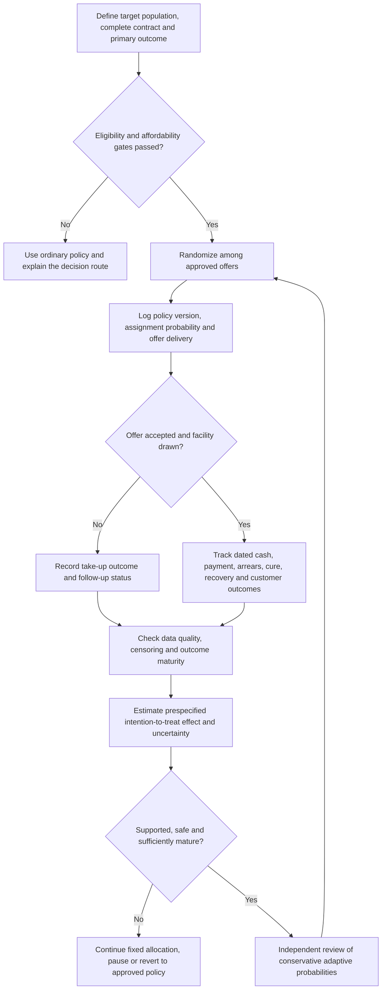

# Testing Credit Offers for Collectability

## From randomized trials to contextual bandits in sustainable MSME lending

**Underwrite for Collection · LinkedIn research article · 8 October 2026**

### Abstract

Credit pricing decisions influence who takes up a loan, how much cash the business must generate, and whether repayment can remain sustainable after disbursement. This makes experimentation in credit different from optimizing clicks or short-term conversions. A randomized controlled trial (RCT) can estimate the effect of specified offers for an eligible population; a contextual bandit can adapt allocation among those offers as evidence accumulates. This article develops a cautious progression from fixed randomization to response-adaptive allocation, explains context, actions, reward and policy, and sets out the assumptions behind Linear UCB, logistic Thompson sampling, inverse-propensity scoring and doubly robust evaluation. It also addresses delayed repayment outcomes, adverse selection, fairness, selective labels and the legal controls relevant to Kenyan credit. The practical aim is to learn which permitted offer supports durable repayment, not to maximize nominal yield in isolation.

### Research questions

1. Among eligible Kenyan MSME applicants, what is the effect of a cash-flow-aligned credit offer on take-up, durable repayment, net realized cash and borrower outcomes compared with a defined standard offer?
2. When does response-adaptive contextual allocation improve offer learning enough to justify its loss of fixed-allocation simplicity, given delayed outcomes, changing cohorts and limited overlap?
3. What experimental, data-protection, fairness and human-review safeguards are needed before contextual bandits can inform credit offers or later collection actions in the *Underwrite for Collection* lifecycle?

### The question starts with a repayment pathway

The *Underwrite for Collection* work began with a practical concern: a credit decision is not complete when funds are disbursed. The loan must fit the borrower’s actual cash generation and the lender must be able to monitor whether that repayment source remains available. For an operating MSME, cash is shaped by sales, working capital, suppliers, seasonality, tax, owner withdrawals and existing obligations. For a ring-fenced receivables stream, repayment depends on eligible invoices, obligor performance, dilution, assignment, account control, servicing continuity, collection timing and the waterfall. A price that appears profitable on a spreadsheet can be uncollectable if its instalment profile conflicts with cash conversion or if the underlying receivable is disputed. Credit experimentation should therefore evaluate the offer as a whole and follow the cash journey after the decision. Financing ring-fenced receivables is the general proposition used throughout this series. In the worked examples that use a special-purpose vehicle (SPV), the vehicle is the chosen structure for holding the receivables and allocating their collections. The underwriting evidence follows the receivables, collection controls and contractual payment priorities of that structure.

An RCT and a contextual bandit are related, but they answer questions differently. A prespecified RCT assigns among allowed offers according to a fixed design so that effects can be estimated with a clear comparison. The allocation need not be uniform: it can be stratified by risk or product, or use unequal probabilities established in the protocol. A contextual bandit also uses randomized assignment, but it updates allocation as outcomes arrive, often assigning more frequently to actions that appear to perform well for particular contexts. That adaptation can improve learning efficiency or participant outcomes under some designs, yet it changes the data-generating process and complicates inference. The decision to adapt should follow a demonstrated need, a credible reward signal and an analysis plan capable of accounting for changing probabilities [1], [2].

In credit, the action is not an abstract “arm.” It is a specified offer: principal or limit, annual percentage rate and fees, term, instalment frequency, grace period, collateral or guarantee conditions, eligibility requirements and servicing conditions. If a loan is fixed-rate, the price is ordinarily set at origination under the contract; the lender cannot treat the rate as a free monthly control variable after disbursement. A revolving facility or renewal may have permitted repricing mechanics, but those must be stated in the contract and policy. Collection actions such as reminders, support referrals or an agreed payment-date adjustment are a separate post-disbursement action set. The bandit methods can inform both settings, but the experimental population, rights, rewards and authority differ. Clear action definitions prevent a pricing experiment from silently becoming a collection intervention.

### Four elements of a contextual bandit

At decision time **t**, the contextual bandit observes a feature vector **Xₜ**, selects action **Aₜ** from an approved set, and later observes a reward **Rₜ**. A policy **π(a|x)** maps context to an action probability. In a credit offer setting, **Xₜ** can include only information available and permitted at that time: verified income or business cash-flow features, debt obligations, product type, season, application channel and economic conditions. It should also capture data quality and uncertainty so the policy can decline to automate or route a case for review. The action set might include a small number of independently approved schedules and rates, not arbitrary price values. The observed reward arrives after the offer, take-up, disbursement and subsequent repayment path, so it is neither immediate nor always fully observed.

The reward should reflect the decision objective and the time period. For a complete one-period loan, with financing expense recorded explicitly, a realised cash contribution can be written:

R = cash received − initial advance − funding cost − servicing cost

Cash received includes actual principal, interest, fees and recoveries. A missed receipt has already reduced that amount, so the same shortfall is counted once. A real credit offer generates dated cash flows, and an asset-level present-value convention can instead handle funding through its declared discount curve:

V(a,x)=E[−P₀(a)+∑ₜ₌₁ᵀ dₜ(Qₜ(a)−OPEXₜ(a)) | X=x]

Here **P₀** is the initial advance, **Qₜ** is actual borrower and recovery cash, **OPEXₜ** is attributable operating cost, and **dₜ** is the chosen discount factor. This convention keeps an additional funding charge out of the same present-value calculation. A contractual-receipts formulation deducts the discounted cash shortfall instead; the appendix derives the reconciliation between the two presentations. The calculation should account for take-up, prepayment, delinquency, cure, recovery timing, funding and capital conventions, with the horizon extended to include the relevant recovery cash or an explicitly valued terminal position. It should report affordability, complaints and other borrower outcomes beside financial value. A scalar reward may support optimization, but its weights must be explicit; legal rights and safety limits remain constraints outside that scalar.

This formulation explains why a simple “interest earned × probability of repayment minus principal × probability of default” can mislead. Interest is earned over time and depends on payment timing and balance; principal repayment is not a loss event; recovery can occur after default; prepayment changes exposure; and operating, funding and capital costs matter. A model may estimate probability of default, while the offer policy also needs take-up, utilization, loss given default, exposure at default and cash-flow timing. Expected credit loss under IFRS 9 is a probability-weighted discounted cash shortfall and should not be confused with a pricing reward or economic capital [3]. The research protocol should preserve outcome components, then document any approved aggregation rule so reviewers can see whether a nominal margin gain was achieved through higher loss, lower take-up, borrower strain or selection of a different cohort.

### What the experiment estimates

Before assigning offers, the research team should define its estimand: for example, the effect of offering a cash-flow-aligned repayment schedule rather than a monthly schedule among applicants who pass the same eligibility and affordability screen. The treatment is the offer, not merely the rate printed in a model. The target population should be described by product, market, period and entry criteria. A primary outcome might be verified net cash recovered by month 12, sustained repayment status at month 12, or net contribution per eligible applicant; secondary outcomes could include take-up, delinquency timing, cure, prepayment, restructuring, complaints and hardship referrals. The denominator must match the question. Profit per funded loan is not profit per eligible applicant, and a lower default rate among originated borrowers can arise because fewer applicants accepted the offer.

An intention-to-treat analysis compares outcomes by randomized assignment, whether or not the applicant accepted, completed documentation or drew the facility. It estimates the effect of making the offer available under the observed take-up process. An analysis restricted to those who accepted may reintroduce selection, because acceptance can depend on price, urgency, outside options and unobserved financial conditions. If the research question concerns the effect of actually receiving credit, a randomized offer might be used as an instrumental variable only under additional assumptions; that estimate typically describes applicants whose take-up changed because of the offer, not everyone. Assignment, offer delivery, acceptance, origination and repayment should therefore be recorded and reported separately [4].

The protocol should state the randomization unit and method, control offer, treatment offers, eligibility rules, allocation probabilities, analysis windows, sample-size assumptions, noncompliance plan, censoring rules, safety monitoring and stop conditions. Stratification by product, season, region or risk band can improve balance if chosen before looking at outcomes. Cluster assignment may be necessary where loan officers handle several applicants and might carry treatment behavior across cases, or where a group guarantee creates spillovers among members. Repeated testing should account for multiple comparisons, interim monitoring and planned stopping. Randomization does not remove data errors, non-adherence, policy changes or economic shocks; it creates a basis for comparison when design and execution remain faithful enough to the protocol.

The flow below shows the order of evidence and authority. The eligibility gate comes before assignment, and the randomized comparison remains visible even if allocation later adapts. A decision to update the offer probabilities depends on outcome maturity, support, customer outcomes and independent review. If those checks fail, the experiment stays fixed, pauses or returns to the approved policy; the algorithm does not loosen eligibility or invent a new price. Recording each transition lets analysts distinguish an offer effect from take-up, origination and later payment. It also gives borrowers and reviewers a traceable route from the original decision to the outcome used in subsequent analysis.

### Moving from fixed RCT allocation to response-adaptive allocation

Suppose the current policy assigns among two or three offers with known probabilities. A contextual bandit estimates expected reward   
μ(x,a)=E[R|X=x,A=a]

 and selects actions as evidence develops. In response-adaptive randomization, probabilities change over time according to accrued outcomes, sometimes with a minimum allocation retained for each approved action. A simple mixture can be written   
πₜ(a|x)=(1−εₜ)π̂ₜ(a|x)+εₜq(a|x),

 where **π̂ₜ** is the current estimated best action, **q** preserves controlled exploration, and **εₜ** follows a predeclared schedule. This is a design family, not a universal formula. Credit outcomes mature slowly, so a policy that updates on incomplete early cases can amplify noise, react to seasonal composition or chase transient take-up rather than durable repayment [5].

Linear upper-confidence-bound methods assume that expected reward can be adequately approximated as   
μ(x,a)=xᵀθₐ

 or by a shared linear action-feature model. The algorithm chooses an action using a predicted mean plus an uncertainty bonus, which encourages learning where the model is uncertain. The assumption can be useful as a transparent baseline, but the relation between business cash context and risk-adjusted value may be nonlinear, and the uncertainty bonus is not itself a credit safety guarantee. A contextual Thompson sampler instead draws plausible model parameters from a posterior and selects the action that appears best in that draw. For binary outcomes, logistic or hierarchical Bayesian models can represent default probabilities, but reward may also depend on take-up, loss severity and cash-flow timing. Both algorithms require a well-defined action set, calibrated models and governance; neither justifies “exploring” an offer that fails affordability or product rules.

Response adaptation can reduce the number of applicants assigned to actions that appear inferior, but it can also reduce statistical precision for those actions. If one arm’s allocation probability approaches zero, later policy comparisons have weak support and inverse-probability weights become unstable. A fixed randomized benchmark, a minimum exploration floor among eligible offers, or a batched adaptive design can help preserve evidence. Analysts need to account for adaptive data collection in confidence intervals and policy-value estimates rather than applying a fixed-sample formula without adjustment. A batched approach waits for a cohort or outcome window before updating; this can fit credit better than reacting to every early payment. The experiment should specify when an outcome is mature enough to influence allocation and what monitoring will detect drift or a change in cohort mix [6].

### Delayed outcomes need careful handling

Credit reward is delayed because repayment, default, cure and recovery unfold over a loan’s life. First-payment default, early delinquency, missed instalments, utilization and payment promises can be informative leading indicators, but they are proxies for later outcomes, not replacements for them. A proxy can be useful if its relationship to the final objective is tested across products, cohorts and economic periods, and if the policy records which outcomes are interim versus mature. Optimizing a proxy can create Goodhart’s law: staff may improve the measured early event while lifetime loss, affordability or durable cure deteriorates. Every interim dashboard should therefore show outcome maturity and avoid relabelling a 30-day metric as a lifetime-risk result.

Survival analysis helps represent event timing and incomplete follow-up. A Cox model can estimate the hazard shown below, while the survival probability follows by integrating that hazard under the model. If prepayment, cure, restructuring or default can occur as competing events, a single-event model that treats every alternative exit as non-informative censoring may answer the wrong question. A multi-state or competing-risk model can distinguish transitions. The Cox model estimates event risk under its assumptions; it does not automatically provide an unbiased causal comparison between offers if action assignment is confounded or adaptive probabilities are ignored. Time-to-default is one input to offer value and monitoring, not a substitute for experiment design [7].

λᵢ(t|Xᵢ,a)=λ₀(t)exp(Xᵢᵀβᴴ+gᴴ(a,Xᵢ)+uᴴ_sector[i]+vᴴ_region[i]+wᴴ_vintage[i])

Sᵢ(t|Xᵢ,a)=exp(−∫₀ᵗλᵢ(u|Xᵢ,a)du)

The hierarchical specification preserves sector, region and origination-vintage effects in both the hazard model and any fixed-horizon logistic model used for offer evaluation. Model label H denotes the hazard parameters; L denotes separate logistic parameters. For each model, sector, region and vintage effects are zero-centred Gaussian conditional on their respective positive scales, and each scale receives a calibrated half-Student-t prior with three degrees of freedom. Non-centred standard-normal variables multiplied by those scales provide the computational representation. Article 2 spells out the complete hierarchy and prior sensitivity. The offer effect gᴴ and its logistic counterpart have distinct parameters and their causal interpretation comes from the experiment. Baseline hazards, fixed-horizon probabilities and competing-event incidence retain their own outcome definitions, so borrowing information across groups preserves what each model actually estimates.

For a competing-risk analysis, define **T** as the time to the first terminal event and **J** as its cause. Default, voluntary prepayment and contractual payoff can be distinct terminal causes when the question concerns which exit happens first. Cure and restructuring are often better represented as intermediate states in a multi-state process, because a cured or modified loan can later default, repay or enter another state. The default cumulative-incidence function for a specified offer and applicant context is:

Fᴰ(τ | x,a) = Pr(T ≤ τ, J = D | X = x, A = a)

The cause-specific hazard for event type *k* is:

λₖ(t | x,a) = lim₍Δt→0₎ Pr(t ≤ T < t+Δt, J = k | T ≥ t, X = x, A = a) / Δt

The cumulative incidence depends on the hazards of all competing causes. Treating prepayment as ordinary independent censoring in a Kaplan–Meier calculation can overstate absolute default incidence because prepaid loans can no longer default under the original contract. Aalen–Johansen estimates transition probabilities and cumulative incidence in a multi-state setting; Fine–Gray models the subdistribution hazard linked to cumulative incidence. These methods answer different descriptive or associational questions. Neither alone identifies a causal offer effect: that still depends on randomization or defensible adjustment, action-probability logs, support, and a clearly specified population and contract [8], [9].

Interim proxy outcomes should be handled in a prespecified hierarchy. The protocol can designate matured net cash or loss as the primary endpoint; first-payment default or 30-day delinquency as early monitoring signals; and contact, take-up or promise-to-pay as process outcomes. A proxy may support a cautious interim stop for harm, but using it to declare a winner requires evidence linking it to the final endpoint. If early outcomes are used in a Bayesian model to inform allocation, the model should include their uncertainty and avoid double-counting the same evidence at maturity. Matured cohorts must later test whether a policy selected on early signals retained the expected benefit. A bandit should be allowed to pause or revert to standard policy when data quality, outcomes or fairness monitoring fall outside predeclared bounds.

### Selection, take-up and reject inference

Historical loan performance contains selective labels: repayment is generally observed for applicants who received a loan under a previous process. Even within a randomized pricing experiment, a trial among already-approved applicants estimates effects within that approval region; it does not reveal how previously rejected applicants would repay. The potential outcome must be tied to a defined offer **a** and horizon **τ**, such as **Dᵢᵃ(τ)**. A model trained on funded loans can predict under assumptions, but a synthetic label sampled from a posterior is not an observed repayment record. The last section of the supplied source raises this issue directly. The companion article, “Who Gets a Repayment Label?”, develops the identification problem, support conditions, sensitivity analysis and controlled offer designs in more detail [10], [11].

The first experiment should usually be a prespecified, fixed-allocation pilot rather than immediate online adaptation. It can establish eligible regions, outcome latency, delivery rates, take-up, data quality and preliminary treatment effects. If a lender later considers controlled expansion near an approval boundary, the protocol must define the population and offer, maintain affordability and legal safeguards, and clarify whether assignment is to an offer or an encouragement. Randomized offers generate evidence only for those screened into that trial and for the specified contract. They do not justify generalizing to applicants who fail legal, identity, affordability or minimum risk criteria. An exploration probability is never a substitute for independent approval of the action and population.

### Off-policy evaluation and the limits of propensities

When a trial or bandit has logged the probability of each action, inverse-propensity scoring can estimate the value of a target policy **π** from data collected under a logging policy **π₀**. A simplified estimator is   
V̂_IPS(π)=n⁻¹∑ᵢ [π(Aᵢ|Xᵢ)/π₀(Aᵢ|Xᵢ)]Rᵢ.

 This corrects action proportions only under assumptions that include accurate propensities, consistency, sufficient overlap and appropriate outcome observation. If a policy was deterministic, an action never taken has no empirical support. Tiny propensities produce large and unstable weights; clipping may reduce variance but introduces bias that should be reported. The probability must reflect the actual conditional assignment after eligibility, affordability, legal, operational and human-review gates have determined which actions were available.

A doubly robust estimator combines an outcome model **m(x,a)** with propensity weighting. One contextual form is   
V̂_DR(π)=n⁻¹∑ᵢ[∑ₐπ(a|Xᵢ)m(Xᵢ,a)+π(Aᵢ|Xᵢ)/π₀(Aᵢ|Xᵢ)(Rᵢ−m(Xᵢ,Aᵢ))].

 Under standard conditions, it can be consistent if either the propensity model or outcome model is correctly specified, but it cannot repair unmeasured confounding, poor overlap, misspecified outcomes and policies outside the data support all at once [1], [12]. Evaluation reports should include weight distributions, effective sample size, support maps, uncertainty intervals, sensitivity to clipping and a direct comparison with the randomized benchmark. “Doubly robust” names a property under assumptions; it is not a certificate that the result is robust to every way the data may be wrong.

### Fairness and legal safeguards

Fairness constraints require a defined decision and outcome. Equal opportunity usually compares true-positive rates across groups; equalized odds compares both true-positive and false-positive rates conditional on the outcome [13]. They do not mean equal accuracy, and no single metric resolves access, price, error burden, affordability, treatment quality and recovery outcomes at once. In credit, protected attributes may be legally restricted or unavailable for routine pricing, while still raising a need for carefully governed evaluation. Proxy variables can arise from geography, business type, account behavior or device data. A model card should state which fairness diagnostics were used, what labels they depend on, where rejected applicants create blind spots, and what action follows if disparities are found. Feature exclusion or adversarial training may be evaluated, but neither alone guarantees fair treatment.

The Data Protection Act, 2019 sets duties for lawful, fair and transparent processing, purpose limitation, data minimisation, accuracy, retention, data-subject rights and security. Section 31 requires a data-protection impact assessment where processing is likely to result in high risk to rights and freedoms; section 35 addresses certain decisions based solely on automated processing that produce legal effects or significantly affect a person [14]. The Data Protection (General) Regulations, 2021 identify high-risk processing requiring a DPIA in regulation 49 and address its conduct, prior consultation, consideration and audit in regulations 50–53. Regulation 22 adds safeguards for automated individual decision-making, including notice, meaningful information about logic, error prevention, appropriate statistical procedures, bias reduction and human intervention [15]. A human reviewer must have enough information, authority and time to assess and change a recommendation. Consent is not the only possible lawful basis, and a model’s research utility does not itself establish a lawful purpose or permission to repurpose transaction data.

The legal perimeter depends on the institution and action. The Central Bank of Kenya (Non-Deposit Taking Credit Providers) Regulations, 2026 (Legal Notice No. 191) apply to non-deposit-taking credit business not regulated under another written law. Regulation 3 excludes, among others, institutions licensed under the Banking Act, Microfinance Act and Sacco Societies Act, alongside other specified categories. The Regulations revoke the 2022 Digital Credit Providers Regulations (regulation 97); existing licensees are treated as licensed under the 2026 Regulations during transition (regulation 96). Within scope, the 2026 Regulations govern matters including credit appraisal, pricing parameters, credit collection, fairness, customer information and consent. Where an in-scope provider uses AI for lending decisions, regulation 60 addresses customer explanations and notice of AI interaction, human oversight, bias assessment, technical robustness, transparency, accountability, explainability, privacy and security [16]. A pricing offer at origination, a credit-limit change, a bureau report and a collection contact engage different rules. The experiment should therefore record controller and processor roles, purpose and lawful basis, notice, data sources, retention, cross-border transfers, automated-decision implications and complaint routes. The Data Protection Act and General Regulations apply on their own terms; classify the institution, product and decision before a pilot.

### What Fannie Mae and Freddie Mac contribute to the method

Fannie Mae and Freddie Mac publish loan-performance datasets and documentation for defined US mortgage populations. Freddie Mac’s Single-Family Loan-Level Dataset includes origination, monthly performance and actual-loss information for specified acquired loans; Fannie Mae’s Single-Family Loan Performance Data describes selected fixed-rate mortgage cohorts and quarterly performance updates [17], [18]. These resources can inform data architecture: stable loan identifiers, origination snapshots, reporting dates, delinquency transitions, modifications, prepayment, liquidation, loss fields, release cut-offs, field definitions and versioned corrections. They are useful examples of how a large portfolio can be made analytically reusable through documentation and time-indexed performance records. The methodological lesson is to preserve the relationship between the offer at origination and the monthly repayment path rather than training on an undated “good/bad” outcome alone.

The US datasets are not Kenyan MSME loan data and do not provide the missing outcomes of rejected Kenyan applicants. Their mortgages are selected by acquisition and program rules, with different legal, product, security, economic and servicing environments. They cannot estimate the causal effect of a Kenyan credit offer or collection practice. The local research question requires Kenyan records with suitable permissions, definitions for business and receivables exposures, account and cash-flow provenance, and governance for natural-person data contained in business files. External datasets can validate data-pipeline concepts, cohort logic and event definitions; local portfolio evidence must establish local performance. The distinction matters for reproducibility and for avoiding claims that a method tested on US mortgages transfers directly to Kenyan micro and small enterprises.

### A worked example with explicit assumptions

Suppose a lender has two fully approved offers for a seasonal trader who passes the same affordability and product rules: **Offer A** has a KES 100,000 principal, a 12-month monthly schedule, and total contractual cost **C_A**; **Offer B** has the same principal and a seasonal schedule aligned to verified receipts, with total contractual cost **C_B**. The numerical amounts below are illustrative only; they are not proposed rates or evidence about a Kenyan portfolio. Within an eligible research population, a fixed 1:1 randomized pilot compares the offers. It records offer delivery, take-up, instalment timing, business receipts, owner support, arrears, cures, recovery, costs and complaints. It does not randomize credit to applicants who fail minimum eligibility or use coercive collection to accelerate cash.

Assume 200 eligible applicants are randomized, 100 per offer; 72 in A and 75 in B accept and draw. At twelve months, 58 A-loans and 64 B-loans are current or fully repaid, while mature loss and recovery are still being reconciled. The raw funded-loan rates are:  
58/72 = 80.6%  
64/75 = 85.3%  
The difference calculated from the unrounded fractions is 4.8 percentage points (4.7778 before rounding). These denominators include only those who accepted, so the raw comparison is not the primary causal estimate. The intention-to-treat comparison uses all 100 assigned to each offer and a prespecified outcome such as verified net cash per eligible applicant by month 12. It reports uncertainty, follow-up completeness, payment timing, loss severity and customer outcomes. The observed counts do not establish significance or a recommendation without a powered design and complete data.

Now suppose an adaptive policy proposes assigning the seasonal schedule more often because early repayment looks better. Before changing allocation, the lender verifies that all observed cases have had comparable follow-up, that the apparent improvement is not driven by lower take-up of a particular risk segment, and that interim delinquency predicts mature loss for this product. It then uses a response-adaptive rule with a minimum probability floor for both offers, randomized benchmark cases and predeclared pause conditions. It records **πₜ(a|x)** after all action gates and preserves a holdout or valid evaluation stream. This step can reduce allocation to an inferior schedule while continuing to learn, but the choice remains governed by affordability, fair access, loss budgets, legal review and outcome maturity. If the evidence remains noisy, the responsible result may be to retain the fixed pilot rather than adapt.

### A practical implementation sequence

The first stage establishes the baseline: define the product and offer catalog, map historical policy and exceptions, reconcile application and loan identifiers, create timestamped cohort data, define outcome maturity and build a support map. The second stage runs a prespecified fixed-allocation experiment inside the approved eligibility set. The third stage analyzes causal effects and heterogeneity with appropriate uncertainty, while separating offer assignment, take-up, loan origination and later repayment. The fourth stage can test contextual allocation in a batched, conservative design with explicit minimum probabilities, benchmark assignment and action gates. Only after outcome quality and adaptive inference are credible should an online bandit be considered. Each stage produces a reviewable artifact: protocol, data dictionary, model card, code version, trial report and approval record.

The ongoing control framework should assign owners for model risk, product policy, affordability, data protection, collections, complaints, finance and independent validation. It should track calibration, offer acceptance, allocation probabilities, portfolio mix, cohort vintage, early and matured outcomes, delinquency migration, cure, recovery, loss severity, overrides, complaints, hardship referrals, data corrections and group-level outcomes. A policy change should require evidence that the new version improves the declared objective without breaching hard constraints. Drift, low overlap, poor data quality, adverse fairness patterns or unexpectedly high losses should trigger a pause or rollback. The system should preserve the prior approved policy and reproducible logs so the institution can explain what information was considered and why a particular offer was made.

### Conclusion

Contextual bandits can extend credit-pricing experiments by learning which approved offer performs better for which observed context. Their value depends on a careful RCT foundation: contract-specific actions, a meaningful outcome, complete assignment logs, adequate overlap, mature repayment data and a valid comparison. Adaptation is not inherently superior to fixed randomization; it trades allocation efficiency against inferential clarity and can react badly to delayed or proxy outcomes. Linear UCB and Bayesian Thompson sampling are candidate methods under different model assumptions, while IPS and doubly robust estimators can evaluate policies only within supported, well-logged data. The offer itself must be affordable and lawful before any algorithm chooses among alternatives.

For *Underwrite for Collection*, the central outcome is sustainable, evidenced repayment. The price, size and timing of credit shape future collections, but they are not identical to post-disbursement servicing decisions. A business financed as a going concern requires evidence about operating cash; a ring-fenced receivables stream requires evidence about eligible invoices, legal transfer, obligor payment and account control. This first article establishes how a controlled offer study can measure permitted choices. The second moves from that origination decision to repeated servicing actions and evolving borrower states; the third examines the missing outcomes created by historical rejection; the fourth carries the control idea to the institution’s balance sheet. Each stage changes the decision unit and evidence required, while preserving the same discipline: define the action, observe outcomes, state assumptions and keep governance in the design.

The foundational whitepaper, *Underwrite for Collection*, is available on Zenodo [19].

### References

[1] M. Dudík, J. Langford, and L. Li, “Doubly robust policy evaluation and learning,” in *Proc. 28th Int. Conf. on Machine Learning*, 2011, pp. 1097–1104. Available: https://icml.cc/2011/papers/554_icmlpaper.pdf.

[2] A. Durand, C. Achilleos, D. Iacovides, K. Strati, G. D. Mitsis, and J. Pineau, “Contextual bandits for adaptive treatment allocation,” *Proceedings of Machine Learning Research*, vol. 85, 2018. Available: https://proceedings.mlr.press/v85/durand18a.html.

[3] IFRS Foundation, *IFRS 9 Financial Instruments*, impairment requirements. Available: https://www.ifrs.org/issued-standards/list-of-standards/ifrs-9-financial-instruments/.

[4] D. Karlan and J. Zinman, “Observing unobservables: Identifying information asymmetries with a consumer credit field experiment,” *Econometrica*, vol. 77, no. 6, pp. 1993–2008, 2009.

[5] L. Li, W. Chu, J. Langford, and R. E. Schapire, “A contextual-bandit approach to personalized news article recommendation,” in *Proc. 19th Int. Conf. on World Wide Web*, 2010, pp. 661–670.

[6] A. Hadad, D. A. Hirshberg, R. Zhan, S. Wager, and S. Athey, “Confidence intervals for policy evaluation in adaptive experiments,” *Proceedings of the National Academy of Sciences*, vol. 118, no. 15, 2021.

[7] D. R. Cox, “Regression models and life-tables,” *Journal of the Royal Statistical Society: Series B*, vol. 34, no. 2, pp. 187–220, 1972. Available: https://web.stanford.edu/~lutian/coursepdf/cox1972paper.pdf.

[8] J. P. Fine and R. J. Gray, “A proportional hazards model for the subdistribution of a competing risk,” *Journal of the American Statistical Association*, vol. 94, no. 446, pp. 496–509, 1999. https://doi.org/10.1080/01621459.1999.10474144.

[9] O. Aalen and S. Johansen, “An empirical transition matrix for non-homogeneous Markov chains based on censored observations,” *Scandinavian Journal of Statistics*, vol. 5, no. 3, pp. 141–150, 1978.

[10] H. Lakkaraju, J. Kleinberg, J. Leskovec, J. Ludwig, and S. Mullainathan, “The selective labels problem: Evaluating algorithmic predictions in the presence of unobservables,” in *Proc. 23rd ACM SIGKDD Int. Conf. on Knowledge Discovery and Data Mining*, 2017, pp. 275–284, doi: 10.1145/3097983.3098066. Author copy: https://www.cs.cornell.edu/home/kleinber/kdd17-selective.pdf.

[11] J. Crook and J. Banasik, “Does reject inference really improve the performance of application scoring models?” *Journal of Banking & Finance*, vol. 28, no. 4, pp. 857–874, 2004.

[12] Y. Wang, A. Agarwal, and M. Dudík, “Optimal and adaptive off-policy evaluation in contextual bandits,” in *Proc. 34th Int. Conf. on Machine Learning*, PMLR 70, 2017, pp. 3589–3597. Available: https://proceedings.mlr.press/v70/wang17a.html.

[13] M. Hardt, E. Price, and N. Srebro, “Equality of opportunity in supervised learning,” in *Advances in Neural Information Processing Systems 29*, 2016.

[14] Republic of Kenya, *Data Protection Act*, No. 24 of 2019, especially ss. 25–37 and 40–50. Available: https://new.kenyalaw.org/akn/ke/act/2019/24/eng%402019-11-15/source.

[15] Republic of Kenya, *Data Protection (General) Regulations*, 2021, regs. 22, 49–53. Official copy: https://www.odpc.go.ke/wp-content/uploads/2024/03/THE-DATA-PROTECTION-GENERAL-REGULATIONS-2021-1.pdf.

[16] Central Bank of Kenya, *The Central Bank of Kenya (Non-Deposit Taking Credit Providers) Regulations, 2026*, Legal Notice No. 191 of 2026, regs. 3, 24–25, 28, 30, 38, 40–41, 44, 53, 58–60, 96–97. Available: https://new.kenyalaw.org/akn/ke/act/ln/2026/191/eng@2026-09-29/source.pdf.

[17] Freddie Mac, *Single-Family Loan-Level Dataset: User Guide*, current release. Available: https://www.freddiemac.com/research/pdf/user_guide.pdf.

[18] Fannie Mae, *Single-Family Loan Performance Data*, current dataset overview and documentation. Available: https://capitalmarkets.fanniemae.com/credit-risk-transfer/fannie-mae-single-family-loan-performance-data.

[19] N. Maloba, *Underwrite for Collection*, integrated research whitepaper, 2026. Zenodo. https://doi.org/10.5281/zenodo.23343888.

[20] Office of the Data Protection Commissioner, Kenya, *Guidance Note for Digital Credit Providers*, 2024. Available: https://www.odpc.go.ke/wp-content/uploads/2024/02/ODPC-Guidance-Note-for-Digital-Credit-Providers.pdf.

---

**Publication note.** All worked numbers are hypothetical. This article proposes a research design and model-governance pathway; it does not report a completed Kenyan RCT, approved price policy or production bandit. Confirm the current legal framework and institution-specific scope before publication.

**Licence:** © 2026 Nevil Maloba. Creative Commons Attribution–NonCommercial–ShareAlike 4.0 International (CC BY-NC-SA 4.0). https://creativecommons.org/licenses/by-nc-sa/4.0/
