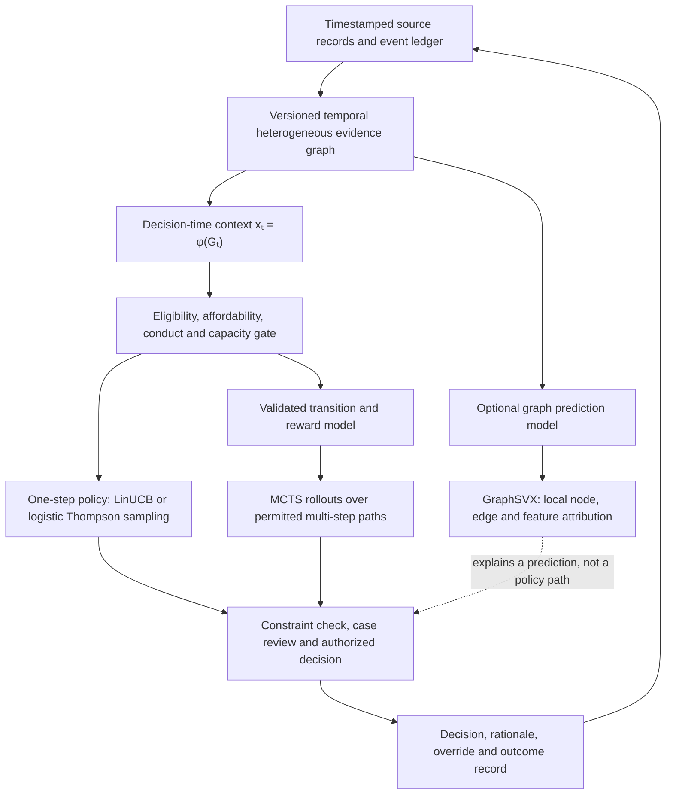
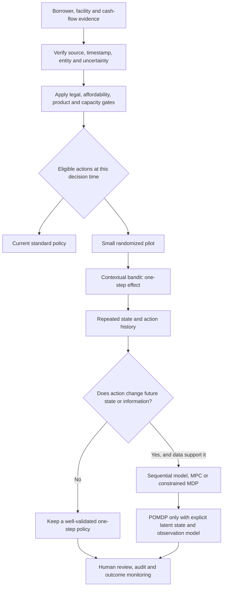

# From a One-Step Bandit to Sequential Credit Control

## How to learn which collection action helps, for whom, and when

**Underwrite for Collection · Article 2 of 5 · LinkedIn research article · 8 October 2026**

### Abstract

Credit models often estimate whether a borrower may miss a payment, but a lender must also decide what to do next, what evidence supports that action, and how the choice changes the borrower’s later options. This article develops a measured path from a randomized collection pilot and contextual bandit to sequential decision-making, while treating affordability, lawful authority, privacy, fair treatment and human review as operating conditions. It explains why reject inference is a separate identification problem, how survival and transition models can describe evolving repayment, and when a partially observed Markov decision process is justified. A small hypothetical example illustrates delayed cash, cost and customer outcomes without presenting synthetic numbers as observed evidence. The final section maps the method to Kenyan data-protection law and to the practical lifecycle architecture developed in *Underwrite for Collection*.

This is the second article in a five-article sequence. Article 1 established the experimental unit as a complete credit offer and showed how fixed randomization can precede conservative contextual allocation. Here the decision unit changes: after disbursement, the lender may face repeated choices as payments, disputes, hardship, collateral and servicing evidence arrive. Article 3 isolates the selective-label problem that limits what historical approval data can tell us; Article 4 applies sequential control to bank-level funding, hedging and balance-sheet choices. The purpose of this progression is to keep the methods matched to their decisions: one-off offer allocation, repeated borrower servicing, missing repayment counterfactuals and institution-wide Treasury control require related but distinct evidence and governance.

### Research questions

1. Among legally and operationally eligible Kenyan MSME credit accounts, what is the causal effect of a support-oriented collection action on verified net cash recovered and sustained repayment, relative to standard servicing?
2. Under what data, overlap, selection and governance assumptions can contextual-bandit or sequential off-policy evaluation estimate the value of alternative collection policies, and how sensitive are the estimates to reject inference and unobserved caseworker information?
3. When do repeated actions, borrower-state transitions and partially observed cash-flow conditions justify moving from randomized pilots and contextual bandits to model-predictive control, constrained MDPs or POMDPs, while preserving affordability, privacy, fairness and meaningful human review?

### The question begins with the borrower’s cash journey

The starting point for this work was practical: lenders can approve a facility that appears affordable at origination and still fail to support sustainable repayment across the months that follow. An enterprise may trade through several bank accounts, mobile-money wallets, payment aggregators and suppliers; a short cash dip may be seasonal, while a longer decline may signal that the business model or repayment schedule has become strained. A collection team then faces a decision under uncertainty: make a reminder, ask for updated information, offer a payment-date adjustment where contract and policy allow it, route the case to a trained officer, or take no additional action. The research question is therefore not simply “Who will default?” It is “Which permissible action, for this borrower and this observed state, improves durable repayment and overall outcomes?”

That framing follows the complete credit lifecycle, connecting the borrower’s operating activity, financing arrangement, servicing decisions and eventual cash recovery. The evidence chain begins with the enterprise and its purpose, follows the actual financing structure and cash source, records payments and servicing events, monitors changes after disbursement, and measures realised cure, recovery and loss. A business loan depends on the going concern: operating cash, working capital, obligations, owner involvement and continued trading. A facility backed by a ring-fenced receivables stream depends on eligible receivables, assignment or transfer effectiveness, obligor performance, dilution, account control, collection timing and a functioning waterfall. Those propositions need different state variables, interventions and recovery plans, even where the same lender holds both exposures.

The distinction matters once intervention is modelled over time. A business cash-flow dip may make a brief, respectful contact useful if it helps verify a temporary timing mismatch; a recurring shortfall may call for a human review of affordability, restructuring eligibility or business viability. In a ring-fenced receivables facility, the same apparent payment delay could instead arise from a disputed invoice, concentration in one payer, set-off, dilution, servicer interruption or a failure to transfer receipts to the controlled account. Treating both as a generic “high-risk borrower” state hides the mechanism that the action is meant to change. A credible decision system represents the source of repayment and the evidence about it, then constrains the action set to the actual product, contract, legal role and borrower circumstances.

### What the one-step contextual bandit can and cannot answer

A contextual bandit is a useful first experimental design when a team observes a context **xₜ**, selects one action **aₜ**, and measures a defined reward **rₜ** over a fixed follow-up window. The context might include days past due, recent payment regularity, verified cash-flow indicators, prior contact outcomes and the product’s servicing rules. The action could be one of a small set of approved reminders or an invitation to speak with a trained officer. The method estimates which action tends to work better for which observed context, while recording the probability with which the action was assigned. It is “one-step” because the principal question is the effect of today’s choice over its declared outcome window; it does not, by itself, learn an optimal series of actions across a changing borrower state.

The minimum experimental record is more precise than a model score. It includes the eligible population; the decision timestamp; the information available at that moment; the actions the case could actually receive; the policy and model versions; all safety and capacity gates; the randomization mechanism; the realized assignment probability; what was offered, delivered, received and accepted; any human override and reason; and outcomes with a prespecified maturity date. If a legal or affordability gate removes two actions, the logged propensity must be conditional on the remaining allowed actions, not the probability before the gate. This is essential for both transparent experimentation and later off-policy evaluation: a logged probability that does not describe the action actually available cannot correct the selection process.

The reward should reflect the research objective rather than a convenient system event. “Contact delivered” is not repayment; “promise to pay” is not cash collected; “account credited” may be a related-party transfer rather than trading income; and a short-term cure may reverse before the next billing cycle. A stronger primary outcome can combine verified net cash recovered by a specified date with repayment durability, while separately reporting the borrower’s cost, complaint, hardship, repeat-delinquency and escalation outcomes. One can predefine a vector of outcomes and a decision rule rather than immediately compress every consequence into one scalar. When an organization does use a scalar objective, it should publish how weights were chosen, preserve legally protected constraints outside the reward, and test whether an apparent gain comes from shifting cost or burden to the borrower.

A randomized pilot is the right benchmark before adaptive assignment. Within a narrow, approved eligibility region, a team can randomize among low-risk, support-oriented actions or compare an action with the current standard process. It should not randomize access to a legally required notice, a complaint route, a hardship safeguard, or a treatment that policy says must be provided. Nor should it offer unaffordable credit or withhold service merely to create labels. Random allocation can make groups comparable in expectation, but small samples, non-compliance, spillovers between staff, differential contact success and delayed outcomes still require careful analysis. A pilot should therefore state its estimand, unit of assignment, follow-up horizon, stopping rules and operational guardrails before the first case is enrolled.

### Sequential control changes the mathematical problem

Sequential decision-making becomes relevant when today’s action can change later states, future choices or the information available to the lender. A borrower who receives a reminder may pay, request assistance, dispute the debt, become temporarily unreachable, or experience no change. A case officer’s choice can also alter future data: a conversation may reveal that funds are seasonal, a receivable is disputed or the owner has suffered a shock. A finite-horizon Markov decision process represents a decision date **t**, state **sₜ**, allowed action set **A(sₜ)**, transition law **P(sₜ₊₁ | sₜ,aₜ)** and stage outcome **rₜ**. The value function is   
Vₜ(s) = maxₐ∈A(s) E[rₜ(s,a,Sₜ₊₁) + γVₜ₊₁(Sₜ₊₁)],

 with a declared horizon and discount convention. This equation describes a framework, not proof that the lender has the data or authority to implement it.

The action set is part of the model specification, not a footnote. It depends on the product agreement, the stage of arrears, known hardship, the collection channel, permitted contact times, complaints, active disputes, vulnerability, data quality and the person or team with authority to act. A hard gate can remove an action when a rule or policy makes it unavailable; a soft penalty can merely make an unlawful or harmful action appear unattractive under some reward weights. For this reason, a legally required notice, a borrower’s right to object or a binding affordability restriction belongs in the eligible-state and action logic. The optimizer should choose only among actions that pass those gates, while staff remain able to pause automation and route a case for review.

The Markov assumption says that the represented state contains the information needed to predict the next transition for the chosen purpose. It is a modelling assumption to test, not a guarantee provided by machine learning. If material history is omitted—such as a prior promise-to-pay, a complaint, a payment reversal, an active dispute or a recent restructuring—the transition model may treat two different situations as identical. If the process is partly hidden, a partially observed Markov decision process (POMDP) can represent a latent condition **zₜ**, an observation **oₜ**, an action **aₜ**, state transitions and an observation likelihood. The agent’s information is then a belief distribution   
bₜ(z)=Pr(zₜ=z | o₁:ₜ,a₁:ₜ₋₁).

 A belief state is useful only where its hidden state and observation model are operationally meaningful and validated.

Irregular payment and contact intervals can make a fixed daily or monthly grid misleading. A semi-Markov formulation can represent the elapsed time until a transition, so that “paid 14 days after contact” and “paid 14 days after a revised due date” are not confused. Survival analysis can model time to default, cure, payment, prepayment or another event, while competing-risk methods distinguish which event occurs first. A Cox model such as   
λᵢ(t)=λ₀(t)exp(xᵢᵀβᴴ+uᴴ_sector[i]+vᴴ_region[i]+wᴴ_vintage[i])

 expresses a relative event hazard; it does not itself choose the next intervention. A hierarchical logistic model such as   
logit(pᵢ,τ)=αᴸ+xᵢᵀβᴸ+uᴸ_sector[i]+vᴸ_region[i]+wᴸ_vintage[i]

 predicts a defined binary outcome horizon. These models can inform a transition model, but repeated scoring alone does not constitute reinforcement learning.

### Put the risk models inside the decision problem

A hierarchical Bayesian logistic model estimates fixed-horizon default probability, while a hierarchical Cox proportional-hazards model describes time to default. These models answer complementary questions. A fixed-horizon model can be written   
Dᵢ(τ) ∼ Bernoulli(pᵢ,τ)

 with   
logit(pᵢ,τ)=αᴸ+Xᵢᵀβᴸ+uᴸ_sector[i]+vᴸ_region[i]+wᴸ_vintage[i];

 it estimates default probability by a specified horizon. A Cox model writes   
λᵢ(t|Xᵢ)=λ₀(t)exp(Xᵢᵀβᴴ+uᴴ_sector[i]+vᴴ_region[i]+wᴴ_vintage[i]),

 with survival   
Sᵢ(t)=exp(−∫₀ᵗλᵢ(u)du)

 under the model. Hierarchical effects partially pool sparse groups, but they do not erase model uncertainty or create evidence in unsupported regions. The decision system should report the group, vintage, contract and data support behind each estimate, and use posterior intervals rather than treating a point prediction as a known risk.

A time-to-default estimate does not by itself require a sequential controller. If a fixed-term loan’s price and repayment schedule are set at origination, the offer decision is made at that point; later survival information helps monitoring and portfolio forecasts, but it does not automatically authorize monthly repricing. Sequential control is relevant when the institution makes repeated, permitted decisions—such as a collection support action, a revolving-line decision under its contract, or a renewal offer—and when each choice can change later states or observations. A useful state can include the original contract, payment and contact history, verified business cash, product-specific repayment source, macro conditions, current arrears, prior restructuring and data confidence. The action list must then separate origination terms from post-disbursement servicing actions, each with its own legal and operational authority.

The transition model should represent the events that matter to the policy. An account can remain current, miss a payment, cure, restructure, default, prepay, refinance or enter recovery; a ring-fenced receivables facility may instead experience payer delay, invoice dispute, dilution, servicing interruption or cash-control failure. These states are not interchangeable. A multi-state model can estimate transitions among them, while cause-specific hazards can describe event timing. The controller’s stage outcome can include incremental verified cash, intervention cost and a declared measure of repayment durability, but a legally required notice, affordability limit, complaint pause or prohibited practice should be enforced as a hard gate. A human reviewer can override a recommendation when new evidence or context changes the case, and the override reason should be logged so that the next evaluation can distinguish policy from execution.

The hierarchy has the same named levels in both models: sector s, region r and origination vintage c. Model label L identifies the fixed-horizon logistic model; H identifies the event-hazard model. Each model has its own coefficients, group effects and scale parameters, fitted to its declared outcome and likelihood. For every model m, the following non-centred representation supplies sector, region and vintage effects and their half-Student-t scale priors. The second argument of Normal denotes variance; Bᵐ is a positive-definite coefficient covariance. The logistic intercept receives its own prior. For a fully Bayesian piecewise-constant baseline hazard, interval ℓ receives a positive Gamma prior with declared shape aℓ and rate bℓ. Cause-specific hazards repeat this structure with a separate event label. Any sharing between outcomes requires an explicitly specified joint model and validation.

uᵐ_s = σᵐ_u zᵐ_us;   zᵐ_us ∼ Normal(0,1)

vᵐ_r = σᵐ_v zᵐ_vr;   zᵐ_vr ∼ Normal(0,1)

wᵐ_c = σᵐ_w zᵐ_wc;   zᵐ_wc ∼ Normal(0,1)

σᵐ_k ∼ Half-Student-t(ν=3, scale=s₀,kᵐ),   k ∈ {u,v,w}, m ∈ {L,H}

αᴸ ∼ Normal(0,sα²);   βᵐ ∼ MVNormal(0,Bᵐ)

λ₀,ℓ ∼ Gamma(shape=aℓ, rate=bℓ)

### An IFRS 9 transition model is an accounting component, not the whole controller

Markov transition matrices are often used to describe migration among credit states, including current, Stage 2, Stage 3, cure and write-off. Such a matrix can support lifetime cash-flow projections, but IFRS 9 stages are accounting classifications governed by the standard’s significant-increase-in-credit-risk and credit-impaired requirements. An MDP used to choose an action is a different object: it combines states, actions, transitions, rewards and a decision objective. A transition model can inform the MDP, while the accounting engine separately applies IFRS 9 measurement and staging requirements. Stage 3 is not automatically an absorbing state, and cure or improvement requires policy-consistent reassessment. A model should not define Stage 2 merely as a “bad state” for reward optimization or minimize provisions by discouraging recognition of deterioration [1].

The ECL calculation must remain distinct from the bandit reward and capital measures. IFRS 9 expected credit loss is a probability-weighted present value of cash shortfalls over the applicable horizon using reasonable and supportable information; 12-month ECL is the portion of lifetime cash shortfalls associated with default events possible in the next twelve months, not simply cash shortfalls occurring during those twelve months [1]. The simplified approximation   
**EL ≈ PD×LGD×EAD**  
 can explain one expected-loss component under simplifying assumptions, but it is not a complete ECL model or economic-capital measure. If an intervention causes earlier payment, its effect on timing, recovery and expected cash shortfall should be assessed under the accounting method. The policy reward can then include separately defined operational costs or incremental net cash, without embedding accounting recognition or provisions as a proxy for borrower welfare.

### Fairness diagnostics need precise targets

Credit fairness analysis should match the decision being evaluated. For a binary classification, equal opportunity compares true-positive rates across groups; equalized odds compares true-positive and false-positive rates conditional on the outcome; disparate-impact ratios compare selection rates under a chosen definition. These measures have different meanings, can conflict and depend on the label, threshold, base rates and population. They do not mean “equal accuracy,” and none alone proves legal compliance or fair collection. Collection outcomes are especially difficult because the lender observes repayment after its own offer and servicing decisions, and because prior treatment can influence payment. A diagnostic should state which group, outcome, time horizon and action are being compared, how uncertainty and small samples are handled, whether the protected attribute is lawfully available for this analysis, and what accountable human process follows a concerning result [2].

Fairness constraints should be tested alongside—not instead of—hard eligibility and conduct rules. A constrained policy may be represented as   
**maxπ Eπ[∑ₜγᵗrₜ]**  
 subject to   
**Eπ[∑ₜcₖ,ₜ] ≤ Bₖ**  
 for each defined risk or burden **k**, plus action-level eligibility restrictions. Yet statistical parity constraints can be inappropriate if the outcome or exposure is misspecified, while group-specific thresholds can introduce other policy choices. Historical labels may be selective and may encode prior access patterns; group evaluation therefore requires a support analysis and sensitivity to unobserved outcomes. Feature removal is not enough because proxies may remain. A governance report should separate descriptive disparity, causal treatment effect, policy constraint and legal assessment rather than presenting one metric as a verdict.

### Economic capital and RAROC require separate, declared conventions

Economic capital and risk-adjusted return on capital can inform the financial assessment of an action when their measurement conventions are explicit. A portfolio loss variable **L** can be simulated from borrower exposures, default timing, loss severity, recovery and dependence. Under an institution-defined horizon and confidence level, one illustrative economic-capital convention is   
ECₐ = VaRₐ(L) − E[L];

 another is **ESₐ(L) − E[L]**. The institution must name its measure, horizon, confidence, diversification treatment and allocation method. It should also validate calibration and stress behavior. Economic capital is not the same as regulatory capital, and there is no universal confidence level or risk measure that every lender must use for pricing. The reported value is a model estimate under specified assumptions, not a cash reserve or a direct amount that can simply be added to a customer’s rate.

An illustrative RAROC may be written   
RAROC = (risk-adjusted income − expected loss − funding cost − operating cost − tax adjustments) / economic capital,

 but institutions define numerator, denominator, horizon and allocation differently. A pricing or collection action may change income, expected loss, take-up, balance duration, recovery, funding and required capital simultaneously. The controller should not optimize headline RAROC without retaining borrower outcomes, absolute loss limits, concentration constraints and affordability. A portfolio can show high RAROC on a thin or volatile denominator while carrying unacceptable exposure; a product with lower transaction-level return might support diversification or strategic access. Use RAROC as a governed decision lens with sensitivity analysis and ALCO or credit authority approval, rather than a universal reward or hurdle silently embedded in code.

For a worked hypothetical calculation, suppose a policy action is estimated to add KES 1,100 in verified net cash per eligible account over the chosen horizon, adds KES 250 in staff and operating cost, and uses KES 5,000 of allocated economic capital. The incremental cash after that direct cost is KES 850.   
KES 850/KES 5,000 = 17%

 is only an illustrative incremental cash-to-capital ratio; it is not automatically the institution’s RAROC because it omits income attribution, funding, expected loss, tax, capital allocation and the institution’s approved horizon. If a risk committee uses a 15% hurdle, the scenario does not prove that the policy passes it. The example is useful precisely because it reveals which terms still need a controlled, reconciled definition before decision-makers compare an intervention with alternatives.

### Default dependence: Clayton can be a challenger, not a contagion story

Portfolio dependence affects tail loss and concentration, but a copula is a dependence model, not a mechanism that automatically explains contagion. A Clayton copula with parameter   
**θ>0**  
 has lower-tail dependence   
λ_L=2^(−1/θ)

 and no upper-tail dependence in its standard bivariate form; its Kendall rank correlation is   
τ=θ/(θ+2).

 It can represent stronger dependence in the lower tail for variables oriented so that the relevant adverse outcome lies there. It does not by itself create time-varying contagion, identify a macroeconomic shock or imply that default probabilities jump at the instant another borrower defaults. A Gaussian copula with finite correlation has zero asymptotic tail dependence, but it still represents dependence at finite quantiles. Model selection should compare the hypothesized mechanism, portfolio evidence, tail diagnostics, stress scenarios and alternatives such as t-copulas or factor structures [3].

The capital framework must preserve two tracks. Regulatory capital uses the standards and local rules applicable to the institution and exposure class. Basel’s IRB risk-weight functions are based on an asymptotic single-risk-factor framework with prescribed parameters and eligibility rules; that does not mean every regulatory capital calculation is a fitted Gaussian copula, nor that an internal Clayton model can replace the regulatory calculation [4]. An internal economic-capital model can use a richer dependence structure if it is justified, validated and governed, but results should be labelled internal and should not be reported as regulatory capital. A difference between internal and regulatory estimates is a risk-management signal for analysis, not proof of regulatory arbitrage or evidence that the bandit should automatically increase prices.

### Pólya–Gamma computation supports posterior estimation

For hierarchical logistic regression, Pólya–Gamma augmentation gives a convenient conditional-Gaussian representation. With binary **yᵢ∈{0,1}**, linear predictor   
ηᵢ=xᵢᵀβ,

 and   
κᵢ=yᵢ−1/2,

 introduce   
ωᵢ∼PG(1,ηᵢ).

 Given **ω**, the likelihood contribution is quadratic in **β**; with a Gaussian prior, the conditional posterior is multivariate normal, with covariance of the form:  
Σ⁎=(XᵀΩX+Σ₀⁻¹)⁻¹

and a corresponding mean determined by **Xᵀκ** and the prior mean [5]. Hierarchical priors add group-level parameters and may require additional sampling steps. The method can make posterior draws practical for logistic PD or selection components, subject to convergence checks, effective sample size, prior sensitivity and computational diagnostics. “Exact” refers to the augmentation identity and conditional sampler under the specified model; it does not mean that a model is exact about reality or that labels are identified.

Those posterior draws can support uncertainty-aware policy evaluation, such as estimating a range of expected loss or the probability that one allowed action outperforms another. They should not be interpreted as a license for the algorithm to explore every action the posterior considers plausible. The experiment still needs a safe action set, sufficient support, minimum allocation rules, a control group, outcome maturity and human governance. Posterior uncertainty can be understated by model misspecification, unobserved selection, changing macro conditions or incomplete histories. A robust implementation checks chain mixing and convergence, posterior predictive performance, calibration across vintages and sensitivity to priors and feature construction. Where the model is too uncertain for a consequential decision, the system should be able to defer to a pre-approved rule or trained reviewer rather than convert uncertainty into a high-stakes experiment.

In the compact Pólya–Gamma equations, the design matrix is expanded to include the intercept, approved feature bases, sector indicators, region indicators and vintage indicators. Its coefficient vector stacks the corresponding logistic coefficients and group effects; the prior covariance carries their current hierarchy scales. The logistic Thompson-sampling notation later in the article uses the same expansion when the hierarchical model supplies its probabilities. The hazard model preserves those named group levels in its own likelihood and posterior computation. This convention makes a short matrix expression reproducible: the registered design specification states every column, constraint, group mapping and coefficient block, while the mathematical appendix gives the likelihoods and conditioning steps used to fit them.

### Half-Student-t priors connect partial pooling to decision uncertainty

A practical collection model must learn how much sectors, regions, institutions and origination cohorts differ while retaining useful estimates for groups with limited observations. This is where a half-Student-t prior with three degrees of freedom enters the hierarchy. For a group effect uⱼ on the log-odds scale, write uⱼ as a positive scale σ multiplied by a standard-normal variable zⱼ. The prior on σ governs the plausible amount of between-group variation and consequently the strength of partial pooling. A smaller inferred scale draws group effects closer together; a larger scale permits stronger differences supported by the observations. The selected prior scale s₀ is calibrated through prior-predictive default probabilities and compared with plausible alternatives, following the sensitivity discipline for hierarchical variance parameters [6].

uⱼ = σzⱼ;   zⱼ ∼ Normal(0,1)

σ ∼ Half-Student-t(ν=3, scale=s₀)

The Gaussian scale-mixture representation makes the construction concrete. Draw a positive precision λ from a Gamma distribution and draw a signed auxiliary quantity q from a normal distribution whose variance depends on λ; the absolute value of q has the required half-t distribution [7]. In these equations, Gamma uses shape and rate, so three Student-t degrees of freedom correspond to Gamma shape 3/2 and rate 3/2. The symbol s₀ denotes the prior scale, and the second argument of Normal below denotes variance. This construction gives a precise meaning to the heavy-tailed scale prior. In the collection hierarchy, σ describes variation across groups, while uⱼ remains Gaussian conditional on σ. A t-copula, discussed earlier, has a separate job describing dependence between outcomes.

λ ∼ Gamma(shape=3/2, rate=3/2)

q | λ ∼ Normal(0, s₀²/λ);   σ = |q|

These scale variables and the Pólya–Gamma variables fit into different steps of a blocked inference procedure. Given the current hierarchy scales and the Pólya–Gamma variables, the regression and Gaussian group-effect coefficients have the normal conditional distribution described above [5]. The hierarchy scales, auxiliary variables and any correlation parameters receive their own validated updates. Thus the useful computational result is conditional Gaussian inference within a larger posterior calculation. The chosen parameterisation still needs convergence, effective-sample-size and sensitivity checks. Operationally, the resulting draws carry uncertainty about sparse groups into predicted default, cure or other separately specified transition probabilities. Those distributions can then inform limit-review decisions and comparison of permitted collection actions. The model record should preserve which prior, data window and calibration version generated the distributions used for each decision [8].

The practical reason for this construction is to make calibrated uncertainty computationally feasible at the frequency the credit process needs. An offline fitting service can reuse the conditional-Gaussian coefficient blocks, update the necessary latent variables and scales, and publish an approved set of posterior draws or summaries for scoring. Selection of the half-t scale and parameterisation balances plausible group variation, prior-predictive behaviour, numerical stability and computation time. Validation compares calibration, tail probabilities, effective sample size, convergence and decision stability with a reference fit. The serving system then uses the versioned artefact within its approved data and policy window; a scheduled or event-triggered refresh follows change control and validation. Combined with an identified treatment comparison, these calculations give a causal credit decision process usable uncertainty about outcomes and action value, while preserving the assumptions under which each estimate was produced.

### Bayesian decision boundaries turn predictions into limit-review evidence

A credit-limit adjustment is a decision about prospective exposure, future cash generation and the consequences of each permitted action. Consider a proposed extension over a declared horizon. Let p be its default probability, G the net gain conditional on repayment, L the net loss conditional on default, and O an explicitly valued opportunity cost of declining a creditworthy case. All three monetary quantities use the same horizon, currency and cash-flow convention. The comparison below holds the payoffs fixed and averages over the posterior distribution of p given evidence D. Set O to zero when the payoff comparison already captures the relevant foregone income, so the same benefit is counted once. Under this simple two-outcome, linear-payoff model, the break-even rule depends on the posterior mean p̄; uncertainty receives a separate policy test [9].

p̄ = E[p | D]

E[V(extend) | D] = (1−p̄)G − p̄L

E[V(decline) | D] = −(1−p̄)O

p* = (G+O)/(G+O+L)

For a hypothetical extension, suppose net gain on repayment is KES 1,200, net loss on default is KES 18,800, and the comparison uses O=0. The break-even posterior mean default probability is 6%. At a posterior mean of 4%, the extension has expected value KES 400 under the stated assumptions. This calculation makes the economics visible: approved income and costs determine G, while prospective utilisation, recoveries, recovery timing and collection costs determine L. A revolving facility therefore needs a stress-drawdown assumption; its current drawn balance alone is insufficient to specify the loss. Larger limits, different repayment schedules or slower recovery change the comparison. The next decision step checks verified repayment capacity, aggregate obligations, concentration and the institution’s approved exposure limits before selecting an action.

p* = 1,200/(1,200+18,800) = 6%

E[V(extend) | D] = 0.96×1,200 − 0.04×18,800 = KES 400

A posterior exceedance rule adds a direct uncertainty check. Let p_cap be an approved product risk cap and ε the largest acceptable posterior probability of exceeding it. Calculate the exceedance probability from the model’s posterior draws, recording both policy values and the reason for their selection. When that probability exceeds ε, the decision may route to verification, a smaller permitted offer, retention of the current limit or an authorised reviewer, according to the contract and credit policy. Two cases with the same posterior mean can receive different review routes because their uncertainty differs. Sparse or conflicting records should prompt a proportionate response to the evidence gap. Any consequential limit change also follows the information, explanation, correction and human-review arrangements developed in the article’s Kenyan legal framework [10], [11].

Pr(p > p_cap | D) > ε   ⇒   apply the approved uncertainty-review route

Meaningful human review needs a compact evidence packet that keeps several uncertainty measures visible. A credible interval for the default-probability parameter describes uncertainty about risk over the stated horizon, and the posterior cap-exceedance probability shows how that risk relates to the approved limit. Under an identified experimental or causal design, a separate credible interval can describe the conditional average incremental effect of an intervention on net cash or sustained cure. A posterior predictive cash interval also includes variation in the future realised outcome. The reviewer should see the posterior distribution of the difference between permitted actions, together with model versions, data age, affordability and support in comparable cases. Overlap between separate action intervals is interpreted through that comparison and the decision costs. For sparse groups, the packet explains pooling and prior sensitivity. Authorised options include requesting verification, maintaining the current limit, choosing a supported alternative or referring the case, with the decision and rationale recorded.

The connection to sequential collection is the effect a limit decision can have on the borrower’s subsequent state. An extension may finance a verified operating cycle and support repayment; it can also increase utilisation, future instalments and exposure during financial stress. The controller therefore evaluates action-specific outcomes, costs and transitions using evidence that supports those actions. A default model trained under historical limits supplies an estimate for its documented conditions; causal evidence is needed to estimate how changing the limit changes repayment. Within a permitted sequential policy, posterior draws can enter the belief state or transition model, and the payoff comparison can inform action values. Affordability, aggregate exposure, lawful processing, contract terms and approval authority define which actions are available at each review date.

### Reject inference leads to article 3

These methods raise a further question: how can a lender assess repayment when an application was previously rejected? This is a natural link to the companion article, “Who Gets a Repayment Label?” A bandit can collect outcomes only for actions that are actually assigned and taken up. If every applicant below a cut-off remains declined, the policy has no repayment observations for that region; Bayesian imputation does not change this fact. A safe offer experiment could generate evidence among a screened, eligible population near a decision boundary, while preserving affordability and legal safeguards. It estimates the effect or repayment experience for that specified offer and sampled population. Historical rejects outside the support region remain unsupported, and any inference about them should be presented as a sensitivity analysis rather than as observed default labels [12], [13].

The first two articles assign distinct roles to the methods. The risk models describe outcomes conditional on data, contract and assumptions; the experiment creates comparative evidence for a defined action; the bandit allocates among approved offers using logged probabilities; and the sequential controller evaluates repeated servicing choices only when actions affect future states. Article 3 examines why historical rejection prevents complete outcome labels, and article 4 moves the control frame to bank funding and balance-sheet exposures. Governance determines which actions are allowed, who reviews them, and how outcomes can be challenged. Capital and fairness analyses inform constraints and oversight but do not replace these functions. This sequence supports a practical agenda: learn from controlled offers and measured collection actions, preserve a standard-care comparison, and expand only where evidence supports the next decision.

### A sequence, a ledger and an evaluation plan

The operational sequence begins with an evidence ledger. At each decision point the record should state what was known, when it was known, where it came from, whether it was verified, which entity and account it referred to, and how it was linked to the borrower or facility. A cash receipt can be recurring, seasonal, borrowed, transferred between related accounts, reversed or disputed. For a trading business, the distinction between customer receipts and owner injections can change the sustainability story. For a ring-fenced receivables stream, the record should distinguish invoice issuance, eligibility, obligor acceptance, dilution, assignment, collection account movement, remittance and waterfall allocation. This provenance allows analysts to measure the state as it existed at the decision date rather than quietly using later information that would not have been available to the policy.

The next record is a state transition table that connects an observation to the decisions staff can take. For example, a “missed instalment” state might branch to verified timing issue, unresolved payment allocation, dispute, hardship, emerging business weakness, or possible manipulation; each branch has its own evidence quality and response route. A ring-fenced facility may instead branch to payer delay, invoice dispute, concentration breach, servicer delay, account-control failure, or legal-enforceability concern. The table should identify the owner of each field, update frequency, missingness code, permissible use, retention trigger and correction pathway. A state label should not become an irreversible borrower attribute: when corrected information arrives, the system should support reassessment, preserve the audit trail and allow the person affected to understand the decision.

### Relationship graphs, contextual bandits and sequential search

A temporal heterogeneous graph can represent the evidence needed to reconstruct a collection decision. Its nodes may include borrowers, operating businesses, beneficial owners, guarantors, accounts, buyers or other obligors, invoices, collateral, contracts, servicers, cash receipts and interventions. Typed edges can record ownership, control, invoice assignment, payment, security, servicing, communication and account movement. Each node and edge should carry source, confidence, observed-at and effective-at times, version, and correction history. This makes the graph a data and state representation; it need not be a graph neural network. It can help trace whether cash came from a customer, a related party or a ring-fenced receivable, and whether the relevant buyer, account and waterfall links were in force at the decision date. Entity-resolution mistakes, shared-group label leakage, temporal leakage and access controls must be tested before graph-derived features enter a model. A compact encoding is:

xₜ = φ(Gₜ)

Here **Gₜ** is the evidence graph available at time *t*, and **φ** is a documented feature or state transformation, which may be rules-based or learned.

Linear UCB and logistic Thompson sampling remain one-step contextual-bandit policies: they compare approved actions using the current context and observed reward. Graph-derived context can enrich **xₜ**, or a validated graph model can provide predictions, but neither method by itself searches a whole sequence of future interventions. In a linear reward model, LinUCB uses a predicted mean plus an uncertainty bonus:

UCBₜ(x,a) = xₜ(a)ᵀ θ̂ₜ + α √(xₜ(a)ᵀ Aₜ⁻¹ xₜ(a))

Logistic Thompson sampling draws plausible parameters for a binary outcome model, then uses the sampled probabilities with loss, timing and cost estimates to construct a sampled risk-adjusted action value:

θ̃ₜ ∼ p(θ | Dₜ);   p̃ₜ(a) = σ(xₜ(a)ᵀ θ̃ₜ)

aₜ = arg max₍a ∈ A_safe₎ Q̃ₜ(a)

The choice is made over a pre-approved safe set; maximizing a sampled default probability would be the wrong objective. Pólya–Gamma sampling is one computational method for logistic posterior draws, while PG-TS applies that idea to logistic contextual bandits [14].

Monte Carlo Tree Search enters only after the problem has a sequential state-transition model, a permitted action set and a sufficiently credible simulator or replay environment. A tree-search rollout can compare paths such as verify an invoice, contact the buyer, then review a dispute, against a permitted reminder followed by a hardship review; each branch leads to possible next states and outcomes. The search tree is a temporary unfolding of candidate action sequences, distinct from the persistent borrower–invoice–account evidence graph. A common node-selection score balances the estimated path value and visits:

U_MCTS(s,a) = Q(s,a) + c √(ln N(s) / N(s,a))

A finite-horizon path value can be summarized as:

Q_H(s,a) = E[Σₖ₌₀ᴴ γᵏ rₜ₊ₖ | sₜ=s, aₜ=a, model]

Here **Q** is the mean rollout return, **N** records search visits, and **c** controls search allocation. In credit operations, this is offline computational search over a validated model, not live experimentation on borrowers. Legal, affordability, hardship, dispute, contact-frequency, operational and human-review gates must constrain every step. MCTS should be compared with rules, dynamic programming or model-predictive control, and stress-tested for model error and unsupported trajectories [15].

“Graph Shapley” belongs to a separate interpretability step. For example, GraphSVX is a post-hoc local explanation method for graph-neural-network predictions: it estimates how selected features, nodes or graph components contribute to a particular model output under its coalition definition [16]. That attribution does not plan an intervention, estimate its causal effect, or explain why an MCTS rollout has greater long-term value than another path. If graph predictions inform a decision, show the prediction explanation alongside the competing action paths, expected outcomes, uncertainty, constraints and human rationale. Keep the action-value comparison distinct from an explanation of one model prediction, and record how graph perturbations affect the explanation.

The evaluation should be organized around a predeclared estimand. One option is the average effect of offering an approved contact action versus standard servicing among eligible cases, measured as incremental net cash realized within 60 days and sustained status at 90 days. Secondary outcomes might include contact burden, complaint rate, repeat arrears, hardship outcomes, time to resolution and staff effort. “Incremental” matters: cash that would have arrived anyway should not be credited to the intervention. “Net” matters: direct contact or servicing cost is deducted, while customer harm cannot simply be priced away. Separate cohort reporting should show the eligible population, assignment, delivery, compliance, loss to follow-up and outcome maturity so that a large nominal lift is not driven by a changing denominator.

For an adaptive policy, the assignment probability at each step becomes part of the data-generating process. A contextual bandit can explore among allowed actions and adapt to observed reward, but adaptive allocation can reduce simple interpretability and complicate variance estimation. An inverse-propensity estimator weights each observed reward by the inverse probability of its selected action; doubly robust estimators combine this weighting with an outcome model. These methods can be statistically efficient when their assumptions hold, but rare actions with tiny propensities can produce unstable weights, while deterministic assignment destroys overlap. The protocol should set minimum support, cap weight influence transparently, report effective sample size, use uncertainty intervals, and keep an unadapted randomized benchmark where feasible. Sequential doubly robust methods extend ideas to trajectories, but require correct logging at every decision time [17].

The concept chart shows the progression from evidence collection to a governed decision. It places legal, affordability, product and operational eligibility before any optimization, because an algorithm should compare only actions that the institution has already authorized for the defined population. The fixed pilot supplies a benchmark; the contextual bandit estimates one-step action value; and the later branch asks whether an action changes a borrower’s future state or information enough to justify sequential control. The diagram also shows the stopping point: if the evidence does not support a more complex model, the lender can retain a validated one-step policy. This is a conceptual map, not an automatic deployment sequence; each transition requires evidence, review and an approved use case.

### A worked example with deliberately hypothetical numbers

Consider a hypothetical Kenyan enterprise borrower with a KES 120,000 instalment due on day 30. The lender observes irregular customer receipts, a recent delayed payment and a high-confidence invoice accepted by one major buyer but payable on day 38. These are scenario assumptions, not empirical findings. Two policy-permitted actions are available: **A**, a neutral reminder and self-service payment link; and **B**, a respectful contact offering a trained review of payment timing and business cash evidence. The standard policy is reminder only. For a randomized pilot, eligible cases can be assigned 50:50 after hardship, complaint and active-dispute gates are applied. The question is whether the review offer increases durable repayment compared with the reminder, not whether the borrower’s profile “deserves” pressure.

Suppose 100 eligible, hypothetical cases are evenly randomized. By day 60, 38 reminder cases and 46 review-offer cases have paid the scheduled instalment; by day 90, sustained payment is 34 and 41 respectively. With 50 assigned cases per arm, the day-60 rates are 76% and 92%, a difference of 16 percentage points; the day-90 rates are 68% and 82%, a difference of 14 percentage points. These are illustrative counts only; no confidence interval, statistical significance or business conclusion follows without sample-size planning, outcome definitions and observed data. Delivery may differ from assignment, and a case may pay through a channel the system did not initially link. The primary analysis should therefore be intention-to-treat, with delivery and acceptance reported as process outcomes and a secondary compliance analysis clearly labelled as such.

The next question is whether the review offer creates incremental value. Suppose, solely for illustration, the review process costs KES 250 per eligible case in staff time and operating expense, and additional verified cash collected by day 90 averages KES 1,100 per assigned case in the review group compared with standard policy. The illustrative average net benefit is:  
KES 1,100 − KES 250 = KES 850 per assigned case  
before funding, capital, tax, servicing and borrower outcomes are considered. If the cash difference disappears after cohort adjustment or the 90-day cure reverses by day 120, the case for scaling weakens. If the intervention increases complaints, induces unaffordable payment sacrifices or places hardship cases under inappropriate pressure, a positive cash metric alone does not make the policy acceptable.

Now compare this with a sequential approach. At day 30 the reminder is sent; at day 38 the buyer has not paid; at day 40 an officer verifies that the receivable is genuine and the payment is scheduled; on day 42 the lender offers a contractually permitted adjustment or support referral; on day 60 the outcome is measured. The action at day 40 depends on new evidence generated by earlier events. A sequence model can compare action paths, such as reminder→review→standard repayment versus reminder→no additional contact, while accounting for cost and outcomes at each date. Yet an exact dynamic program would require transition estimates for these states and actions, a defined horizon and reliable support. If those are not available, a transparent rule plus a pilot may be a better operational answer than a simulated optimum.

### The Kenyan legal and governance framework is part of the design

The Data Protection Act, 2019 creates duties for processing personal data. A company is not itself a natural-person data subject, but a business file can contain personal data about a sole proprietor, director, guarantor, employee or identifiable customer. Transaction-level cash evidence may also reveal private or sensitive circumstances depending on what it shows. The design must identify controller and processor roles, define the purpose and lawful basis, minimize the information collected, provide appropriate notices, maintain accuracy, limit retention, protect the data and enable the statutory rights that apply [10]. Consent is one possible legal basis in specified circumstances; it is not a universal substitute for purpose limitation, necessity, fairness or a valid processing condition.

Section 31 of the Act requires a data-protection impact assessment (DPIA) where processing is likely to result in high risk to the rights and freedoms of a data subject; section 35 addresses decisions based solely on automated processing that produce legal effects or significantly affect a person, subject to statutory exceptions and safeguards [10]. Regulation 49 of the General Regulations, 2021 identifies high-risk operations requiring a DPIA, while regulations 50–53 address its conduct, prior consultation, consideration and audit. Regulation 22 sets out safeguards for automated individual decision-making, including notice, meaningful information about logic, transparency and fairness measures, error prevention, appropriate statistical procedures, bias reduction and human intervention [11]. A decorative review button does not establish meaningful human involvement; the reviewer must have context, authority, time and the ability to change the result.

The other provisions matter across the data lifecycle. The Act’s principles, rights, lawful-basis rules, security duties, breach obligations, sensitive-data conditions and cross-border-transfer rules apply according to the actual processing rather than the model label [10]. Data minimization affects feature design; accuracy affects entity matching and correction; purpose limitation affects whether data gathered for one service can be repurposed for scoring; retention affects trajectory storage; and security affects account-level feeds and access. A model-development project should define a controlled research dataset, access roles, pseudonymization where appropriate, linkage approvals, retention periods and a process for correcting source records. Removing direct names does not automatically make detailed transaction histories anonymous, especially where rare patterns can identify a person.

Credit-specific rules require scope discipline. The Banking (Credit Reference Bureau) Regulations, 2020 govern defined credit-information processes [18]. The ODPC’s digital-credit guidance remains operational context where relevant [19]. For non-deposit-taking credit business not regulated under another written law, the CBK (Non-Deposit Taking Credit Providers) Regulations, 2026 (Legal Notice No. 191) now set provider requirements; regulation 3 excludes banks, licensed microfinance institutions, SACCOs and other specified categories. Regulations 96 and 97 carry forward existing 2022 licensees and revoke the 2022 Digital Credit Providers Regulations, respectively. For providers within scope, regulation 30 governs credit collection, regulation 44 addresses debt collection, regulation 53 covers access to and collection of customer information, and regulation 60 sets safeguards for AI used in lending decisions [20]. Before relying on a particular rule, classify the institution, product, decision and data flow. Banks, NDTCPs, MFIs and SACCOs do not necessarily sit under the same sector rulebook. The study connects consumer protection, credit reporting, banking supervision and data protection while recording which law or institutional policy governs each action.

### Operational validation and model controls

Model validation should cover calibration and discrimination, but also stability, missingness, subgroup performance, decision thresholds, action availability, override frequency, data freshness, contact delivery, outcome maturity and rollback criteria. For a survival model, calibration at a defined horizon and competing-event treatment matter; for an MDP, transition calibration and value estimates matter; for a POMDP, belief quality and observation model matter. A model can have good ranking metrics and still recommend actions that do not improve outcomes. Independent validation should replay historical data only where the information timing is reconstructed, compare against simple rules and current policy, stress periods of economic change, and report performance by product and segment. Any simulator used for policy learning must be tested against observed distributions and known constraints before it informs a real decision.

### A data-lineage lesson from mortgage performance files

Article 1 discusses the GSE data architecture as a template for dated origination and performance records. For sequential collections, the specific lesson is to preserve the information set at each decision: what the servicer knew before contact, what action was sent, what response followed, and whether the later payment can be linked to that action. Monthly mortgage histories are not event logs for Kenyan MSME collections, but they show why release dates, loan identifiers, outcome windows and corrections must be versioned [21], [22]. They also illustrate the selection boundary: published acquired mortgages do not reveal outcomes for every denied applicant. Use these datasets to validate time alignment and data lineage; estimate local collection effects only from properly governed Kenyan records and designs.

### From borrower evidence to bank decisions

A borrower-level intervention experiment connects to the institution through clearly assigned responsibilities. The lending and servicing teams define the borrower, facility, decision date, permissible action and realised cash or customer outcome. Where repayment comes from an operating business, the evidence follows trading activity, working capital and the obligations supported by that cash. Where repayment comes from a ring-fenced receivables stream, it follows eligible receivables, legal transfer, payer performance, servicing continuity, controlled accounts, reserves and the contractual payment waterfall. Finance and risk teams translate reconciled outcomes into the institution’s approved loss, capital and funding measures. An analytical workbench can present these records, model distributions and proposed actions to authorised staff. Every handoff carries an agreed definition, source, timestamp, permitted purpose, responsible owner and reconciliation rule. Credit authority, model approval and customer communication remain explicit stages in the operating process, so the reader can follow how an experimental finding becomes evidence for a particular decision.

Article 5 develops the bank-controlled agentic workflow that connects these responsibilities across credit-offer experiments, sequential collections, reject inference and Treasury decisions. A restricted orchestration service retrieves a dated case view, invokes the approved analytical tools and assembles a proposal showing alternatives, credible intervals, risk-cap exceedance probabilities and policy checks. A generative model can help explain the evidence, while versioned statistical models calculate the quantities under review. Building on the bank-controlled deployment architecture in Part 4 of the *Underwrite for Collection* whitepaper, the authorised officer can inspect source records, obtain further information, change the proposed action or decline it before a separate execution service acts. The record then joins approval, customer communication, execution, settlement and later outcomes. Corrections and complaints return through the same case history, and validated learning advances through documented release gates. Kenya’s Data Protection Act and General Regulations shape purpose, access, explanation, review and data handling throughout this workflow [10], [11].

Collection evidence can inform later loss measurement, but the connection needs a reconciled amount, date, probability, legal control, availability, currency, account and destination. Earlier cash may reduce an outstanding balance or change recovery timing; a modelled borrower-level effect does not become a portfolio accounting or capital result until the institution applies its approved measurement process. Expected credit loss under IFRS 9 is a probability-weighted present value of cash shortfalls using reasonable and supportable information; it is not identical to a simple PD×LGD×EAD expected-loss approximation or to economic and regulatory capital [1]. The analysis should keep borrower cash, expected loss, realized loss and capital measures separate, then document any bridge between them.

### A practical development path

The first stage is descriptive and operational: reconcile identifiers, cash and servicing events; define a data dictionary; establish outcome windows; document existing actions and their authority; and measure missingness, correction delay and denominator drift. The second stage is a prespecified randomized pilot among eligible cases, with a current-policy comparator, power analysis, outcome maturity, stop criteria, user-facing notices and independent review. The third stage is heterogeneity analysis using context that was available at assignment, with uncertainty and subgroup safeguards. Only after repeatable evidence and stable operations should the team test contextual-bandit allocation among allowed actions. Adaptive assignment should retain a benchmark and record propensities and policy versions at each decision point.

The fourth stage asks whether a sequential model earns its complexity. The team should show that decisions recur, actions affect later states, meaningful state transitions can be measured, and historical or experimental data support the relevant action paths. Then compare interpretable dynamic programming, model-predictive control or constrained MDP methods before deep RL. A POMDP is justified only if the unobserved state matters, observations can be modelled and validated, and uncertainty improves decisions enough to warrant the additional complexity. A simulator can support stress testing and planning, but policy evaluation should include off-policy uncertainty, model misspecification and distribution shift. If evidence is too weak, a transparent rule with a manual review can remain the most defensible choice.

The fifth stage is governance and ongoing evaluation. Define who may approve a policy, who can pause it, who owns each data source, who reviews complaints and fairness findings, how adverse decisions are explained, what triggers recalibration, and when an old policy is retired. Track action rates, override reasons, contact failure, payment reversals, sustained cure, complaints, hardship referrals, data-correction requests, subgroup outcomes and economic conditions. Keep the record reproducible so that a reviewer can reconstruct the information and action set at a decision date. Change control should preserve prior versions and support rollback. This turns a research result into a governed operating capability rather than treating deployment as the inevitable final step.

### Conclusion

The transition from a one-step bandit to sequential credit control is a progression of evidence, not a change of algorithm name. A randomized pilot can estimate whether an approved action improves a defined outcome for an eligible population. A contextual bandit can adapt among such actions when assignment probabilities and delayed outcomes are managed. A sequential model becomes relevant when decisions change future borrower states or information; a POMDP becomes relevant when material state is partly hidden and observations support a validated belief model. Reject inference remains a separate counterfactual-identification problem, and Bayesian modelling cannot substitute for missing experimental support. The practical foundation is a clean lifecycle record that distinguishes operating-business cash from ring-fenced receivables and connects every decision to its evidence, authority, action and outcome.

For Kenyan application, privacy and data-protection duties shape the dataset, experiment and user journey from the beginning. The Data Protection Act, General Regulations and applicable credit rules must be mapped to the actual institution and processing. Hard eligibility gates protect rights and affordability; explainable records, meaningful human review, correction routes and independent validation support accountable decisions. The proposed research agenda is therefore concrete: define a local eligible population, preserve a standard-care benchmark, test support-oriented actions, measure durable repayment and borrower outcomes, and publish uncertainty. Only after that evidence exists should a team ask whether a more complex controller provides enough additional value to justify its cost, governance and operational risk.

The foundational whitepaper, *Underwrite for Collection*, is available on Zenodo [23].

### References

[1] IFRS Foundation, *IFRS 9 Financial Instruments*, impairment requirements and supporting materials. Available: https://www.ifrs.org/issued-standards/list-of-standards/ifrs-9-financial-instruments/.

[2] M. Hardt, E. Price, and N. Srebro, “Equality of opportunity in supervised learning,” in *Advances in Neural Information Processing Systems 29*, 2016. Available: https://papers.neurips.cc/paper_files/paper/2016/hash/6a9659feb1216f14f7384ba499518b38-Abstract.html.

[3] D. G. Clayton, “A model for association in bivariate life tables and its application in epidemiological studies of familial tendency in chronic disease incidence,” *Biometrika*, vol. 65, no. 1, pp. 141–151, 1978. doi: 10.1093/biomet/65.1.141.

[4] Basel Committee on Banking Supervision, “CRE31: IRB approach—risk weight functions,” *Basel Framework*. Available: https://www.bis.org/basel_framework/chapter/CRE/31.htm.

[5] N. G. Polson, J. G. Scott, and J. Windle, “Bayesian inference for logistic models using Pólya–Gamma latent variables,” *Journal of the American Statistical Association*, vol. 108, no. 504, pp. 1339–1349, 2013. https://doi.org/10.1080/01621459.2013.829001.

[6] A. Gelman, “Prior distributions for variance parameters in hierarchical models,” *Bayesian Analysis*, vol. 1, no. 3, pp. 515–534, 2006. Available: https://www.stat.columbia.edu/~gelman/research/published/taumain.pdf.

[7] Stan Development Team, “Reparameterizing a Student-t distribution,” *Stan User’s Guide*, sec. 23.7, ver. 2.27, 2021. Available: https://mc-stan.org/docs/2_27/stan-users-guide/reparameterization-section.html.

[8] M. P. Wand, J. T. Ormerod, S. A. Padoan, and R. Frühwirth, “Mean field variational Bayes for elaborate distributions,” *Bayesian Analysis*, vol. 6, no. 4, pp. 847–900, 2011, doi: 10.1214/11-BA631, Result 5. Author copy: https://matt-p-wand.net/publicns/Wand11.pdf.

[9] A. Gelman, J. B. Carlin, H. S. Stern, D. B. Dunson, A. Vehtari, and D. B. Rubin, *Bayesian Data Analysis*, 3rd ed. Boca Raton, FL, USA: CRC Press, 2013, chs. 2, 5 and 9. Author resources: https://sites.stat.columbia.edu/gelman/book/.

[10] Republic of Kenya, *Data Protection Act*, No. 24 of 2019, ss. 25–37, 40–50. Available: https://new.kenyalaw.org/akn/ke/act/2019/24/eng%402019-11-15/source.

[11] Republic of Kenya, *Data Protection (General) Regulations*, 2021, regs. 22, 49–53. Official copy: https://www.odpc.go.ke/wp-content/uploads/2024/03/THE-DATA-PROTECTION-GENERAL-REGULATIONS-2021-1.pdf.

[12] J. Crook and J. Banasik, “Does reject inference really improve the performance of application scoring models?” *Journal of Banking & Finance*, vol. 28, no. 4, pp. 857–874, 2004.

[13] A. Ehrhardt, C. Biernacki, V. Vandewalle, P. Heinrich, and S. Beben, “Reject inference methods in credit scoring,” *Journal of Applied Statistics*, vol. 48, nos. 13–15, pp. 2734–2754, 2021, doi: 10.1080/02664763.2021.1929090. Available: https://pmc.ncbi.nlm.nih.gov/articles/PMC9041715/.

[14] B. Dumitrascu, K. Feng, and B. E. Engelhardt, “PG-TS: Improved Thompson sampling for logistic contextual bandits,” in *Advances in Neural Information Processing Systems 31*, 2018. Available: https://papers.nips.cc/paper/2018/hash/ce6c92303f38d297e263c7180f03d402-Abstract.html.

[15] C. Browne, E. Powley, D. Whitehouse, S. M. Lucas, P. I. Cowling, P. Rohlfshagen, S. Tavener, D. P. Liebana, S. Samothrakis, and S. Colton, “A survey of Monte Carlo tree search methods,” *IEEE Transactions on Computational Intelligence and AI in Games*, vol. 4, no. 1, pp. 1–43, 2012. https://doi.org/10.1109/TCIAIG.2012.2186810.

[16] A. Duval and F. D. Malliaros, “GraphSVX: Shapley value explanations for graph neural networks,” in *Machine Learning and Knowledge Discovery in Databases: ECML PKDD 2021*, LNCS, vol. 12975, pp. 302–318, 2021. https://doi.org/10.1007/978-3-030-86520-7_19.

[17] N. Jiang and L. Li, “Doubly robust off-policy value evaluation for reinforcement learning,” in *Proc. 33rd Int. Conf. on Machine Learning*, PMLR 48, 2016, pp. 652–661. Available: https://proceedings.mlr.press/v48/jiang16.html.

[18] Republic of Kenya, *Credit Reference Bureau Regulations*, 2020, as amended, relevant provisions on credit information and scoring. Kenya Law, https://new.kenyalaw.org/.

[19] Office of the Data Protection Commissioner, Kenya, *Guidance Note for Digital Credit Providers*, 2024. Available: https://www.odpc.go.ke/wp-content/uploads/2024/02/ODPC-Guidance-Note-for-Digital-Credit-Providers.pdf.

[20] Central Bank of Kenya, *The Central Bank of Kenya (Non-Deposit Taking Credit Providers) Regulations, 2026*, Legal Notice No. 191 of 2026, regs. 3, 30, 44, 53, 60, 96–97. Available: https://new.kenyalaw.org/akn/ke/act/ln/2026/191/eng@2026-09-29/source.pdf.

[21] Freddie Mac, *Single-Family Loan-Level Dataset: User Guide*, current release. Available: https://www.freddiemac.com/research/pdf/user_guide.pdf.

[22] Fannie Mae, *Single-Family Loan Performance Data*, documentation and access portal. Available: https://capitalmarkets.fanniemae.com/credit-risk-transfer/single-family-credit-risk-transfer/loan-performance-data.

[23] N. Maloba, *Underwrite for Collection*, integrated research whitepaper, 2026. Zenodo. https://doi.org/10.5281/zenodo.23343888.

[24] L. P. Kaelbling, M. L. Littman, and A. R. Cassandra, “Planning and acting in partially observable stochastic domains,” *Artificial Intelligence*, vol. 101, nos. 1–2, pp. 99–134, 1998, doi: 10.1016/S0004-3702(98)00023-X. Author copy: https://people.csail.mit.edu/lpk/papers/aij98-pomdp.pdf.

[25] D. R. Cox, “Regression models and life-tables,” *Journal of the Royal Statistical Society: Series B*, vol. 34, no. 2, pp. 187–220, 1972. Available: https://web.stanford.edu/~lutian/coursepdf/cox1972paper.pdf.

[26] M. Dudík, J. Langford, and L. Li, “Doubly robust policy evaluation and learning,” in *Proc. 28th Int. Conf. on Machine Learning*, 2011, pp. 1097–1104. Available: https://icml.cc/2011/papers/554_icmlpaper.pdf.

---

**Publication note.** Scenario figures in this article are explicitly hypothetical. This article describes a research and governance pathway; it does not report a completed Kenyan randomized trial, fitted collection controller or production deployment. The legal references should be checked against the institution’s current classification and the authoritative consolidated instruments before publication.

**Licence:** © 2026 Nevil Maloba. Creative Commons Attribution–NonCommercial–ShareAlike 4.0 International (CC BY-NC-SA 4.0). https://creativecommons.org/licenses/by-nc-sa/4.0/
