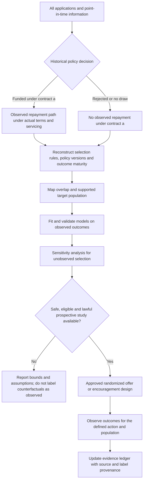

# Who Gets a Repayment Label?

## Reject inference, selective labels and evidence for sustainable MSME credit

**Underwrite for Collection · Article 3 of 5 · LinkedIn research article · Companion piece · 8 October 2026**

### Abstract

Credit institutions observe repayment only after an applicant receives and takes up a particular financing offer. A rejected applicant therefore does not have an observed repayment outcome under that offer, and a model cannot turn the missing counterfactual into fact by imputation. This article treats reject inference as an evidence-design problem: define the contract-specific outcome, reconstruct how historical approval selected the observed portfolio, map support and uncertainty, and build controlled evidence where a decision is safe and lawful. It develops hierarchical Bayesian logistic and survival models, selection assumptions, sensitivity analysis, Pólya–Gamma computation and a guarded offer pilot. A worked example shows what a small study can establish and how wide its uncertainty remains. The discussion connects applicant selection to business cash, ring-fenced receivables, Kenya’s data-protection framework, Fannie Mae and Freddie Mac performance data, IFRS 9 and the *Underwrite for Collection* lifecycle.

This third article takes the evidence boundary raised in the first two pieces and examines it directly: lenders observe repayment after a contract is offered, accepted, funded and serviced, while rejected applicants have no realized repayment under the unissued contract. The first article explains how an RCT can create comparative evidence for approved offers; the second shows why repeated collection actions require action-time records and supported comparisons. Reject inference asks what can responsibly be learned outside those observed paths. The answer depends on the defined contract, the historical selection mechanism, overlap, assumptions and prospective evidence. This article develops those elements without repeating the earlier tutorials on bandits or sequential control, then identifies where the fourth article moves to bank balance-sheet decisions.

### Research questions

1. In which Kenyan MSME segments and contract types do historical funded-loan records provide enough overlap to estimate repayment risk, and how do conclusions change under plausible unobserved-selection assumptions?
2. What randomized offer or repayment-schedule design can generate useful evidence near an approval boundary while preserving affordability, data-protection safeguards, human review and ordinary borrower rights?
3. How should borrower cash provenance, ring-fenced receivables, collective guarantees and realized collection outcomes enter a validated risk framework without treating imputed reject labels as observed repayment or conflating ECL with capital?

### Start with the question that repayment data can answer

The practical question behind *Underwrite for Collection* is how a lender can support sustainable repayment across the full facility life. That question reaches back to origination because the amount, price, repayment calendar, security and servicing plan shape the cash burden that the borrower must meet. Historical performance files contain payment paths for loans that were approved, accepted and disbursed under previous policies. They do not contain repayment under a loan that was declined or never drawn. This is a selective-label problem: the decision process determines whose outcomes become observable. It is not an administrative gap that can be solved by assigning a simulated good-or-bad label to every rejected application.

For an MSME, a financing offer is inseparable from the operating context. A seasonal trader may not be able to meet the same monthly schedule as a service firm with regular invoices, even when their annual cash generation is similar. A borrower who needs working capital for stock has a different repayment mechanism from a business financing a productive asset. An invoice-backed facility may depend on eligible receivables, obligor payment, dilution, legal assignment, account control and waterfall rules rather than unrestricted enterprise cash. Thus the target is not an abstract “creditworthy” flag. It is the repayment and loss path associated with a specified product and contract, for a defined population, under a defined servicing process and time horizon.

The distinction among prediction, transport and causal policy analysis is central. Prediction asks how well the model estimates an outcome in a population with support in the development data. Transport asks how to adjust or qualify that prediction for a different target population. Causal evaluation asks what would happen under an alternative offer or policy. A model that ranks approved borrowers accurately can still be wrong for applicants outside the approval region. Reweighting may target a broader distribution only if selection is measured and overlap exists. A policy effect needs a defined intervention and a credible comparison group. The research should name which question it answers before reporting a performance metric, because a high AUC among funded loans does not establish the counterfactual repayment behavior of applicants who were never funded [1], [2], [3].

### Define the potential outcome under a complete contract

Let **Xᵢ** be applicant information available at the decision time, and let   
Sᵢ=1

 indicate that the historical process financed applicant *i*. Let **a** denote a complete offer: principal or limit, price and fees, term, repayment schedule, grace period, collateral or guarantee conditions, disbursement requirements and servicing regime. Define   
Dᵢᵃ(τ)=1

 if applicant *i* would default by horizon **τ** under offer **a**. The contract-specific risk target is   
pᵢ,τ(a)=Pr(Dᵢᵃ(τ)=1 | Xᵢ).

 For an applicant who never received offer **a**, **Dᵢᵃ(τ)** is unobserved. If two applicants received different amounts or schedules, their outcomes are not automatically labels for the same intervention. Writing the offer explicitly prevents the analysis from treating credit risk as a property detached from contract design.

Take-up is another potential outcome. Let   
Tᵢᵃ=1

 if the applicant would accept and draw offer **a**. A lender may care about default among originated loans, take-up among eligible applicants, expected net contribution per applicant approached, or the effect of an offer policy on the broader cohort. These are different quantities with different denominators. An offer may change who accepts; a schedule may change both affordability and take-up; a guarantee may change recovery without changing the business’s ability to pay. Therefore, observed default conditional on acceptance under a high-rate offer cannot be compared casually with observed default among accepted lower-rate loans. Research should record the full chain—eligible, assigned, offered, accepted, originated, serviced, cured, prepaid or defaulted—so an analyst can identify which population a reported estimate describes.

The same contract specificity applies to time. A fixed 12-month default indicator may be appropriate for one question, while a lender planning amortization, expected loss or recovery may need the event timing. Default, cure, prepayment, refinancing, restructuring, write-off and liquidation change exposure and observation. A time-to-event model estimates event hazards only under its assumptions; it does not supply missing events for declined cases. A model that censors every prepayment as if it were unrelated to future default can answer the wrong question if prepayment is informative. The study must state the event definition, start date, horizon, competing events, censoring rule, and whether the target is default by any time, default before another event, or a net cash-shortfall measure.

### What a hierarchical Bayesian model contributes

A hierarchical Bayesian logistic model can partially pool evidence across sectors, regions, vintages or product types. One specification is   
Dᵢᵃ(τ) ∼ Bernoulli(pᵢ,τ(a)),

 with   
logit(pᵢ,τ(a)) = αᴸ + uᴸ_sector[i] + vᴸ_region[i] + wᴸ_vintage[i] + fᴸ(Xᵢ) + hᴸ(a,Xᵢ).

 The function **f** represents borrower characteristics and pre-specified nonlinearities; **h** represents offer and context interactions; and the group terms allow information sharing across related cohorts. Partial pooling can stabilize estimates for small segments, while the posterior represents uncertainty conditional on the likelihood, prior and model structure. Model checks should include prior sensitivity, calibration, posterior predictive checks, time-based validation, missingness, subgroup performance and sensitivity to contract definitions. Hierarchical structure is a way to share information, not a guarantee that a model extrapolates correctly beyond the historical support [4], [5].

A hierarchical Cox model can represent the time to a specified event:   
λᵢ(t|Xᵢ,a)=λ₀(t)exp(Xᵢᵀβᴴ+qᴴ(a,Xᵢ)+uᴴ_sector[i]+vᴴ_region[i]+wᴴ_vintage[i]),

 with survival   
Sᵢ(t)=exp(−∫₀ᵗλᵢ(u)du)

 in a single-event formulation. It can show how risk changes over loan seasoning and help distinguish near-term from later exposure. If cure, prepayment and default compete, cause-specific hazards or a multi-state model may be needed. The model’s term structure is estimated for observed contracts and populations; it does not by itself justify sequential price changes or prove an intervention is effective. For fixed-term loans, the price is ordinarily set at origination. The survival model may inform future monitoring, new offer cohorts or a permitted renewal decision, while collection actions after disbursement remain a distinct decision process [6].

The hierarchy retains sector s, region r and origination vintage c in both specifications. Model label L identifies the fixed-horizon logistic model; H identifies the event-hazard model. Each model has its own group effects, scales and likelihood. The following non-centred representation supplies every group level and its half-Student-t scale prior. The functions fᴸ, hᴸ and qᴴ use declared feature and interaction bases, whose coefficients belong to the corresponding βᵐ block; Bᵐ is its positive-definite prior covariance. Normal uses variance as its second argument. The positive scale settings s₀,kᵐ and sα are declared before fitting and assessed by prior-predictive checks. For a fully Bayesian piecewise-constant baseline hazard, interval ℓ receives a positive Gamma prior with specified shape aℓ and rate bℓ. Cause-specific models repeat the structure with an additional event label. Explicit joint modelling is required if information is shared between outcome types [4], [5], [6].

uᵐ_s = σᵐ_u zᵐ_us;   zᵐ_us ∼ Normal(0,1)

vᵐ_r = σᵐ_v zᵐ_vr;   zᵐ_vr ∼ Normal(0,1)

wᵐ_c = σᵐ_w zᵐ_wc;   zᵐ_wc ∼ Normal(0,1)

σᵐ_k ∼ Half-Student-t(ν=3, scale=s₀,kᵐ),   k ∈ {u,v,w}, m ∈ {L,H}

αᴸ ∼ Normal(0,sα²);   βᵐ ∼ MVNormal(0,Bᵐ)

λ₀,ℓ ∼ Gamma(shape=aℓ, rate=bℓ)

### Model the selection process, then test its assumptions

Let   
e(x)=Pr(S=1|X=x)

 be the historical financing-selection probability. If the recorded information captures all relevant causes of selection and potential repayment, one may consider a conditional exchangeability assumption such as **Dᵃ(τ) ⫫ S | X**, together with overlap   
**0<e(x)<1**  
 in the target region. These conditions are strong and must be assessed against decision practice. If policy always rejected an entire score or business segment,   
e(x)=0

 there; no reweighting estimator can obtain outcomes from financed counterparts that do not exist. An estimated propensity close to zero can generate unstable weights, and an algorithmic smoothing prior does not turn unsupported data into observed evidence. A useful report therefore pairs predicted PD with a support label and clearly distinguishes observed, weakly supported and extrapolated regions.

Historical lending decisions may have used information that the modelling extract does not contain. Loan officers might have reviewed business continuity, inconsistent documents, supplier reliability or customer concentration; a credit committee may have recorded a policy exception in a separate system. If such information influenced both approval and repayment, conditioning on **X** does not make historical selection ignorable. The analysis should reconstruct available decision rules, application channels, manual overrides, policy versions, score cut-offs, declined reasons and economic periods. It should preserve the variables and timestamps actually available at each decision. If a source field cannot be recovered, the absence should be documented, because the selection process may have relied on it. A propensity model is useful only insofar as it represents the actual decision mechanism and shares support with the target population.

Sensitivity analysis makes hidden assumptions reviewable. One illustrative parameterization is   
logit Pr(Dᵃ=1|X,S=0) = logit Pr(Dᵃ=1|X,S=1)+δ_g,

 where **δ_g** represents a segment-specific difference in risk associated with unobserved selection information. Analysts can vary **δ_g** across plausible values, compare resulting expected loss and approval policies, and show where the preferred action changes. A joint Bayesian selection-outcome model can also describe dependence between approval and repayment, but its posterior depends on identifying restrictions, priors, exclusions or other information that links the two processes. The practical aim is not to invent a “true” hidden adjustment; it is to show whether a conclusion survives credible assumptions. Parameter uncertainty and selection uncertainty should be reported separately so a narrow posterior conditional on a strong assumption is not mistaken for certainty about the counterfactual.

Inverse-probability weighting can help target the historical sample to an applicant population when selection is conditionally explainable and overlap is adequate. If an applicant with context **x** has financing probability **e(x)**, observations can be weighted to represent the intended population. Yet extreme weights can make a small number of loans dominate the estimate, and clipping them changes the estimand or introduces bias that must be disclosed. Outcome-regression and doubly robust approaches combine a model for repayment with a model for selection or action assignment; under standard conditions, they can remain consistent if one nuisance model is correct, but they do not solve unmeasured confounding and no-overlap together [7], [8]. Reports should show propensity distributions, weight truncation sensitivity, effective sample size, support by segment, outcome missingness and uncertainty. “Doubly robust” describes a property under assumptions; it is not a guarantee that an arbitrary reject-inference process is robust.

### Pólya–Gamma helps compute a model; it does not reveal missing outcomes

Pólya–Gamma augmentation can make Bayesian logistic regression computationally convenient. For binary outcome **yᵢ∈{0,1}** with predictor   
ηᵢ=xᵢᵀβ,

 define   
κᵢ=yᵢ−1/2

 and introduce latent   
ωᵢ∼PG(1,ηᵢ).

 Conditional on **ω**, the likelihood is quadratic in **β**; with a Gaussian prior, the regression coefficients have a Gaussian conditional distribution, with covariance:  
Σ⁎=(XᵀΩX+Σ₀⁻¹)⁻¹

and a corresponding posterior mean [9]. Hierarchical models add group-level parameters and additional sampling steps. This structure can support posterior inference for a default model or historical selection model, provided the sampler mixes and converges, posterior predictive checks are satisfactory and results are tested for prior sensitivity. Store these diagnostics with the fitted version and link them to the decision for which the model is being evaluated.

The computational identity should not be overextended. It can simplify sampling from a posterior conditional on a stated model, but it cannot identify a repayment label that was never observed. If a Gibbs sampler draws **yᵢ** for a rejected application from **Bernoulli(pᵢ)** and then feeds that draw back into the same model, the result is model-generated synthetic data. It may illustrate consequences under assumptions or support a sensitivity analysis, but it does not add empirical repayment evidence. A posterior can be precise conditional on an assumed selection mechanism while the actual counterfactual remains weakly identified. Label provenance should therefore distinguish observed outcomes, administrative corrections, externally verified events, model predictions and simulated values. Only observed or appropriately adjudicated outcomes should be used as factual repayment records in a lender’s performance ledger.

The compact Pólya–Gamma expression uses an expanded design matrix containing the intercept, approved borrower and offer-interaction bases, sector indicators, region indicators and vintage indicators. Its coefficient vector stacks the logistic coefficients and group effects; the Gaussian prior covariance conditions on the current hierarchy scales. Thus the short matrix formula represents the same complete logistic hierarchy rather than dropping its group levels. The survival model uses those named levels in its own hazard likelihood and posterior calculation. Versioned design records preserve every column, reference level, group mapping, constraint and prior setting. The appendix derives the coefficient conditional distribution and explains the separate scale updates, so the computational shortcut and the human-review uncertainty summary remain connected to the fitted specification.

### Generate evidence through a guarded offer design

The alternative to unsupported imputation is prospective evidence collection when a decision is genuinely uncertain and an offer is safe, affordable and lawful. Define a narrow study population that passes identity, eligibility, ability-to-repay, product and other required policy checks. Within that group, a randomized offer or repayment-schedule comparison can estimate outcomes for the specified action. A design might compare a standard monthly schedule with a cash-flow-aligned schedule, or randomize a controlled invitation to reconsider an application after a policy review. The randomized action is not a license to expand credit to applicants who fail safeguards. It should be approved by the institution’s responsible-lending, legal, data-protection, model-risk and research governance functions, and the control group should retain standard service and rights.

The protocol should specify the estimand, population, offer terms, assignment mechanism, comparator, follow-up horizon, outcome definitions, sample-size assumptions, treatment noncompliance, missing-data plan, interim monitoring, stop rules and human review. Keep the point-in-time application record, proposed contract, policy version, assignment probability, final offer, staff override and reason, acceptance, disbursement, servicing history, repayment, arrears, cure, restructuring, recovery and loss. A randomized offer estimates the effect of the offer policy, including take-up, if analyzed by assignment. It does not automatically estimate the effect of origination among those who accept. If an encouragement is used as an instrument for take-up, its assumptions and local-complier interpretation must be made explicit. The assignment unit may be a borrower, account, branch or group depending on spillovers and operational delivery.

Adaptive allocation can follow once a fixed pilot establishes data quality, outcome latency, safe action sets and support. A mixture policy might be written   
πₜ(a|x)=(1−εₜ)π̂ₜ(a|x)+εₜq(a|x),

 where **π̂ₜ** is the current estimated best action and **q** preserves controlled exploration. In credit, the allowed action set should be determined by law, affordability, credit policy and capacity before the bandit acts. Propensities should be logged after all eligibility and human gates, and the design should retain a randomized benchmark or valid holdout. Bandit adaptation can reduce assignment to actions that look inferior, but it can also starve an arm of evidence and amplify noise when outcomes are delayed. The adaptive method must use inference appropriate to changing allocation, rather than standard fixed-randomization formulas without adjustment [10].

### A worked example: four defaults among eighty funded pilot loans

Consider a hypothetical design with **1,000** applicants who were declined under an earlier policy but pass a new minimum affordability and eligibility screen for one specified product. Suppose **100** are randomly selected to receive the offer, **80** accept and draw, and all 80 have complete twelve-month follow-up. Four default by the pre-defined twelve-month endpoint. The observed funded-loan rate is   
4/80=5%.

 A Wilson 95% interval for a binomial proportion is approximately **2.0%–12.2%**. These numbers are illustrative, not portfolio findings or a recommended approval policy. They show that the study has produced evidence for a defined offer and pilot-eligible population, while leaving material uncertainty about its risk. The denominator is 80 originated loans, not the 100 offered and not all 1,000 screened applicants [11].

The randomized offer also creates information about offer take-up and outcomes among the assigned population if the study includes an appropriate comparator and captures the defined outcome for all assigned applicants. The intention-to-treat comparison can measure the effect of making the offer available on net contribution per eligible applicant, take-up, or a later arrears indicator. The 900 applicants not offered a loan and the 20 offered applicants who did not draw account for 920 applicants without funded-loan repayment observations under this pilot contract. Comparing the 80 acceptors with a historical approved pool is not a causal comparison; acceptance and historical approval both reflect selection. A report should state which quantity is estimated, show attrition and noncompliance, and avoid stating that all applicants previously rejected have a 5% PD. The pilot’s evidence is local to the design and does not travel automatically to a different rate, product, sector or economic period.

If the four defaults occurred in months 2, 5, 10 and 12, and some other loans cured or prepaid before month 12, a survival or multi-state analysis could describe time to event and competing exits. The small sample would make segment-specific hazards highly uncertain. A hierarchical model might pool groups, but its prior and risk structure would matter substantially; reporting the 5% point estimate alone would conceal that. The next study could grow the sample only within suitable eligibility and governance boundaries, with matured cohorts and ongoing loss monitoring. A separate sensitivity analysis could ask how estimates change if the pilot population still differs from historical rejects in unrecorded ways. Neither step turns the estimate into a universal rejected-applicant default rate.

| Quantity | Hypothetical value | Interpretation |
|---|---:|---|
| Screened and eligible population | 1,000 | Passed documented pre-randomization safeguards |
| Applicants assigned an offer | 100 | Randomly selected in this example |
| Offers accepted and originated | 80 | Take-up count |
| Twelve-month defaults | 4 | Matured outcomes under this offer |
| Funded-loan default estimate | 5% | 4 ÷ 80 for the pilot offer and population |
| Approximate 95% Wilson interval | 2.0%–12.2% | Sampling uncertainty under binomial approximation |

### Connect the evidence to business cash and receivables

For an operating business, the repayment analysis should distinguish customer receipts from owner injections, inter-account transfers, refinancing, asset sales and one-off grants. Those flows may be valid sources of payment but they answer different questions about sustainability. The lender needs an entity-resolved view of revenue, working capital, taxes, payroll, suppliers, debt obligations, owner withdrawals and seasonal cycles. An applicant may repay an instalment through a transfer from a related account while the business itself is weakening; another may have temporary timing pressure because a verified customer invoice will settle after the due date. A risk model that treats all credits as recurring operating cash can misclassify these situations. The data ledger should preserve source, account ownership, transaction date, reversal status and verification level, subject to privacy and purpose limits.

For financing a ring-fenced receivables stream, the core exposure is identified assets and the collections legally dedicated to repayment. Evidence should cover invoice eligibility, underlying supply, obligor acceptance, concentration, dilution, set-off, dispute, assignment, perfection, account control, servicing continuity, collection timing, reserves and waterfall distributions. The collections dedicated to the receivables facility can be strong even where the originator’s unrestricted business cash is weak, and the reverse can also occur. Where the worked structure uses a special-purpose vehicle (SPV), the analysis follows the receivables held by that vehicle and the collections available under its waterfall. Reject inference for an operating-business facility therefore needs a separately specified outcome and selection model when applied to financing ring-fenced receivables. The offer, unit of analysis, obligor, legal rights and observed repayment event differ. A trial should record whether cash came from ordinary trading, an assigned invoice, a guarantor, a reserve, owner support or recovery action so that a “repayment” label preserves its economic source.

Collective guarantee arrangements and chama-based screening add group information and group-level risks. Peer screening may provide contextual evidence about trading continuity, member history and local knowledge; peer monitoring may identify deterioration after disbursement. At the same time, members can be exposed to correlated shocks, social pressure, privacy loss, inaccurate peer reports and unclear liability. The research design should distinguish individual debt from group guarantee obligations, identify who supplies and can correct information, explain what members can see, and define the procedure for disputes and guarantee calls. Statistically, members share an environment and may affect one another’s outcomes; the no-interference assumption can fail. Cluster-level randomization or explicit network and group effects may be needed. Peer knowledge should augment documented underwriting, not act as an unreviewable label or substitute for a member’s rights.

### What the GSE data can show about selection

The GSE files are useful here for their visible population boundary. A performance dataset begins after a defined acquisition and eligibility process, so it supports analysis of included loans but cannot reveal the potential repayment of applicants or loans excluded before acquisition. That is the same distinction a reject-inference study must preserve: document who entered the file, which policy or acquisition cut-offs applied, and what exclusions shaped the observed labels. Loan vintages, identifiers, reporting dates and later corrections also matter because selection can occur at several stages, not only at the original application decision [12], [13]. Article 1 covers the broader data architecture; in this article the focus is how recorded coverage limits counterfactual claims. These mortgage files are not Kenyan MSME evidence, so local estimates require locally governed data and prospective designs.

### Kenyan data protection and credit rules shape the study

The Data Protection Act, 2019 sets processing principles in section 25 and data-subject rights in section 26. Section 31 requires a data-protection impact assessment where processing is likely to result in high risk to rights and freedoms; section 35 addresses decisions based solely on automated processing that produce legal effects or significantly affect a person, subject to statutory exceptions and safeguards [14]. A company is not itself a natural-person data subject, but business files may identify a sole proprietor, director, guarantor, employee or customer. Transaction-level records can reveal personal or sensitive circumstances. The project should classify controller and processor roles, purpose, lawful basis, notices, data sources, minimisation, accuracy, retention, security, rights handling, access controls, linkage and cross-border transfers before model construction.

Regulation 22 of the Data Protection (General) Regulations, 2021 gives operational safeguards for automated individual decision-making, including notice, meaningful information about the logic, measures to prevent errors and bias, suitable statistical procedures, and a route to human intervention and expression of the data subject’s point of view. Regulation 49 identifies processing activities requiring a DPIA, and regulations 50–53 address assessment, prior consultation, consideration and audit [15]. The assessment should distinguish a model that prioritizes a case for human review from one that automatically declines an application, changes a credit limit or triggers a collection outcome. Human review should be substantive: the reviewer needs information, expertise, authority and time to change the recommendation. The workflow should preserve correction and complaint routes. A DPIA identifies and mitigates processing risks; it does not by itself establish every lawful basis or permission needed for the project.

Credit-specific rules depend on the institution and product. The Banking (Credit Reference Bureau) Regulations, 2020 govern defined credit-information processes [16]. For non-deposit-taking credit business not regulated under another written law, the Central Bank of Kenya (Non-Deposit Taking Credit Providers) Regulations, 2026 (Legal Notice No. 191) apply; regulation 3 excludes institutions regulated under banking, microfinance, SACCO and other specified statutes. Regulations 96–97 provide transition for existing licensees and revoke the 2022 Digital Credit Providers Regulations. For providers within scope, the 2026 Regulations set requirements on credit appraisal, collection, customer information and AI lending decisions; regulation 60 requires explanation where AI decisions affect loan applications, customer notice of AI interaction, human oversight, bias risk assessment and technically robust, transparent and explainable systems [17]. Banks, MFIs, SACCOs, NDTCPs, intermediaries and chamas may have distinct regimes, permissions and duties. Before a pilot, classify the entity and determine applicable banking, microfinance, SACCO, credit-reporting, consumer-protection and data-protection provisions. Record which rule governs eligibility, offer, collection contact, bureau reporting, automated decisions and appeals, and apply the selected regime to this study’s evidence path.

### Fairness and outcome measurement

Fairness diagnostics should be selected according to the decision and the error that matters. Equal opportunity compares true-positive rates across groups; equalized odds compares true-positive and false-positive rates conditional on the outcome [18]. Neither means equal accuracy, and neither resolves all questions about access, price, affordability, service quality, collection burden, recovery or privacy. The labels themselves are selective: repayment is observed under prior offers and servicing, and an intervention can change the outcome. Protected characteristics may be restricted or sensitive, though a carefully governed fairness assessment may need lawful access to some attributes. Reports should state group definitions, sample sizes, label source, outcome horizon, uncertainty, thresholds, support gaps and the action taken when a disparity appears. Excluding sensitive fields or adding an adversarial constraint does not by itself eliminate proxy effects or prove legal compliance.

### IFRS 9, expected loss and capital remain distinct

Expected credit loss, pricing expected loss, economic capital and regulatory capital are related but non-interchangeable. IFRS 9 uses probability-weighted discounted cash shortfalls over the applicable horizon using reasonable and supportable information; 12-month ECL is not simply the cash shortfall expected to occur during the next twelve months [19]. The approximation   
**EL≈PD×LGD×EAD**  
 can explain an expected-loss component under simplifying assumptions, but it is not a complete ECL calculation or an economic-capital measure. Economic capital may be defined using a selected tail-loss measure and horizon, while regulatory capital follows applicable prudential rules. Reject-inference sensitivity can inform a risk discussion, but model-imputed labels should not be inserted into a ledger as observed Stage 1-to-Stage 2 transitions or used to state an actual provision amount. Accounting and regulatory outputs must follow their separate methods and approvals.

### A staged evidence program

The first stage reconstructs historical decision-making: policy versions, score cut-offs, manual overrides, offer terms, application channels, applicant data available at the time, and the path from approval to acceptance, disbursement and servicing. It measures overlap, missingness, outcome maturity, group support, data corrections and changes in market conditions. The second stage validates fixed-horizon PD and survival models within the funded population, using time-based holdouts, calibration, competing-event checks and subgroup diagnostics. The third stage varies assumptions about unrecorded selection information and reports where estimates or decisions change. These steps show which segments can be addressed with historical evidence and which rely mostly on extrapolation. They also help the institution design a prospective study whose action and target population match the decision it needs to make.

The evidence pathway below keeps the observed and unobserved branches separate. Historical modelling describes supported experience, while sensitivity analysis makes assumptions visible; a safeguarded prospective design can add outcomes only for a defined eligible population and contract. The path does not collapse model-generated values into the repayment ledger. That separation matters for audit, fairness, accounting and future policy evaluation because the same applicant may face different outcomes under different contract terms. The flow also makes a review point explicit: if the proposed study cannot establish an eligible population, lawful data use, meaningful comparison and protection of ordinary rights, the process returns to design rather than progressing to adaptive policy.

The fourth stage develops a controlled offer or schedule pilot among applicants who meet minimum eligibility and affordability requirements, with a current-policy comparator, a prespecified outcome, appropriate statistical power and governance approval. The fifth stage examines heterogeneous effects and outcomes by product, sector, season and relevant groups while preserving uncertainty and privacy safeguards. Contextual allocation may be considered after fixed randomization establishes reliable outcomes, sufficient overlap and an operationally safe action set. Adaptive assignments need accurate logged propensities, a benchmark and inference that accounts for response-adaptive allocation. The final stage follows financed cases into borrower cash, servicing, cure, recovery and loss, distinguishing enterprise repayment from receivables proceeds, guarantee payments and owner support. This gives model users a credible basis for future decisions without claiming that one experiment resolves every rejected application.

### Conclusion

Reject inference is best handled as a transparent account of what is observed, what is assumed and what new evidence can be generated. Define repayment under a specific offer and horizon; reconstruct the historical selection process; map overlap; test selection assumptions; and separate model uncertainty from uncertainty about unrecorded decision information. Hierarchical Bayesian logistic and survival models can pool supported data and describe risk over time. Pólya–Gamma augmentation can support computation for logistic models. Neither creates repayment outcomes for loans never made. Randomized offers can generate evidence for carefully screened populations and specified contracts, while adaptive bandits can allocate only among approved actions with logged probabilities and suitable inference.

For *Underwrite for Collection*, this method connects application, contract, operating cash, monitoring, collection and recovery. The evidence unit differs between a going-concern business loan and a ring-fenced receivables stream, and it differs again for a collective guarantee. Kenyan privacy, data-protection and sector rules determine what data can be processed and how people can challenge consequential decisions. Fannie Mae and Freddie Mac provide valuable examples of cohort design and performance-data documentation, while local evidence must establish local MSME outcomes. The most credible next step is a governed support map followed by a narrow, affordable study with clear outcomes and a standard-care comparator. The result can improve future lending decisions while stating its limits plainly.

The foundational whitepaper, *Underwrite for Collection*, is available on Zenodo [20].

### References

[1] H. Lakkaraju, J. Kleinberg, J. Leskovec, J. Ludwig, and S. Mullainathan, “The selective labels problem: Evaluating algorithmic predictions in the presence of unobservables,” in *Proc. 23rd ACM SIGKDD Int. Conf. on Knowledge Discovery and Data Mining*, 2017, pp. 275–284, doi: 10.1145/3097983.3098066. Author copy: https://www.cs.cornell.edu/home/kleinber/kdd17-selective.pdf.

[2] J. Crook and J. Banasik, “Does reject inference really improve the performance of application scoring models?” *Journal of Banking & Finance*, vol. 28, no. 4, pp. 857–874, 2004.

[3] A. Ehrhardt, C. Biernacki, V. Vandewalle, P. Heinrich, and S. Beben, “Reject inference methods in credit scoring,” *Journal of Applied Statistics*, vol. 48, nos. 13–15, pp. 2734–2754, 2021, doi: 10.1080/02664763.2021.1929090. Available: https://pmc.ncbi.nlm.nih.gov/articles/PMC9041715/.

[4] A. Gelman, J. B. Carlin, H. S. Stern, D. B. Dunson, A. Vehtari, and D. B. Rubin, *Bayesian Data Analysis*, 3rd ed. Boca Raton, FL, USA: CRC Press, 2013, chs. 2, 5 and 9. Author resources: https://sites.stat.columbia.edu/gelman/book/.

[5] A. Gelman, “Prior distributions for variance parameters in hierarchical models,” *Bayesian Analysis*, vol. 1, no. 3, pp. 515–534, 2006, doi: 10.1214/06-BA117A. Available: https://www.stat.columbia.edu/~gelman/research/published/taumain.pdf.

[6] D. R. Cox, “Regression models and life-tables,” *Journal of the Royal Statistical Society: Series B*, vol. 34, no. 2, pp. 187–220, 1972. Available: https://web.stanford.edu/~lutian/coursepdf/cox1972paper.pdf.

[7] M. Dudík, J. Langford, and L. Li, “Doubly robust policy evaluation and learning,” in *Proc. 28th Int. Conf. on Machine Learning*, 2011.

[8] Y. Wang, A. Agarwal, and M. Dudík, “Optimal and adaptive off-policy evaluation in contextual bandits,” in *Proc. 34th Int. Conf. on Machine Learning*, PMLR 70, 2017, pp. 3589–3597.

[9] N. G. Polson, J. G. Scott, and J. Windle, “Bayesian inference for logistic models using Pólya–Gamma latent variables,” *Journal of the American Statistical Association*, vol. 108, no. 504, pp. 1339–1349, 2013. https://doi.org/10.1080/01621459.2013.829001.

[10] A. Durand, C. Achilleos, D. Iacovides, K. Strati, G. D. Mitsis, and J. Pineau, “Contextual bandits for adaptive treatment allocation,” *Proceedings of Machine Learning Research*, vol. 85, 2018.

[11] E. B. Wilson, “Probable inference, the law of succession, and statistical inference,” *Journal of the American Statistical Association*, vol. 22, no. 158, pp. 209–212, 1927, doi: 10.1080/01621459.1927.10502953.

[12] Freddie Mac, *Single-Family Loan-Level Dataset: User Guide*, current release. https://www.freddiemac.com/research/pdf/user_guide.pdf.

[13] Fannie Mae, *Single-Family Loan Performance Data*, current overview and documentation. https://capitalmarkets.fanniemae.com/credit-risk-transfer/fannie-mae-single-family-loan-performance-data.

[14] Republic of Kenya, *Data Protection Act*, No. 24 of 2019, especially ss. 25–37 and 40–50. https://new.kenyalaw.org/akn/ke/act/2019/24/eng%402019-11-15/source.

[15] Republic of Kenya, *Data Protection (General) Regulations*, 2021, regs. 22, 49–53. Official copy: https://www.odpc.go.ke/wp-content/uploads/2024/03/THE-DATA-PROTECTION-GENERAL-REGULATIONS-2021-1.pdf.

[16] Central Bank of Kenya, *The Banking (Credit Reference Bureau) Regulations*, 2020, L.N. 55 of 2020, as amended. https://www.centralbank.go.ke/wp-content/uploads/2026/03/The-Banking-Credit-Reference-Bureau-Regulations.pdf.

[17] Central Bank of Kenya, *The Central Bank of Kenya (Non-Deposit Taking Credit Providers) Regulations, 2026*, Legal Notice No. 191 of 2026, regs. 3, 24, 28, 30, 40–41, 44, 53, 60, 96–97. Available: https://new.kenyalaw.org/akn/ke/act/ln/2026/191/eng@2026-09-29/source.pdf.

[18] M. Hardt, E. Price, and N. Srebro, “Equality of opportunity in supervised learning,” in *Advances in Neural Information Processing Systems 29*, 2016.

[19] IFRS Foundation, *IFRS 9 Financial Instruments*, impairment requirements. https://www.ifrs.org/issued-standards/list-of-standards/ifrs-9-financial-instruments/.

[20] N. Maloba, *Underwrite for Collection*, integrated research whitepaper, 2026. Zenodo. https://doi.org/10.5281/zenodo.23343888.

[21] M. P. Wand, J. T. Ormerod, S. A. Padoan, and R. Frühwirth, “Mean field variational Bayes for elaborate distributions,” *Bayesian Analysis*, vol. 6, no. 4, pp. 847–900, 2011, doi: 10.1214/11-BA631, Result 5. Author copy: https://matt-p-wand.net/publicns/Wand11.pdf.

---

**Publication note.** The pilot numbers are hypothetical and do not describe a Kenyan portfolio or propose an approval rule. This article is a research design discussion, not a fitted model, legal opinion or claim that reject inference has been solved.

**Licence:** © 2026 Nevil Maloba. Creative Commons Attribution–NonCommercial–ShareAlike 4.0 International (CC BY-NC-SA 4.0). https://creativecommons.org/licenses/by-nc-sa/4.0/
