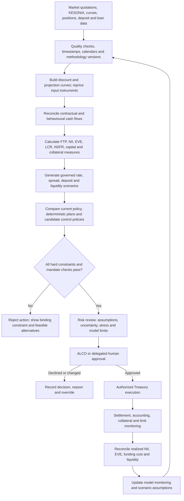
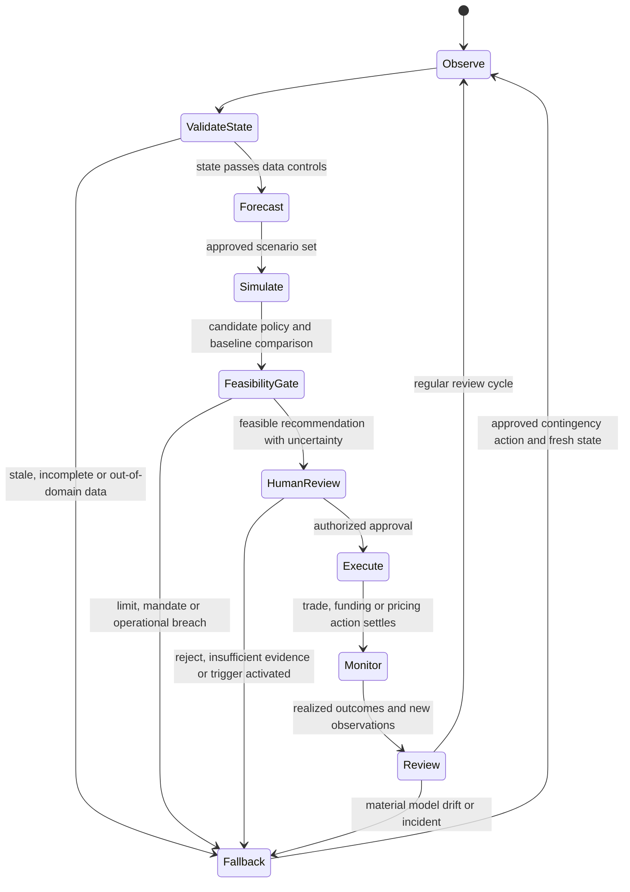

# Can Reinforcement Learning Help Run a Bank’s Balance Sheet?

## From KESONIA and FTP to constrained ALM, IRRBB and ALCO decisions

**Underwrite for Collection · Article 4 of 5 · LinkedIn research article · 8 October 2026**

### Abstract

A bank’s Treasury decisions recur: funding matures, deposits move, rates change, loans reprice, collateral is called and liquidity buffers evolve. This makes asset-liability management (ALM) a natural setting for stochastic control. Reinforcement learning (RL) can help compare sequences of funding, investment and hedging decisions under uncertain scenarios, but only when the decision problem is defined around the bank’s actual balance sheet, policy limits and governance. This article develops that proposition from the Kenyan reference-rate and credit-pricing setting. It distinguishes KESONIA, a market benchmark, from internal funds transfer pricing (FTP); connects earnings and economic-value measures; illustrates behavioural deposit assumptions, liquidity and hedge collateral; and sets out a constrained research pathway from deterministic planning to simulation and carefully evaluated policies. The worked numbers and diagrams are illustrative, not a bank forecast or a production recommendation.

### Research questions

1. How should a Kenyan bank connect KESONIA-based customer pricing, internal FTP, curve construction and behavioural deposit assumptions so that product profitability reconciles with Treasury funding costs and ALCO risk measures over the facility lifecycle?
2. Under what data, simulation, constraint and governance conditions can stochastic control or reinforcement learning improve Treasury decisions relative to transparent baselines while preserving NII, EVE, liquidity, capital, collateral and operational limits?
3. Which data-protection and model-governance controls are required when Treasury analytics use identifiable deposit, borrower, guarantor or employee data, and when does a workflow move from institutional optimization to a potentially significant automated decision about an individual?

### How this article extends the sequence

The first three articles focus on credit decisions at borrower and applicant level. Article 1 asks how randomized comparisons and contextual bandits can test credit offers; Article 2 follows repeated servicing actions and evolving borrower states; Article 3 examines what repayment data can and cannot tell us when historical approval policies create selective labels. This fourth article changes the unit of analysis from a borrower, account or application to an institution’s balance sheet. It carries forward the sequence’s core discipline—define the action, information available at the time, outcome, constraints and evidence—but applies it to Treasury and ALCO decisions. A loan portfolio may appear in both settings, yet a collection intervention and a bank funding or hedge decision have different owners, time horizons, risk limits and evidence requirements. The methods connect; the decisions remain distinct.

The borrower models pass their uncertainty into this balance-sheet view through versioned portfolio cash-flow scenarios. The logistic and survival specifications developed earlier retain sector, region and origination-vintage effects, together with their model-specific coefficient and scale distributions. A portfolio simulation should sample each shared effect once for a scenario and apply that draw to the borrowers belonging to that group; otherwise independently resampling a common sector shock for every loan can understate aggregate uncertainty. Contract schedules, exposure paths, prepayment, collections and recoveries then determine dated cash, with separately specified dependence where needed. Treasury receives scenario cash flows, uncertainty summaries, modelling dates and data-support indicators. It can combine them with funding, deposit and market scenarios while preserving the distinction between an estimated borrower outcome and an authorised Treasury action. The hierarchy therefore remains traceable from individual evidence to the liquidity and earnings distribution presented to ALCO.

### Why balance-sheet control is a sequential problem

ALM coordinates assets, liabilities, capital and off-balance-sheet positions over time. A Treasury team does not make one isolated decision and then observe a fixed result. It reconsiders funding as wholesale instruments approach maturity, deposit balances change, lending growth departs from plan, market rates move, collateral values shift and liquidity forecasts are updated. Each action changes later choices: issuing term funding now can reduce refinancing risk while increasing current cost; entering a swap can reshape interest-rate sensitivity while creating margin and counterparty exposures; changing product pricing can alter both deposit retention and future asset growth. These links make the balance sheet a dynamic system, with actions today changing the state and feasible choices tomorrow.

A useful control model begins with a state vector, xₜ, that summarizes information available at decision time t. It could include contractual repricing and maturity ladders, currency and basis exposures, deposit balances and estimated behavioural parameters, loan pipeline, funding spreads, liquid assets, collateral capacity, current NII and EVE sensitivities, capital and policy headroom. Market conditions and customer behaviour evolve under uncertainty, so the state transition is written xₜ₊₁ ~ P(· | xₜ, aₜ, wₜ₊₁), where aₜ is the approved decision and wₜ₊₁ represents new shocks or observations. The state must be sufficient for the intended comparison and measurable on the bank’s operating timetable. A convenient feature vector is not automatically a reliable economic state.

Actions are not unrestricted switches. They may include setting approved funding volumes and tenors, investment maturity, hedge type and notional, eligible transfer prices, balance-sheet growth limits or contingent-funding steps. The allowed set A(xₜ) must be specified by governance, mandate, operational readiness, legal entity, market access, counterparty limits, accounting designation and risk appetite. Some controls are continuous, such as a hedge notional within an authorized range; others are discrete, such as selecting among approved funding tenors. A model should identify actions that are unavailable, unsuitable or unaffordable before optimization. It should also represent implementation lag: a funding issue or hedge approved today may settle later, at a price that differs from the assumed one.

The bank’s objective is not one scalar unless leadership has made the trade-offs explicit. Shareholder return, NII stability, economic value, liquidity resilience, capital use, customer pricing and strategy can conflict across horizons. A control objective can combine measurable financial outcomes, but it must show the reporting horizon and weights, and should present separate constraints and dashboards so that a high expected return cannot conceal a weak liquidity position. ALCO supplies the institution’s risk appetite and approved strategy; Treasury executes within delegated authority; independent risk validates exposure and limits; Finance owns accounting and performance bridges; and the board remains accountable for its oversight. A learned policy can inform this process, but it cannot set institutional risk appetite by optimizing a reward function.

### Economic value, earnings and the risks that connect them

Two essential IRRBB views answer different questions. Economic value of equity (EVE) measures how interest-rate changes alter the present value of expected banking-book cash flows. Net interest income (NII) measures how rates, repricing, volumes and behavioural responses alter earnings over a chosen horizon. EVE gives a longer-run value sensitivity; NII gives a near- to medium-term earnings view under a stated balance-sheet scenario. Basel’s framework treats IRRBB as risk to both capital and earnings and explains that measurement depends on rate shocks, customer options, non-maturity-deposit assumptions, business replacement assumptions and accounting treatment [1], [2]. Reporting both views matters because a strategy that improves one can worsen the other.

EVE can be represented as:  
ΔEVE = EVE(shocked curves, behavioural cash flows) − EVE(base curves, behavioural cash flows).  
In a simplified fixed-cash-flow approximation:  
ΔEVE ≈ −Dₑff × EVE₀ × Δr,  
where Dₑff is an effective duration and Δr is a parallel rate move. This approximation is useful for intuition only: real banking books have multiple curves, basis risks, floors, caps, embedded options, non-parallel shocks and cash flows that respond to rates. NII under scenario *s* over horizon *H* can be written:  
NIIₛ(H) = Σₜ₌₁ᴴ [interest incomeₜ,s − interest expenseₜ,s] + relevant fee and hedge effects,  
with a consistent classification policy. A baseline comparison must state whether the balance sheet runs off, remains constant or grows dynamically, since those assumptions can materially change results [2].

Credit spread risk in the banking book also deserves a distinct lens. A bond or loan may lose economic value because its credit spread widens even when the risk-free curve is unchanged; changes in rates can also affect borrower affordability, deposits and credit quality through separate channels. ALM should avoid treating all valuation movements as pure interest-rate risk or assuming that a hedge of a risk-free curve eliminates spread risk. The control model should report key-rate and basis sensitivities, credit-spread measures where relevant, non-parallel shocks, option effects and concentration by currency and portfolio. It should also identify which exposures are behavioural rather than contractual, and show the sensitivity of reported outcomes to those assumptions. These outputs turn a headline “rates up” result into a risk explanation ALCO can act on.

### Curves, KESONIA and the internal price of funding

The discount and projection curves are inputs to measured cash flows, pricing and valuation. A curve-building process begins with dated, quality-controlled instrument quotations, conventions, day counts, calendars and market cut-offs. It selects instruments appropriate to each curve’s purpose, bootstraps discount factors or zero rates, specifies interpolation and extrapolation, and reprices the input instruments as a validation test. Projection curves for floating cash flows and discount curves for present value may differ; basis between indices and tenor points also matters. A model should store the source, timestamp, convention, interpolation choice and fallback for every curve node. In a market with sparse term observations, the gap between observed quotations and modelled long tenors must be visible as uncertainty, not hidden by a smooth chart.

KESONIA is Kenya’s transaction-based average rate for unsecured overnight interbank KES transactions, administered and published daily by the Central Bank of Kenya [3]. CBK’s revised Risk-Based Credit Pricing Model anchors variable-rate loan pricing to KESONIA compounded in arrears, with the premium K covering lending-related costs, shareholder return, borrower risk and other relevant costs; the published total cost of credit also includes fees and charges [4], [5]. This customer-facing reference and pricing framework should be mapped accurately. KESONIA is a market benchmark, while FTP is the bank’s internal method for assigning funding and liquidity economics to business units and products. FTP may use a term structure of funding costs and behavioural adjustments; it is not a synonym for KESONIA or a substitute for the customer-pricing components required by the CBK model.

A coherent architecture can link the layers without blending their purposes. Treasury’s external funding and market curves feed an approved internal FTP methodology; the business line receives a matched-maturity and liquidity-aware transfer charge or credit; credit risk, operating costs, capital and margin are assessed under the applicable product-pricing framework; and the customer contract identifies its benchmark, premium, fees and reset terms. Management overlays or strategic incentives should be separately visible from measured funding economics. This allows ALCO to understand how choices affect balance-sheet shape while Finance can reconcile internal profitability to general-ledger results. If a market rate, curve construction or customer benchmark changes, the bank should preserve the effective date and affected contracts, methods and approvals so it can reproduce both pricing and performance.

### A worked FTP illustration

Consider a purely hypothetical one-year KES variable-rate business loan of KES 10,000,000 with a customer rate set at 13.0% annualized. Suppose the approved internal funding curve assigns a 9.4% one-year marginal funding rate, a 0.6% liquidity term premium and 0.3% operating allocation, while the applicable expected credit cost is 1.2% and allocated capital return is 0.8%. A simplified annual contribution is:  
13.0% − 9.4% − 0.6% − 0.3% − 1.2% − 0.8% = 0.7%,  
before taxes, unmodelled costs and any additional adjustments. The arithmetic is only an illustrative bridge; an actual product requires institution-approved bases, measurement conventions, amortization, repricing and accounting treatment. It does not assert that a Kenyan bank uses these exact components or values.

Suppose KESONIA compounded over the customer’s reset period rises by 100 basis points while the contractual premium stays fixed. The customer rate may reset according to the product’s documented terms, but the internal profitability analysis must also update its funding, behavioural, liquidity and risk assumptions. If the bank’s internal one-year funding curve rises by 120 basis points and the loan’s effective repricing lags by one month, the mismatch can compress interim margin. The size and timing depend on cash-flow dates, balance amortization, repricing caps or floors, benchmark conventions, funding strategy and the chosen internal FTP method. The purpose of the example is to identify the questions to calculate and reconcile, not to imply that an overnight index and one-year bank funding costs move one-for-one.

The business case should be carried from origination through its life. At each review date, it can compare realized interest income and fees with the customer benchmark and margin; the approved FTP debit or credit; actual and expected funding costs; liquidity and capital allocations; credit losses and servicing costs; and the business unit’s net contribution. New production, early repayment, delinquency, deposit migration, hedges and non-linear options can all change later economics. The result is a versioned profitability path rather than a single rate at loan approval. A robust implementation records both the original pricing decision and subsequent repricing or assumption changes, allowing management to distinguish model variance from customer behaviour, market movements, strategic subsidy and operational error.

### Non-maturity deposits and behavioural replication

A non-maturity deposit has no contractual term that fixes its future balance or repricing date, yet portions of the book may remain stable and respond slowly to market rates. The bank can estimate deposit beta (the change in the customer deposit rate relative to a change in the market reference rate), balance decay, migration and withdrawal behaviour from longitudinal data. These quantities vary by product, segment, channel, customer type, rate regime and liquidity conditions. A single portfolio average can mask material differences between operational accounts, rate-sensitive savings, transactional balances and large corporate deposits. Estimation therefore needs stable definitions, suitable observations across different environments, confidence intervals and scenario testing; behavioural lives should not be selected solely because they make a preferred hedge or EVE result appear attractive.

A replication portfolio approximates the interest-rate profile of deposits through a set of modelled repricing tenors or instruments. It can help allocate interest-rate risk internally, compare product economics and assess hedging needs, but it is a model of observed behaviour rather than a legal maturity of the deposit. If customers move quickly when market rates rise, a long assumed behavioural duration may overstate stable funding value and understate NII sensitivity. The model should test alternative betas, decay rates, floors, migration channels and stress responses, and should separate stable core balance from volatile balances where the data support that distinction. Any replication model should be monitored against realized deposit repricing and runoff, with limits and a documented process for recalibration.

For a simple illustration, assume a KES 100 million deposit portfolio earns customers an average 3.0% while a market rate is 10.0%. The observed average beta over the past year might be 0.35, implying an estimated 35 basis-point customer-rate change for each 100 basis-point market move over that sample period. That statistic is descriptive, not a promise that next year’s beta will be 0.35. If the bank’s stress scenario assumes beta 0.60 and 20% balance migration, the expected expense and cash-flow profile differs sharply from a static-balance assumption. ALM should show these alternatives as scenarios, link each to sample period and estimation method, and ask what actions remain feasible if behaviour changes. This is especially important when a model-informed hedge relies on deposit stability that has not been observed in comparable conditions.

### Liquidity and funding: the constraint that changes the optimum

Liquidity strategy cannot be reduced to a target ratio. The Basel Liquidity Coverage Ratio (LCR) compares eligible high-quality liquid assets (HQLA), after applicable haircuts and caps, with net cash outflows in a specified 30-day stress; the NSFR relates available stable funding to required stable funding over a longer structural horizon [6], [7]. The ratios are important but their calculation depends on legal entity, currency, encumbrance, counterparty, contractual maturity and run-off or funding factors. A bank also needs cash-flow ladders, intraday measures, concentration limits, stress scenarios, survival horizons and a contingency funding plan. The LCR stress scenario explicitly includes deposit outflows, wholesale funding loss, collateral requirements and committed facility draws, showing why a hedge or funding strategy must be evaluated for liquidity effects as well as price risk [6].

For a stylized ratio illustration, assume a bank reports KES 120 billion of eligible HQLA and KES 100 billion of 30-day net cash outflows; the simplified LCR is 120%. If a proposed hedge strategy or funding change increases stressed net outflows by KES 8 billion and also requires KES 5 billion of liquid assets to be encumbered or unavailable, the illustrative ratio becomes:  
(120 − 5) / (100 + 8) = 106.5%.  
 This is not a regulatory calculation: actual HQLA eligibility, haircuts, caps, inflow limits, cash-flow factors, currency treatment and national rules must be applied. The example makes the interaction visible: an action that looks profitable in a rate model can use liquidity capacity that has value precisely when stress occurs.

Structural funding decisions also affect lending growth and internal business incentives. A long-term asset funded by short-term liabilities may generate a higher current margin than a matched-tenor structure, but it can increase refinancing exposure and sensitivity to funding market disruption. A term funding premium should reflect the cost and stability of the funding profile, while reserves and liquidity buffers should be assessed under stress and legal-entity transferability. Funds raised by one subsidiary may not be immediately transferable to another; collateral may be pre-positioned, operationally available only after a delay, or subject to restrictions. These details affect the feasible state and action set. The Treasury controller should therefore represent intragroup limits and operational capacity explicitly, not assume that consolidated liquidity is instantly fungible.

### Hedging, collateral and margin calls

A hedge can lower one risk measure while adding another. An interest-rate swap may reduce a fixed-versus-floating repricing mismatch and improve EVE or NII under a selected shock, but it creates counterparty exposure, basis and hedge-accounting considerations, and collateral calls under market moves. A hedge that is attractive in an average scenario can become hard to fund during a joint rates, spread and liquidity shock. The bank should calculate potential future exposure, initial and variation margin needs where applicable, eligible collateral, haircuts, concentration, settlement timing and cash buffers alongside market-risk benefit. LCR treatment and liquidity stress should reflect collateral outflows using the applicable rules, and internal stress tests should include larger or faster calls than the base case [6], [8].

A simple hedge comparison should place measures side by side. For example, a hypothetical swap might reduce a parallel-up-shock ΔEVE loss from KES 2.0 billion to KES 1.2 billion, while raising modeled peak collateral needs from KES 1 billion to KES 4 billion under a joint stress. The decision depends on the bank’s appetite, available liquidity, hedge basis, counterparty terms and time path—not simply the 0.8 billion EVE benefit. These illustrative figures are not estimates for any institution. The comparison should include market value and earnings effects, collateral and liquidity, counterparty limits, accounting consequences, operational capacity, unwind cost and the impact of simultaneous customer deposit withdrawals. ALCO can then review the trade-off rather than seeing a single optimized hedge ratio.

### Constrained stochastic control rather than reward-only optimization

A finite-horizon control objective can be written as maximizing the expected discounted value of outcomes,
J(π) = Eπ[Σₜ₌₀ᵀ γᵗ r(xₜ, aₜ, xₜ₊₁)],
subject to:  
aₜ ∈ A(xₜ), LCRₜ ≥ ℓₜ, NSFRₜ ≥ nₜ, capitalₜ ≥ cₜ, |ΔEVEₜ| ≤ eₜ, liquidity stressₜ ≤ qₜ, and applicable counterparty, currency, concentration and operational limits.  
 Here π is a policy mapping information to action, γ is a discount factor, and thresholds ℓₜ, nₜ, cₜ, eₜ and qₜ are approved risk limits or internal guardrails. This is a schematic formulation, not a full regulatory model. Hard legal, contractual and prudential constraints belong in a verified feasible-action gate, not merely as penalties that an optimizer may choose to violate in exchange for a larger expected reward.

A reward could represent a transparent combination of risk-adjusted earnings, funding cost, customer pricing effects and implementation cost over specified horizons. However, any scalar objective can hide value judgments: how much near-term NII is worth a unit of EVE sensitivity, how liquidity resilience is valued, whether customer repricing is delayed, and how low-probability stress is weighted. The model card and ALCO paper should therefore show the component outcomes, scenario distributions, tail measures, constraint headroom and sensitivity to weights. If an objective changes, the policy must be re-evaluated and approved as a new version. A “risk penalty” is not a substitute for keeping the bank inside formal limits, nor does a positive expected reward demonstrate that a strategy is resilient under adverse scenarios.

Constrained Markov decision processes, model-predictive control and stochastic programming are practical alternatives or companions to deep RL. A stochastic program can optimize decisions over a scenario tree with explicit constraints; model-predictive control can re-optimize at each review as new forecasts arrive; and a constrained MDP can represent repeated decisions and long-run resource limits. Deep stochastic control may approximate policies in richer state spaces, but it should be compared against interpretable deterministic and stochastic baselines. The 2023 deep-treasury study demonstrates a research approach using simulated yield-curve scenarios and dynamic funding/investment decisions, while also emphasizing simplifications and the need for thorough validation; its method is a candidate for study, not evidence that an AI policy is ready for a bank [9]. ALCO oversight remains necessary because the model cannot define the bank’s mandate.

A POMDP can be useful where important economic states are only partially observed: the true persistence of deposit balances, future customer repricing response, or latent stress regime may be uncertain. The model then maintains a belief distribution bₜ over possible states, updated from observed rates, flows, customer behaviour and forecast errors. But a belief state is only as useful as the observation process, timing and validation behind it. If account feeds arrive late, deposit definitions change, or a rate series has a methodology break, the uncertainty is not solved by a recurrent neural network. An institution may first improve data lineage and model the uncertainty through scenario ranges, Bayesian updating or robust optimization. A POMDP should be used when partial observability changes decisions materially and the model’s belief update has demonstrable value.

### A practical sequence for AI and Treasury research

The first stage is to define the balance-sheet decision and the control owner. Choose a narrow question—such as allocating new fixed-rate assets across approved tenors while preserving a liquidity buffer—rather than “optimize Treasury.” State the decision frequency, time horizon, legal entity, currency, instruments, forecast sources, constraints and the baseline used today. Reconstruct what decision-makers knew when prior actions were taken and retain policy, override and execution records. This first step tests whether the research has decision-grade data and a feasible action set. If Treasury cannot replay a historical decision from timestamped curves, cash-flow positions, limits and scenario assumptions, a sophisticated agent would produce an impressive answer to an unreproducible question.

The second stage builds deterministic and stochastic baselines. Reprice contractual cash flows, validate curve construction, reconcile FTP allocations and compare run-off, constant-balance-sheet and dynamic NII projections. Stress rate level, slope, basis, spread, deposit beta and runoff; test available funding and collateral capacity; and verify that the model reproduces known portfolio sensitivities. The third stage is simulation validation: compare simulated market and balance-sheet paths with historical distributions, stress episodes, expert scenarios and known financial identities. Assess tail coverage, autocorrelation, cross-curve dependence, deposit behaviour and structural breaks. A simulator that generates convenient rate paths but misses funding crises, liquidity feedback or deposit migration can train a policy to exploit its defects.

The fourth stage evaluates candidate policies offline against approved historical decisions and a common set of scenarios. It should report the gap between logged actions and proposed actions, extrapolation beyond historical support, uncertainty in value estimates, tail outcomes and constraint breaches under model error. Importance weighting or doubly robust estimators can be unstable where the policy being evaluated chooses actions rarely seen in historical data; a high point estimate is not enough without overlap and uncertainty analysis. Policy comparisons should include simple rule-based strategies, current practice, robust or risk-sensitive optimization and a transparent no-change option. The fifth stage tests a shadow policy: it generates recommendations without executing them, while Treasury and independent risk review the recommendation, available information, constraints, sensitivity and implementation feasibility.

Only after that should a narrowly scoped pilot be considered, and only where experimentation is institutionally permissible and operationally safe. Market-wide Treasury actions can affect liquidity, capital, customer rates and other firms; randomly exploring actions on the live balance sheet is not equivalent to a borrower offer pilot. A safer progression can use historical replay, stress simulation, shadow operation and controlled parameter adjustments approved through normal mandate and risk governance. If a pilot is used, it requires an explicit treatment definition, safe range, risk limits, monitoring, stop conditions and accountable human sign-off. No model should take live actions outside approved authorities or explore merely to improve its own future reward.

### Diagram 1: from market data to approved ALCO action

The following flow separates data construction, measurement and recommendation from approval and execution. It highlights validation checkpoints: source quality and curve conventions are checked before valuation; balance-sheet assumptions are explicit before the scenario engine runs; and policy outputs pass through hard limits and delegated authority before a trade or pricing decision is made. The diagram also makes the feedback path visible. Actual funding cost, deposit behaviour, collateral calls and realised NII return to model monitoring, while accounting, risk and Treasury reconcile results using the same effective-dated decision record. This is the intended boundary for decision support: an AI component can compare strategies and explain trade-offs, but ALCO and delegated officers retain approval under the bank’s governance.

### Diagram 2: constrained sequential control loop and governance boundary

The second diagram shows the repeated control loop. At each decision date the bank updates its observable state and uncertainty, computes scenario outcomes, applies an approved feasibility gate, and sends a recommendation for review. If observations are incomplete, the model should widen uncertainty, request data remediation or decline to recommend rather than quietly imputing certainty. If a limit is near breach or the policy is outside its validated domain, the loop falls back to an approved contingency plan. This makes the action pathway auditable and resilient to model failure. It is especially important for Treasury because an action can change later liquidity, collateral and pricing states, and a sequence that looks optimal in the simulator may be infeasible after settlement or customer response.

### Data protection and automated decision safeguards

Treasury optimization may use mostly institution-level or market data, but its workflow can also process personal data: identifiable depositors, sole proprietors, borrowers, guarantors, employees, counterparties or customer-level transaction and repricing histories. Whether a dataset is personal data depends on identifiability and processing context, not on whether an AI model is described as “Treasury.” The Kenyan Data Protection Act requires lawful, fair, transparent and purpose-limited processing, data minimization, accuracy, retention control and appropriate security; it also establishes data-subject rights and controller/processor duties [10]. Teams should map fields and purposes, controller and processor roles, access, retention, linkage and cross-border handling before training or operational use. An aggregated portfolio statistic can reduce exposure but does not automatically remove re-identification risk from detailed histories.

Section 31 of the Act requires a data-protection impact assessment where processing is likely to result in high risk to rights and freedoms; section 35 concerns decisions based solely on automated processing, including profiling, with legal effects or significant effects on a data subject, subject to the section’s conditions and safeguards [10]. Regulation 22 of the Data Protection (General) Regulations, 2021 sets safeguards for automated individual decision-making, including notice, meaningful information about the logic, fairness, error prevention, appropriate statistical procedures, bias mitigation and human intervention; regulations 49–53 provide the DPIA process [11]. These provisions should be mapped to the actual decision and personal data involved. An aggregate ALCO optimization recommendation will not automatically be an automated decision about an individual; a customer-specific pricing, deposit treatment or credit action may raise different questions if it has significant effect and is made solely by automated processing.

The data-protection control path should specify lawful purpose and basis, notices, data minimization, correction routes, security, retention and meaningful human review where required. Where a model uses transaction histories to estimate deposit stability, it should distinguish the balance-sheet variable needed from unnecessary details of individual transactions. When customer-level information is linked across products, the institution must assess whether that linkage is necessary and compatible with the disclosed purpose, and whether a less granular or de-identified input would suffice. DPIA screening should occur early enough to shape the system rather than being a late approval document. For a consequential individual decision, a human reviewer needs enough context and authority to reconsider the recommendation; merely clicking “approve” without examining the basis does not supply meaningful review.

### Model risk, ALCO and implementation evidence

Model governance should define ownership for data, curve construction, behavioural assumptions, scenario generation, objective weights, constraint implementation, code, validation and production monitoring. Independent validation should test conceptual soundness, implementation, outcomes and intended use, including challenger methods and stress beyond the training distribution. It should examine model drift, deposit beta stability, forecast error, curve repricing, basis effects, constraint logic, scenario coverage, policy support and override patterns. Explainability should show which state variables and constraints drove a recommendation, alongside the effect of alternative assumptions and feasible actions. A model that cannot explain whether a recommendation came from a maturity mismatch, liquidity pressure, deposit response, curve basis or reward weight is difficult to govern, even if its predictions are statistically accurate.

ALCO papers should contain the decision question, the current position, scenario set, baseline and candidate strategy; separate NII, EVE, LCR, NSFR, capital and collateral outcomes; state key behavioural and curve assumptions; and identify what the model does not represent. They should report central and tail outcomes, uncertainty, limit headroom, customer or business-line consequences, stress response, execution costs, accounting impacts and fallback plan. The minutes should record the selected policy, any rejected alternatives, rationale, owner, approval authority, limits, review date and conditions for stopping or revisiting the action. A reproducible decision record should link model and data versions to the approved action and later realized outcomes. This makes a Treasury recommendation reviewable months later, after rates or management priorities have changed.

A path toward operational use begins with decision-grade data and transparent baselines, not with a deep-learning agent. The institution can first create an integrated curve and cash-flow view, reconcile FTP, build behavioural deposit monitoring and produce consistent stress reporting. Next it can add scenario comparison and optimization with explicit constraints, then run shadow recommendations against ALCO decisions and analyze where they differ. If the differences improve risk-adjusted outcomes under robust tests and remain within governance, the bank may consider a restricted decision-support pilot. This sequence offers practical value even if the eventual model is not reinforcement learning. It also improves the foundation for an institutional analytics workbench: data contracts, definitions, scenario lineage and approved outputs should be reusable without embedding an unapproved execution policy into a reporting layer.

### Conclusion

Reinforcement learning and stochastic control offer a useful research lens for Treasury because funding, pricing, hedging and liquidity decisions recur under uncertainty and affect future choices. Their practical contribution depends on a sound ALM representation: dated curves and cash flows, observable decision states, explicit behavioural assumptions, matched-maturity FTP, separate earnings and value measures, liquidity and capital constraints, and a complete collateral view. KESONIA provides an external overnight market reference in the Kenyan pricing framework; it does not replace an internal funding curve or determine the bank’s FTP method. The worked cases show why Treasury should measure how a decision changes customer rates, business-line economics, EVE, NII, funding, liquidity and collateral together.

A credible AI program begins with deterministic and stochastic baselines, checks simulator realism, evaluates policies offline, runs shadow recommendations, and preserves human approval under the institution’s ALCO and risk governance. Hard limits remain hard constraints, while uncertainty and model boundaries are visible in the decision paper. Data protection applies wherever personal data enter the process, with the Act and General Regulations mapped to the actual controller, purpose and decision; section 35 is relevant to qualifying individual decisions based solely on automated processing, not every portfolio-level optimization. This fourth article extends the first three from offers, collection and selective outcomes to the bank’s own balance sheet. It extends the analysis to an institutional scale, preparing for Article 5’s bank-controlled agentic workflow, which connects the analytical tools to evidence access, human review, authorised execution and monitored outcomes.

### References

[1] Basel Committee on Banking Supervision, *Interest Rate Risk in the Banking Book*, Bank for International Settlements, Apr. 2016. Available: https://www.bis.org/bcbs/publ/d368.htm.

[2] Basel Committee on Banking Supervision, “SRP98: Application guidance on interest rate risk in the banking book,” *Basel Framework*, effective Jan. 1, 2026. Available: https://www.bis.org/committees/bcbs/basel-framework/standard/srp/98/inforce/2026-01-01/published/2024-07-16.

[3] Central Bank of Kenya, “KESONIA Interest Rate Benchmark,” official overview and FAQs. Available: https://www.centralbank.go.ke/kesonia/.

[4] Central Bank of Kenya, *Revised Risk-Based Credit Pricing Model*, Aug. 2025. Available: https://www.centralbank.go.ke/wp-content/uploads/2025/08/Revised-Risk-based-Credit-Pricing-Model.pdf.

[5] Central Bank of Kenya, “Issuance of a Revised Risk-Based Credit Pricing Model,” Aug. 26, 2025. Available: https://www.centralbank.go.ke/2025/08/26/11578/.

[6] Basel Committee on Banking Supervision, “LCR20: Calculation,” *Basel Framework*, current consolidated standard. Available: https://www.bis.org/basel_framework/chapter/LCR/20.htm.

[7] Basel Committee on Banking Supervision, “NSF: Net Stable Funding Ratio,” *Basel Framework*, current consolidated standard. Available: https://www.bis.org/committees/bcbs/basel-framework/standard/nsf.

[8] Basel Committee on Banking Supervision, *Principles for Sound Liquidity Risk Management and Supervision*, Bank for International Settlements, Sept. 2008. Available: https://www.bis.org/publ/bcbs144.htm.

[9] H. Englisch, T. Krabichler, K. J. Müller, and M. Schwarz, “Deep treasury management for banks,” *Frontiers in Artificial Intelligence*, vol. 6, art. no. 1120297, Mar. 2023, doi: 10.3389/frai.2023.1120297.

[10] Republic of Kenya, *Data Protection Act*, No. 24 of 2019, ss. 25, 26, 31 and 35. Available: https://new.kenyalaw.org/akn/ke/act/2019/24/eng%402019-11-15/source.

[11] Republic of Kenya, *Data Protection (General) Regulations*, 2021, regs. 22 and 49–53. Official copy: https://www.odpc.go.ke/wp-content/uploads/2024/03/THE-DATA-PROTECTION-GENERAL-REGULATIONS-2021-1.pdf.

[12] L. P. Kaelbling, M. L. Littman, and A. R. Cassandra, “Planning and acting in partially observable stochastic domains,” *Artificial Intelligence*, vol. 101, nos. 1–2, pp. 99–134, 1998, doi: 10.1016/S0004-3702(98)00023-X. Author copy: https://people.csail.mit.edu/lpk/papers/aij98-pomdp.pdf.

[13] Central Bank of Kenya, “Revised Risk-Based Credit Pricing Model,” *36th Monetary Policy Committee Meeting Background Data*, Apr. 2026. Available: https://www.centralbank.go.ke/uploads/monetary_policy_reports/131378250_36th%20Monetary%20Policy%20Committee%20Report%2C%20April%202026.pdf.

---

**Publication note.** All numerical cases in this article are hypothetical and designed to illustrate calculation structure. This article presents a research and decision-support architecture, not a fitted Kenyan bank model, legal opinion, approved Treasury policy or claim of production performance. Basel standards are international reference material; institution-specific obligations and domestic implementation must be checked against the applicable Kenyan prudential instruments and the bank’s approved policies.

**Licence:** © 2026 Nevil Maloba. Creative Commons Attribution–NonCommercial–ShareAlike 4.0 International (CC BY-NC-SA 4.0). https://creativecommons.org/licenses/by-nc-sa/4.0/
