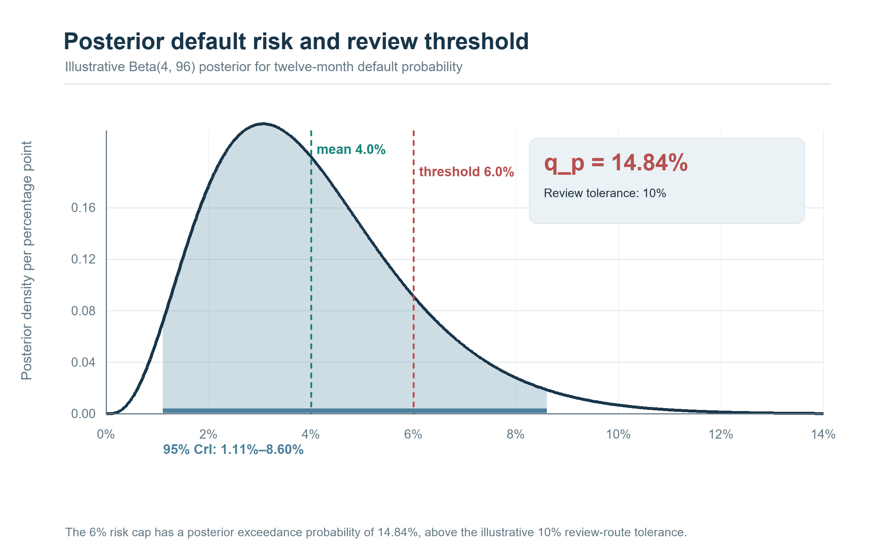
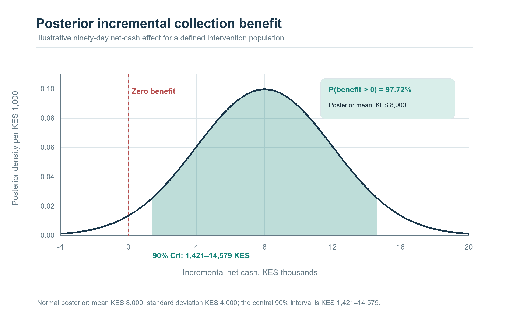
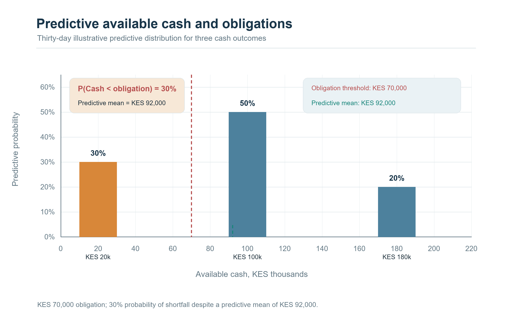
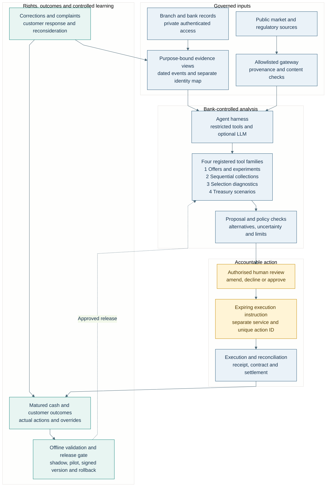

# Bringing the Methods into the Bank

## Agentic AI, Bayesian evidence and accountable credit and Treasury decisions

**Underwrite for Collection · Article 5 of 5 · LinkedIn research article · 8 October 2026**

### Abstract

Credit experiments, sequential collection policies, selection analysis and Treasury optimisation become useful when a bank can connect their results to an authorised operating decision. This fifth article develops that connection through a bank-controlled agentic workflow: approved evidence enters registered analytical tools, the outputs form a reviewable proposal, an accountable officer authorises an action, and execution returns as a reconciled customer and cash outcome. Bayesian credible intervals, exceedance probabilities and predictive distributions help reviewers understand uncertainty alongside point estimates. A worked hypothetical case distinguishes uncertainty about default probability, incremental intervention benefit and future available cash. The design extends the research environment described in Part 4 of the *Underwrite for Collection* whitepaper into an operating architecture covering branch access, restricted agent tools, model releases, customer correction, meaningful human review and Kenyan data-protection obligations. Its practical objective is to make each decision traceable from the information available at the time to the action delivered and the outcome subsequently observed.

### Research questions

1. How can a bank-controlled agentic workflow connect offer experiments, sequential collections, selection diagnostics and Treasury analysis while preserving purpose-bound data access, separate decision authority and reconciled execution?
2. How should credible intervals, exceedance probabilities and predictive cash distributions be presented to human reviewers so that uncertainty changes limit, servicing and funding decisions constructively?
3. What evidence and operating tests should govern progression from a research sandbox to shadow use and bounded deployment under Kenya’s Data Protection Act and General Regulations?

### The fifth step connects the first four

Article 1 developed experiments for credit offers, Article 2 followed the borrower through sequential servicing decisions, Article 3 examined the missing outcomes created by historical approval, and Article 4 considered the bank’s balance-sheet decisions. Their shared operational question is now straightforward: who can act on these analyses, using which evidence, with what controls, and how will the institution know what happened? Part 4 of the whitepaper proposed bringing approved research methods into the bank, building purpose-specific evidence views and promoting complete analytical artefacts through controlled stages [1]. This article develops that foundation into a practical agentic workflow. Readers can follow the architecture directly: the bank owns the source records, decision mandates, customer relationship and execution systems; analytical services prepare evidence and alternatives; accountable people and approved policies determine the permissible action.

A branch example makes the connection tangible. An MSME asks for a higher revolving limit while one instalment is overdue and a large customer invoice remains unpaid. The relationship manager needs a current view of operating cash, existing obligations, the invoice’s collectability and the borrower’s next payment dates. Collections needs to know whether supportive contact or a revised arrangement is appropriate. Credit needs to understand risk and affordability under the requested limit. Treasury needs aggregate information about likely drawings and receipts across the portfolio. These questions share some events but produce different decisions. An agentic workflow can gather the relevant evidence, request approved calculations and assemble coherent proposals for each owner, maintaining the links between them as payments, new information and human decisions arrive.

### Deploy the workflow inside an accountable environment

In this design, branch employees use authenticated applications connected to bank-controlled services over private connections. Analytical workloads may run on premises or in an approved private-cloud environment, with distinct research, validation and production accounts. The institution records where processing, model inference, backups, logs and support access occur. Approved research code works against purpose-specific views, while stable pseudonymous identifiers link facilities, payments, interventions and outcomes. The identity mapping is held separately and accessed only by permitted operational services. This makes longitudinal analysis possible while keeping direct identifiers out of routine research tasks. The deployment specification also covers identity management, encryption, key ownership, service availability, disaster recovery and controlled export of results. Each arrangement is evaluated against the institution’s actual processing and applicable requirements.

The agent harness is the coordinator: software that receives a task, checks permissions, invokes approved tools and returns a structured result. A generative model can help organise case evidence, draft explanations and highlight missing information. Statistical services calculate risk, uncertainty, treatment estimates and financial scenarios; a policy service defines permissible actions. Model hosting and harness hosting are separate choices, determined by available deployment arrangements, licences, security assessments and processing contracts. A bank may deploy a small set of specialist agents for evidence preparation, analysis and explanation, with explicit handoffs and narrow permissions. Shared memory is limited to the registered task, and access to customer cases expires. This keeps the proposed architecture understandable enough for technology, model risk, compliance and business owners to examine together.

A useful division of labour is an evidence agent that retrieves permitted records, an analysis agent that invokes the registered statistical services, and an explanation agent that prepares the reviewer’s narrative. A deterministic verifier checks quoted values against tool receipts and flags unsupported statements. Each component receives only the information needed for its task, and the bank records the handoffs. The same arrangement can be implemented as one orchestrator with several tools when that is easier to operate. The design choice should follow measured quality, latency, cost and failure containment. Human model validation and business approval remain assigned to accountable institutional roles, so additional software agents improve task organisation while the bank’s governance structure stays explicit.

External information arrives through a controlled gateway. Benchmark rates, market quotations and regulatory publications are collected from approved sources, checked for freshness and saved with source, timestamp and document version. Web text and uploaded documents are treated as evidence; permission settings remain under the bank’s configuration controls. The gateway screens outbound requests so that an agent retrieving a public curve does not also transmit customer records. Where an approved external processor is used, the contract, transfer basis, permitted purposes and handling of prompts, outputs and support logs enter the deployment assessment. These controls also address generative-AI risks such as fabricated references and malicious instructions embedded in retrieved content. NIST’s Generative AI Profile provides a useful voluntary framework for evaluating provenance, testing and the interaction between people and AI systems [2].

### Give each analytical tool a defined operating contract

The four tool families retain their distinct purposes. The offer service records eligibility, experimental assignment, offer delivery, take-up and the relevant outcome window. The collection service compares permitted actions using the current evidence, action history, customer circumstances and validated transition or reward models. The selection-analysis service examines which populations and actions have repayment evidence, then reports support, assumptions and sensitivity. The Treasury service works with reconciled portfolio cash-flow measures, instrument records and approved curves to assess funding, liquidity and risk. Each tool returns a typed result containing its inputs, units, horizon, model version, uncertainty and completion status. The harness can combine these results into a case packet while preserving the boundaries between an observed transaction, a model estimate, a proposed action and an authorised instruction.

That contract begins with time. A payment can occur on one date, settle on another and become visible to an analytical service later. An invoice can be disputed after it originally entered the evidence set. A corrected ownership link can change which transfers count as operating cash. The evidence service therefore preserves economic time, institutional availability time and correction history, allowing reviewers to reconstruct what was known when an earlier decision was made. Data-quality flags travel with features and proposals. For operating businesses, the view separates customer revenue, financing, owner contributions and internal transfers. For ring-fenced receivables, it includes eligibility, dilution, account control, servicing and collection availability. These distinctions help the bank maintain the cash-provenance discipline established in the earlier articles throughout deployment.

### Show the reviewer three kinds of uncertainty

A posterior mean is a useful summary, but a decision packet should also show how uncertain the relevant quantity remains. For a proposed limit, the reviewer may need the distribution of twelve-month default probability under the specified model and action. A credible interval describes posterior uncertainty about that probability, conditional on the observed data, model and prior. An exceedance probability answers a policy-facing question: how much posterior probability lies above the bank’s approved risk threshold? The screen should identify the population, horizon, action, data cutoff and supporting evidence beside these summaries. It should also show sensitivity to material assumptions and the consequences of an incomplete record. The uncertainty becomes operational when it changes the requested evidence, review level or permitted action.

Uncertainty about incremental intervention benefit answers a different question. Suppose a supportive collection action is compared with standard servicing. Its relevant quantity might be the additional net cash recovered over ninety days for a defined eligible population, with treatment costs included consistently. A credible interval for this difference and the posterior probability that it exceeds a worthwhile-benefit threshold help assess the decision. Their causal interpretation depends on the experiment or identification assumptions, overlap, treatment delivery and outcome definitions developed in Articles 1–3. The prior and hierarchical model influence estimation and pooling; the design supplies the basis for interpreting the comparison as an effect. A reviewer should therefore see both the numerical uncertainty and the evidence supporting transfer of the estimated effect to the current case.

A predictive distribution for future cash answers the operational question of what may actually become available. It combines uncertainty about parameters with variability in future payments, drawings, prepayments, defaults and recoveries under the stated model. A facility can have a relatively well-estimated default probability while its next month’s available cash remains volatile. Treasury may therefore need a probability of a cash shortfall, while collections needs the chance of a payment arriving within a promised window. The distribution should state whether cash is gross or net, which expenses and reversals are included, and when money becomes usable. The same packet can present all three uncertainty measures below, with each retaining its own definition and decision purpose.

qₚ = Pr(p₁₂(a) > p_max | D)

q_Δ = Pr(Δ(a, a₀) > δ | D, identification assumptions)

q_C = Pr(C₃₀(a) < B₃₀ | D, a)

Here D denotes the registered evidence; a is the candidate action and a₀ the comparison action. The quantity p₁₂(a) is the modelled twelve-month default probability and p_max its policy threshold. The quantity Δ is the incremental outcome under the stated causal comparison, while δ is the bank’s declared minimum worthwhile benefit. C₃₀(a) is future available cash over thirty days and B₃₀ the corresponding required amount. The three q quantities are probabilities calculated from their respective distributions. They need not share one approval threshold or one escalation rule. A bank can require additional review for material default-risk uncertainty, retain a supportive intervention with credible benefit, and maintain a liquidity buffer against uncertain receipt timing in the same case.

### Make Bayesian computation feasible and reviewable

The hierarchical modelling developed earlier can be trained in a controlled research environment. Pólya–Gamma augmentation gives logistic models conditionally Gaussian coefficient updates when the relevant latent quantities and prior scales are fixed [3]. Where a Student-t prior is represented through latent scales, those variables also belong to the conditional inference structure; the exact representation depends on whether the prior is placed on coefficients or on hierarchical standard deviations. The model package records this choice, its hyperparameters and sensitivity checks. Computation is evaluated using convergence diagnostics, effective sample sizes, posterior predictive checks and comparison with an independent reference. The deployment plan then specifies how the approved posterior is represented for scoring and how much approximation error is acceptable for the decision quantities.

At operational time, a registered service can evaluate an approved set of posterior draws or a validated approximation to produce credible intervals, exceedance probabilities and predictive summaries. The generative assistant receives these typed outputs and their definitions for explanation. Latency, reproducibility and numerical agreement are tested against the reference calculation, including sparse groups, unseen categories, missing evidence and values near a decision threshold. A compact approximation may support routine cases, while complex or uncertain cases follow a slower review path. The model registry records the scoring representation, expiry, approved population and fallback. This separation gives the bank computational flexibility while allowing an independent reviewer to reproduce how the uncertainty displayed on the officer’s screen was obtained.

The registered model schema makes the hierarchy explicit for every call. A borrower record identifies the sector, region and origination vintage used by the approved model. Logistic and hazard services retain separate coefficient sets and outcome definitions, each with the Gaussian conditional effects and calibrated half-Student-t scale priors developed in Article 2. Their non-centred representation and posterior artefacts are recorded with the fit. If a model adds institution, product or calendar effects, the schema names those levels and their priors as well. An unseen group follows the approved predictive treatment, with its additional uncertainty visible to the reviewer. The orchestration service preserves model labels when combining risk, causal-effect and cash-flow summaries, allowing staff to trace a decision quantity to the exact hierarchy, likelihood and evidence that produced it.

### Build Kenyan data-protection duties into the workflow

The Data Protection Act, 2019 supplies the legal foundation for personal-data processing. Sections 25, 26, 29 and 30 address principles, rights, notice and lawful processing; section 31 addresses high-risk impact assessment and section 35 significant solely automated decisions. Sections 39–43 cover retention, correction, protection by design, organisational measures and breach response. Sections 44–47 concern sensitive data, while sections 48–49 address cross-border transfers [4]. The practical design records purposes and access roles for each tool, gives customers usable information and maintains routes for correction and review. Business records receive this assessment where they contain personal data about identifiable owners, guarantors, employees or customers. The bank also documents institutional roles, registration requirements and the applicable credit, consumer-protection and supervision framework.

The General Regulations make that assessment operational. Regulation 22 addresses automated individual decisions, including meaningful information about logic, consequences, statistical procedures, errors, bias and human intervention. Regulation 21 concerns sharing; regulations 23–25 cover handling policies and processor arrangements; regulation 19 concerns retention. Regulations 27–36 develop protection by design, regulations 39–48 address transfers and regulations 49–53 address DPIA processes [5]. These provisions inform the review screen, processor contract, retention schedule and release assessment. The proposed workflow makes the reviewer’s evidence and authority visible, and gives a customer a usable route to express their position. Application of section 35 is assessed against the actual decision, its effect and the degree of automation, with any applicable statutory conditions recorded for that use case [4].

The release calendar incorporates the statutory assessment and review routes. Section 31 requires a DPIA before high-risk processing, and subsection (5) specifies submission of its report sixty days before processing; subsection (3) requires prior consultation with the Commissioner where the assessment indicates high risk [4]. Regulation 51 addresses the Commissioner’s consultation period after receipt [5]. These are separate planning milestones, with any resulting conditions incorporated into the release decision. For a significant solely automated individual decision, the bank assesses the section 35 exceptions, including necessity for a contract, statutory authorisation with safeguards, or consent. It records the applicable written notification and the customer’s route to request reconsideration or a new decision with substantive human involvement. The assigned reviewer can examine the case afresh and change its outcome.

Processor and hosting controls extend through the full service chain. The bank documents written processing instructions, authorised subprocessors, access by support staff, retention of prompts and logs, incident reporting and exit arrangements. Regulation 25 governs third-party processor authorisation and contracts, alongside the processor’s continuing responsibility [5]. Overseas processing is assessed under sections 48–49 and the transfer regulations; section 49 adds consent and confirmation of appropriate safeguards for sensitive personal data processed outside Kenya [4]. Section 50 and regulation 26 require attention to specified localisation purposes when applicable. This assessment covers inference, backup, telemetry and remote support as well as the main database. Hosting on a private server is therefore one element of the bank’s documented arrangement, together with the people, services, locations and purposes involved.

### Turn an analysis into a meaningful human decision

A proposal packet contains the requested action, feasible alternatives, evidence cutoff, unresolved facts, model and policy versions, financial consequences and uncertainty. It also shows the relevant affordability, contractual, hardship, dispute, contact and exposure checks. The officer can inspect supporting source records, request clarification, change assumptions, select an allowed alternative, defer the case or decline the proposal. Review requires competence, sufficient time and authority over the result. The interface should make uncertainty and missing evidence as visible as the preferred recommendation, with clear explanations of the consequences of waiting. The retained record captures the officer’s reasoning and any changes to the proposed action. A review-quality programme can then assess whether staff used the evidence meaningfully and whether escalation rules are operating as intended.

The packet also needs a stable operational identity. Its case number connects the customer and facility references, data snapshot, proposed amount, currency, effective date, approval expiry and permitted execution conditions. It includes the reviewer’s identity, mandate reference, recorded rationale and any required second approval. Numerical outputs retain their model run identifiers and the evidence needed to reproduce them; customer communications retain the approved template and final delivered version. If the customer supplies a corrected invoice after approval but before execution, the service can determine whether the change invalidates the packet and requires reconsideration. This makes approval an instruction about a specific action under specific conditions, with a clear route for handling material changes.

Credit and Treasury follow their own mandates within this common structure. A credit officer or committee may approve a facility or contractual adjustment within delegated authority, with customer acceptance where required. A servicing team executes permitted contact and support actions. Treasury evaluates funding and hedge proposals against dealing mandates, available collateral, counterparty limits and ALCO-approved risk appetite; Finance and independent Risk retain their accounting and validation responsibilities. The bank’s outsourcing assessment considers the applicable requirements of CBK/PG/16, including retained institutional responsibility for core management and lending decisions [6]. Each approval therefore names the responsible function and the scope of authority being exercised. A shared assistant can organise the evidence across these functions while the institution preserves explicit ownership of each financial decision.

### Follow one hypothetical case from evidence to settlement

Consider an illustrative food processor with a KES 500,000 revolving limit, KES 300,000 drawn and a request for an additional KES 100,000 of headroom. A missed instalment and an unpaid customer invoice trigger review. The evidence service links the contractual schedule, verified sales receipts, supplier payments, owner transfers and invoice status as known that morning. It flags the expected invoice receipt as uncertain and distinguishes the requested limit from an actual drawing. For illustration, suppose the candidate-limit model returns a Beta(4,96) posterior for twelve-month default probability. Its mean is 4%, its central 95% credible interval is approximately 1.11%–8.60%, and the probability of exceeding 6% is approximately 14.84%. These constructed figures illustrate the review mechanics and are not estimates from a borrower study [7].

*Figure 5.1. Beta(4, 96) posterior and limit-review gate. Mean 4.0%; central 95% credible interval 1.11%–8.60%; at 6%, exceedance probability is 14.84%, above the illustrative 10% review-route tolerance.*

Suppose the bank’s illustrative policy requires the probability of exceeding that 6% threshold to be at most 10% for the proposed approval route. The mean alone would give the reviewer an incomplete picture: the exceedance probability directs the case to additional evidence or a different authority. The officer asks for verified invoice acceptance, updates the short-term affordability view and considers retaining the existing limit while the evidence is resolved. Separately, a model supported by an eligible collection experiment may estimate the incremental ninety-day net cash benefit of a supportive action. To illustrate a second uncertainty display, take a Normal distribution with mean KES 8,000 and standard deviation KES 4,000. Its central 90% credible interval is approximately KES 1,421–14,579, and its probability of positive benefit is approximately 97.72%.

*Figure 5.2. Posterior for incremental ninety-day net cash benefit. Normal mean KES 8,000 and standard deviation KES 4,000; central 90% interval KES 1,421–14,579; probability of positive benefit 97.72%.*

Those summaries enter separate decisions. The first concerns uncertainty about default risk at the proposed limit; the second concerns the expected incremental outcome for the defined intervention population under its identification assumptions. The caseworker examines whether the customer falls within that population and whether the action remains appropriate given the disputed or delayed invoice. The officer can approve a support-oriented contact while deferring the higher limit. Meanwhile, the cash forecast represents the timing and amount of the expected receipt, including a delay scenario. Treasury receives the approved portfolio-level aggregation with those timing assumptions. A promised receipt remains distinct from settled liquidity, and an undrawn approved limit contributes to the relevant drawing scenarios and commitment measures under the bank’s methodology.

For a simple predictive-cash illustration, suppose the thirty-day model assigns probabilities of 30%, 50% and 20% to available cash of KES 20,000, KES 100,000 and KES 180,000. The predictive mean is KES 92,000. If obligations due within the same period require KES 70,000, the probability of a shortfall is 30%, even though average cash exceeds the requirement. These deliberately simplified scenarios demonstrate why the reviewer needs the distribution and timing alongside the mean. The bank would replace them with a validated model tied to dated receipts, expenses and obligations. A support plan can then address the plausible low-cash outcome, and Treasury can aggregate scenarios using justified dependence assumptions across accounts rather than summing isolated adverse cases mechanically.

*Figure 5.3. Thirty-day predictive available cash. The mean is KES 92,000; the KES 70,000 obligation is unmet in the KES 20,000 scenario, giving 30% shortfall probability.*

The approved support action creates an expiring instruction with case, customer, channel, content conditions and authority. A separate execution service validates the instruction, checks current case status and records submission, delivery and response using a unique action identifier. If the invoice later pays, the payment reference is reconciled to the account, facility and available-cash date. A failed delivery or duplicate retry remains visible in the operational record. The experiment record keeps the original assignment, actual receipt, human override and matured outcome, allowing analysts to distinguish what was offered from what was delivered. The credit review can then be reopened with the new evidence, using the appropriate model and policy versions rather than treating the earlier approval packet as permanently current.

### Test the whole decision service before expanding use

The release programme begins with synthetic cases that exercise ordinary, boundary and failure conditions. Retrospective replay reconstructs historical evidence without including information learned later, and checks whether outputs reconcile to the source systems. Shadow use then produces prospective recommendations without customer action, measuring coverage, latency, disagreement and emerging performance. A bounded pilot follows under a documented mandate, with defined eligibility, action limits, monitoring, review capacity and stopping rules. Each stage tests the model, policy interface, explanation and execution process together. Results are assessed against the existing service and transparent alternatives. NIST’s AI Risk Management Framework offers a voluntary structure for governing, mapping, measuring and managing this evaluation across the system’s lifecycle [8].

Operational tests should include an outdated curve, a reversed payment, a false entity link, an unavailable reviewer, contradictory source documents and a failed settlement. Security testing should exercise instructions hidden in documents, unauthorised tool requests, excessive data retrieval and attempts to reuse expired execution permissions. Staff simulations assess whether reviewers recognise an interval crossing a decision boundary, understand the stated causal assumptions and use the correction route. Release evidence records the expected result, actual result, exception owner and remediation. CBK’s cybersecurity guidance addresses institutional governance, independent assessment, outsourcing and incident reporting [9]. The proposed test programme applies those concerns to the additional interfaces created by agents, generative models and statistical services, with accountable owners for each material dependency.

### Learn from outcomes, corrections and human decisions

After deployment, monitoring follows financial results, customer experience and operational performance together. The record retains recommendations, approved actions, overrides, assignment probabilities where relevant, actual delivery and mature outcomes. Corrections and complaints trigger a governed review of affected evidence and decisions, while historical records preserve the information used at the time. Within an approved adaptive experiment, allocation probabilities can change according to the registered update rule. Changes to eligibility, outcomes, model weights or decision authority follow the relevant validation and release process. A signed version, expiry, fallback and rollback route accompany each production release. This gives the institution a clear account of what learned from new evidence, what changed through approval and which customers or portfolios were affected.

The value of this fifth step is practical continuity. The bank can trace a question from the branch through evidence preparation, uncertainty-aware analysis, human judgement, authorised execution and reconciled cash. Credit experiments contribute evidence about offers; sequential models help compare servicing paths; selection analysis clarifies the population supported by available outcomes; Treasury evaluates the institution’s resulting cash and risk positions. Agentic software coordinates these activities within defined permissions, and a generative model can make the evidence easier to use. The research becomes an operating capability when staff can reproduce the numbers, explain the decision, correct the record and act within their authority. That is the intended progression from the four methodological articles to sustainable, accountable credit and balance-sheet management.

### Bank-controlled workflow diagram

**From governed evidence to accountable action and validated learning.** The diagram follows one decision through the bank’s evidence, authority and execution records.

### References

[1] N. Maloba, “Part 4: Bank-Controlled Research Sandboxes and Enterprise Credit Architecture,” in *Underwrite for Collection*, research-edition whitepaper, 2026. Zenodo: https://doi.org/10.5281/zenodo.23343888.

[2] National Institute of Standards and Technology, *Artificial Intelligence Risk Management Framework: Generative Artificial Intelligence Profile*, NIST AI 600-1, Jul. 2024, doi: 10.6028/NIST.AI.600-1. Available: https://doi.org/10.6028/NIST.AI.600-1.

[3] N. G. Polson, J. G. Scott, and J. Windle, “Bayesian inference for logistic models using Pólya–Gamma latent variables,” *Journal of the American Statistical Association*, vol. 108, no. 504, pp. 1339–1349, 2013, doi: 10.1080/01621459.2013.829001. Author manuscript: https://arxiv.org/abs/1205.0310.

[4] Republic of Kenya, *Data Protection Act*, No. 24 of 2019, ss. 25–26, 29–31, 35, 39–50. [Online]. Available: https://www.odpc.go.ke/wp-content/uploads/2024/02/TheDataProtectionAct__No24of2019.pdf. Accessed: Oct. 8, 2026.

[5] Republic of Kenya, *Data Protection (General) Regulations*, Legal Notice No. 263 of 2021, regs. 19, 21–53. [Online]. Available: https://www.odpc.go.ke/wp-content/uploads/2024/03/THE-DATA-PROTECTION-GENERAL-REGULATIONS-2021-1.pdf. Accessed: Oct. 8, 2026.

[6] Central Bank of Kenya, “Guideline on Outsourcing, CBK/PG/16,” in *Prudential Guidelines*, Jan. 2013, pp. 393–409. [Online]. Available: https://www.centralbank.go.ke/wp-content/uploads/2016/08/PRUDENTIAL-GUIDELINES.pdf. Accessed: Oct. 8, 2026.

[7] A. Gelman, J. B. Carlin, H. S. Stern, D. B. Dunson, A. Vehtari, and D. B. Rubin, *Bayesian Data Analysis*, 3rd ed. Boca Raton, FL, USA: CRC Press, 2013, chs. 2, 5 and 9. Author resources: https://sites.stat.columbia.edu/gelman/book/.

[8] E. Tabassi, *Artificial Intelligence Risk Management Framework (AI RMF 1.0)*, NIST AI 100-1, Jan. 2023, doi: 10.6028/NIST.AI.100-1. Available: https://doi.org/10.6028/NIST.AI.100-1.

[9] Central Bank of Kenya, *Guidance Note on Cybersecurity*, Aug. 2017. [Online]. Available: https://www.centralbank.go.ke/uploads/banking_circulars/634077191_GUIDANCE%20NOTE%20ON%20CYBERSECURITY%20FOR%20THE%20BANKING%20SECTOR.pdf. Official publication notice: https://www.centralbank.go.ke/2017/08/18/cbk-guidance-note-cybersecurity/. Accessed: Oct. 8, 2026.

[10] M. P. Wand, J. T. Ormerod, S. A. Padoan, and R. Frühwirth, “Mean field variational Bayes for elaborate distributions,” *Bayesian Analysis*, vol. 6, no. 4, pp. 847–900, 2011, doi: 10.1214/11-BA631, Result 5. Author copy: https://matt-p-wand.net/publicns/Wand11.pdf.

**Licence:** © 2026 Nevil Maloba. Creative Commons Attribution–NonCommercial–ShareAlike 4.0 International (CC BY-NC-SA 4.0). https://creativecommons.org/licenses/by-nc-sa/4.0/
