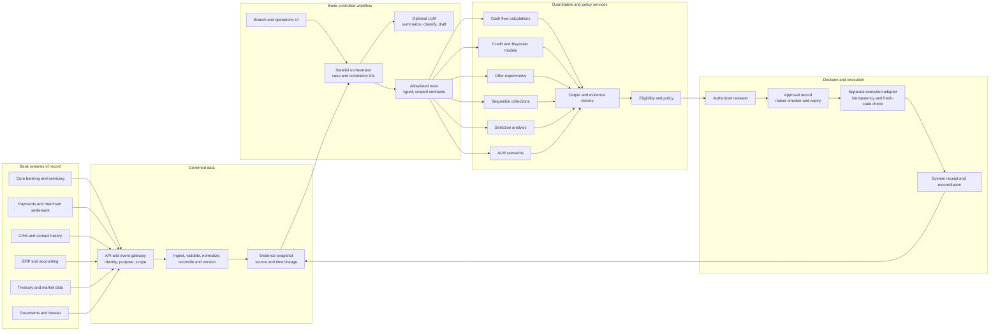

# From Credit Research to Bank Software: A Practical Engineering Specification for Governed AI

**Article 1 of 2 · Underwrite for Collection · 3 November 2026**

## Abstract

Research methods become useful in a bank when their decisions, calculations and evidence can enter an operating process with clear ownership. This article translates the five-article *Underwrite for Collection* series and its Moniepoint application into a software-engineering specification. It connects experimental credit offers, sequential servicing, selective repayment labels, Treasury decisions and governed agentic workflows to bank systems, data pipelines, APIs, interfaces, model services, approvals and audit records. C++, C#, Excel-DNA, Office.js, VSTO, React, Power BI, Tableau, Dynamics 365 and Oracle Treasury interfaces are treated as candidate roles to assess against requirements and the bank’s current architecture. A practical design keeps quantitative computation, policy authority and financial execution in services with testable contracts; a language model can coordinate evidence and explanation within scoped permissions. The article sets out data contracts, correlation and audit identifiers, maker-checker controls, staged deployment and acceptance criteria, then applies them to the Moniepoint transaction-to-decision case.

### Research questions

1. How should the methods in Articles 1–5 become software requirements and integration contracts that preserve reproducibility, evidence lineage and decision authority across credit, collections and Treasury?
2. Which architecture and workflow controls allow generative AI and tool-using agents to organize bank evidence while registered quantitative services, approved policy and authorized staff retain distinct responsibilities?
3. What measurable acceptance criteria should govern progression from research data pipelines to replay, shadow operation, bounded pilot and production release?

## Begin with the decision, then select the technology

The *Underwrite for Collection* whitepaper and five articles begin with connected business questions. Article 1 compares eligible credit offers under randomized allocation. Article 2 studies which permitted servicing action may help at a particular repayment stage. Article 3 examines who receives observable outcomes and how selection affects inference. Article 4 considers Treasury and ALCO management of repricing, liquidity and balance-sheet risk. Article 5 connects these methods to a bank-controlled workflow [1], [2].

Whitepaper Part 4 §§3–8 anchors the bank architecture; Part 5 §§5–6 carries capital, collection timing and liquidity into Treasury [1].

The Moniepoint case makes the software question concrete: permitted transaction records are classified and reconciled; a cash bridge and obligations inform repayment capacity; a model returns estimates and uncertainty; a reviewer assesses a proposal; and servicing outcomes return to the evidence chain [3]. Each step needs an owner and boundary. Normalized transactions retain source references; model outputs carry units and versions; approvals have scope and expiry; execution returns a receipt.

A software specification identifies the objective, decision owner, population, data purpose, action set, calculation, review route, execution endpoint and outcome before selecting an LLM, hosting or interface. It defines behavior for late, incomplete, corrected or contradictory evidence. This preserves the distinctions between offer experimentation, collection intervention, missing labels and Treasury’s portfolio mandate.

## Turn the five articles into testable requirements

A requirements register links each research question to data, services, controls and acceptance tests. Article 1 needs an experiment registry for eligibility, offer set, assignment probabilities, delivery and outcomes. Article 2 needs state and action history separating observations from interventions. Article 3 needs the historical decision and outcome-observation process. Article 4 needs Treasury curves, cash flows, constraints, scenario versions and ALCO decisions. Article 5 needs orchestration, review, execution and audit. Moniepoint supplies the end-to-end transaction-to-repayment case [2], [3].

“Estimate default probability” needs a target event, population, horizon, evidence cutoff, model version, missing-data treatment, calibration status, uncertainty summary and fallback. A recommendation screen names the sources, alternatives and policy reasons that a reviewer can inspect. A model call carries its approved release, validated inputs, output schema, permissions and reproducibility record.

The matrix names an owner and a test for each requirement. Assignment tests check probabilities and treatment receipt; interval-routing tests verify the target quantity and threshold meaning; Treasury tests verify scenario cutoff, horizon and aggregation. This lets engineers change implementation without changing the research question.

## Architecture: orchestration without transferred authority

A practical design has authenticated user applications, bank integration gateways, governed evidence services, an orchestrator, registered model and calculation services, policy and approval services, and separate execution adapters. Each service has a versioned contract. The workflow can begin as a small state machine with one orchestrator and several tools; additional agents earn inclusion when their task, permissions and measurable benefit are clear.

The bank selects where data transformation, model inference, storage, logs, telemetry, backups and support access occur. It maps branch connectivity, identity services, model registry, data platform, operational systems and approved external sources. A virtual private server may be a candidate deployment environment, but the architecture specifies its actual network, identities, retention and service dependencies rather than relying on a hosting label.

The language model can retrieve approved evidence, identify missing information, summarize and draft an explanation. Statistical services estimate risk, treatment effects or cash distributions. Deterministic software reconciles cash and applies defined arithmetic. A policy service identifies eligible routes. An authorized employee reviews the evidence and decides within delegated authority. A separate execution service submits only an approved, current instruction. Agent orchestration frameworks can pause and resume tasks for human review; the bank application must still authenticate the reviewer and enforce permissions independently of the model [4].

*Figure 1. Evidence, analysis, authority and execution have separate responsibilities; the workflow joins their records.*

## Data engineering: preserve the economic event

The pipeline preserves the economic event as it moves through systems. A transaction may be authorized, settled, reversed, corrected and reported later, while several systems may describe the same transfer. Records retain source-system and event IDs, currency, amount, account or merchant reference, event, settlement and ingestion times, correction history and classification status. Normalization adds common fields without erasing source meaning.

A practical pipeline separates ingestion, validation, normalization, reconciliation, feature construction and serving. Checks cover totals, currency, duplicates, dates, ownership, missing coverage, reversals and account mapping. A feature snapshot names its cutoff and source coverage. Corrections link to earlier records so analysts can reconstruct what a reviewer knew and avoid future-information leakage in replay.

CRISP-DM structures analytical work through business understanding, data understanding, preparation, modelling, evaluation and deployment [5]. Applied here, it starts with the lending question, documents source coverage, prepares events, estimates models, evaluates calibration, fairness, stability and economic outcomes, and deploys an approved service. Security, privacy, resilient operations and software governance surround that analytical cycle.

The Moniepoint case separates source records, coverage, cash bridge, payment schedule and monitoring routes [3]. Static checks and rolling measures belong alongside models: balance identities, trailing receipts, source coverage, obligations, arrears, calendar mismatch and concentration. They can validate data, define eligibility or route review under approved policy. A rolling average summarizes recent activity; it does not alone establish future cash or causal effect. An agent can flag a discrepancy while a registered rule determines its route.

## APIs, contracts and traceable identifiers

Each service declares field names, types, units, allowed values, validation errors, version, timeout behavior and permission scope. OpenAPI is a candidate REST definition; ASP.NET Core can generate OpenAPI documents [6]. This allows C#, Python, C++, JavaScript and reporting tools to exchange results without sharing a runtime or directly accessing one another’s databases.

A request carries case, purpose, evidence snapshot, decision time, facility, currency, product, service and model or policy version. The response carries status, estimate and uncertainty, definition, horizon, units, evidence references, quality status and reproducibility key. Schema validation checks shape; domain validation checks financial meaning; authorization checks operation and case access.

For example, an offer-evaluation request can include an eligibility snapshot, approved offer IDs, the assignment schedule and the analysis window. Its response records the policy version, assigned probability, actual delivery, outcome maturity and evaluation status. A limit-review request instead carries the facility, dated cash snapshot and model version, and returns the risk horizon, posterior interval, threshold probability and reviewer route. Separate schemas prevent a one-step offer result from being mistaken for a sequential collection recommendation.

Use distinct IDs for the case, proposal, source event, model run, approval and execution. A correlation ID links the workflow. W3C Trace Context defines distributed tracing headers that can accompany the bank’s business identifiers; a trace ID links software events but does not establish source authenticity or reviewer identity [7].

Record material state changes: evidence, validation, calculation, policy route, review, execution, receipt, reconciliation and outcome. Include service or user identity, timestamp, prior and new state, result, software and contract versions, and correlation ID. Corrections become linked events, preserving the earlier decision snapshot.

Contracts preserve quantitative meaning: Article 1 records eligible offers, assignment probabilities and treatment delivery; Article 2 distinguishes observed state from estimated belief and lists permitted actions; Article 3 reports which decisions and outcomes are observed plus support diagnostics; Article 4 names curves, instruments, scenarios and aggregation. These fields support evaluation.

## Connect existing bank platforms through supported interfaces

Adapters can connect core banking, origination and servicing, payments, merchant aggregators, bureau, CRM, ERP, Treasury, data warehouse, documents, identity provider and branches. Each translates source terms into governed data while preserving the system of record.

Dynamics 365 is a product family. For Dataverse-backed applications, its Web API exposes OData service documents and operations; the contract names the environment, entities, API version and permissions [8]. Where a needed function lacks a supported API, use an approved integration service or managed exchange rather than creating a parallel customer master.

Oracle Banking Treasury Management documents REST and gateway interfaces for external systems [9]. Use the supported interface when the bank has the product and the operation is covered. PL/SQL can encapsulate an approved database-side function; direct writes to vendor tables create a fragile dependency. A reviewed package needs explicit grants, versioning, transaction handling and reconciliation. Treasury bookings, payments and limits remain with authorized Treasury systems.

Choose event streams or scheduled extracts according to latency and need. Define ordering, duplicates, replay, retries, failure queues, control totals and ownership. Retries must not duplicate an amendment; batches report completeness. A current balance may suit a live review, while portfolio studies can use curated snapshots.

Branch access needs a low-connectivity mode. A managed device can present a small, encrypted, time-stamped read-only snapshot and queue a draft note for later synchronization. The UI marks stale evidence and limits offline work to preparation; approvals and execution require a live permission and current-state check after reconnection. Define cache expiry, local-data minimization, device controls, conflict resolution and failed-sync escalation. This keeps branch staff productive while a network link is intermittent.

## Place technology candidates in specific roles

The stack is a set of options. Use a C++ kernel when profiling demonstrates a performance or specialist-library need; isolate it behind an API, deterministic test vectors and numeric tolerances. It has no authority over customer or policy records. A Python Bayesian prototype may remain suitable until benchmarks support porting.

C# can support enterprise APIs, identity integration and workflow applications in a Microsoft environment. A service calls registered quantitative logic rather than embedding it in a screen. Compatibility tests check dates, nulls, units, rounding and enum meanings [6].

Excel has three routes. **Office.js** supports web add-ins with platform and requirement-set differences [10]. **Excel-DNA** exposes .NET code to desktop Excel through an XLL [11]. **VSTO** suits maintenance of Windows-only solutions; Microsoft identifies .NET Framework 4.8 as its last major runtime and recommends Office web add-ins for cross-platform development [12]. Select by Excel version, deployment, signing, Trust Center and support requirements.

A workbook can request an approved calculation, show version and assumptions, and preserve a review snapshot. Keep policy outside hidden workbook logic; credentials stay out of worksheets; overrides return to the workflow with reviewer and rationale.

React and a chart library such as Recharts can support branch interfaces. Displays may show transaction timelines, cash bridges, posterior intervals and source coverage, with units, cutoff, horizon, freshness, model version and uncertainty meaning. Reviewers can inspect source records and distinguish observed, derived, estimated, proposed, approved and executed values.

Power BI and Tableau suit governed reporting and embedded analytics. Power BI provides REST and embedding APIs; its documentation notes that some API data may be processed outside the tenant’s home region, a data-location consideration [13]. Tableau documents embedding and authentication [14]. Use approved semantic views with tested row-level access and refresh controls. Dashboards report cohorts, cure, recovery, cash coverage, overrides, model performance and Treasury scenarios; bank records remain authoritative.

## Bound the agent harness and model services

The Model Context Protocol is a candidate interface between an LLM client and registered information or tools. The current 2026-07-28 specification standardizes tool and context exchange; it does not by itself implement the bank’s domain authorization [15]. Every tool call checks identity, role, purpose, case, operation, data scope and expiry. A model-generated call is a request, not a credential or approval.

An allowlist can expose “retrieve approved evidence,” “calculate cash bridge,” “run registered model,” “retrieve policy route” and “draft explanation.” Each tool has a narrow schema and documented side effects. Read and write tools are separate; arbitrary SQL, shell and database write access are outside the agent. Before action, the execution service validates approval and current state.

vLLM is one candidate for serving an open model. Its documentation describes schema-constrained calls while distinguishing valid arguments from high-quality calls [16]. Schema validation checks format; the application checks permission and meaning. Benchmark candidate versions, quantization, context, concurrency, language, latency, license and parser compatibility on representative tasks.

Treat documents, web pages and transaction descriptions as evidence, not privileged instructions. Limit context, verify sources, screen external connections, check generated values against calculation receipts and test prompt manipulation. OWASP’s excessive-agency guidance supports least privilege, operation limits and human authorization for consequential changes [17].

Two external projects serve as implementation examples. Qwenderwriter pairs deterministic score/policy calculations with verified generated explanations [18]. Dygnosis provides Dynare source-analysis and MCP tools; official Dynare performs numerical solving and simulation [19], [20]. The whitepaper, series and Moniepoint case define this implementation’s financial-domain contracts.

## Maker-checker approval and separate execution

A reviewer packet shows evidence cutoff, source coverage, unresolved facts, cash reconciliation, model and policy versions, units, uncertainty, alternatives and route rationale. In a Moniepoint repeat-facility case it can show sales and transfers, debt service, cash remaining, proposed terms, risk interval and facts to confirm [3]. Distinguish model suggestion, policy route, maker proposal, checker approval and execution.

Where the mandate requires it, a maker proposes and a different checker approves, amends, defers or returns the case. Record identity, role, delegation, timestamp, rationale and packet version. The reviewer needs enough evidence and authority to reach a different result.

Execution is separate and narrow. Its instruction names customer, facility, amount, currency, date, conditions, approval ID, expiry, snapshot and expected state. The adapter rechecks approval, facility and duplicate status before submission. An idempotency key protects retries; the source receipt is reconciled to the event ledger. Material evidence changes route back for review.

Offer assignment records probability, delivery and take-up; collection records proposed and actual intervention; reject-inference analysis retains how outcomes became observable; Treasury records ALCO or dealing authority. A common workflow links these records without merging decision rights.

## Release, monitor and measure the whole service

Build the deterministic baseline first: source validation, cash reconciliation, static rules, rolling measures and a review packet. Add registered statistical services, then a read-only evidence assistant. Replay historical cases using only information available at the original cutoff, then shadow prospective cases without changing customer terms. A bounded pilot needs a defined workflow, review capacity, eligibility, action limits, monitoring and rollback.

The pipeline records source commit, dependencies, signed build, infrastructure, model artifact, feature code, evaluation, approval and rollback. NIST SSDF 1.1 provides secure-development practices; Rev. 1 / SSDF 1.2 was an initial public draft at the research cutoff and should be labelled as draft [20]. Model release records include purpose, population, outcomes, features, priors, validation, calibration, subgroup results, limits, expiry, owner and approved actions.

Acceptance tests measure the service as well as model fit. Reproduce Article 1 assignment probabilities and treatment records. Reconcile Moniepoint fixtures to source totals, including duplicate, reversal, delayed settlement and missing-channel cases. Compare model outputs with reference cases within approved numerical tolerances, including sparse segments and threshold values. Test every eligibility route and show unauthorized, expired, altered and duplicate instructions cannot execute.

A pilot scorecard tracks coverage, provenance accuracy, reconciliation, calibration, interval coverage, delinquency, cure, recovery timing, borrower cash, complaints, corrections, overrides, receipts, latency, uptime, retries, drift and design-appropriate fairness measures. Interface tests check whether staff can locate sources, distinguish observed from forecast cash, interpret intervals, inspect alternatives and record reasons. Set release thresholds before examining results.

Data protection belongs in the design register. Kenya’s Data Protection Act addresses processing principles, lawful bases, high-risk impact assessment, data-subject rights and specified automated decisions. The General Regulations address automated-decision information and safeguards [21], [22]. Record purpose, source, notice, correction route, access, retention, processing roles, transfer locations and relevant DPIA outcomes. The 2026 CBK Non-Deposit Taking Credit Providers Regulations include AI-lending provisions for in-scope providers; map them to the actual entity and product [23]. NIST AI RMF and its Generative AI Profile can structure system governance [24]. CBK’s banking-sector AI survey, based on information through 31 December 2024, lists credit-risk assessment among reported AI applications and identifies data quality, governance, cybersecurity, third-party dependencies and skills as implementation considerations. This design turns those local findings into requirements and release gates [25].

## A phased implementation for the Moniepoint case

**1. Specify the case.** Select a repeat-facility review using recent transaction evidence. Name user, owner, sources, purpose, outcomes, system of record and actions. Define operating receipts, financing, transfers, refunds, settlements and obligations. Freeze a synthetic dataset and truth ledger.

**2. Implement the baseline.** Build validation, source mapping, reconciliation, rolling measures, affordability scenarios and approved rules or models. Produce a versioned case packet as the benchmark for agent assistance.

**3. Add interfaces.** Expose read services through the bank gateway and versioned contracts. Assign IDs to cases, events, runs, approvals and executions; link them by correlation. Start with a test adapter and specify retries, idempotency and reconciliation.

**4. Add a read-only harness.** Retrieve approved evidence and calculations. The LLM can propose a transaction label or note with source links; numerical services return calculations and uncertainty. Compare candidate models for quality, stability, language coverage, latency, cost, context and security.

**5. Replay and shadow.** Reconstruct earlier decisions from contemporaneous evidence, comparing classifications with reviewed truth and calculations with the baseline. Then shadow prospective cases without customer action and investigate disagreement and coverage gaps.

**6. Pilot one proposal workflow.** Present recommendations for a defined journey to trained reviewers; keep authority with the assigned officer. Track proposal, delivery, response, payment and operating cash. Measure recommendation, review and execution quality separately.

**7. Extend incrementally.** Add Article 1’s randomized assignment; Article 2’s sequential state and action ledger; Article 3’s selection diagnostics; and Article 4’s Treasury scenarios and approvals. Article 5 supplies shared orchestration and governance. Each extension needs a question, validated contract, owner and release evidence.

This sequence makes technology choices testable: profile before porting a kernel to C++; use C# where it fits; select Excel-DNA, Office.js or VSTO by platform; use React for case interactions and Power BI or Tableau for reporting; connect Dynamics or Oracle through supported interfaces in the bank’s actual environment.

## Conclusion

The transition from research to software translates business decisions into evidence, statistical assumptions into model contracts and each operation into an accountable service. A bank-controlled workflow can coordinate evidence and explanations while the bank retains source ownership, policy authority, human approval and execution.

For *Underwrite for Collection*, the system preserves the path from offer or intervention to realized cash and borrower outcomes. Moniepoint adds transaction provenance, dated capacity, facility terms, review and performance; Treasury adds scenario assumptions and ALCO authority. Correlation IDs connect events, while evidence snapshots, user identities, model versions, approvals and receipts make them traceable.

## References

[1] N. Maloba, *Underwrite for Collection: An Integrated Research Whitepaper on Sustainable MSME Credit*, 2026. Zenodo DOI: https://doi.org/10.5281/zenodo.23343888. Bank-controlled architecture: Part 4, https://github.com/TheAlchemistNerd/underwrite-for-collection/blob/main/series/parts/Part_4_Bank_Controlled_Research_Sandboxes_and_Enterprise_Credit_Architecture.md. Capital and Treasury treatment: Part 5 §§5–6, https://github.com/TheAlchemistNerd/underwrite-for-collection/blob/main/series/parts/Part_5_KESONIA_Pricing_Expected_Credit_Loss_Capital_and_Funding.md.

[2] N. Maloba, *Causal Credit and Treasury Decision-Making*, five-article series, 2026. https://github.com/TheAlchemistNerd/underwrite-for-collection/tree/main/series/publications/linkedin/2026-10-08_causal_credit_series.

[3] N. Maloba, “Cash-flow Lending at Moniepoint: Turning payment activity into repayment-capacity evidence,” 2026. Article: https://github.com/TheAlchemistNerd/underwrite-for-collection/blob/main/publications/linkedin/moniepoint_cashflow_2026-10-14/MONIEPOINT_CASHFLOW_UNDERWRITE_FOR_COLLECTION_LINKEDIN_ARTICLE.md; worked case: https://github.com/TheAlchemistNerd/underwrite-for-collection/blob/main/docs/research/MONIEPOINT_REPRODUCIBLE_CASHFLOW_CASE_2026-10-18.md; model: https://github.com/TheAlchemistNerd/underwrite-for-collection/tree/main/research_lab/moniepoint_cashflow_case.

[4] LangChain, “Thinking in LangGraph,” official documentation. https://docs.langchain.com/oss/javascript/langgraph/thinking-in-langgraph.

[5] IBM, “CRISP-DM Help Overview” and “Projects phases for data mining in SPSS Modeler.” https://www.ibm.com/docs/en/spss-modeler/saas?topic=dm-crisp-help-overview.

[6] Microsoft, “OpenAPI support in ASP.NET Core API apps.” https://learn.microsoft.com/en-us/aspnet/core/fundamentals/openapi/overview.

[7] W3C, “Trace Context,” Recommendation, 2021. https://www.w3.org/TR/trace-context/.

[8] Microsoft, “Use the Microsoft Dataverse Web API.” https://learn.microsoft.com/en-us/power-apps/developer/data-platform/webapi/overview.

[9] Oracle, *Oracle Banking Treasury Management: REST API Documentation*, Release 14.8.2.0.0, 2026. https://docs.oracle.com/en/industries/financial-services/banking-treasury-management/14.8.2.0.0/restr/rest-api.pdf.

[10] Microsoft, “Office JavaScript API” and “Office client application and platform availability.” https://learn.microsoft.com/en-us/office/dev/add-ins/develop/understand-the-javascript-api-for-office and https://learn.microsoft.com/en-us/javascript/api/requirement-sets.

[11] Excel-DNA, “Getting Started” and “Installing Your Add-in.” https://excel-dna.net/docs/getting-started/.

[12] Microsoft, “Visual Studio Tools for Office Runtime.” https://learn.microsoft.com/en-us/visualstudio/vsto/visual-studio-tools-for-office-runtime.

[13] Microsoft, “Power BI REST APIs.” https://learn.microsoft.com/en-us/rest/api/power-bi/.

[14] Tableau, “Authentication and Embedding,” Embedding API documentation. https://help.tableau.com/current/api/embedding_api/en-us/docs/embedding_api_auth.html.

[15] Model Context Protocol, *Specification*, revision 2026-07-28. https://modelcontextprotocol.io/specification/2026-07-28.

[16] vLLM, “Tool Calling,” documentation. https://docs.vllm.ai/en/stable/features/tool_calling/.

[17] OWASP, “Excessive Agency,” *Top 10 for Large Language Model Applications*. https://owasp.org/www-project-top-10-for-large-language-model-applications/.

[18] J. Mancilla and T. Tagliani, “Qwenderwriter: A complete credit decision system,” public demonstration repository, 2026. CC BY-NC 4.0. https://github.com/maximer-v/qwenderwriter and https://github.com/maximer-v/qwenderwriter/blob/main/LICENSE.

[19] Dygnosis contributors, “Agent Tools” and “Use Dynare,” https://github.com/naivej/dygnosis/blob/main/help/agents.md; Dynare Team, *Dynare Reference Manual*, v. 7.2, 2026. https://www.dynare.org/manual/.

[20] M. Souppaya et al., *Secure Software Development Framework (SSDF) Version 1.1*, NIST SP 800-218, 2022; and Version 1.2, Initial Public Draft, 2025. https://doi.org/10.6028/NIST.SP.800-218 and https://doi.org/10.6028/NIST.SP.800-218r1.ipd.

[21] Republic of Kenya, *Data Protection Act*, No. 24 of 2019. https://new.kenyalaw.org/akn/ke/act/2019/24/eng@2019-11-15/source.

[22] Republic of Kenya, *Data Protection (General) Regulations*, Legal Notice No. 263 of 2021. https://www.odpc.go.ke/wp-content/uploads/2024/03/THE-DATA-PROTECTION-GENERAL-REGULATIONS-2021-1.pdf.

[23] Central Bank of Kenya, *Non-Deposit Taking Credit Providers Regulations*, Legal Notice No. 191 of 2026. https://new.kenyalaw.org/akn/ke/act/ln/2026/191/eng@2026-09-29/source.pdf.

[24] NIST, *Artificial Intelligence Risk Management Framework: Generative Artificial Intelligence Profile*, NIST AI 600-1, 2024. https://doi.org/10.6028/NIST.AI.600-1.

[25] Central Bank of Kenya, *Survey on Artificial Intelligence in the Banking Sector*, survey issued March 2025, reporting sector information as at 31 Dec. 2024. https://www.centralbank.go.ke/uploads/banking_sector_reports/595566510_Survey%20on%20Artificial%20Intelligence%20in%20the%20Banking%20Sector.pdf.

