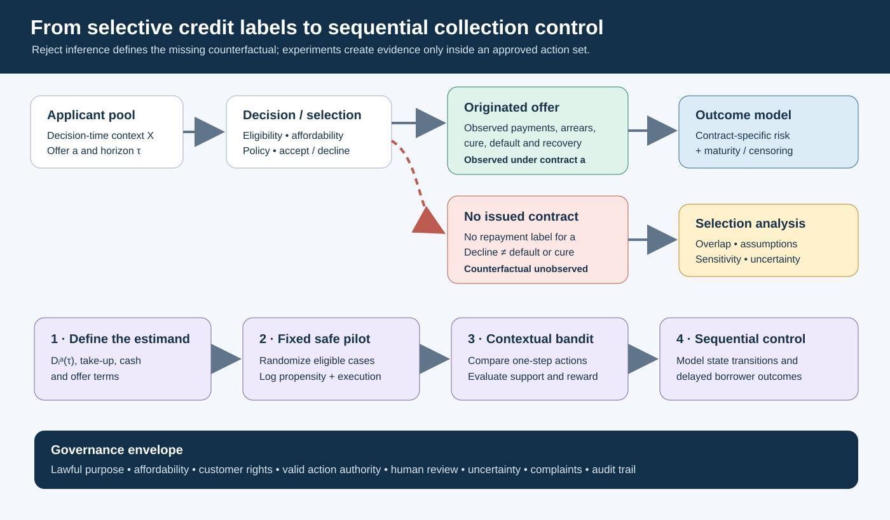

# From Rejected Applications to Sequential Support: Learning Credit Decisions Without Inventing Repayment History

*LinkedIn research article draft | 7 October 2026*

## The missing outcome behind a credit decision

A lender can observe whether a funded borrower repays. It cannot directly observe how an applicant who was declined would have repaid under the specific loan that was never issued. That gap matters when a lender wants to review an approval policy, estimate portfolio performance under a new offer, or design a collection intervention that adapts over time.

This is the reject-inference problem. It is also a problem of decision design: each financing decision determines which outcomes enter the next model-development dataset. A credit model is therefore part of a larger system linking eligibility, offers, take-up, repayment, servicing, collection and recovery.

The practical question behind *Underwrite for Collection* is how credit decisions can support sustainable repayment over a facility's life. Its architecture follows contract cash flow from application through recovery. Sequential control asks which eligible action to take now and what evidence should inform the next decision.

The central distinctions are: an unobserved outcome is not a default label; prediction under observed policy differs from estimating an action's effect; and sequential control requires explicit states, transitions, delayed outcomes and safeguards. The Fannie Mae and Freddie Mac files offer examples of selected mortgage performance histories, not repayment labels for rejected Kenyan applicants or direct MSME calibration data [1], [2]. Their project protocols propose acquisition and testing; this article does not present raw GSE analysis as completed.

The project crosswalk is practical. *Underwrite for Collection* Parts 1–5 move from portfolio measurement and risk evidence through selective labels, experiments, operating records, recovery and financial consequences. *Mwendo Pamoja* Parts 1–6 connect facility and receivables structure, borrower and product evidence, interventions, systems and telemetry, KESONIA pricing and capital, and implementation. The reject-inference and action-ledger questions sit across those layers.

The cash-flow unit changes with the financing proposition. Business finance follows enterprise trading cash, working capital, owner obligations and continuing operations. Ring-fenced receivables finance follows identified eligible claims, obligor concentration, dilution, enforceable transfer, account control, servicing continuity, reserves and waterfall. Each needs its own state, outcomes and monitoring evidence.

## What is the target quantity?

Let Xᵢ denote information about applicant i available at decision time. Let a denote a fully specified loan offer: amount, price, term, repayment schedule, collateral conditions and any other material contract terms. Define Dᵢᵃ(τ) = 1 if the applicant would default by horizon τ after taking offer a, and Dᵢᵃ(τ) = 0 otherwise. The contract-specific risk quantity is

P(Dᵢᵃ(τ) = 1 ∣ Xᵢ = x, applicant takes up a).

This notation forces a useful discipline. A person does not carry one timeless “good” or “bad” label independent of amount, term, repayment frequency and economic conditions. The estimand must name the offer and horizon. Take-up is a different quantity: q(x,a) = P(Tᵢᵃ = 1 ∣ Xᵢ = x). A lender also needs to know whether the offer was assigned, communicated, accepted, originated, modified or overridden.

For historical data, let Sᵢ = 1 mean the application was originated under a recorded contract and Sᵢ = 0 mean no such loan outcome is observed. The funded sample identifies repayment outcomes under its historical selection process. It does not, by itself, identify Dᵢᵃ for all applicants who were not funded. Reject inference estimates that missing counterfactual using assumptions and evidence; it does not turn the estimate into a historical observation [3]–[5].

### An evidence map before a model

Before fitting a model, map which labels actually exist and for whom. Separate:

| Evidence state | What is observed | What it can support |
|---|---|---|
| Originated and sufficiently seasoned | Contract, payments, arrears, default, cure and recovery to an observation date | Outcomes under recorded offers, with follow-up and censoring handled |
| Originated but not fully seasoned | Payments up to the data cut-off | Survival or pending-outcome analysis; not a mature horizon label |
| Offered but not accepted | Offer terms, delivery and take-up response | Offer/take-up analysis; no repayment outcome for the unaccepted contract |
| Declined with no offer | Decision record and possibly a later external credit outcome | Selection and access analysis; no repayment outcome on the unissued offer |
| Accepted elsewhere after decline | The later lender's observed contract and outcomes, if lawfully available | A different contract and servicing context; not automatically the outcome of this lender's offer |

Later bureau performance can describe subsequent credit history, subject to lawful access, purpose and provenance. It still does not reveal how the person would perform on the loan, price and servicing arrangements under evaluation.

## Hierarchical models can structure evidence; they cannot create identification

A hierarchical Bayesian logistic model can represent borrower-level risk alongside sector, region, product and vintage variation:

logit pᵢ,τ(a) = α + u_sector[i] + v_region[i] + w_vintage[i] + f(Xᵢ) + h(a, Xᵢ).

Here pᵢ,τ(a) is a default probability for a specified horizon and offer, while u, v and w are partially pooled group effects. The term h(a, Xᵢ) allows offer terms to interact with borrower characteristics. Partial pooling can stabilize estimates for smaller groups by sharing information under a stated population model. It does not establish that changing one contract term causes the estimated change in default risk.

That causal question depends on offer assignment. If historical pricing, amount or tenor used information missing from Xᵢ, a fitted coefficient can absorb selection and underwriting judgment. A Bayesian posterior expresses uncertainty under its model; it cannot recover information the data never identify.

Pólya–Gamma data augmentation is one computational method for Bayesian logistic models [6]. It can make a compatible posterior sampling problem more tractable. It does not correct selection bias, supply missing rejected outcomes, prove a causal effect or establish that the chosen predictors are valid for operational use. Those remain design, measurement and governance questions.

### Two routes through selection

The first route is conditional exchangeability: after conditioning on recorded X, the selection into funding contains no further information about the potential outcome under offer a. In symbols, this requires Dᵢᵃ ⟂ Sᵢ ∣ Xᵢ. It must be justified from the decision process, data availability and domain knowledge. A propensity model e(x) = P(S = 1 ∣ X = x) describes selection; it is not the probability of default. Weighting or transport methods also need overlap: applicants like those in the target population must have a meaningful chance of appearing in the observed funded sample.

The second route recognizes that selection may depend on unrecorded information, such as an officer's assessment or undocumented business signal. Name that information, seek a credible design or data source, and test conclusions under plausible departures from exchangeability. Model complexity alone cannot settle unobserved selection [3]–[5].

Before presenting an expanded policy result, create a **support map**: show overlap by product, sector and region; report weight concentration; and separate observed estimates from extrapolation. Where support is thin, quantify uncertainty and use a bounded decision.

## Rejected applicants and unfinished loans are different data problems

For an originated loan, the lender observes a time-to-event process, although the loan may still be current at the data cut-off. Survival methods treat that observation as right-censored: the event has not yet been observed, while the account contributes its observed time at risk. For example, a cause-specific default hazard λᴅ(t ∣ X) can be combined with survival from all competing events S_all(t ∣ X):

PD(τ) = 1 − exp[−∫₀^τ λᴅ(u ∣ X) du]; Fᴅ(τ) = ∫₀^τ S_all(u ∣ X) λᴅ(u ∣ X) du.

The first expression gives net default risk under the default hazard; the second gives cumulative default incidence with competing exits such as prepayment. Cox provides the classic proportional-hazards formulation [7].

A never-originated application is different: the outcome process under the proposed contract never starts. Its outcome cannot be handled simply as an immature loan or a censored performance record. Keep these populations distinct in both training data and reporting. Do not convert a pending 6-month observation into a 12-month non-default, and do not count a rejected application as a censored loan on terms that were never offered.

Fannie Mae and Freddie Mac monthly records cover payment status and, depending on the dataset and loan, modifications, liquidation or disposition and loss information [1], [2]. They support work on event definitions, delinquency, cure, foreclosure, prepayment and loss timing. The selection chain runs through application, lender decision, borrower acceptance, origination, GSE acquisition and reporting. These selected US mortgage cohorts inform longitudinal-data methods, not Kenyan MSME PDs or rejected-applicant outcomes. The project protocols propose data acquisition and audit; they are not completed GSE analyses.

## From reject inference to a controlled offer experiment

When a lender wants evidence about a new credit action, a pre-specified experiment can provide a stronger basis than assigning inferred labels to historical rejects. The action set should include the real decision alternatives: decline, refer for manual review, or offer a particular affordable product and price. It should not be limited to “which approved borrower receives which collection message?” if the live policy question also concerns access, amount or terms.

The experiment begins with independently approved eligibility and affordability boundaries. Within a group for whom multiple offers are acceptable, a fixed randomized pilot can allocate approved offers subject to credit, concentration, customer-treatment and loss limits. Randomization creates comparisons within that region; it does not authorize lending outside it. Start with a fixed design that can be audited before considering adaptation.

For each case, record decision-time context; eligible actions; assignment probability; assigned and delivered offer; take-up; booked contract; overrides; payments; follow-up; default, cure, recovery and complaints. Use assignment probabilities after hard eligibility gates. Preserve timestamps and policy versions so an analyst can reconstruct what the system knew.

### A small numerical illustration

Suppose 1,000 historically declined applicants meet a separately reviewed affordability and eligibility rule for a defined small-ticket offer. A pilot randomly assigns 100 to receive it and 100 to the current-policy comparison group. Eighty of the 100 offered accept and originate; at 12 months, four of those 80 have defaulted.

The observed default proportion among the originated takers is 4/80 = 5%. A Wilson 95% interval is approximately 2.0%–12.2%, illustrating substantial sampling uncertainty [8]. The estimate applies to the takers who originated this specified offer in this eligible pilot cohort, at this observation horizon. It does not estimate the default rate of all 1,000 applicants, all historically rejected applicants, or applicants who would accept a different price or repayment schedule.

The offer assignment question is different. If assignment was randomized, compare offer take-up, net cash contribution or other pre-specified outcomes between the assigned-offer group and a valid control group, including non-takers. This is an intention-to-treat comparison [17]. Default conditional on origination is useful for portfolio monitoring but conditions on take-up, which may depend on risk and offer terms. Report both quantities distinctly.

The offer value can be written V(x,a) = q(x,a) × E[Πᵃ ∣ Tᵃ = 1, X = x] − C_offer(x,a), where q is take-up, Πᵃ is contribution under the contract among takers, and C_offer is offer and servicing cost. This does not replace expected-loss accounting. Price can change take-up and applicant mix, so risk and offer value need separate evidence.

## A one-step contextual bandit is a useful bridge

A contextual bandit observes context Xₜ, chooses eligible action Aₜ, and records reward Rₜ. It compares immediate actions for similar contexts. Credit actions may be a permitted offer or collection treatment; the reward can include net cash over a defined period, while affordability, customer rights and portfolio limits remain constraints.

The trial record should include a logged assignment probability μ(Aₜ ∣ Xₜ). Offline evaluation of a candidate policy can then use inverse-propensity or doubly robust estimators under their identification assumptions [9], [10]. A simplified doubly robust form is

V̂_DR(π) = (1/n) Σᵢ₌₁ⁿ [Σₐ π(a ∣ Xᵢ) μ̂_R(Xᵢ,a) + {π(Aᵢ ∣ Xᵢ) / μ(Aᵢ ∣ Xᵢ)} × {Rᵢ − μ̂_R(Xᵢ,Aᵢ)}].

Here π is the evaluation policy and μ̂_R is an outcome model. Robustness is conditional: actions need support, propensities must be correct, outcomes must match their definitions, and the design must address confounding. It cannot repair unlogged assignment, unmeasured judgment, zero overlap, delayed rewards or unlawful data use.

For collection, a one-step trial might compare approved contact schedules or assistance pathways. It could measure cash within a defined window alongside complaints, repeat arrears, broken promises, restructuring, cure and customer burden. A click is a process signal; a short-window payment is not necessarily durable cure.

## Sequential control: when one action changes the next state

Collection decisions are sequential when current actions alter both future cash flows and what will be observed. A controlled Markov decision process (MDP) has state Sₜ, action Aₜ, transition law P(Sₜ₊₁ ∣ Sₜ,Aₜ), and reward Rₜ. A finite-horizon policy seeks

Vₜ(s) = maxₐ∈A_safe(s) E[rₜ(s,a) + Vₜ₊₁(Sₜ₊₁) ∣ Sₜ = s, Aₜ = a].

A_safe(s) contains only actions the institution is authorized and able to take in that state. A collection state may include days past due, verified cash-flow changes, contact history, a promise-to-pay, restructuring or dispute status, collateral events, data freshness and uncertainty. Actions may include a permitted contact, human review, temporary arrangement, hardship referral or pause during a dispute.

A partially observed MDP (POMDP) is appropriate when the underlying state is genuinely latent and the observation process is explicit. For example, a borrower's cash generation might be uncertain and observed intermittently through incomplete transaction aggregates. The model maintains a belief distribution bₜ(s) = P(Sₜ = s ∣ observations and actions to date), updated after each new observation and action. Missing data alone do not prove that a hidden-state model is appropriate; one must describe why the state is latent, how evidence arrives and how observation errors are represented [11].

Read the diagram from left to right across the selection split, then along the lower development path. Repayment evidence for an originated offer is observed; the declined applicant's outcome under an unissued offer remains counterfactual. A fixed eligible pilot builds supported comparisons before any contextual or sequential policy is considered.

This is a research and assurance sequence, not a promise that every lender should adopt reinforcement learning. At each stage, the richer method must earn its place by improving a defined decision while remaining understandable, testable and operationally governable.

## A collection example with delayed states

Consider a fictional facility with one missed monthly instalment, recorded on day 10. A bank-feed interruption makes the latest cash-flow view stale and contact has not yet occurred. Actions are an agreed-channel reminder, a human call to verify the situation, or a requested hardship review. Legal and contractual rules exclude abusive contact; a new loan is not assumed to cure arrears.

Suppose a pilot finds more 14-day payments after reminders but more verified cash-flow updates and fewer broken arrangements after human calls over 60 days. A 14-day reward could favor reminders. Sequential evaluation may value the call's information if it improves the next decision. Test that with a defined horizon, handling costs, durable outcomes and an account of which customers supply updated data.

The reward need not collapse every objective into one score. Report a financial objective, such as discounted net collections after servicing cost, beside hard constraints and separate complaint, dispute, affordability, restructuring and redefault outcomes. Put legal rights in action feasibility. Governance should document priorities when outcomes conflict.

“No response to one message” is an event under a channel and time, not a timeless willingness-to-pay trait. A changed number, language preference or network interruption can produce the same event. State definitions should preserve source, timestamp, confidence and correction history.

## Reject inference, fairness and the limits of exploration

Historical approval creates selective labels. Repayment-conditioned metrics can be estimated for supported funded cases, not directly for declined applicants. Separate observable access measures—approval, offer terms, referral, delay and appeal—from repayment outcomes. Report support and uncertainty by group; generated labels are not measured fairness outcomes.

An approved pilot can broaden outcome support only inside a prospectively defined safe region. Do not cross an affordability boundary to create labels. Exploration is also limited by concentration, customer impact, loss appetite, capacity and legal rights. Safe-RL methods formalize constraint questions; deployment still needs institution-specific limits and validation [12].

For existing facilities, action authority matters. An adaptive policy may alter a fixed-rate or fixed-term contract only where its terms and applicable law authorize the action. Revolving facilities may provide different adjustment rights. A sequential policy selects among authorized servicing and assistance actions.

## Kenyan data-protection duties shape the experiment

The legal map separates **Constitution Article 31**, which protects privacy, from **section 31 of the Data Protection Act, 2019**, which requires a prior data protection impact assessment (DPIA) for processing likely to create high risk. Constitution Article 27 and the Act's section 25 principles also inform fair decision design [13].

Sections 25–30 cover processing principles, data-subject rights, collection notices and lawful bases. A lender should define each data purpose, recipient, retention period and route for exercising rights. Research provisions do not automatically establish a basis for operational underwriting; section 53 has its own safeguards [13].

Sections 36–37 address objections and commercial use; sections 40–43 cover correction, erasure, privacy by design, security and breach response; sections 44–47 concern sensitive data; and sections 48–50 govern cross-border transfers. These duties shape the data lifecycle and linkage design [13].

Section 35 addresses solely automated decisions with legal or similarly significant effects, subject to limited exceptions and rights to information and reconsideration. General Regulations regulation 22 adds notice, meaningful information about the logic, significance and consequences, accuracy, statistical safeguards, bias controls, human intervention and an opportunity to express a point of view [14]. Applicability depends on the decision and process; review must be substantive and authorized.

Regulation 49 identifies high-risk processing, including specified automated decisions, profiling and dataset linkage. A DPIA for this research should cover eligibility, randomization, inputs, interventions, outcome linkage, retention, group impacts, correction and appeal. Controller/processor roles and cross-border safeguards follow the actual data flow and lawful basis [13], [14].

Credit-reference rules have a separate scope. Regulations 39–40 restrict use of a bureau score as the sole basis for declining credit; regulation 63 requires notice when bureau information contributed [15]. Digital Credit Provider rules include ability-to-repay and collection requirements, but apply to their defined DCP category, not institutions regulated under the Banking Act, Microfinance Act or Sacco Societies Act [16].

Human review should let reviewers access evidence, correct records, consider the customer's view, document reasons and change the proposed action. The decision log should preserve model version, input provenance, eligible actions, rationale, reviewer, override and outcome, enabling reconstruction without exposing unnecessary personal data.

Research teams choose estimators and fairness diagnostics within these safeguards, documenting how they fit the available evidence, decision and affected population.

## From evidence to accounting, capital and funding

Realized recoveries, cure, write-off, collateral proceeds and recovery cost are operational credit-risk evidence. IFRS 9 expected credit loss (ECL) is an accounting estimate owned under the applicable accounting policy. Regulatory capital, internal economic capital and product profitability are related but distinct; reconcile them without counting expected loss twice.

A borrower-level hierarchical model does not specify portfolio default dependence. Stress analysis needs a stated common-factor, scenario, copula or other model, calibration evidence and sensitivity tests. A copula does not identify rejected applicants' outcomes; a capital budget bounds exposure but cannot resolve selection assumptions.

Dated cash evidence can later inform Treasury and FTP. If a collection action brings KES 100,000 forward by ten days, and the illustrative marginal funding rate is 12% per annum on ACT/365, the simple timing value is

KES 100,000 × 0.12 × 10/365 = KES 328.77.

With KES 500 of incremental handling cost, net timing contribution is KES −171.23, assuming lifetime recovery is unchanged and receipt is ten days earlier. This is not additional lifetime cash and does not by itself change FTP, liquidity, capital or contract pricing; Treasury applies its approved methodology.

## Three research questions

1. **Selection and calibration:** How do selection-aware hierarchical Bayesian models change contract-specific PD calibration for historically declined applicants relative to accepted-only and conventional reject-inference methods, under explicit overlap and unobserved-selection sensitivity assumptions?
2. **Safe learning:** Can a fixed randomized offer or servicing pilot generate decision-useful evidence inside independently approved affordability, customer-treatment, concentration and loss constraints, while separating assignment effects, take-up and repayment-conditioned risk?
3. **Sequential value:** How do take-up, delayed outcomes, selective labels and state uncertainty affect the estimated value and fairness of a constrained sequential collection policy compared with rules and one-step contextual-bandit policies?

## Closing perspective

Repayment under an unissued contract is unknown. Models expose assumptions; controlled pilots create evidence for eligible populations; bandits compare immediate actions; and sequential control accounts for later states and cash flows. A practical cycle defines the contract and estimand, maps maturity and overlap, tests approved actions, logs execution and evaluates durable outcomes with human review. It improves credit decisions while preserving the distinction between inference and observed repayment.

## References

[1] Fannie Mae, “Single-Family Loan Performance Data,” Fannie Mae Capital Markets. [Online]. Available: https://capitalmarkets.fanniemae.com/credit-risk-transfer/fannie-mae-single-family-loan-performance-data. Accessed: Oct. 7, 2026.

[2] Freddie Mac, “Single-Family Loan-Level Dataset,” Freddie Mac, 2026. [Online]. Available: https://www.freddiemac.com/research/datasets/sf-loanlevel-dataset. Accessed: Oct. 7, 2026.

[3] T. Banasik and C. Crook, “Reject inference, augmentation, and sample selection,” *European Journal of Operational Research*, vol. 183, no. 3, pp. 1582–1594, 2007, doi: 10.1016/j.ejor.2006.06.072.

[4] C. Crook and J. Banasik, “Does reject inference really improve the performance of application scoring models?” *Journal of Banking & Finance*, vol. 28, no. 4, pp. 857–874, 2004, doi: 10.1016/j.jbankfin.2003.10.010.

[5] S. Bücker, M. van Kampen, and W. Krämer, “Reject inference in consumer credit scoring with nonignorable missing data,” *Journal of Banking & Finance*, vol. 37, no. 3, pp. 1040–1045, 2013, doi: 10.1016/j.jbankfin.2012.11.002.

[6] N. G. Polson, J. G. Scott, and J. Windle, “Bayesian inference for logistic models using Pólya–Gamma latent variables,” *Journal of the American Statistical Association*, vol. 108, no. 504, pp. 1339–1349, 2013, doi: 10.1080/01621459.2013.829001.

[7] D. R. Cox, “Regression models and life-tables,” *Journal of the Royal Statistical Society: Series B*, vol. 34, no. 2, pp. 187–202, 1972, doi: 10.1111/j.2517-6161.1972.tb00899.x.

[8] E. B. Wilson, “Probable inference, the law of succession, and statistical inference,” *Journal of the American Statistical Association*, vol. 22, no. 158, pp. 209–212, 1927, doi: 10.1080/01621459.1927.10502953.

[9] M. Dudík, J. Langford, and L. Li, “Doubly robust policy evaluation and learning,” in *Proc. 28th Int. Conf. Machine Learning (ICML)*, 2011, pp. 1097–1104.

[10] L. Li, W. Chu, J. Langford, and X. Wang, “Unbiased offline evaluation of contextual-bandit-based news article recommendation algorithms,” in *Proc. 4th ACM Int. Conf. Web Search and Data Mining*, 2011, pp. 297–306, doi: 10.1145/1935826.1935878.

[11] V. Krishnamurthy, *Partially Observed Markov Decision Processes: From Filtering to Controlled Sensing*. Cambridge, U.K.: Cambridge Univ. Press, 2016.

[12] R. Wachi and Y. Sui, “Safe reinforcement learning in constrained Markov decision processes,” in *Proc. 37th Int. Conf. Machine Learning*, PMLR, vol. 119, 2020, pp. 9797–9806.

[13] Republic of Kenya, *Data Protection Act, No. 24 of 2019*, secs. 25–31, 35–37, 40–50 and 53. [Online]. Available: https://new.kenyalaw.org/akn/ke/act/2019/24/eng%402022-12-31/source. Accessed: Oct. 7, 2026.

[14] Republic of Kenya, *Data Protection (General) Regulations, 2021*, Legal Notice No. 263, regs. 22 and 49–51. [Online]. Available: https://new.kenyalaw.org/akn/ke/act/ln/2021/263/eng%402022-12-31/source. Accessed: Oct. 7, 2026.

[15] Central Bank of Kenya, *Banking (Credit Reference Bureau) Regulations, 2020*, Legal Notice No. 55, regs. 28–30, 37 and 63. [Online]. Available: https://new.kenyalaw.org/akn/ke/act/ln/2020/55/eng%402022-12-31/source. Accessed: Oct. 7, 2026.

[16] Central Bank of Kenya, *Central Bank of Kenya (Digital Credit Providers) Regulations, 2022*, Legal Notice No. 46. [Online]. Available: https://new.kenyalaw.org/akn/ke/act/ln/2022/46/eng%402022-04-22/source. Accessed: Oct. 7, 2026.

[17] D. Karlan and J. Zinman, “Expanding credit access: Using randomized supply decisions to estimate the impacts,” *Review of Financial Studies*, vol. 23, no. 1, pp. 433–464, 2010, doi: 10.1093/rfs/hhp092.

