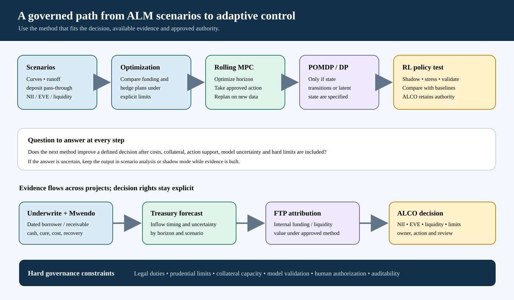

# From Balance-Sheet Scenarios to Stochastic Control: When Would POMDPs or Reinforcement Learning Add Value to Treasury?

*LinkedIn research article draft | 7 October 2026*

## The decision problem behind ALM

Asset and Liability Management (ALM) is often described as matching the timing, repricing and cash-flow characteristics of assets and liabilities. In practice, a Treasury and ALCO process must do more: interpret evolving market and customer behaviour, choose funding and hedging actions, protect liquidity, manage interest-rate risk and explain how those actions support the institution's strategy and risk appetite.

The decisions are sequential, but that does not mean every ALM problem needs reinforcement learning (RL). Repricing reports, scenarios or constrained optimization may be better when decisions are few, horizons short or learning data sparse.

The research question is therefore specific: **when does a richer sequential model add decision value beyond scenarios and optimization, and what data, controls and governance would make its use defensible?** This article develops a path from conventional ALM and Funds Transfer Pricing (FTP) to stochastic control, partially observed Markov decision processes (POMDPs) and, only where justified, RL.

The supplied material emphasizes links among balance-sheet management, FTP, product pricing, liquidity, capital and governance, and describes a deep-learning Treasury agent. Here this is a research hypothesis. The project has no fitted bank-level RL policy, live balance-sheet environment or production action engine.

## Start with a decision map

Before selecting a model, document the decision, owner, cadence and evidence. Actions might change the secured/unsecured funding mix, hedge position, tenor, liquidity buffer or FTP method, or refer a question to ALCO. Mandates and limits define the available actions.

The boundaries among the related concepts matter:

| Discipline | Primary question | Typical owner or forum |
|---|---|---|
| ALM | How do asset and liability cash flows, repricing and embedded options respond over time? | Treasury / ALM, within governance |
| IRRBB | How can interest-rate changes affect banking-book earnings and economic value? | Risk and ALM, with independent challenge |
| FTP | How should funding, liquidity and term costs or benefits be attributed internally to products and business units? | Treasury / Finance methodology with business governance |
| ALCO | Which balance-sheet actions are within strategy, appetite, limits and delegated authority? | Asset and Liability Committee |
| Contract pricing | What rate, fees and terms are offered to the customer under the applicable product and policy? | Product and credit decision owners |
| Prudential liquidity and capital | Does the institution meet external rules and approved internal limits? | Treasury / Risk / Finance under regulatory reporting governance |

FTP internally attributes funding and liquidity costs or benefits to products and business units. It informs profitability and incentives; it is distinct from a customer's contract rate, an external funding trade and regulatory liquidity. Basel's IRRBB standard establishes a banking-book risk framework, while applicable local rules and institutional policy govern implementation [1].

## Model ladder: choose the least complex method that answers the question

The progression below helps locate a problem before introducing RL:

1. **Static metrics and limits** summarize current exposures.
2. **Scenarios and stress tests** examine defined rate, liquidity and behaviour assumptions.
3. **Stochastic optimization** compares plans over sampled futures subject to constraints.
4. **Model predictive control (MPC)** re-optimizes on a rolling horizon as data update.
5. **Dynamic programming or POMDPs** represent material state transitions and uncertainty.
6. **Reinforcement learning** estimates a policy when repeated interaction with a suitable simulator or controlled environment adds value beyond these methods.

Each step requires stronger state data, action records, transition assumptions, outcome definitions, validation and action limits. Complexity should follow the decision need and evidence.

The upper path tests whether more complex control is justified; the lower path shows how dated credit cash evidence informs Treasury forecasts and FTP before an authorized ALCO decision.

## MDP, POMDP and stochastic control in plain terms

A Markov decision process (MDP) represents a sequence with state Sₜ, action Aₜ, transition distribution and reward. A Treasury state could include balance sheet, repricing and maturity ladders, funding, observed deposit behaviour, liquidity buffers, market curves, limits and forecast uncertainty. An action might adjust an approved hedge or funding mix; the transition describes next-period balance-sheet and market changes.

For a finite planning horizon, a constrained Bellman equation is

Vₜ(s) = maxₐ∈A_safe(s) E[rₜ(s,a,ξₜ) + Vₜ₊₁(Sₜ₊₁) ∣ Sₜ = s, Aₜ = a],

where ξₜ represents market and customer-behaviour uncertainty. The feasible set A_safe(s) contains approved instruments, limits, liquidity requirements and delegated actions. Multi-objective control can report NII, EVE, liquidity headroom, concentration and cost separately, making trade-offs visible [9].

A POMDP is appropriate when a relevant state is not observed directly, but there is a defensible observation process. For example, customer deposit behaviour is latent at account level: the institution observes balances and rates over time, but does not directly observe each customer's future rate sensitivity or withdrawal decision. A belief state bₜ(s) = P(Sₜ = s ∣ o₁:ₜ, a₁:ₜ₋₁) summarizes uncertainty about the latent state given observations o and earlier actions. The policy can then depend on the belief as well as visible exposures [2].

Missing fields or reconciliation gaps may require data repair, not a POMDP. Parameter uncertainty can be handled through Bayesian estimation, robust optimization or scenarios. A POMDP is useful when it specifies how observations arrive and how actions change the institution and later evidence.

## What is the agent learning, and from which decisions?

An RL environment combines the balance sheet and contractual cash flows with customer and depositor responses, market evolution, execution, assumptions, limits and reporting. State information must be available at decision time; actions executable; and rewards tied to institutional outcomes [10].

ALM actions affect later states as well as current rates: hedges can create collateral calls; funding choices alter rollover exposure; deposit rates change pass-through and attrition; and loan origination creates future repricing and liquidity flows.

Bank-level actions are infrequent. Monthly ALCO decisions provide few policy observations, while macro shocks affect many accounts together. Thousands of accounts are not thousands of independent Treasury decisions. Report decision count, action overlap, common shocks and uncertainty, especially for actions with little comparable history.

Log the state snapshot, eligible actions, owner, selected and executed action, timing, costs, overrides and resulting exposures. For committee decisions, retain the information and scenario assumptions presented. This supports comparison with rules, optimizers and learned policies.

## A reproducible bridge from collections to Treasury

*Underwrite for Collection* Parts 1–5 and *Mwendo Pamoja* Parts 1–6 develop evidence lower in the cash-flow chain: facility or receivables structure, borrower cash, collections, cure, recovery, servicing cost and timing. Mwendo Part 5 connects product economics with KESONIA, capital and funding; Part 6 defines implementation and evidence controls. Treasury receives **dated cash-flow inputs**, not an identified bank-wide hedge or funding policy.

Those inputs retain the financing structure. An operating-business facility is forecast from enterprise receipts, operating costs, working capital, owner obligations and debt service. A ring-fenced receivables facility is forecast from eligible invoices, obligor payment dates, dilution, legal transfer, controlled collections, servicing continuity, reserves and waterfall priorities. The funding source, timing uncertainty and interruption risks differ; Treasury should preserve these distinctions in its inflow scenarios.

Consider a purely illustrative example. A collection action results in KES 100,000 arriving ten days earlier, with the same eventual lifetime collection. If marginal funding is 12% per year on ACT/365, the simple timing value is:

Timing value = KES 100,000 × 0.12 × 10/365 = KES 328.77.

If the additional collection and processing action costs KES 500, the simple net timing contribution is KES −171.23. The KES 100,000 is not new lifetime revenue; the example values the timing difference under the stated rate and day-count assumption. Actual liquidity and funding value depends on the institution's marginal funding conditions, account structure, settlement, encumbrance, operational flows and measurement policy.

This auditable calculation keeps timing value separate from lifetime recovery. Borrower cash can enter Treasury forecasts as a dated inflow distribution with documented uncertainty; it does not identify a particular ALCO hedge or deposit-pricing effect.

### A two-period Treasury illustration

To show the control structure, let period 1 be a baseline year for a hypothetical balance sheet with KES 10 million of average interest-earning assets, KES 8 million of interest-bearing funding and KES 2 million of equity or non-interest-bearing funding. At an illustrative 10% asset yield and 6% funding cost, baseline annual NII is:

NII_base = KES 10,000,000 × 0.10 − KES 8,000,000 × 0.06 = KES 520,000.

For period 2, assume a scenario increases market rates by 200 basis points. Asset yields reprice by 80% of the shock while funding costs pass through by 50%. Holding balances constant, incremental annualized NII is:

ΔNII = KES 10,000,000 × 0.80 × 0.02 − KES 8,000,000 × 0.50 × 0.02 = KES 80,000.

Period 2 NII is therefore KES 600,000 under these assumptions. This single-period sensitivity excludes lags, floors, caps, new business, prepayments, hedge cash flows, liquidity premiums, term structure, growth and customer responses. A stochastic model would define rate and deposit-pass-through distributions, then evaluate approved actions against NII, EVE, collateral, cost and liquidity constraints over both periods.

For example, let a hedge reduce the rate sensitivity in the second period by 30%, incur a KES 20,000 annualized cost, and require a potential KES 100,000 collateral call under a stress path. In a simple rate-up scenario, its NII effect might be adverse because it gives up some benefit from asset repricing. In a rate-down scenario it may protect NII or EVE. Whether the hedge is appropriate requires both scenarios, an agreed metric set, EVE valuation, collateral availability and the institution's risk appetite. The action should not be selected from one favorable scenario alone.

The illustrative numbers are deliberately few. A reproducible project case should publish the input table, dates, day count, repricing assumptions, cash-flow timing, discounting, stress paths, permitted actions, limit definitions and calculations. It should show base, rising-rate, falling-rate and deposit-runoff scenarios, then reconcile period results to the balance-sheet schedule. The action comparison should disclose which outcomes are measured, modelled or assumed.

## KESONIA, customer rates and FTP are connected but distinct

The Central Bank of Kenya describes KESONIA as a transaction-based overnight interbank average in Kenya shillings, published daily, with a compounded index [3]. For variable-rate lending, the benchmark may enter contract pricing subject to product terms. Compounding in arrears, resets, spread, floors and notice need product-specific treatment.

FTP can allocate matched-maturity funding cost, liquidity value and policy components to products and business units. Comparing margin with FTP and other costs supports internal decisions; it does not mean each loan was separately funded at that rate.

For a floating-rate loan, identify customer benchmark formula, FTP charge, expected credit loss, capital allocation and operating costs separately. KESONIA changes affect customer rates through contract resets, FTP through internal methodology, and ALCO through repricing gaps, hedges, deposit behaviour and liquidity.

Keep the banking book distinct from the trading book. Origination, hedging, accounting, valuation and capital follow approved architecture and applicable rules. Define the capital measure, horizon and calculation before using “capital efficiency” as an objective.

## Selection bias does not disappear in Treasury data

The reject-inference question in credit has a Treasury analogue in selection and action support, though the estimand differs. Credit models observe outcomes for selected originated borrowers. The Fannie Mae and Freddie Mac loan-level datasets likewise describe selected mortgages that were purchased or guaranteed and whose performance entered the published files [4], [5]. They are rich examples of longitudinal credit performance, but their selection chain runs through application, underwriting, borrower acceptance, origination, acquisition and reporting.

Fannie Mae's single-family performance data cover a defined subset of mortgages with monthly performance information; Freddie Mac's dataset provides loan-level performance through payoff or other resolution paths. The GSE protocols in this project propose using these files to study event timing, censoring, modifications, cures, prepayment and loss resolution. The sample files have not been acquired and audited for the planned local protocol, so the analysis remains a proposed research design. The datasets do not provide outcomes for mortgages denied by the GSEs or for Kenyan MSME applicants. A modification flag also does not record the complete eligible action set, assignment probability, customer contact, offer terms, decision rationale or a randomized treatment; it cannot alone identify the causal effect of modification [4]–[6].

Likewise, a Treasury history contains actions taken under the institution's past policy. It may not support value estimates for a hedge or funding action never tried under comparable conditions. A model can simulate such an action, but that result is conditional on the simulation and transition model. It is not observed policy evidence. Report policy extrapolation separately from data-supported estimates. Use stress tests and robust bounds where actions or market regimes have weak historical support.

Borrower-level randomized experiments answer borrower-level questions. A collection trial can estimate the effect of a specified eligible treatment on borrower outcomes under its design. It does not identify what a bank-wide hedge would have done during a macroeconomic shock. Conversely, Treasury market data do not identify the treatment effect of a new collection approach. The scenarios, decision cadence and independent units differ.

## Risk objectives need explicit metrics and owners

Several outcome families belong in a Treasury analysis, but each has a distinct definition:

- **Net interest income (NII):** a projected earnings measure over a stated horizon, with a specified balance-sheet and behavioural assumption set.
- **Economic value of equity (EVE):** a present-value sensitivity of relevant asset, liability and off-balance-sheet cash flows under rate scenarios.
- **Liquidity:** cash and funding resilience under defined outflows, inflows, encumbrance and contingency assumptions. LCR and NSFR, where applicable, follow their own regulatory definitions.
- **FTP and product profitability:** internal attribution of funding and liquidity effects, reconciled to the institution's approved methodology.
- **Capital:** regulatory and internal capital measures, which should be defined separately from expected loss and accounting ECL.
- **Execution and collateral:** transaction costs, margin requirements, settlement and available collateral under base and stress conditions.

An MDP may represent transitions in an accounting-stage state for analysis, while IFRS 9 staging and ECL remain governed by the applicable accounting policy and controls [11].

An optimizer can use one objective with constraints, or a multi-objective analysis can show the efficient frontier among earnings, value, liquidity and cost. A committee can then choose an action under its mandate. A scalar reward that combines NII, EVE, liquidity, capital and compliance needs an explicit scale and governance rationale; otherwise the model may hide which risk it has traded away.

Chance constraints can express a tolerated probability of breaching a specified limit under a defined model, for example P(gₖ(Sₜ,Aₜ) > 0) ≤ εₖ. Such a constraint is only as reliable as the scenario distribution and measure. A regulatory obligation or legal prohibition is a hard rule, not a penalty that a learned policy may outweigh for enough profit.

## Data, privacy and operational governance in Kenya

Treasury data may be aggregated at portfolio or currency level and contain no personal data. Account-level deposit rates, withdrawals, borrower cash receipts, proprietor transactions or customer-specific pricing can involve identifiable people. The legal analysis follows the actual data and processing activity, not the department name.

For processing personal data, the Data Protection Act, 2019 requires fair, lawful and transparent processing, specified purpose, minimisation, accuracy and appropriate safeguards [7]. Section 31 requires a DPIA before processing likely to create high risk; profiling, combining data sources and consequential decisions deserve assessment against the statutory and regulatory criteria. The General Regulations, 2021 include regulation 49 on high-risk processing [8].

When a borrower-level policy makes a decision solely through automated processing with legal or similarly significant effects, section 35 and regulation 22 may apply, depending on the system and decision. Regulation 22 addresses notice, meaningful information about the logic, significance and consequences, accuracy, statistical measures, bias control and access to human intervention and expression of a view [7], [8]. A bank-level Treasury recommendation to ALCO is not automatically an individual decision. If a system uses customer-specific data to change an identifiable person's rate, offer or service, that processing should be assessed on its own facts.

Data roles and purposes should be mapped across the bank, servicer, cloud provider, data aggregator and any analytics workbench. Access, retention, security, transfer and audit arrangements need to match actual data flow. For a research dataset, separate the protocol, lawful basis and safeguards from an operational deployment basis. A research classification does not automatically permit a production policy.

Governance should also define a clear operating boundary among the projects. *Underwrite for Collection* develops the credit evidence, borrower treatment and collection-policy questions. *Mwendo Pamoja* develops the enterprise or ring-fenced cash-flow architecture and its operating and financing case. RegTech KESONIA develops institution-level benchmark, Treasury, ALM, FTP, liquidity and capital applications. SokoIntel Financial Analytics Workbench could later present approved analytical outputs and reproducible scenarios across these domains; it should not be described as a regulator, autonomous ALCO or independent decision authority. Each project can share data definitions and evidence lineage while retaining its own accountable owner and model purpose.

## An empirical programme that can be completed

A credible programme can be staged so each phase has a clear deliverable:

**Phase 1: Reproduce the current process.** Reconcile contract cash flows, market curves, balance-sheet extracts, deposit segments and the current FTP method. Reproduce approved NII/EVE, liquidity and funding reports from frozen inputs. Record the assumptions and data cut-off. These outputs become transparent baselines against which later adaptive recommendations must be independently judged.

**Phase 2: Build transparent scenario tests.** Specify parallel and non-parallel curve shocks, KESONIA changes, deposit pass-through and runoff, prepayment, new business, funding spread and collateral stresses. Validate the mechanics against independent calculations.

**Phase 3: Compare constrained plans.** Compare a baseline strategy with deterministic optimization and stochastic optimization. Define action bounds and hard constraints before calculating outcomes. Report objective metrics and a frontier rather than only a single preferred score.

**Phase 4: Test rolling control in shadow.** Use MPC to re-optimize against refreshed data while leaving existing decisions in force. Compare its recommendations with committee decisions and the approved baseline. Record recommendation, acceptance, override, execution, cost and subsequent state. A shadow output is not action evidence until the action is actually carried out under an approved design.

**Phase 5: Assess partial observation and policy learning.** Identify genuine latent state variables, specify observation distributions and update rules, and compare a POMDP or model-based RL policy with simpler baselines. Conduct off-policy evaluation only where action support, timing, propensities and outcome definitions justify it. Use simulation for scenarios, label it as simulation, and test model uncertainty.

**Phase 6: Independent review and controlled use.** Validate code and data lineage, model performance, stress behaviour, limits, cyber and access control, user override, incident handling, audit logging and change approval. The ALCO and risk owners approve the decision rights. Monitor whether the balance sheet and market environment have moved beyond the support of the training data.

The project should publish enough information for a reviewer to rerun the example: the data dictionary; input series and units; transformations; curve construction; interpolation; day count; cash-flow dates; scenario generation; action set; limit calculations; code version; and output reconciliation. Where confidentiality prevents release of bank records, publish a synthetic dataset with all figures labelled synthetic and provide the calculation logic.

## Three research questions

1. **Control value:** Under what KESONIA, yield-curve and deposit-behaviour scenarios does rolling-horizon stochastic control improve the balance of NII, EVE and liquidity resilience relative to transparent static strategies, after transaction and collateral cost?
2. **Partial observation and data support:** Which Treasury state variables are genuinely latent, what observations update them, and does a POMDP or model-based RL method outperform scenario analysis and MPC under sparse, correlated bank-level decisions?
3. **Credit-to-Treasury linkage:** How can realized borrower and receivables cash-flow timing from Underwrite for Collection and Mwendo Pamoja enter FTP and Treasury forecasts without conflating lifetime recovery, timing value, customer pricing, IFRS 9 ECL, regulatory liquidity or capital?

## Conclusion: let control complexity follow evidence

ALM already involves forward-looking decisions under uncertainty. Stochastic control gives a precise language for how balance-sheet actions interact with future states. A POMDP can represent uncertainty about a meaningful latent state. RL can help estimate a policy when the decision process repeats and the data or validated simulator adequately support the action comparisons.

The practical starting point is still a reconciled balance sheet, explicit cash flows, behavioral assumptions, scenarios, limits and committee accountability. A sequential algorithm becomes useful when it improves a defined decision against those baselines, remains within hard constraints, and can be independently tested. The route from borrower collection to Treasury should preserve each link: observed cash, timing and uncertainty inform forecasts; FTP allocates internal value under a governed methodology; ALCO decides within mandate; and the institution measures NII, EVE, liquidity, capital and customer impacts on their own terms.

That is a research agenda with practical outputs: reproducible cases, state and action definitions, credible comparisons, documented assumptions and a controlled path from scenario analysis to adaptive decision support.

## References

[1] Basel Committee on Banking Supervision, “Interest rate risk in the banking book,” *Standards*, Bank for International Settlements, Apr. 2016. [Online]. Available: https://www.bis.org/bcbs/publ/d368.htm. Accessed: Oct. 7, 2026.

[2] V. Krishnamurthy, *Partially Observed Markov Decision Processes: From Filtering to Controlled Sensing*. Cambridge, U.K.: Cambridge Univ. Press, 2016.

[3] Central Bank of Kenya, “Kenya Shilling Overnight Interbank Average (KESONIA),” CBK. [Online]. Available: https://www.centralbank.go.ke/kesonia/. Accessed: Oct. 7, 2026.

[4] Freddie Mac, “Single-Family Loan-Level Dataset,” Freddie Mac, 2026. [Online]. Available: https://www.freddiemac.com/research/datasets/sf-loanlevel-dataset. Accessed: Oct. 7, 2026.

[5] Fannie Mae, “Single-Family Loan Performance Data,” Fannie Mae Capital Markets. [Online]. Available: https://capitalmarkets.fanniemae.com/credit-risk-transfer/fannie-mae-single-family-loan-performance-data. Accessed: Oct. 7, 2026.

[6] Freddie Mac, “Single-Family Loan-Level Dataset: General User Guide,” Freddie Mac. [Online]. Available: https://www.freddiemac.com/fmac-resources/research/pdf/user_guide.pdf. Accessed: Oct. 7, 2026.

[7] Republic of Kenya, *Data Protection Act, No. 24 of 2019*, secs. 25–31, 35–37, 40–50 and 53. [Online]. Available: https://new.kenyalaw.org/akn/ke/act/2019/24/eng%402022-12-31/source. Accessed: Oct. 7, 2026.

[8] Republic of Kenya, *Data Protection (General) Regulations, 2021*, Legal Notice No. 263, regs. 22 and 49–51. [Online]. Available: https://new.kenyalaw.org/akn/ke/act/ln/2021/263/eng%402022-12-31/source. Accessed: Oct. 7, 2026.

[9] M. L. Puterman, *Markov Decision Processes: Discrete Stochastic Dynamic Programming*. Hoboken, NJ, USA: Wiley, 1994.

[10] R. S. Sutton and A. G. Barto, *Reinforcement Learning: An Introduction*, 2nd ed. Cambridge, MA, USA: MIT Press, 2018.

[11] IFRS Foundation, “IFRS 9 Financial Instruments.” [Online]. Available: https://www.ifrs.org/issued-standards/list-of-standards/ifrs-9-financial-instruments/. Accessed: Oct. 7, 2026.
